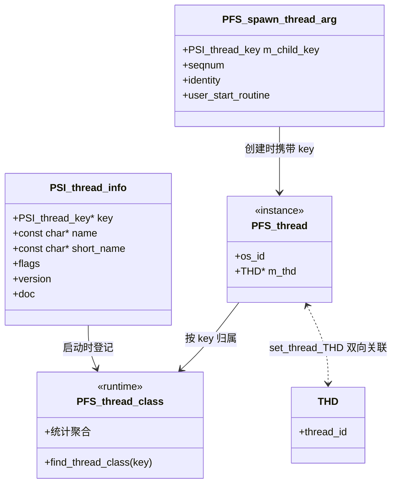

# PSI 线程插桩深度解析

> 基于 MySQL 8.0.39 源码，覆盖线程类注册表 `all_server_threads[]`、`pfs_spawn_thread` 包装器如何给新线程附加插桩、PSI 线程对象的完整生命周期（`new_thread` → `set_thread_os_id` → `set_thread` → `set_thread_THD` → `delete_*`）、THD 与 PSI 的双向关联、标志位语义，以及七代 `psi_thread` 服务的版本共存。
>
> **边界**：本篇只讲**线程这一维的 PFS 插桩**——系统里有哪些线程类、线程怎么被登记、怎么被观测到。
> PFS 框架本身（事件模型、表实现、零开销探针、三层开关）见 [`../../server/infra/pfs.md`](pfs.md)；`psi_thread` 服务的**ABI 版本演化账本**见 [`../../server/plugin/abi.md`](../../../server/plugin/abi.md)；线程的创建原语见 [`thread_lifecycle.md`](../../threading/thread_lifecycle.md)；THD 对象见 [`thd.md`](../../threading/thd.md)。
> 本篇不写 PFS 的事件/阶段/等待模型（那是 `pfs.md` 与 [`../../server/infra/pfs_statement.md`](pfs_statement.md) 的事）。

## 目录

- [概述](#概述)
- [理论基础](#理论基础)
- [核心实现](#核心实现)
- [★ 本机制里的工程实现技法](#-本机制里的工程实现技法)
- [可观测性](#可观测性)
- [Misc](#misc)
- [参考](#参考)

---

## 概述

### 是什么

PFS（Performance Schema）要回答的第一个问题是：**系统里到底有哪些线程？**

MySQL 的线程数以百计（InnoDB 约 26 类 + server 约 14 类，见 [`threading_architecture.md`](../../threading/threading_architecture.md) 的源码级盘点），而 PFS 是"外挂"的观测层——它不能侵入每个线程的实现去问"你是谁"。

解决方案是一个**双向注册表**：

```
                      ① 静态声明（编译期）
   源码里写死的线程类 ─────────────────────► all_server_threads[]
   （key_thread_xxx 变量）                     PFS 在 register 时登记

                      ② 动态登记（运行期）
   每创建一个线程 ─────────────────────────► PSI 线程对象（PFS_thread）
   （经 pfs_spawn_thread 包装）                 按 key 找到类，实例化并挂上
```

反直觉的第一件事：**`mysql_thread_create` 在开启 PFS 时创建的不是你的线程函数，而是 PFS 的包装器**。真正的用户函数被塞进一个参数结构体，由包装器在新线程里"先附加插桩、再调用你"：

```c
#define mysql_thread_create(K, P1, P2, P3, P4) \
  inline_mysql_thread_create(K, 0, P1, P2, P3, P4)
```

```cpp
#ifdef HAVE_PSI_THREAD_INTERFACE
  result = PSI_THREAD_CALL(spawn_thread)(key, sequence_number, thread, attr,
                                         start_routine, arg);
#else
  result = my_thread_create(thread, attr, start_routine, arg);
#endif
```

反直觉的第二件事：**一个线程可以没有 THD，一个 THD 也可以不在任何线程上**。PSI 线程对象、OS 线程、THD 是**三个独立的东西**，靠 `set_thread_THD()` 建立关联。后台线程有 PSI 对象但可能没有 THD（见 [`internal_thd.md`](../../threading/internal_thd.md) 的 `ut_d` 例子）；连接 THD 在线程池下会从一个 OS 线程迁移到另一个（见 [`thd.md`](../../threading/thd.md)）。

反直觉的第三件事：**`psi_thread` 服务在 8.0.39 里有四代同时注册**（v4/v5/v6/v7）。每加一个方法就要换一个版本名，因为虚类里加方法会错位所有槽位——所以"版本"不是"新旧替换"，而是"并存"。

### 用途

解决三个具体问题：

1. **线程可枚举**：`performance_schema.threads` 表从哪来？从这条登记链。
2. **资源可归属**：内存、等待、阶段事件都要挂到某个线程上，否则无法归因。
3. **状态变量可按线程看**：连接线程的状态变量汇总依赖 `aggregate_thread_status`（见 [`thd.md`](../../threading/thd.md) 的 `release_resources`）。

### 版本演进

| 版本 | 变化 |
|---|---|
| 5.6 | PSI 线程插桩成型；`PSI_thread_info` 静态注册表 + `spawn_thread` 包装 |
| 8.0.3 → 8.0.33 | `psi_thread` 服务迭代 **v1 → v7**（每次"加一个方法"就换版本）；v1~v3 已移除，**v4/v5/v6/v7 在 8.0.39 全部仍注册** |
| 8.0.15 (v5) | 加 `m_os_name`；`spawn`/`new_thread` 加 sequence number |
| 8.0.22 (v6) | 加 `set_thread_secondary_engine` |
| 8.0.28→8.0.33 (v7) | 加 `detect_telemetry` / `abort_telemetry`（指向 9.x Telemetry 方向） |
| 26.7 | 线程池进社区版后，新增 `tp_*` 四个线程相关 PFS 表；线程池自己的 PSI key 由插件动态注册（见 [`thread_pool.md`](../../threading/thread_pool.md)） |

> 演进主线：**从"静态注册的固定线程集合"到"允许插件动态注册自己的线程类"**。后者正是线程池能作为插件被观测的前提。

---

## 理论基础

### 设计思想与权衡

#### 权衡一：为什么线程类要"静态声明"而不是自动发现？

`all_server_threads[]` 是一张写死的表：

```c
static PSI_thread_info all_server_threads[]=
{
#if defined (_WIN32)
  { &key_thread_handle_con_namedpipes, "con_named_pipes", "con_pipe", PSI_FLAG_SINGLETON, 0, PSI_DOCUMENT_ME},
  ...
#endif /* _WIN32 */
  { &key_thread_bootstrap, "bootstrap", "boot", PSI_FLAG_SINGLETON, 0, PSI_DOCUMENT_ME},
  { &key_thread_handle_manager, "manager", "handle_mgr", PSI_FLAG_SINGLETON, 0, PSI_DOCUMENT_ME},
  { &key_thread_main, "main", "main", PSI_FLAG_SINGLETON, 0, PSI_DOCUMENT_ME},
  { &key_thread_one_connection, "one_connection", "connection",
    PSI_FLAG_USER | PSI_FLAG_NO_SEQNUM, 0, PSI_DOCUMENT_ME},
  { &key_thread_signal_hand, "signal_handler", "sig_handler", PSI_FLAG_SINGLETON, 0, PSI_DOCUMENT_ME},
  { &key_thread_compress_gtid_table, "compress_gtid_table", "gtid_zip", PSI_FLAG_SINGLETON, 0, PSI_DOCUMENT_ME},
  { &key_thread_parser_service, "parser_service", "parser_srv", PSI_FLAG_SINGLETON, 0, PSI_DOCUMENT_ME},
  { &key_thread_handle_con_admin_sockets, "admin_interface", "con_admin", PSI_FLAG_USER, 0, PSI_DOCUMENT_ME},
  ...
```

| 方案 | 评价 |
|---|---|
| 运行时自动发现（扫描所有线程，猜它是谁） | ❌ 无法知道语义；线程没有自描述能力 |
| **静态声明 + 按 key 查找** | ✅ 编译期确定、零运行时开销；代价是**加一个线程类必须改这张表** |

代价落到具体后果：**漏登记 = 在 PFS 里完全不可见**。这不是"显示成 unknown"，而是根本没有对应行。所以 [`threading_architecture.md`](../../threading/threading_architecture.md) 里那次"线程清单从 PSI 注册表 + `os_thread_create` 全部调用点源码级核对"是必要的——两边对着看才能发现漏登记的。

#### 权衡二：为什么 spawn 要用包装器（而不是让线程自己注册）？

新线程的第一条指令不是用户代码，而是 PFS 的 `pfs_spawn_thread`：

```cpp
extern "C" {
static void *pfs_spawn_thread(void *arg) {
  auto *typed_arg = (PFS_spawn_thread_arg *)arg;
  ...
  /* First, attach instrumentation to this newly created pthread. */
  PFS_thread_class *klass = find_thread_class(typed_arg->m_child_key);
  ...
```

参数结构体里装的是"用户真正想跑的东西"：

```cpp
struct PFS_spawn_thread_arg {
  ulonglong m_thread_internal_id;
  PFS_user_name m_user_name;
  PFS_host_name m_host_name;

  PSI_thread_key m_child_key;
  PSI_thread_seqnum m_child_seqnum;
  const void *m_child_identity;
  void *(*m_user_start_routine)(void *);
  void *m_user_arg;
};
```

**为什么必须包装**：新线程一旦启动，就存在"已经在跑但还没被 PFS 登记"的窗口。如果让用户函数自己注册，那么用户函数开头的任何 PFS 事件都会落到"无主"状态。包装器保证**插桩先于用户代码生效**。

而且 `m_child_identity` 字段允许**在线程启动前就把一个身份对象绑上去**——这正是 InnoDB `create_detached_thread` 里 `PSI_THREAD_CALL(new_thread)(value, m_pfs_seqnum, this, 0)` 那第四个参数的用途（传的是 `Detached_thread` 自身指针）。

代价：**多一次函数调用 + 一个堆上的参数结构体**；以及"线程真正的入口"在调试器里显示为 `pfs_spawn_thread` 而非你的函数。

#### 权衡三：为什么"加一个方法"就要换一个服务版本号？

`psi_thread` 从 v1 迭代到 v7，看起来很夸张。原因是 PSI 服务以**虚类（函数指针表）**形式暴露：

```
struct psi_thread_service_v7 {
  new_thread(...);            // 槽位 0
  set_thread_id(...);         // 槽位 1
  set_thread_THD(...);        // 槽位 2
  ...
  detect_telemetry(...);      // v7 新增
};
```

在中间插入或追加都会改变布局（追加稍好，但版本号的语义是"整体契约"）。所以 MySQL 的做法是**整份换名**，新旧并存。后果是 8.0.39 里 v4/v5/v6/v7 四个版本的 `psi_thread` 服务**全部注册着**——详见 [`../../server/plugin/abi.md`](../../../server/plugin/abi.md) 的版本账本。

### 理论溯源

| 理论 / 模式 | 源码落点 | 说明 |
|---|---|---|
| **Registry / 静态元数据表** | `all_server_threads[]` | 编译期声明线程类，运行时按 key 查找 |
| **Decorator / 包装器** | `pfs_spawn_thread` | 在用户线程函数外裹一层，先附加插桩再调用 |
| **Handler / 不透明句柄** | `PSI_thread *psi` | 对外只给不透明指针，内部结构 PFS 私有（与 [`thd.md`](../../threading/thd.md) 的 ABI 隔离同构） |
| **双向关联（而非包含）** | `set_thread_THD(psi, thd)` | PSI 线程与 THD 是两个独立对象，靠显式关联挂钩 |
| **版本化 ABI** | `psi_thread` v1~v7 | 服务以版本号命名，多代并存 |

### 算法与数据结构

| 结构 | 用途 | 复杂度 |
|---|---|---|
| `PSI_thread_info{ key*, name, short_name, flags, version, doc }` | 静态线程类声明 | 数组线性扫描（只在启动时） |
| `PFS_thread_class` | 线程类的运行时表示（含统计聚合） | 按 key 查找，`find_thread_class()` |
| `PFS_thread` | 线程实例（一个 OS 线程一个） | 由 `new_thread` 分配 |
| `PFS_spawn_thread_arg` | spawn 包装器的参数载体 | 堆分配一次，线程启动后释放 |

`PSI_thread_info` 六个字段的语义：

| 字段 | 含义 |
|---|---|
| `key` | 指向 `PSI_thread_key` 变量的指针（PFS 启动时回填真实 key） |
| `name` | 全名，出现在 `threads.NAME` |
| `short_name` | 短名（如 `con_sock`、`gtid_zip`） |
| `flags` | 见下 |
| `version` | 该线程类的版本（通常为 0） |
| `doc` | `PSI_DOCUMENT_ME` 表示"请文档自动生成" |

### 他库对比与演进动机

| 维度 | MySQL/PFS | PostgreSQL | Linux perf/eBPF |
|---|---|---|---|
| 线程如何被识别 | 静态注册表 + 显式 key | `pg_stat_activity` 按 backend 类型，无注册表概念 | 按 tid/pid，无语义 |
| 开销 | 编译期可关（`HAVE_PSI_THREAD_INTERFACE`） | 常开 | 采样，按需 |
| 扩展 | 插件可动态注册自己的 key | 扩展注册较受限 | — |

**演进动机**：早期 PFS 只覆盖 server 的固定线程。随着线程池插件化（26.7）、各类组件出现，"插件也要能被观测"成为需求——于是线程 key 的注册从"只有内建一张表"扩展到"插件可动态注册"。这是"可观测性跟随可扩展性"的典型路径。

---

## 核心实现

### 主链路

从"声明一个线程类"到"在 PFS 里看到它"：

```
【编译期】
源码声明 PSI_thread_info 条目
  （&key_thread_xxx, "name", "short", FLAGS, 0, PSI_DOCUMENT_ME）
  ↓ 加入 all_server_threads[]
【启动期】
PFS 初始化 → register_thread_class() → 回填 key_thread_xxx 的真实值
  ↓
【运行期：创建线程】
mysql_thread_create(key, ...)             ← 宏
  → inline_mysql_thread_create
      → PSI_THREAD_CALL(spawn_thread)(key, seqnum, ...)
          → 构造 PFS_spawn_thread_arg（含 child_key + 用户函数）
          → my_thread_create(..., pfs_spawn_thread, arg)
              → pfs_spawn_thread（新线程入口）
                  → find_thread_class(child_key)    ★ 先附加插桩
                  → 调用用户的 start_routine
【运行期：登记属性】
set_thread_os_id()  → set_thread()  → set_thread_THD()（可选）
【销毁】
delete_current_thread()（线程自毁）或 delete_thread(psi)（外部销毁）
```

配图（三方对象的关系）：

```
   OS 线程 (pthread / std::thread)
        │  1:1
        ▼
   PFS_thread (PSI 线程对象)  ←── set_thread_THD(psi, thd) ──►  THD
        │                              （可选关联）              │
        │                                                        │
   threads 表可见                                    PROCESSLIST 可见
   （所有插桩线程）                                  （仅非 BACKGROUND）
```

**注意这个不对称**：PSI 线程对象覆盖**所有**插桩线程（含后台），而 `PROCESSLIST` 只含非 BACKGROUND 的（见 [`internal_thd.md`](../../threading/internal_thd.md)）。所以"后台线程在 PFS 可见、在 PROCESSLIST 不可见"是正常现象，不是 bug。

### 一、线程类注册表：`all_server_threads[]`

条目形态与标志位：

| 标志 | 含义 | 谁在用 |
|---|---|---|
| `PSI_FLAG_SINGLETON` | 全局只有一个实例 | 绝大多数后台线程（`main`、`signal_handler`、`manager`、`compress_gtid_table`、`parser_service`、Windows 的 `con_named_pipes` 等） |
| `PSI_FLAG_USER` | 用户/连接线程 | `one_connection`、`admin_interface` |
| `PSI_FLAG_NO_SEQNUM` | 不给实例编号 | `one_connection`（连接数可变，且已有 `PROCESSLIST_ID` 作标识） |

`one_connection` 用 `PSI_FLAG_USER | PSI_FLAG_NO_SEQNUM`——连接线程数量不定、且已有更合适的标识，所以不需要 PFS 再编序号。而 `admin_interface` 只有 `PSI_FLAG_USER`（它是单例的管理接口）。

Windows 专有条目被 `#if defined (_WIN32)` 包住：`con_named_pipes`、`con_shared_mem`、`con_sockets`、`shutdown_restart`——这四条在 Unix 上根本不存在（详见 [`threading_architecture.md`](../../threading/threading_architecture.md) 的 1.6 节）。

**★ 完整表 + 真位置**（⚠️ 不在 `pfs_server.cc`，真身在 **`sql/mysqld.cc:12097`**）：

```cpp
/* clang-format off */
static PSI_thread_info all_server_threads[]=
{
#if defined (_WIN32)
  { &key_thread_handle_con_namedpipes, "con_named_pipes", "con_pipe", PSI_FLAG_SINGLETON, 0, PSI_DOCUMENT_ME},
  { &key_thread_handle_con_sharedmem, "con_shared_mem", "con_shm", PSI_FLAG_SINGLETON, 0, PSI_DOCUMENT_ME},
  { &key_thread_handle_con_sockets, "con_sockets", "con_sock", PSI_FLAG_SINGLETON, 0, PSI_DOCUMENT_ME},
  { &key_thread_handle_shutdown_restart, "shutdown_restart", "down_up", PSI_FLAG_SINGLETON, 0, PSI_DOCUMENT_ME},
#endif /* _WIN32 */
  { &key_thread_bootstrap, "bootstrap", "boot", PSI_FLAG_SINGLETON, 0, PSI_DOCUMENT_ME},
  { &key_thread_handle_manager, "manager", "handle_mgr", PSI_FLAG_SINGLETON, 0, PSI_DOCUMENT_ME},
  { &key_thread_main, "main", "main", PSI_FLAG_SINGLETON, 0, PSI_DOCUMENT_ME},
  { &key_thread_one_connection, "one_connection", "connection",
PSI_FLAG_USER | PSI_FLAG_NO_SEQNUM, 0, PSI_DOCUMENT_ME},
  { &key_thread_signal_hand, "signal_handler", "sig_handler", PSI_FLAG_SINGLETON, 0, PSI_DOCUMENT_ME},
  { &key_thread_compress_gtid_table, "compress_gtid_table", "gtid_zip", PSI_FLAG_SINGLETON, 0, PSI_DOCUMENT_ME},
  { &key_thread_parser_service, "parser_service", "parser_srv", PSI_FLAG_SINGLETON, 0, PSI_DOCUMENT_ME},
  { &key_thread_handle_con_admin_sockets, "admin_interface", "con_admin", PSI_FLAG_USER, 0, PSI_DOCUMENT_ME},
};
/* clang-format on */
```

> ★ 每行 **6 个字段**（不是 5 个）：`{m_key 地址, m_name, m_os_name, m_flags, m_volatility, m_documentation}`。
> ★ Linux 构建下该表只有 **8 条**；`admin_interface` 只有 `PSI_FLAG_USER`（无 NO_SEQNUM）⇒ 会被自动编号成 `con_admin-N`。
> ⚠️ **`all_server_threads` 不在 `storage/perfschema/pfs_server.cc`**（该文件 0 命中，只有 `init_thread_class(param->m_thread_class_sizing)`）。这是 8.0 相比 5.6/5.7 最大的一处重构位移——**线程类的定义权在 server 层，PFS 只提供注册服务**。

**★ `PSI_thread_info` 的真身是 `PSI_thread_info_v5`（6 字段）**——⚠️ **不存在 `PSI_thread_info_v4` / `_v6` / `_v7`**：

```cpp
struct PSI_thread_info_v5 {
  PSI_thread_key *m_key;
  const char *m_name;
  /** The thread name to advertise to the operating system. ...
    First, the thread can be unique (PSI_FLAG_SINGLETON). In this case, the
    m_os_name attribute is printed as is.
    Second, for threads that exist in multiple instances ... the caller code
    should pass a sequence number ... "foo" with a sequence of "12" is
    displayed as "foo-12".
    Third, ... PSI_FLAG_AUTO_SEQNUM causes the performance schema to number
    threads automatically ...
    Fourth and last, ... PSI_FLAG_NO_SEQNUM can be used to avoid numbering. */
  const char *m_os_name;          // ★ v5 独有
  unsigned int m_flags;
  int m_volatility;
  const char *m_documentation;
};
typedef struct PSI_thread_info_v5 PSI_thread_info;   // psi_thread_bits.h:596
```

对照 `PSI_thread_info_v1`（**5 字段，无 `m_os_name`**）——v1 的 flags 也**不含** AUTO_SEQNUM / NO_SEQNUM。

**★ 标志位全表**（`psi_bits.h`，⚠️ `PSI_FLAG_THREAD_SYSTEM` 与 `PSI_FLAG_THREAD` 是两个不同的东西）：

```cpp
#define PSI_FLAG_SINGLETON      (1 << 0)   // 单实例
#define PSI_FLAG_MUTABLE        (1 << 1)
#define PSI_FLAG_THREAD         (1 << 2)   // ★ 名字叫 THREAD，但"Reserved for future use"
#define PSI_FLAG_STAGE_PROGRESS (1 << 3)
#define PSI_FLAG_RWLOCK_SX      (1 << 4)
#define PSI_FLAG_TRANSFER       (1 << 5)
#define PSI_FLAG_USER           (1 << 6)   // ★ "用户/前台线程"
#define PSI_FLAG_ONLY_GLOBAL_STAT (1 << 7)
#define PSI_FLAG_RWLOCK_PR      (1 << 8)
#define PSI_FLAG_THREAD_SYSTEM  (1 << 9)   // ★★ 这才是"系统/后台线程"标志
#define PSI_FLAG_AUTO_SEQNUM    (1 << 10)  // 自动编号
#define PSI_FLAG_NO_SEQNUM      (1 << 11)  // 不编号
#define PSI_FLAG_MEM_COLLECT    (1 << 12)
#define PSI_FLAG_DISABLED       (1 << 13)
```

```cpp
static constexpr unsigned PSI_INSTRUMENT_ME = 0;
#define PSI_DOCUMENT_ME ""                 // ★ 就是空串占位符，MySQL 至今没真正填文档
static constexpr unsigned PSI_NOT_INSTRUMENTED = 0;
```

> ★ `PSI_INSTRUMENT_ME` 与 `PSI_NOT_INSTRUMENTED` **值都是 0**，语义对立只是给人看的。`key == 0` 在 `find_thread_class()` 里直接 return NULL ⇒ 不插桩。
> ⚠️ clang+Windows 下 `PSI_NOT_INSTRUMENTED` 故意去掉 `constexpr`，为绕开 `Prealloced_array` 构造重载决议 bug（llvm#51582）。

**★ 注册链**：没有 `pfs_register_thread_classes()`，真名是 `init_server_psi_keys()`（`sql/mysqld.cc:12400`）：

```cpp
static void init_server_psi_keys(void) {
  const char *category = "sql";
  int count;
  ...
  count = static_cast<int>(array_elements(all_server_threads));
  mysql_thread_register(category, all_server_threads, count);
  ...
```

> ★ `category = "sql"` ⇒ instrument 全名是 `thread/sql/main`、`thread/sql/connection` 等。

```cpp
void pfs_register_thread_vc(const char *category, PSI_thread_info *info,
                            int count) {
  REGISTER_BODY_V1(PSI_thread_key, thread_instrument_prefix,
                   register_thread_class);
}
```

> ★ `REGISTER_BODY_V1` 里：若 PFS 未初始化或前缀构造失败，会把**所有 `*(info->m_key)` 写回 0**——这就是"关闭 PFS 时 `key_thread_*` 全是 0"的机制来源。

**★ `register_thread_class()`**：⚠️ 返回值语义反直觉——**0 = 注册失败/不插桩**，成功返回 `index + 1`（key 从 1 开始，因为 0 恒表示"不插桩"）：

```cpp
PFS_thread_key register_thread_class(const char *name, uint name_length,
                                     PSI_thread_info *info) {
  uint32 index;
  PFS_thread_class *entry;
  REGISTER_CLASS_BODY_PART(index, thread_class_array, thread_class_max, name,
                           name_length);   // ★ 全表 name 比对（幂等：插件 reload 复用旧 key）
  index = thread_class_dirty_count++;
  if (index < thread_class_max) {
    entry = &thread_class_array[index];
    init_instr_class(entry, name, name_length, info->m_flags,
                     info->m_volatility, info->m_documentation,
                     PFS_CLASS_THREAD);
    entry->m_singleton = nullptr;
    entry->m_history = true;
    entry->enforce_valid_flags(PSI_FLAG_SINGLETON | PSI_FLAG_USER |
                               PSI_FLAG_THREAD_SYSTEM | PSI_FLAG_AUTO_SEQNUM |
                               PSI_FLAG_NO_SEQNUM);   // ★ 只许这 5 个位
    configure_instr_class(entry);
    ++thread_class_allocated_count;
    entry->m_seqnum.store(1);                          // ★ 序号从 1 开始
    if (entry->has_seqnum()) {
      assert(strlen(info->m_os_name) < PFS_MAX_OS_NAME_LENGTH - 3);
      (void)snprintf(entry->m_os_name, PFS_MAX_OS_NAME_LENGTH, "%s-%%d",
                     info->m_os_name);                 // ★ 存成 printf 模板 "con_admin-%d"
    } else {
      strncpy(entry->m_os_name, info->m_os_name, PFS_MAX_OS_NAME_LENGTH);
    }
    return (index + 1);
  }
  if (pfs_enabled) thread_class_lost++;
  return 0;                                            // ★★ 表满 → key=0 → 永久不插桩
}
```

**★ `find_thread_class()` 是 O(1) 且完全无锁**——靠"数组只追加不移动"：

```cpp
#define FIND_CLASS_BODY(KEY, COUNT, ARRAY) \
  if ((KEY == 0) || (KEY > COUNT)) {       \
    return NULL;                           \
  }                                        \
  return &ARRAY[KEY - 1]

PFS_thread_class *find_thread_class(PFS_sync_key key) {
  FIND_CLASS_BODY(key, thread_class_allocated_count, thread_class_array);
}
```

**★ `m_os_name` 与 OS 线程名**（这是"在 `ps`/`top` 里能看到 MySQL 线程名"的来源）：

```cpp
/**
  Maximum length of the thread os name.
  Must include a terminating NUL character.
  Length is 16 because of linux pthread_setname_np(3)
*/
#define PFS_MAX_OS_NAME_LENGTH 16
```

```cpp
    if (klass->has_seqnum()) {
      if (klass->has_auto_seqnum()) {
        seqnum = klass->m_seqnum++;            // ★ 自动序号：原子自增
      }
      (void)snprintf(pfs->m_os_name, PFS_MAX_OS_NAME_LENGTH - 1,
                     klass->m_os_name, seqnum);  // ★ 模板 %d 实例化成 "con_admin-1"
    } else {
      (void)snprintf(pfs->m_os_name, PFS_MAX_OS_NAME_LENGTH, "%s",
                     klass->m_os_name);
    }
```

```cpp
  bool has_seqnum() const {
    return (m_flags & (PSI_FLAG_SINGLETON | PSI_FLAG_NO_SEQNUM)) == 0;  // ★ 单例/禁编号 → 不生成 -N
  }
```

> ⚠️ **不存在 `pfs_thread_seqnum` 全局计数器**——序号是**每类**的原子计数器 `PFS_thread_class::m_seqnum`。
> ⚠️ 16 字节上限来自 Linux `pthread_setname_np(3)`，超了会被**截断**。

### 二、创建路径：`pfs_spawn_thread` 包装器

```cpp
extern "C" {
static void *pfs_spawn_thread(void *arg) {
  auto *typed_arg = (PFS_spawn_thread_arg *)arg;
  void *user_arg;
  void *(*user_start_routine)(void *);

  PFS_thread *pfs;

  /* First, attach instrumentation to this newly created pthread. */
  PFS_thread_class *klass = find_thread_class(typed_arg->m_child_key);
  ...
```

三个关键设计：

1. **`extern "C"`**——这个包装器要作为 `pthread_create` 的入口，必须是 C 链接（与 [`thread_lifecycle.md`](../../threading/thread_lifecycle.md) 讲的 C/C++ 边界一致）。
2. **`find_thread_class(m_child_key)`**——按创建时传进来的 key 找回线程类。key 是启动期回填的数值，不是指针。
3. **参数结构体携带"身份"**：`m_child_identity` 让调用方可以在线程启动前就绑定一个对象（InnoDB 传的是 `Detached_thread*`，见 `PSI_THREAD_CALL(new_thread)(value, m_pfs_seqnum, this, 0)`）。

对比**不开 PFS** 的路径：`inline_mysql_thread_create` 直接调 `my_thread_create`，没有包装器、没有参数结构体——**零额外开销**。这是"编译期分流"的价值（详见 [`thread_lifecycle.md`](../../threading/thread_lifecycle.md)）。

**★ 为什么必须包装——物证在 `mysys/my_thread.cc`**（它只认识 `(func, arg)`，全文无 PSI 字样）：

```cpp
int my_thread_create(my_thread_handle *thread, const my_thread_attr_t *attr,
                     my_start_routine func, void *arg) {
#ifndef _WIN32
  return pthread_create(&thread->thread, attr, func, arg);
#else
  struct thread_start_parameter *par;
  ...
```

> ★★ 因为 `my_thread_create` 的签名只能传一个函数指针 + 一个参数，PSI **只能**把 `(func, arg)` 塞进参数结构体，再用 `pfs_spawn_thread` 顶替 `func` 的位置。这就是"包装器不可省略"的硬原因。

**★ `pfs_spawn_thread` 完整实现**——注意 `my_free(typed_arg)` 在调用用户函数**之前**：

```cpp
extern "C" {
static void *pfs_spawn_thread(void *arg) {
  auto *typed_arg = (PFS_spawn_thread_arg *)arg;
  void *user_arg;
  void *(*user_start_routine)(void *);

  PFS_thread *pfs;

  /* First, attach instrumentation to this newly created pthread. */
  PFS_thread_class *klass = find_thread_class(typed_arg->m_child_key);
  if (likely(klass != nullptr)) {
    pfs = create_thread(klass, typed_arg->m_child_seqnum,
                        typed_arg->m_child_identity, 0);
    if (likely(pfs != nullptr)) {
      pfs->m_thread_os_id = my_thread_os_id();          // ★ OS 号在这里补
      clear_thread_account(pfs);

      pfs->m_parent_thread_internal_id = typed_arg->m_thread_internal_id;
      pfs->m_user_name = typed_arg->m_user_name;        // ★ 继承父线程的 user/host
      pfs->m_host_name = typed_arg->m_host_name;

      set_thread_account(pfs);
    }
  } else {
    pfs = nullptr;
  }
  my_thread_set_THR_PFS(pfs);                           // ★ 挂到 TLS

  pfs_notify_thread_create((PSI_thread *)pfs);
  /*
    Secondly, free the memory allocated in spawn_thread_v1().
    It is preferable to do this before invoking the user
    routine, to avoid memory leaks at shutdown, in case
    the server exits without waiting for this thread.
  */
  user_start_routine = typed_arg->m_user_start_routine;
  user_arg = typed_arg->m_user_arg;
  my_free(typed_arg);                                   // ★★ 先 free 再跑用户代码

  /* Then, execute the user code for this thread. */
  (*user_start_routine)(user_arg);

  return nullptr;
}
}  // extern "C"
```

> ★★ **顺序很关键**：建插桩 → 挂 TLS → **立刻 `my_free(arg)`** → 才跑用户函数。这样即使服务器不等该线程退出也不会泄漏 `psi_arg`。
> ★ `klass == nullptr`（key 未注册/超限）时 `pfs = nullptr`，**线程照常跑**，只是完全不被插桩。

**★ `pfs_spawn_thread_vc()`（真名，不是 `_v1`）**：

```cpp
int pfs_spawn_thread_vc(PSI_thread_key key, PSI_thread_seqnum seqnum,
                        my_thread_handle *thread, const my_thread_attr_t *attr,
                        void *(*start_routine)(void *), void *arg) {
  PFS_spawn_thread_arg *psi_arg;
  PFS_thread *parent;

  /* psi_arg can not be global, and can not be a local variable. */
  psi_arg = (PFS_spawn_thread_arg *)my_malloc(
      PSI_NOT_INSTRUMENTED, sizeof(PFS_spawn_thread_arg), MYF(MY_WME));
  //  ★★ 必须堆分配：栈变量父线程返回即失效，全局变量会并发踩踏
  //  ★ my_malloc 用 PSI_NOT_INSTRUMENTED，避免 PFS 递归插桩自己的内存
  if (unlikely(psi_arg == nullptr)) return EAGAIN;

  psi_arg->m_child_key = key;
  psi_arg->m_child_seqnum = seqnum;
  psi_arg->m_child_identity = (arg ? arg : thread);   // ★ arg 为空时退化为线程句柄地址
  psi_arg->m_user_start_routine = start_routine;
  psi_arg->m_user_arg = arg;

  parent = my_thread_get_THR_PFS();
  if (parent != nullptr) {
    /*
      Make a copy of the parent attributes.
      This is required, because instrumentation for this thread (the parent)
      may be destroyed before the child thread instrumentation is created.
    */
    psi_arg->m_thread_internal_id = parent->m_thread_internal_id;
    psi_arg->m_user_name = parent->m_user_name;
    psi_arg->m_host_name = parent->m_host_name;
  } else {
    psi_arg->m_thread_internal_id = 0;
    psi_arg->m_user_name.reset();
    psi_arg->m_host_name.reset();
  }

  const int result = my_thread_create(thread, attr, pfs_spawn_thread, psi_arg);
  if (unlikely(result != 0)) my_free(psi_arg);   // ★ 创建失败必须 free，否则子线程永不跑
  return result;
}

int pfs_spawn_thread_v4(PSI_thread_key key, my_thread_handle *thread,
                        const my_thread_attr_t *attr,
                        void *(*start_routine)(void *), void *arg) {
  return pfs_spawn_thread_vc(key, 0, thread, attr, start_routine, arg);  // ★ seqnum 恒 0
}
```

> ⚠️ **`spawn_thread_v1()` / `pfs_spawn_thread_v1()` 都不存在**。`spawn_thread_v1_t` 只是**函数指针类型名**。

**★ `mysql_thread_create` 宏恒传 seqnum=0**——想要 `foo-12` 这种 OS 线程名必须改用 `mysql_thread_create_seq`：

```cpp
#define mysql_thread_create(K, P1, P2, P3, P4) \
  inline_mysql_thread_create(K, 0, P1, P2, P3, P4)          // ★ seqnum 恒 0
#define mysql_thread_create_seq(K, S, P1, P2, P3, P4) \
  inline_mysql_thread_create(K, S, P1, P2, P3, P4)
```

```cpp
static inline int inline_mysql_thread_create(
    PSI_thread_key key [[maybe_unused]],
    unsigned int sequence_number [[maybe_unused]], my_thread_handle *thread,
    const my_thread_attr_t *attr, my_start_routine start_routine, void *arg) {
  int result;
#ifdef HAVE_PSI_THREAD_INTERFACE
  result = PSI_THREAD_CALL(spawn_thread)(key, sequence_number, thread, attr,
                                         start_routine, arg);
#else
  result = my_thread_create(thread, attr, start_routine, arg);   // ★ 编译期消掉 PSI
#endif
  return result;
}
```

> ⚠️ **`have_pfs_thread_service` 不存在**。真实的编译期开关是 `HAVE_PSI_THREAD_INTERFACE`（`my_psi_config.h:113`），运行期是 `psi_thread_hook` / `psi_thread_service` / `set_psi_thread_service()`。
> ★ `psi_thread_service` **默认是 noop 表**（`mysys/psi_noop.cc`），PFS 插件装载后才被 `set_psi_thread_service()` 换成真的——这就是"关 PFS 零开销"的运行期保障。

### 三、PSI 线程对象的生命周期

一组服务方法构成生命周期：

| 阶段 | 方法 | 谁调用 | 说明 |
|---|---|---|---|
| 创建 | `spawn_thread`（内含 `new_thread`） | `mysql_thread_create` / InnoDB `preamble` | 分配 `PFS_thread` 并挂到当前 OS 线程 |
| 登记 OS id | `set_thread_os_id(psi)` | `thd_init`（`bound=true` 时）、InnoDB `preamble` | 填 `THREAD_OS_ID` |
| 登记线程自身 | `set_thread(psi)` | 同上 | 使 `threads` 表可见 |
| 关联 THD | `set_thread_THD(psi, thd)` | 连接 THD 建立时、`create_internal_thd`、`inline_mysql_thread_set_psi_THD` | **PSI ↔ THD 挂钩** |
| 关联 id | `set_thread_id(psi, id)` | `inline_mysql_thread_set_psi_id` | 填 `PROCESSLIST_ID` |
| 自毁 | `delete_current_thread()` | InnoDB `epilogue` | 线程自己退出前调用 |
| 外部销毁 | `delete_thread(psi)` | `destroy_thd` | 销毁别人（或自己造的）的 PSI 对象 |

**所有权纪律**（与 [`internal_thd.md`](../../threading/internal_thd.md) 呼应）：

- `create_internal_thd()` 只做 `get_thread()` + `set_thread_THD()`（**关联已有**），所以销毁时用 `set_thread_THD(nullptr)`（**只解绑**）。
- `create_thd()`（InnoDB `create_mysql_thd`）会 `new_thread()`（**新建**），所以销毁时用 `delete_thread()`（**销毁**）。

谁创建谁销毁——这条纪律在代码里体现为两套不同的收尾调用。

**⚠️ 上表所有方法的真名都带 `_vc` 后缀**（`vc` = version 'current'）——这是 8.0 的一项命名策略，出自 `include/pfs_thread_provider.h:51`：

```cpp
/*
  Naming current apis as _vc (version 'current'),
  to avoid changing the names every time
  psi_thread_v<N> is replaced by psi_thread_v<N+1>.
*/
#define PSI_THREAD_CALL(M) pfs_##M##_vc
```

> ★★ 所以真实符号是 `pfs_new_thread_vc` / `pfs_set_thread_id_vc` / `pfs_set_thread_THD_vc` / `pfs_set_thread_os_id_vc` / `pfs_delete_current_thread_vc` / `pfs_delete_thread_vc` / `pfs_get_thread_vc` …… **无一以 `_v1` 结尾**。
> ⚠️ **`pfs_new_thread()` / `pfs_delete_thread()` / `pfs_set_thread_os_id()` 等无后缀名全都不存在**。
> ⚠️ **`pfs_get_current_thread()` 不存在**——PFS 内部用的是 `PFS_thread::get_current_thread()`（`return THR_PFS;`）。
> ⚠️ **`storage/perfschema/pfs_thread_provider.cc` 不存在**（只有 `.h`）。

**★ `create_thread()`——实例构造（`pfs_instr.cc:598`）**：

```cpp
PFS_thread *create_thread(PFS_thread_class *klass, PSI_thread_seqnum seqnum,
                          const void *identity [[maybe_unused]],
                          ulonglong processlist_id) {
  PFS_thread *pfs;
  pfs_dirty_state dirty_state;

  pfs = global_thread_container.allocate(&dirty_state);   // ★ 从预分配容器取槽位，满则返回 nullptr
  if (pfs != nullptr) {
    pfs->m_thread_internal_id = thread_internal_id_counter.m_u64++;   // ★ 全局原子发号
    pfs->m_parent_thread_internal_id = 0;
    pfs->m_processlist_id = static_cast<ulong>(processlist_id);       // ★★ TYPE 列的全部依据
    pfs->m_thread_os_id = 0;
    pfs->m_system_thread = !(klass->m_flags & PSI_FLAG_USER);         // ★ 存了但对 TYPE 无影响
    pfs->m_event_id = 1;
    pfs->set_enabled(klass->m_enabled);      // ★★ 初值继承类的开关
    pfs->set_history(klass->m_history);
    pfs->m_class = klass;
    pfs->m_events_waits_current = &pfs->m_events_waits_stack[WAIT_STACK_BOTTOM];
    ...
    pfs->m_thd = nullptr;                    // ★ m_thd 在此初始化
    pfs->m_cnt_thd = nullptr;
    set_thread_account(pfs);                 // ★ 立刻建 account/user/host 聚合绑定
    ...
    if (klass->is_singleton()) klass->m_singleton = pfs;
    if (klass->has_seqnum()) { ... snprintf(pfs->m_os_name, ...) }
    pfs->m_lock.dirty_to_allocated(&dirty_state);   // ★★ 这一刻对象才对外可见
  }
  return pfs;
}
```

**★ `destroy_thread()`——实例析构**：

```cpp
void destroy_thread(PFS_thread *pfs) {
  pfs->reset_session_connect_attrs();
  pfs->m_thd = nullptr;                      // ★★ 断开关联，防悬挂 THD*
  pfs->m_cnt_thd = nullptr;
  ...
  if (klass->is_singleton()) klass->m_singleton = nullptr;
  if (pfs->m_account != nullptr) { pfs->m_account->release(); pfs->m_account = nullptr; }
  else { /* 分别 release m_user / m_host */ }
  if (pfs->m_filename_hash_pins) { lf_hash_put_pins(pfs->m_filename_hash_pins); ... }
  /* 9 组 LF_PINS 逐个归还 */
  global_thread_container.deallocate(pfs);   // ★★ 只归还槽位，对象本身不 free
}
```

> ★ `destroy_thread()` 里有一段**被 `#if 0` 关掉的 assert** 值得读——它解释了"为什么单例线程在物理上不是单例"：`STOP XYZ` 只是通知线程停止，代码库普遍**不调 `pthread_join()`**，所以 `START→STOP→START` 会短暂同时存在两个线程。要真正强制该断言，全代码库必须先改用 `pthread_join()`。

**★ 两个 delete 路径的差异**（`pfs.cc:3650`）：

```cpp
void pfs_delete_current_thread_vc() {
  PFS_thread *thread = my_thread_get_THR_PFS();
  if (thread != nullptr) {
    aggregate_thread(thread, thread->m_account, thread->m_user, thread->m_host);
    my_thread_set_THR_PFS(nullptr);          // ★★ 先解绑 TLS，再销毁，避免销毁期重入
    pfs_notify_thread_destroy((PSI_thread *)thread);
    destroy_thread(thread);
  }
}

void pfs_delete_thread_vc(PSI_thread *thread) {
  auto *pfs = reinterpret_cast<PFS_thread *>(thread);
  if (pfs != nullptr) {
    aggregate_thread(pfs, pfs->m_account, pfs->m_user, pfs->m_host);
    pfs_notify_thread_destroy(thread);
    destroy_thread(pfs);                     // ★ 注意：这里不动 THR_PFS（销毁的是别人的）
  }
}
```

**★ `m_thd` 的写入点全库只有一处**（`pfs_set_thread_THD_vc`）：

```cpp
void pfs_set_thread_THD_vc(PSI_thread *thread, THD *thd) {
  auto *pfs = reinterpret_cast<PFS_thread *>(thread);
  if (unlikely(pfs == nullptr)) return;
  pfs->m_thd = thd;        // ★★ 唯一的 PFS→THD 关联写入点
  pfs->m_cnt_thd = thd;    // 同时把"内存计数 THD"设成同一个
}
```

> ⚠️ **`PFS_thread` 上没有 `m_psi` 回指成员**——`PFS_thread*` ⇄ `PSI_thread*` 就是 `reinterpret_cast`，零开销。
> ⚠️ `pfs_status.cc:88` 有一条注释明确警告：**"memory for THD accessed from `PFS_thread::m_thd` is not safe to"**（读 m_thd 指向的 THD 内存不安全，需先 sanitize）。

**★ 另外两个容易搞混的 setter**：

```cpp
void pfs_set_thread_id_vc(PSI_thread *thread, ulonglong processlist_id) {
  pfs->m_processlist_id = (ulong)processlist_id;   // ★ 只写 PROCESSLIST_ID，不动 m_thread_internal_id
}
void pfs_set_thread_os_id_vc(PSI_thread *thread) {
  pfs->m_thread_os_id = my_thread_os_id();         // ★★ 无参数：OS 号直接问当前线程要
}
```

> ⚠️ **`inline_mysql_thread_set_psi_os_id` 不存在**——`mysql_thread.h` 只有 `set_psi_id` 和 `set_psi_THD`。OS 号只在 PFS 内部写。

**★ `m_enabled` 没有 `is_enabled()`**——代码一律直接读字段：

```cpp
  void set_enabled(bool enabled) { m_enabled = enabled; }   // ★ 只有 setter
```

```cpp
  if (flag_thread_instrumentation) {                 // ① 全局消费者开关
    PFS_thread *pfs_thread = my_thread_get_THR_PFS();
    if (unlikely(pfs_thread == nullptr)) return nullptr;
    if (!pfs_thread->m_enabled) return nullptr;      // ② 线程级开关（直接读字段）
```

> ★ `m_enabled` 会在 `pfs_set_thread_user_vc` / `pfs_set_thread_account_vc` 里**被重算**：有 account 用 account 的开关，否则查 `setup_actors`；**后台线程（无 user/host）默认 `enabled = true`**（源码注释原文 `/* There is no setting for background threads */`）。

**★ 容器不是数组**（⚠️ `thread_array` / `THREAD_ARRAY` 都不存在）：

```cpp
PFS_thread_allocator thread_allocator;
PFS_thread_container global_thread_container(&thread_allocator);

#ifdef USE_SCALABLE
typedef PFS_buffer_scalable_container<PFS_thread, 256, 256, PFS_thread_array,
                                      PFS_thread_allocator>
    PFS_thread_container;      // ★ 初始 256，每次增长 256
#endif
```

> ★ `PFS_thread` 本体是**整块数组**一次 `PFS_MALLOC_ARRAY`，每个实例的各种 history/stack 数组再各自切成"切片"用指针指过去（`alloc_array()` 里那段 `pfs->m_waits_history = &array->m_waits_history_array[index * ...]`）。这是 PFS 内存模型的核心手法。

### 四、THD 与 PSI 的双向关联

这是最容易被忽略的一环。`set_thread_THD(psi, thd)` 建立的关联让：

- PFS 的 `threads` 表能显示 `PROCESSLIST_ID`（即 THD 的 thread_id）
- 状态变量能按线程聚合（`aggregate_thread_status`）
- 等待/阶段事件能归因到具体会话

反过来说，**没有 THD 的线程**（如后台线程未调 `create_internal_thd`）在 `threads` 表里 `PROCESSLIST_ID` 为 NULL——它仍然可见（有 NAME/TYPE），但没有会话身份。

`inline_mysql_thread_set_psi_THD` 是这条关联的公开入口：

```cpp
#ifdef __cplusplus
class THD;
static inline void inline_mysql_thread_set_psi_THD(THD *thd [[maybe_unused]]) {
#ifdef HAVE_PSI_THREAD_INTERFACE
  struct PSI_thread *psi = PSI_THREAD_CALL(get_thread)();
  PSI_THREAD_CALL(set_thread_THD)(psi, thd);
#endif
}
#endif /* __cplusplus */
```

注意 `class THD;` 前向声明——公开头不能引入 `sql_class.h`，这与 [`thd.md`](../../threading/thd.md) 讲的 ABI 隔离是同一条纪律。

### 五、七代 `psi_thread` 服务与版本共存

| 版本 | 引入版本 | 关键变化 |
|---|---|---|
| v1 | 8.0.3 | 初版 |
| v2 | 8.0.15 前 | — |
| v3 | 8.0.17 前 | — |
| v4 | 8.0.22 前 | **8.0.39 仍注册** |
| v5 | 8.0.25 | `PSI_thread_info_v5` 加 `m_os_name`；`spawn`/`new_thread` 加 sequence number |
| v6 | 8.0.28 | 加 `set_thread_secondary_engine` |
| v7 | 8.0.33（active） | 加 `detect_telemetry` / `abort_telemetry` |

v1~v3 已移除，**v4/v5/v6/v7 在 8.0.39 全部注册**。这不是冗余，而是 ABI 兼容的必然：老组件可能链接 v4，新组件链接 v7，服务器必须都能提供。

详细的版本账本与"换名可由加一个方法触发"的机制分析见 [`../../server/plugin/abi.md`](../../../server/plugin/abi.md)。

**★ 版本号宏与"当前版本"**（`psi_thread.h:45`）：

```cpp
#define PSI_THREAD_VERSION_1 1   /* This version is obsolete. */
#define PSI_THREAD_VERSION_4 4
#define PSI_THREAD_VERSION_5 5
#define PSI_THREAD_VERSION_6 6
#define PSI_THREAD_VERSION_7 7

#define PSI_CURRENT_THREAD_VERSION 7

struct PSI_thread_bootstrap {
  void *(*get_interface)(int version);
};
```

**★ 版本分发：`get_thread_interface()`（`pfs.cc:9645`）——v1~v3 已彻底移除**：

```cpp
static void *get_thread_interface(int version) {
  switch (version) {
    case PSI_THREAD_VERSION_1: return nullptr;   // ★ 已移除
    case PSI_THREAD_VERSION_2: return nullptr;
    case PSI_THREAD_VERSION_3: return nullptr;
    case PSI_THREAD_VERSION_4: return &pfs_thread_service_v4;
    case PSI_THREAD_VERSION_5: return &pfs_thread_service_v5;
    case PSI_THREAD_VERSION_6: return &pfs_thread_service_v6;
    case PSI_THREAD_VERSION_7: return &pfs_thread_service_v7;
    default: return nullptr;
  }
}
```

```cpp
    /* Obsolete: PROVIDES_SERVICE(performance_schema, psi_thread_v1), */
    /* Obsolete: PROVIDES_SERVICE(performance_schema, psi_thread_v2), */
    /* Obsolete: PROVIDES_SERVICE(performance_schema, psi_thread_v3), */
    PROVIDES_SERVICE(performance_schema, psi_thread_v4),
    PROVIDES_SERVICE(performance_schema, psi_thread_v5),
    PROVIDES_SERVICE(performance_schema, psi_thread_v6),
    PROVIDES_SERVICE(performance_schema, psi_thread_v7),
```

**★ 槽位数与"v6 是中间插入"**（这是"换版本"必要性的最好证据）：

| 版本 | 槽位数 | 变化 |
|---|---|---|
| v4 | 28 | `register_thread` 仍是 `register_thread_v1_t`（用 `PSI_thread_info_v1`，**无 `m_os_name`**） |
| v5 | 29 | 前 3 槽**改型**（register/spawn/new 加 `m_os_name` / seqnum）+ 末尾加 `set_mem_cnt_THD` |
| v6 | 30 | **中间插入** `set_thread_secondary_engine`（在 `set_thread_info` 之后、`set_thread_resource_group` 之前） |
| v7 | 32 | 末尾加 `detect_telemetry` / `abort_telemetry` |

> ★★ **v5→v6 是"中间插入"而非末尾追加**——槽位整体偏移，所以必须换版本名。这正是"加一个方法就要换版本"的机制根源。
> ⚠️ **`PSI_thread_service_v4` 与组件侧的 `psi_thread_v4` 不完全等价**：组件版**不含** `set_thread_resource_group(_by_id)` 和 `set_mem_cnt_THD`（plugin 版有）。

```cpp
struct PSI_thread_service_v7 {
  register_thread_v5_t register_thread;
  spawn_thread_v5_t spawn_thread;
  new_thread_v5_t new_thread;
  set_thread_id_v1_t set_thread_id;
  ...
  set_thread_info_v1_t set_thread_info;
  set_thread_secondary_engine_v6_t set_thread_secondary_engine;   // ★ v6 插入点
  ...
  set_mem_cnt_THD_v1_t set_mem_cnt_THD;
  thread_detect_telemetry_v7_t detect_telemetry;      // ★ v7 新增
  thread_abort_telemetry_v7_t abort_telemetry;
};
typedef struct PSI_thread_service_v7 PSI_thread_service_t;       // ★ "当前"别名
```

**★ 实现绑定：每个版本都同时注册"plugin 版"与"component 版"两套**（`pfs.cc:9017~9300`）：

```cpp
PSI_thread_service_v4 pfs_thread_service_v4 = {
    /* Old interface, for plugins. */
    pfs_register_thread_v1,     // ★ v4 走 v1 注册（无 m_os_name）
    pfs_spawn_thread_v4,        // ★ seqnum 恒 0 的适配器
    pfs_new_thread_v4,
    ...
};
SERVICE_TYPE(psi_thread_v4)
SERVICE_IMPLEMENTATION(performance_schema, psi_thread_v4) = {
    /* New interface, for components. */
    pfs_register_thread_v1,
    pfs_spawn_thread_v4,
    pfs_new_thread_v4,
    ...
};
```

```cpp
PSI_thread_service_v7 pfs_thread_service_v7 = {
    pfs_register_thread_vc,     // ★ v5+ 起注册入口统一为 v5（带 m_os_name）
    pfs_spawn_thread_vc,
    pfs_new_thread_vc,
    ...
    pfs_set_mem_cnt_THD_vc,
    pfs_detect_telemetry_vc,
    pfs_abort_telemetry_vc};
```

**★ v1→v5 的桥接：没有 `m_os_name` 就截断 `m_name` 顶替**：

```cpp
void pfs_register_thread_v1(const char *category, PSI_thread_info_v1 *info,
                            int count) {
  for (int i = 0; i < count; i++) {
    PSI_thread_info info_vc;
    char os_name[PFS_MAX_OS_NAME_LENGTH];

    info_vc.m_key = info->m_key;
    info_vc.m_name = info->m_name;
    info_vc.m_flags = info->m_flags;
    info_vc.m_volatility = info->m_volatility;
    info_vc.m_documentation = info->m_documentation;

    /* No os name in PSI_thread_info_v1, truncate the thread name. */
    strncpy(os_name, info->m_name, sizeof(os_name) - 1);
    os_name[sizeof(os_name) - 1] = '\0';
    info_vc.m_os_name = os_name;

    pfs_register_thread_vc(category, &info_vc, 1);
  }
}
```

**★★ 一个反直觉的事实：`PSI_THREAD_CALL` 在服务器内部与组件里语义不同，且组件默认绑 v6**：

```cpp
// include/pfs_thread_provider.h（服务器内部）
#define PSI_THREAD_CALL(M) pfs_##M##_vc            // ★ 直连符号，不经过服务指针

// include/mysql/components/services/psi_thread.h（组件）
#define REQUIRES_PSI_THREAD_SERVICE REQUIRES_SERVICE(psi_thread_v6)
#define PSI_THREAD_CALL(M) mysql_service_psi_thread_v6->M   // ★★ 绑 v6，不是 v7
```

> ★★ 而 `PSI_CURRENT_THREAD_VERSION` 是 **7**，`sql/mysqld.cc:7448` 装载的也是 v7（`psi_thread_hook->get_interface(PSI_CURRENT_THREAD_VERSION)`）。**"当前版本 7"与"组件便捷宏默认 v6"并存**是 8.0.39 的真实状态。
> ⚠️ **不存在 `REGISTER_PSI_THREAD_V4` 之类的宏**——plugin 侧靠 `get_thread_interface(version)`，component 侧靠 `PROVIDES_SERVICE`。

**★ telemetry（v7）用"脏读 + 二次加锁确认"的双检模式**：

```cpp
void pfs_detect_telemetry_vc(PSI_thread *thread [[maybe_unused]]) {
#ifdef HAVE_PSI_SERVER_TELEMETRY_TRACES_INTERFACE
  auto *pfs_thread = reinterpret_cast<PFS_thread *>(thread);
  telemetry_t *actual_telemetry = g_telemetry.m_ptr.load();      // ① 无锁脏读

  telemetry_t *expected_telemetry = pfs_thread->m_telemetry;

  if (actual_telemetry != expected_telemetry) {                  // ★ 不一致才加锁，快路径零开销
    server_telemetry_tracing_lock();
    actual_telemetry = g_telemetry.m_ptr.load();                 // ② 加锁后复核
    if (actual_telemetry != expected_telemetry) {
      if (expected_telemetry == nullptr) {
        pfs_thread->m_telemetry = actual_telemetry;
        pfs_thread->m_telemetry_session =
            actual_telemetry->m_tel_session_create();            // 组件刚装载 → 建 session
      } else {
        expected_telemetry->m_tel_session_destroy(
            pfs_thread->m_telemetry_session);                    // 组件刚卸载 → 销毁 session
        pfs_thread->m_telemetry = nullptr;
        pfs_thread->m_telemetry_session = nullptr;
      }
    }
    server_telemetry_tracing_unlock();
  }
#endif
}
```

> ★ 这段代码**默认被 `#ifdef HAVE_PSI_SERVER_TELEMETRY_TRACES_INTERFACE` 关掉**——8.0.39 的常规构建里 telemetry 是空转的，指向 9.x 的方向。

**★ 两个 sysvar 的完整定义**（⚠️ 都只读，且**没有** `PFS_MAX_THREAD_INSTANCES` 宏）：

```cpp
static Sys_var_ulong Sys_pfs_max_thread_classes(
    "performance_schema_max_thread_classes",
    "Maximum number of thread instruments.",
    READ_ONLY GLOBAL_VAR(pfs_param.m_thread_class_sizing),
    CMD_LINE(REQUIRED_ARG), VALID_RANGE(0, 1024), DEFAULT(PFS_MAX_THREAD_CLASS),
    BLOCK_SIZE(1), PFS_TRAILING_PROPERTIES);

static Sys_var_long Sys_pfs_max_thread_instances(
    "performance_schema_max_thread_instances",
    "Maximum number of instrumented threads."
    " Use 0 to disable, -1 for automated scaling.",
    READ_ONLY GLOBAL_VAR(pfs_param.m_thread_sizing), CMD_LINE(REQUIRED_ARG),
    VALID_RANGE(-1, 1024 * 1024), DEFAULT(PFS_AUTOSCALE_VALUE), BLOCK_SIZE(1),
    PFS_TRAILING_PROPERTIES);
```

```cpp
#define PFS_AUTOSCALE_VALUE (-1)
#define PFS_MAX_THREAD_CLASS 100      // ★ 线程类上限 100
```

| sysvar | 绑定变量 | 范围 | 默认值 | on_check/on_update |
|---|---|---|---|---|
| `..._max_thread_classes` | `pfs_param.m_thread_class_sizing` | 0..1024 | **100** | **无** |
| `..._max_thread_instances` | `pfs_param.m_thread_sizing` | -1..1048576 | **-1（自动伸缩）** | **无** |

> ⚠️ **`pfs_max_thread_class` / `pfs_max_thread_instances` 作为变量名不存在**——真名是 `pfs_param.m_thread_class_sizing` / `m_thread_sizing`。
> ★ 实例数默认 **-1 = 自动伸缩**，所以"实例超限"在默认配置下**几乎不会发生**。

**★ 超限行为**：

```cpp
// 类超限 → key = 0 → 该类永久不插桩（静默）
  if (pfs_enabled) thread_class_lost++;
  return 0;

// 实例超限 → create_thread 返回 nullptr → 该线程无插桩但照常运行（静默）
  pfs = global_thread_container.allocate(&dirty_state);
  if (pfs != nullptr) { ... }
```

```cpp
    {"Performance_schema_thread_classes_lost", (char *)&thread_class_lost,
     SHOW_LONG_NOFLUSH, SHOW_SCOPE_GLOBAL},
    {"Performance_schema_thread_instances_lost", (char *)&global_thread_container.m_lost,
     SHOW_LONG_NOFLUSH, SHOW_SCOPE_GLOBAL},
```

> ⚠️ **实例超限计数不是 `thread_lost`**（该符号不存在），真名是 **`global_thread_container.m_lost`**；只有**类**超限才用 `thread_class_lost`。

**★ 线程池四张 `tp_*` 表在 8.0.39 不存在**——全仓搜 `tp_thread` / `tp_thread_group` / `tp_connections` / `thread_pool_groups` 命中 0，`storage/perfschema` 下无任何 `tp_*` 表。篇中"26.7 新增"的说法是**未来版本**，本仓库源码无此物。

### 六、标志位与可见性对照

| 线程类型 | 注册标志 | `threads` 表 | `PROCESSLIST` | 说明 |
|---|---|---|---|---|
| 后台单例线程 | `PSI_FLAG_SINGLETON` | ✅ 可见 | ❌ 不可见 | 后台线程不进 `Global_THD_manager` |
| 连接线程 | `PSI_FLAG_USER｜NO_SEQNUM` | ✅ 可见 | ✅ 可见 | 有 THD |
| admin 接口 | `PSI_FLAG_USER` | ✅ 可见 | ✅ 可见 | 管理连接 |
| 未插桩线程（key 为 `PSI_NOT_INSTRUMENTED`） | — | ❌ 不可见 | 取决于 THD | 显式放弃插桩 |
| 线程池插件线程（26.7） | 插件动态注册 | ✅ 可见 | ✅（工作线程持有 THD） | 见 [`thread_pool.md`](../../threading/thread_pool.md) |

**★★ 重大勘误：`TYPE` 列的判定依据不是 `PSI_FLAG_USER`，也不是 `m_system_thread`，而是 `PROCESSLIST_ID != 0`**：

```cpp
        case 2: /* TYPE */
          if (m_row.m_processlist_id != 0) {
            set_field_varchar_utf8mb4(f, "FOREGROUND", 10);
          } else {
            set_field_varchar_utf8mb4(f, "BACKGROUND", 10);
          }
          break;
```

> ★★ `m_processlist_id` 来自 `create_thread(..., processlist_id)` 或 `pfs_set_thread_id_vc()`。后台线程 `new_thread(key, seqnum, identity, 0)` 传 0 ⇒ `TYPE='BACKGROUND'`、`PROCESSLIST_ID=NULL`、**`PROCESSLIST_COMMAND` 也是 NULL**。
> ★ `PSI_FLAG_USER → m_system_thread` 这条链路**不参与 TYPE**，只被 `get_thread_system_attrs()` 导出（供组件查）。
> ★★ 可观测后果：**复制 I/O 线程在 `PFS.threads` 里是 `TYPE='FOREGROUND'`**——因为 `rpl_replica.cc` 明确给它调了 `set_thread_id`，源码注释原文：*"Replication threads are: background threads in the server, not user sessions, yet still assigned a PROCESSLIST_ID, for historical reasons (displayed in SHOW PROCESSLIST)."*

**★ `SHOW PROCESSLIST` 看不到后台线程是"两道闸"**（不只是 `system_thread`）：

```cpp
// ① 数据源只有 Global_THD_manager 的 THD 链表，与 PFS 的 global_thread_container 无关
    thread_infos.reserve(Global_THD_manager::get_instance()->get_thd_count());
    List_process_list list_process_list(user, &thread_infos, thd, max_query_length);
    Global_THD_manager::get_instance()->do_for_all_thd_copy(&list_process_list);
```

```cpp
// ② 无 PROCESS 权限时额外过滤 system_thread
      if (!inspect_thd->is_connected(true) ||
          (m_user && (inspect_thd->system_thread || !inspect_sctx_user.str ||
                      strcmp(inspect_sctx_user.str, m_user)))) {
        return;
      }
```

> ★★ **纯后台线程根本没有 THD**，从闸①就被挡住；**有 THD 的系统线程**（replica I/O、event_scheduler、DD bootstrap）有 PROCESS 权限时**会**出现在 SHOW PROCESSLIST。
> ★ 进入链表必须**显式调 `Global_THD_manager::add_thd()`**——全仓只有 5 处调用（srv_session / rpl_io_monitor / table_access_service / rpl_group_replication / parser_service），**没有任何 InnoDB 通用后台线程调它**。反证注释（`table_access_service.cc`）：*"...we add the child THD in the global 'session' list, so that SHOW PROCESS can actually see it."*

**★ `setup_threads`（类）vs `threads`（实例）**——两张表的数据源完全不同：

```cpp
// setup_threads：遍历"类"数组
ha_rows table_setup_threads::get_row_count() { return thread_class_max; }
  instr_class = find_thread_class(m_pos.m_index);      // ★ 按 key 索引，从 1 起

// threads：遍历"实例"容器
ha_rows cursor_by_thread::get_row_count() {
  return global_thread_container.get_row_count();
}
  PFS_thread_iterator it = global_thread_container.iterate(m_pos.m_index);
```

```cpp
Plugin_table table_setup_threads::m_table_def(
    "performance_schema", "setup_threads",
    "  NAME VARCHAR(128) not null,\n"
    "  ENABLED ENUM ('YES', 'NO') not null,\n"
    "  HISTORY ENUM ('YES', 'NO') not null,\n"
    "  PROPERTIES SET('singleton', 'user') not null,\n"
    "  VOLATILITY int not null,\n"
    "  DOCUMENTATION LONGTEXT,\n"
    "  PRIMARY KEY (NAME) USING HASH\n", ...);
```

> ★★ **开关继承方向**：`setup_threads` 改的是**类**开关（`klass->m_enabled`），**新实例**创建时继承（`pfs->set_enabled(klass->m_enabled)`）；而 `threads.INSTRUMENTED` 的 UPDATE 只改**该实例自身**（`m_row.m_psi->set_enabled(...)`），不影响类、也不影响已存在的其它实例。
> ★ `PROPERTIES` 列的 `singleton` / `user` 分别来自 `is_singleton()` / `is_user()`（后者才是"前台类"标记）。

**★ `threads` 表的 DDL**（⚠️ 含 8.0.32+ 的 `TELEMETRY_ACTIVE`，对应 v7 服务）：

```cpp
Plugin_table table_threads::m_table_def(
    "performance_schema", "threads",
    "  THREAD_ID BIGINT unsigned not null,\n"
    "  NAME VARCHAR(128) not null,\n"
    "  TYPE VARCHAR(10) not null,\n"
    "  PROCESSLIST_ID BIGINT unsigned,\n"
    ...
    "  THREAD_OS_ID BIGINT unsigned,\n"
    "  RESOURCE_GROUP VARCHAR(64),\n"
    "  EXECUTION_ENGINE ENUM ('PRIMARY', 'SECONDARY'),\n"
    "  CONTROLLED_MEMORY BIGINT unsigned not null,\n"
    "  MAX_CONTROLLED_MEMORY BIGINT unsigned not null,\n"
    "  TOTAL_MEMORY BIGINT unsigned not null,\n"
    "  MAX_TOTAL_MEMORY BIGINT unsigned not null,\n"
    "  TELEMETRY_ACTIVE ENUM ('YES', 'NO') not null,\n"
    "  PRIMARY KEY (THREAD_ID) USING HASH,\n"
    "  KEY (PROCESSLIST_ID) USING HASH,\n"
    "  KEY (THREAD_OS_ID) USING HASH,\n"
    "  KEY (NAME) USING HASH,\n"
    "  KEY `PROCESSLIST_ACCOUNT` (PROCESSLIST_USER, PROCESSLIST_HOST) USING HASH,\n"
    "  KEY (PROCESSLIST_HOST) USING HASH,\n"
    "  KEY (RESOURCE_GROUP) USING HASH\n",
    " ENGINE=PERFORMANCE_SCHEMA", nullptr);
```

> ★ `NAME` 来自 **`safe_class->m_name`（类）**，不是实例字段。`ROLE` 列在 8.0.39 **恒定 NULL**（预留列）。
> ★ `make_row()` 用 **三重乐观锁**（`m_lock` / `m_session_lock` / `m_stmt_lock`）：后两把校验失败时**不丢弃整行**，而是把相应的列置 NULL——源码注释原文 *"Do not discard the entire row. Do not loop waiting for a stable value. Just return NULL values."*

---

## ★ 本机制里的工程实现技法

### 一、C++ 特性

| 特性 | 用在哪 | 为什么（收益） | 代价 / 反直觉处 |
|---|---|---|---|
| **`extern "C"` 包装器** | `pfs_spawn_thread` | 作为 pthread 入口必须 C 链接 | 内部其实是 C++ 实现（`auto *`、`PFS_thread_class`） |
| **参数结构体传"闭包"** | `PFS_spawn_thread_arg` | 把 key + 用户函数 + identity 打包传给新线程 | 堆分配一次；生命周期要小心（线程启动后释放） |
| **前向声明 + 不透明指针** | `class THD;` + `struct PSI_thread *` | 公开头不引入实现头 | 类型安全丧失，靠约定 |
| **`[[maybe_unused]]`** | `inline_mysql_thread_set_psi_THD(THD *thd)` | 不开 PFS 时参数未用 | 掩盖语义 |
| **条件编译分流** | `HAVE_PSI_THREAD_INTERFACE` | 编译期消掉 PSI 路径 | 两套代码路径，测试覆盖要都跑 |

**C 与 C++ 的边界**：`pfs_spawn_thread` 是最典型的一处——C 链接的入口函数，内部却是完整的 C++（找类、构造对象、异常安全）。这种"C 接口 + C++ 实现"正是 MySQL 跨层边界的常规形态（另见 [`thread_lifecycle.md`](../../threading/thread_lifecycle.md) 的 `my_thread_init` vs `MySQL_thread`）。

### 二、经典算法的落地

线程插桩没有教科书算法，但有一处**工程惯例**值得单列：**"创建时传 key，启动后按 key 找回类"**。

| 维度 | 教科书原型（工厂/注册） | 本实现的落地 | 差异原因 |
|---|---|---|---|
| 类如何声明 | 运行时注册 | **编译期静态表** + 启动期回填 key | 线程集合固定，运行时注册无收益且增加启动开销 |
| 实例如何找类 | 持有类指针 | 持有 **key（整数）**，用 `find_thread_class` 查 | key 可跨 ABI 边界传递（指针不行）；代价是多一次查找 |
| 未注册怎么办 | 通常报错 | **静默不可见**（`PSI_NOT_INSTRUMENTED` 或找不到类） | 观测失败不该影响功能 |

### 三、复杂体系与设计模式的代码结构



| 模式 / 体系 | 代码落点 | 结构说明 |
|---|---|---|
| **静态注册表** | `all_server_threads[]` | 编译期声明，启动期回填 key |
| **Decorator（包装器）** | `pfs_spawn_thread` | 用户线程函数被包一层，插桩先于业务 |
| **不透明句柄** | `struct PSI_thread *` | 对外只给指针，内部结构私有 |
| **双向关联** | `set_thread_THD` | PSI 线程 ↔ THD 是两个对象，显式挂钩 |
| **版本化服务** | `psi_thread` v4~v7 并存 | 虚类布局变化 ⇒ 整份换名，多代共存 |

---

## 可观测性

### 系统变量

| 变量 | 默认值 | 说明 |
|---|---|---|
| `performance_schema` | ON | 总开关；关闭后 `HAVE_PSI_THREAD_INTERFACE` 仍编译进代码，但运行时不生效 |
| `performance_schema_max_thread_classes` | — | 线程类上限（注册表大小） |
| `performance_schema_max_thread_instances` | — | 线程实例上限；**超限时新线程无法被插桩**（静默降级） |

### 观测对象 → 手段 速查

| 我想看 | 手段 | 入口 |
|---|---|---|
| 系统里有哪些线程 | SQL | `performance_schema.threads`（`TYPE` 列区分 FOREGROUND/BACKGROUND） |
| 后台线程在做什么 | SQL | `threads` 表 `TYPE='BACKGROUND'`（**`SHOW PROCESSLIST` 看不到后台线程**） |
| 线程对应的 OS 线程 id | SQL | `threads.THREAD_OS_ID`（由 `set_thread_os_id` 填） |
| 线程绑定的会话 | SQL | `threads.PROCESSLIST_ID`（由 `set_thread_id` 填；后台线程通常 NULL） |
| 某线程的内存占用 | PFS | `memory/*` 表按线程聚合 |
| 线程池的线程组/连接 | PFS | 26.7 的 `tp_thread_group_state` / `tp_thread_group_stats` / `tp_thread_state` / `tp_connections`（见 [`thread_pool.md`](../../threading/thread_pool.md)） |
| 插桩是否达到上限 | SQL | 对比 `threads` 表行数与 `performance_schema_max_thread_instances` |

---

## Misc

### 术语表

| 术语 | 含义 |
|---|---|
| PSI | Performance Schema Instrument（插桩接口层） |
| PFS | Performance Schema（实现层） |
| `PSI_thread_key` | 线程类的数值标识，启动期回填 |
| `PSI_thread_info` | 静态线程类声明结构（6 字段） |
| `pfs_spawn_thread` | PFS 的线程创建包装器（`extern "C"`） |
| `PSI_FLAG_SINGLETON` | 标志：全局单实例 |
| `PSI_FLAG_USER` | 标志：用户/连接线程 |
| `PSI_FLAG_NO_SEQNUM` | 标志：不给实例编号 |
| `PSI_NOT_INSTRUMENTED` | 特殊 key 值，表示放弃插桩 |
| `psi_thread` vN | 线程服务的第 N 代 ABI |

### ★ 本篇核实出的"易误判"的说法

| 流传的说法 | 实际情况 |
|---|---|
| "后台线程在 `SHOW PROCESSLIST` 能看到" | **不能**。要用 `performance_schema.threads` 的 `TYPE='BACKGROUND'`（详见 [`internal_thd.md`](../../threading/internal_thd.md)） |
| "`psi_thread` v7 取代了旧版本" | **没有**。v4/v5/v6/v7 在 8.0.39 **全部注册**，老组件可链接旧版本 |
| "漏登记线程类会显示为 unknown" | **不会**，是完全不可见（连一行都没有） |
| "一个 PSI 线程对象就是一个 THD" | 不是。两者是独立对象，靠 `set_thread_THD` 关联；后台线程有 PSI 但可能无 THD |
| "线程插桩开销可以忽略" | 多数情况成立，但**不走 `mysql_thread_create` 宏的路径没有插桩**；且实例数超上限会静默降级 |
| "加个方法不用换服务版本" | 要换。虚类布局变化 ⇒ 整份换名（v1→v7 的迭代就是这么来的） |

### 易混淆概念对比

| 此 X | 非彼 X | 说明 |
|---|---|---|
| `PSI_thread_key`（类） | `PSI_thread *`（实例） | 前者是"线程种类"的数值，后者是"某个具体线程"的不透明指针 |
| `name` | `short_name` | 注册表的两个字段：`threads.NAME` 用前者，后者是缩写（如 `gtid_zip`） |
| `delete_current_thread()` | `delete_thread(psi)` | 前者线程自毁（InnoDB `epilogue`）；后者外部销毁（`destroy_thd`） |
| `set_thread_os_id` | `set_thread_id` | 前者填 OS 线程 id（`THREAD_OS_ID`），后者填 MySQL 的 thread_id（`PROCESSLIST_ID`） |
| `PSI_FLAG_USER` | 用户账户 | 只是"连接线程"的标志，与账号无关 |
| `PSI_FLAG_THREAD` (1<<2) | `PSI_FLAG_THREAD_SYSTEM` (1<<9) | 前者"Reserved for future use"；**后者**才是"系统/后台线程" |
| `setup_threads`（类） | `threads`（实例） | 前者遍历 `thread_class_array`（行数 = `thread_class_max`），后者遍历 `global_thread_container` |
| `setup_threads.ENABLED` | `threads.INSTRUMENTED` | 前者改**类**开关（新实例继承），后者只改**该实例** |
| `PSI_THREAD_CALL` | `PSI_THREAD_CALL`（组件） | 同名宏，服务器内部 = `pfs_*_vc()` 直连；组件里 = `mysql_service_psi_thread_v6->M` |
| `m_thread_internal_id` | `m_processlist_id` | 前者唯一、PFS 内部号（`THREAD_ID`）；后者不唯一、可复用（`PROCESSLIST_ID`） |
| `m_system_thread` | `TYPE` 列 | **前者不参与 TYPE 判定**，TYPE 只看 `m_processlist_id != 0` |

**★ 真名勘误全表**（经全仓 grep 验证）：

| 常见写法 | 8.0.39 真相 |
|---|---|
| `all_server_threads[]` 在 `pfs_server.cc` | **不在**。真身 `sql/mysqld.cc:12097`；`pfs_server.cc` 0 命中 |
| `pfs_register_thread_classes()` | **不存在**。真名 `init_server_psi_keys()`（`mysqld.cc:12400`） |
| `PSI_thread_info_v4/_v6/_v7` | **都不存在**。只有 `_v1`（5 字段）与 `_v5`（6 字段）；`PSI_thread_info` = `_v5` |
| `spawn_thread_v1()` / `pfs_spawn_thread_v1()` | **不存在**。真名 `pfs_spawn_thread_vc()` / `pfs_spawn_thread_v4()` |
| `pfs_thread_seqnum` | **不存在**。序号是**每类**的 `PFS_thread_class::m_seqnum` |
| `register_thread_class()` 在 `pfs.cc` | 真身 `pfs_instr_class.cc:1347` |
| `thread_class_lost` 在 `pfs.cc` | 定义在 `pfs_instr_class.cc:117` |
| `mysys/my_thread.cc` 里有 PSI | **没有**。全文无 PSI 字样，是裸 `pthread_create` |
| `mysql_thread_create` 是函数 | 是**宏**，且**恒传 seqnum=0**；要编号用 `mysql_thread_create_seq` |
| `PSI_thread_info` 有 5 个字段 | **6 个**（v5 新增 `m_os_name`） |
| `register_thread_class` 返回 0 = 成功 | **反了**。0 = 失败/不插桩；成功返回 `index + 1` |
| `find_thread_class` 参数是 `PSI_thread_key` | 声明处是，定义处签名是 `PFS_sync_key`（都是 unsigned int） |
| `pfs_thread_provider.cc` | **不存在**（只有 `.h`） |
| `pfs_new_thread()` / `pfs_new_thread_v1()` | **不存在**。真名 `pfs_new_thread_vc()` / `_v4()` |
| `pfs_delete_thread()` / `_current_thread()` / `_v1` | 真名 `pfs_delete_thread_vc()` / `pfs_delete_current_thread_vc()` |
| `pfs_set_thread_os_id()` / `pfs_set_thread()` / `_id()` / `_THD()` | 真名全部带 `_vc` 后缀 |
| `pfs_get_current_thread()` | **不存在**。PFS 内部用 `PFS_thread::get_current_thread()` |
| `PFS_thread::m_psi` | **不存在**。与 PSI_thread 之间是 `reinterpret_cast`，无回指 |
| `m_username` / `m_hostname` | 真名 `m_user_name` / `m_host_name` |
| `m_thread_class` | 真名 `m_class` |
| `PFS_thread : public PFS_instr` | 实际 `struct PFS_ALIGNED PFS_thread : PFS_connection_slice` |
| `thread_array` / `THREAD_ARRAY` | **不存在**。真名 `global_thread_container` |
| `find_thread()` | **不存在**。真名 `find_thread_by_internal_id()` / `find_thread_by_processlist_id()` |
| `reset_session()` / `carry_over_session()` | **不存在**。只有 `reset_session_connect_attrs()` + `clear_thread_account()` |
| `set_thread_user_host()` / `pfs_set_thread_user` | 真名 `set_thread_account()` / `pfs_set_thread_user_vc()` |
| `PFS_thread::is_enabled()` | **不存在**。只有 `set_enabled()`，读取直接判 `m_enabled` |
| `inline_mysql_thread_set_psi_os_id` | **不存在**。只有 `set_psi_id` / `set_psi_THD` |
| `have_pfs_thread_service` | **不存在**。真名 `HAVE_PSI_THREAD_INTERFACE` + `psi_thread_hook` / `psi_thread_service` |
| `pfs_max_thread_class` / `pfs_max_thread_instances` | **不存在**。真名 `pfs_param.m_thread_class_sizing` / `m_thread_sizing`；且**无** `PFS_MAX_THREAD_INSTANCES` 宏 |
| `thread_lost`（实例超限计数） | **不存在**。真名 `global_thread_container.m_lost` |
| `REGISTER_PSI_THREAD_V4` 之类宏 | **不存在**。靠 `get_thread_interface(version)` + `PROVIDES_SERVICE` |
| `tp_*` 四张线程池表（26.7） | **8.0.39 不存在**（全仓 0 命中） |

**★ 三个"不在/没有"的结构性事实**：

1. **线程类的定义权在 server 层**（`sql/mysqld.cc`），PFS 只提供注册服务——这是 8.0 相对 5.6/5.7 最大的重构位移。
2. **`mysys/my_thread.cc` 完全不含 PSI**——插桩 100% 发生在 `pfs_spawn_thread` 包装层。这是"包装器不可省略"的硬证据。
3. **`psi_thread_service` 默认是 noop 表**——PFS 插件装载后才被 `set_psi_thread_service()` 换成真的。这是"关 PFS 零开销"的运行期保障（配合编译期的 `HAVE_PSI_THREAD_INTERFACE`）。

### 扩展点

新增一个可观测的后台线程要改的地方：

1. 在 `all_server_threads[]` 加一条 `PSI_thread_info`（含 `&key_thread_xxx` 变量声明）。
2. 选对标志：单例用 `PSI_FLAG_SINGLETON`；连接类用 `PSI_FLAG_USER`。
3. 创建时用 `mysql_thread_create(key, ...)` 传这个 key——**用错 key 会导致线程被归到别的类**。
4. 若该线程需要 OS id，创建后调 `inline_mysql_thread_set_psi_id` 或在 `thd_init` 里传 `bound=true`。
5. 若该线程持有 THD，确保 `set_thread_THD` 被调用（连接路径自动做；内部 THD 由 `create_internal_thd` 做）。
6. 退出前 `delete_current_thread()`（或用 `destroy_thd` 的 `delete_thread` 路径）。

### 坑与已知缺陷

1. **漏登记 = 完全不可见**：不加进 `all_server_threads[]` 的线程在 PFS 里没有任何痕迹。
2. **实例数超限静默降级**：`performance_schema_max_thread_instances` 用满后，新线程**不再被插桩**，且没有任何报错。
3. **后台线程不可 KILL**：`threads` 表能看到，但 `KILL` 依赖 `Global_THD_manager`（后台 THD 不在内）。
4. **`ut_d` 导致的 debug/release 差异**：部分后台线程的 THD 只在 debug 构建存在（见 [`internal_thd.md`](../../threading/internal_thd.md)），其 PFS 可见性也随之不同。
5. **多代服务并存的维护负担**：v4~v7 都要维护，改一个方法要评估是否影响旧版本契约。
6. **包装器让栈回溯变深一层**：调试器里线程入口是 `pfs_spawn_thread`，真正的用户函数在其之下。

---

## 参考

**官方文档**
- *MySQL 8.0 Reference Manual → Performance Schema Thread Tables*（`threads` 表列语义基准）

**相关文档**
- PFS 框架本身：[`../../server/infra/pfs.md`](pfs.md)
- 语句级 PFS：[`../../server/infra/pfs_statement.md`](pfs_statement.md)
- **`psi_thread` 七代 ABI 版本账本**：[`../../server/plugin/abi.md`](../../../server/plugin/abi.md)
- 插件如何消费服务（registry / my_service）：[`../../server/plugin/service.md`](../../../server/plugin/service.md)
- 线程创建原语与 PSI 宏分流：[`thread_lifecycle.md`](../../threading/thread_lifecycle.md)
- 内部 THD 与 PSI 的"关联已有 vs 新建"：[`internal_thd.md`](../../threading/internal_thd.md)
- 线程池的 PSI key 与四张表：[`thread_pool.md`](../../threading/thread_pool.md)
- 线程全景（含 PSI 注册表核对过的线程清单）：[`threading_architecture.md`](../../threading/threading_architecture.md)
