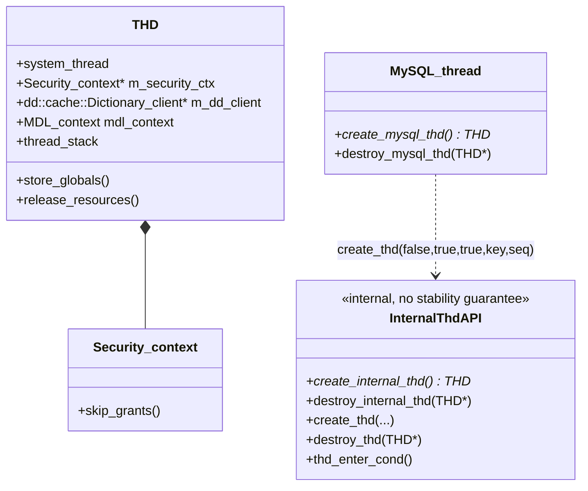

# 内部 THD 深度解析（后台线程持有的 THD）

> 基于 MySQL 8.0.39 源码，覆盖内部 THD 的三种创建路径、`create_internal_thd()` 的六个关键动作、`SYSTEM_THREAD_BACKGROUND` 的连锁影响、InnoDB 侧全部调用点分类（业务用 vs `ut_d` 调试用）、销毁配对纪律，以及它在 C ABI 边界上的位置。
>
> **边界**：本篇讲**非客户端连接的 THD**——后台线程、内部任务临时持有的 THD 是怎么造出来、怎么用、怎么销毁的。
> 连接 THD（有客户端、有 VIO、有认证）见 [`thd.md`](thd.md) 与 [`connection_threading.md`](connection_threading.md)；线程本身的创建见 [`thread_lifecycle.md`](thread_lifecycle.md)；后台线程全景见 [`threading_architecture.md`](threading_architecture.md)。
> 本篇不深剖"某个后台线程在做什么"（那是各模块篇的事），只深剖**它们共用的那个 THD 是怎么来的、有什么特殊性**。

## 目录

- [概述](#概述)
- [理论基础](#理论基础)
- [核心实现](#核心实现)
- [★ 本机制里的工程实现技法](#-本机制里的工程实现技法)
- [可观测性](#可观测性)
- [Misc](#misc)
- [参考](#参考)

---

## 概述

### 是什么

MySQL 里存在**两类 THD**：

| 类别 | 谁持有 | 有没有客户端 | 典型创建方式 |
|---|---|---|---|
| **连接 THD** | 连接线程（Per_thread 或线程池工作线程） | 有（VIO + 认证） | `Channel_info::create_thd()` / 线程池的 `create_thd_and_authenticate_conn` |
| **内部 THD**（本篇） | 后台线程、内部任务 | **没有** | `create_internal_thd()` 或 InnoDB 的 `create_mysql_thd()` |

内部 THD 是**一个没有客户端的 THD**。它不是"会话"，只是一个**让后台线程能调用 server 层设施的凭证**。

反直觉的第一件事：**内部 THD 不会被计入 `SHOW PROCESSLIST`**。因为它被标记为 `SYSTEM_THREAD_BACKGROUND`，而 `thd_init()` 里明确跳过——不分配 thread_id、不加入 `Global_THD_manager`。所以你在 `PROCESSLIST` 里看到的永远只有连接线程，后台线程是"隐身"的。

反直觉的第二件事：**内部 THD 默认跳过权限检查**。`create_internal_thd()` 里直接 `thd->security_context()->skip_grants()`。这不是漏洞而是设计——后台线程是服务器自己的代码，不该被用户权限拦住。但代价是：任何拿到这个 THD 的代码路径都**绕过 ACL**。

反直觉的第三件事：**redo 那几个后台线程的 THD 是 `ut_d` 包着的——只有 debug 构建才创建**：

```cpp
  ut_d(log.m_writer_thd = create_internal_thd());
```

也就是说 release 构建里 log writer **没有** THD。这些 THD 是给断言用的（验证"这段代码确实在 log writer 线程里跑"），不是给业务用的。

### 用途

后台线程为什么要 THD？因为 server 层的核心设施都以 THD 为入口：

| 需要做的事 | 为什么必须有 THD |
|---|---|
| 读写数据字典（DD） | `THD::dd_client()` 在 THD 上 |
| 报告错误 / warning | `my_error`、`push_warning` 需要 `current_thd` |
| 访问表（打开、加锁） | MDL 上下文 `THD::mdl_context` |
| 触发审计 | 审计事件以 THD 为上下文 |
| 记录 binlog / 读系统变量 | 都要 THD |
| PFS 记账 | 状态变量挂在 THD 上 |

一句话：**THD 是 server 层所有服务的"会话凭证"**，后台线程没有它寸步难行。而 `store_globals()` 把它挂到 `current_thd`，后续所有 `current_thd` 隐式引用就都通了。

### 版本演进

| 版本 | 变化 |
|---|---|
| 5.7 | 已有 `create_internal_thd`（用于 InnoDB 后台线程、事件调度器等）；但 DD 未引入，后台线程访问元数据主要靠 InnoDB 内部字典 |
| 8.0 | **DD 引入后内部 THD 变得更重要**：后台线程读写 DD 表（`mysql.*`）必须有 `dd_client`，于是 InnoDB 各处的 `create_internal_thd()` 调用显著增多；同时在 `MySQL_thread` 里加了 `create_mysql_thd()`，把"InnoDB 线程造 THD"封装成一行 |
| 8.0.x | `create_thd()` 参数化为 `(enable_plugins, background_thread, bound, psi_key, psi_seqnum)`，让 InnoDB 侧能把 PSI key 传进来——此前内部 THD 的 PFS 归属是脱节的 |

> 演进主线：**从"少数后台线程偶尔造个 THD"到"后台线程普遍持有 THD，且与 PFS 正确关联"**。驱动因素是 8.0 的 DD——元数据搬到表里之后，没有 THD 就访问不了。

---

## 理论基础

### 设计思想与权衡

#### 权衡一：为什么不给后台线程发一个"真"的会话 THD？

两个可选方案：

| 方案 | 做法 | 评价 |
|---|---|---|
| 给后台线程也建一个完整会话 THD（有 thread_id、进全局链表） | 复用连接 THD 的创建路径 | ❌ 会让 `SHOW PROCESSLIST`/`KILL` 看到一堆后台线程；`max_connections` 计数被污染；线程 id 消耗 |
| **建一个精简的、标记为 BACKGROUND 的 THD** | MySQL 选这个 | ✅ 不进全局链表、不计连接数；代价是它**不能被 KILL、不可见于 PROCESSLIST** |

代价落到具体后果：后台线程如果卡死，你**无法用 `KILL` 杀掉它**（`KILL` 依赖 `Global_THD_manager` 查找 THD）。只能靠停止协议（设标志 + `os_event_set` + join），见 [`thread_lifecycle.md`](thread_lifecycle.md)。

#### 权衡二：为什么内部 THD 要 `skip_grants()`？

```cpp
  // Skip grants and set the system_user flag in THD.
  thd->security_context()->skip_grants();
```

后台线程执行的是**服务器自己的运维逻辑**（刷脏页、更新统计、归档 redo），它不代表任何用户。走 ACL 检查会出现荒谬的情况：`dict_stats_thread` 想更新 `mysql.innodb_table_stats`，却因为"当前用户没权限"失败。

代价：**任何持有内部 THD 的代码路径都绕过了权限系统**。所以源码纪律是——内部 THD 只在服务器自己的代码里短时间使用，绝不把它暴露给任何用户可控的路径。

#### 权衡三：`thread_stack` 为什么能用局部变量地址？

```cpp
  thd->thread_stack = reinterpret_cast<char *>(&thd);
```

`thread_stack` 用于**栈溢出检测**（判断当前栈深度是否超界）。连接 THD 的 `thread_stack` 是线程函数真实的栈起始地址。

内部线程没有"客户端连接的栈"概念，而且它往往是**在创建 THD 的那个函数里就地使用**（栈已经很深了）。于是直接取局部变量 `thd` 的地址——这在技术上"能用"（栈方向正确即可做上界判断），但语义上是**近似值**，不是真实栈底。

**代价 / 失效场景**：这个近似值会让栈溢出检测的边界不准。但因为内部线程执行的都是固定深度的服务器代码（不会递归到用户表达式），实际风险很低。这是一处"够用就行"的务实妥协。

#### 权衡四：PSI 是"关联已有"还是"新建"？

对比两条路径：

| 路径 | PSI 动作 | 含义 |
|---|---|---|
| `create_internal_thd()` | `PSI_THREAD_CALL(get_thread)()` | **取当前线程已有的** PSI 对象，把 THD 关联上去 |
| `create_thd(...)`（InnoDB 用） | `PSI_THREAD_CALL(new_thread)(psi_key, psi_seqnum, thd, thd->thread_id())` | **新建** PSI 线程对象 |

为什么不同？因为调用时机不同：

- `create_internal_thd()` 通常在线程已经跑起来之后、由线程自己调用。而 InnoDB 线程在 `preamble()` 里**已经**注册过 PSI 了（见 [`thread_lifecycle.md`](thread_lifecycle.md)）——所以这里只需要"把 THD 挂到已有 PSI 上"。
- `create_thd()` 是更底层的构造函数，它承接"连 PSI 都要我来建"的场景。

注释把这个意图写得很清楚：

> Associate this THD to the background thread instrumentation, so that system variables and status variables are visible for the background thread.

即：**为了让后台线程的系统变量与状态变量在 PFS 里可见**。

### 理论溯源

| 理论 / 模式 | 源码落点 | 说明 |
|---|---|---|
| **Credential / Capability 模式** | 内部 THD 本身 | THD 是调用 server 层服务的凭证；后台线程没有它就不能调 |
| **Null Object 的特化变体** | 无客户端但有 THD | 不是空对象，而是"降级的会话"：有 mdl_context/dd_client，无 VIO/无 thread_id |
| **RAII 的手写版** | `create_internal_thd` / `destroy_internal_thd` 配对 | 必须成对，否则泄漏 THD（且 `current_thd` 悬挂） |
| **条件编译的调试专用路径** | `ut_d(log.m_writer_thd = create_internal_thd())` | 只在 debug 构建存在，为断言提供证据 |

### 算法与数据结构

内部 THD 没有专门的数据结构——它就是一个普通 `THD`，靠**几个字段的取值**被区分：

| 字段 | 内部 THD 的取值 | 后果 |
|---|---|---|
| `system_thread` | `SYSTEM_THREAD_BACKGROUND` | 不进 `Global_THD_manager`、不分配 thread_id、销毁时不 `remove_thd` |
| `m_main_security_ctx` | `skip_grants()` 已调用 | 绕过 ACL |
| `thread_stack` | `&thd`（局部变量地址，近似值） | 栈溢出检测边界不准 |
| `m_enable_plugins` | `false`（`new THD(false)`） | 不启用插件相关的会话变量 |
| `m_psi` | 关联当前线程的 PSI 对象 | 让后台线程的状态变量在 PFS 可见 |

`SYSTEM_THREAD_*` 还有其他取值（如复制线程用的是 `SYSTEM_THREAD_SLAVE_IO` / `SYSTEM_THREAD_SLAVE_SQL`），它们**会**进全局链表（因为不等于 BACKGROUND）——所以复制线程在 `SHOW PROCESSLIST` 里是可见的。这是"内部"与"后台"的细微区别。

### 他库对比与演进动机

| 维度 | MySQL | PostgreSQL |
|---|---|---|
| 后台任务的会话凭证 | 造一个"内部 THD"（降级会话） | 后台进程/ worker 用 `MyProc` 或干脆不需要（后台写直接操作文件，不走 SQL 层） |
| 权限 | `skip_grants()` 绕过 | 无对应概念（后台不执行 SQL） |
| 可见性 | BACKGROUND 线程在 PROCESSLIST 中隐藏 | `pg_stat_activity` 可见后台进程（backend_type 列） |

差异根因：**MySQL 的后台任务经常要"用 SQL 层的方式做事"**（读写 DD 表、走 MDL），所以必须借一个会话凭证；PostgreSQL 的后台任务多直接操作存储层，不需要执行器上下文。

**演进动机**：8.0 把元数据搬进 InnoDB 表（DD）之后，"后台线程读写元数据"从"读内存/文件"变成了"走 server 层访问表"——这一步把内部 THD 从可选变成了必需。这是 8.0 里内部 THD 调用点显著增多的根本原因。

---

## 核心实现

### 主链路

```
后台线程启动（InnoDB 侧由 MySQL_thread::preamble 完成 PSI 与 mysys 注册）
  ↓
create_internal_thd()
  ├─ new THD(false)                        enable_plugins = false
  ├─ system_thread = SYSTEM_THREAD_BACKGROUND
  ├─ security_context()->skip_grants()     绕过 ACL
  ├─ thread_stack = &thd                   栈上界近似值
  ├─ store_globals()                       ★ current_thd = this（此后所有 server API 可用）
  └─ PSI: get_thread() → set_thread_THD() → set_psi()
  ↓
业务代码（读写 DD / 开表 / 报错 / 记状态变量 …）
  ↓
destroy_internal_thd(thd)
  ├─ assert(system_thread == BACKGROUND)
  ├─ PSI: set_thread_THD(psi, nullptr) → set_psi(nullptr)
  ├─ release_resources()
  └─ delete thd
```

配图（连接 THD vs 内部 THD）：

```
【连接 THD】                              【内部 THD】
Channel_info::create_thd()                create_internal_thd()
  ├─ new THD(true)      enable_plugins ✓    ├─ new THD(false)     enable_plugins ✗
  ├─ system_thread = 0  （普通）             ├─ system_thread = BACKGROUND
  ├─ 完整认证（Security_context 真实用户）    ├─ skip_grants()     绕过 ACL
  ├─ thread_stack = 真实栈底                 ├─ thread_stack = &thd（近似）
  ├─ set_new_thread_id()                    ├─ ✗ 不分配 thread_id
  ├─ Global_THD_manager::add_thd()          └─ ✗ 不加入全局链表
  └─ PROCESSLIST 可见 / 可 KILL              └─ PROCESSLIST 隐藏 / 不可 KILL
```

### 一、三种创建路径对比

| 路径 | 函数 | 用在哪 | PSI 动作 | 进全局链表 |
|---|---|---|---|---|
| 连接 THD | `Channel_info::create_thd()` | Per_thread / 线程池 | `new_thread`（由 `thd_init` 重载版） | ✅ |
| server 侧内部 THD | `create_internal_thd()` | InnoDB 多数后台线程、事件调度器等 | `get_thread()`（关联已有） | ❌ |
| InnoDB 侧内部 THD | `MySQL_thread::create_mysql_thd()` → `create_thd(false, true, true, pfs_key, pfs_seqnum)` | InnoDB 线程需要指定 PSI key 时 | `new_thread`（新建） | ❌（因为 `background_thread=true`） |

第三条来自 `os0thread-create.h`：

```cpp
  /** @return a THD instance. */
  THD *create_mysql_thd() noexcept {
#ifdef UNIV_PFS_THREAD
    return create_thd(false, true, true, m_pfs_key.m_value, m_pfs_seqnum);
#else
    return create_thd(false, true, true, 0, 0);
#endif /* UNIV_PFS_THREAD */
  }

  void destroy_mysql_thd(THD *thd) noexcept { destroy_thd(thd); }
```

四个实参 `false, true, true, ...` 依次是：`enable_plugins=false`、`background_thread=true`、`bound=true`、PSI key/seqnum。**`background_thread=true` 决定了它是内部 THD**（走 `skip_grants` + `SYSTEM_THREAD_BACKGROUND`）。

### 二、`create_internal_thd()` 逐行剖析

```cpp
THD *create_internal_thd() {
  /* For internal threads, use enabled_plugins = false. */
  THD *thd = new THD(false);
  thd->system_thread = SYSTEM_THREAD_BACKGROUND;
  // Skip grants and set the system_user flag in THD.
  thd->security_context()->skip_grants();
  thd->thread_stack = reinterpret_cast<char *>(&thd);
  thd->store_globals();

#ifdef HAVE_PSI_THREAD_INTERFACE
  PSI_thread *psi;
  psi = PSI_THREAD_CALL(get_thread)();
  if (psi != nullptr) {
    /*
      Associate this THD to the background thread instrumentation,
      so that system variables and status variables
      are visible for the background thread.
    */
    PSI_THREAD_CALL(set_thread_THD)(psi, thd);
    thd->set_psi(psi);
  }
#endif /* HAVE_PSI_THREAD_INTERFACE */

  return thd;
}
```

六个动作逐个说：

1. **`new THD(false)`**——`enable_plugins = false`。这个参数控制 THD 是否初始化插件相关的会话状态（插件可以为会话添加自己的变量/状态）。内部线程不是真会话，不需要。
2. **`system_thread = SYSTEM_THREAD_BACKGROUND`**——决定后续所有"是否是后台线程"的判定（是否进全局链表、是否分配 id、销毁时是否 remove）。
3. **`skip_grants()`**——见「设计思想与权衡」。
4. **`thread_stack = &thd`**——见上。注意 `reinterpret_cast<char *>(&thd)` 取的是**指针变量自身的地址**（栈上），不是 THD 对象地址。
5. **`store_globals()`**——**最关键的一步**。它把 `current_thd = this`、`THR_MALLOC = &mem_root`（详见 [`thd.md`](thd.md)）。做完这步，后续所有依赖 `current_thd` 的 server 代码才可用。**这也是为什么内部 THD 必须在"要用它的那个线程"里创建**——TLS 是线程私有的。
6. **PSI 关联**——`get_thread()` 取当前线程已有的 PSI 对象（不是新建，因为 `preamble()` 已经建过），把 THD 挂上去。注意 `if (psi != nullptr)` 的判空：没开 PFS 或该线程未插桩时 psi 为空，此时 THD 没有 PSI 归属（功能仍正常，只是 PFS 看不到）。

### 三、`SYSTEM_THREAD_BACKGROUND` 的连锁影响

关键在 `thd_init()`：

```cpp
void thd_init(THD *thd, char *stack_start) {
  DBUG_TRACE;
  // TODO: Purge threads currently terminate too late for them to be added.
  // Note that P_S interprets all threads with thread_id != 0 as
  // foreground threads. And THDs need thread_id != 0 to be added
  // to the global THD list.
  if (thd->system_thread != SYSTEM_THREAD_BACKGROUND) {
    thd->set_new_thread_id();
    Global_THD_manager *thd_manager = Global_THD_manager::get_instance();
    thd_manager->add_thd(thd);
  }
  ...
  thd_set_thread_stack(thd, stack_start);
  thd->store_globals();
}
```

一个 `if` 带来四条连锁后果：

| 后果 | 说明 |
|---|---|
| **不分配 thread_id** | 后台 THD 的 `thread_id()` 是 0 |
| **不进 `Global_THD_manager`** | `SHOW PROCESSLIST` 看不到；`KILL <id>` 找不到它 |
| **不计入连接数** | `Threads_connected` 不含后台线程 |
| **销毁时不 `remove_thd`** | `destroy_thd` 里同样用 `system_thread != BACKGROUND` 守卫 |

注释里还有一条被忽视的信息：**PFS 把 `thread_id != 0` 的线程都解释为前台线程**。所以"不给后台 THD 分配 id"也是为了让 PFS 正确区分前后台——如果给后台 THD 发了 id，PFS 会把它误当前景线程统计。

另外那句 `// TODO: Purge threads currently terminate too late for them to be added.` 承认了一个历史遗留：purge 线程因为退出太晚（在 THD 管理器已经停止之后），没法被加入全局链表——这也是它们只能当 BACKGROUND 的现实原因之一。

`thd_init` 还有一个 PSI 重载版，用于需要新建 PSI 对象的场景：

```cpp
void thd_init(THD *thd, char *stack_start, bool bound [[maybe_unused]],
              PSI_thread_key psi_key [[maybe_unused]],
              unsigned int psi_seqnum [[maybe_unused]]) {
  thd_init(thd, stack_start);

#ifdef HAVE_PSI_THREAD_INTERFACE
  PSI_thread *psi;
  psi = PSI_THREAD_CALL(new_thread)(psi_key, psi_seqnum, thd, thd->thread_id());
  if (bound) {
    PSI_THREAD_CALL(set_thread_os_id)(psi);
  }
  PSI_THREAD_CALL(set_thread_THD)(psi, thd);
  thd->set_psi(psi);
#endif
}
```

`bound` 决定是否调 `set_thread_os_id`——只有"确实绑定了 OS 线程"时才填 OS 线程 id。InnoDB 的 `create_mysql_thd()` 传 `bound=true`。

### 四、`create_thd()` 的参数化形态

```cpp
THD *create_thd(bool enable_plugins, bool background_thread, bool bound,
                PSI_thread_key psi_key, unsigned int psi_seqnum) {
  THD *thd = new THD(enable_plugins);
  if (background_thread) {
    thd->system_thread = SYSTEM_THREAD_BACKGROUND;
    // Skip grants and set the system_user flag in THD.
    thd->security_context()->skip_grants();
  }
  (void)thd_init(thd, reinterpret_cast<char *>(&thd), bound, psi_key,
                 psi_seqnum);
  return thd;
}
```

对比 `create_internal_thd()`，差别只有两点：

1. `background_thread` 是**参数**而非硬编码 `true`——所以 `create_thd` 也能造前台 THD（虽然实践上 InnoDB 只用它造 background）。
2. `thread_stack` 同样是 `&thd`（注意：这里 `&thd` 是**局部变量**，两处写法一致）。

也就是说：**`create_internal_thd()` 基本等价于 `create_thd(false, true, ...)` 但不新建 PSI**。两者的 PSI 策略不同，这是唯一实质差异。

### 五、调用点全景：业务用 vs `ut_d` 调试用

InnoDB 侧全部 `create_internal_thd()` 调用点（源码实证）可分为两类：

**A. 业务用（release 与 debug 构建都存在）**

| 调用点 | 场景 | 为什么需要 THD |
|---|---|---|
| `dict0stats_bg.cc`（`dict_stats_thread`） | 后台统计重算 | 要读写 `mysql.innodb_table_stats` 等 DD 表 |
| `buf0flu.cc` | buffer pool flush 相关 | 访问 DD / 报告错误 |
| `lock0lock.cc` | 锁子系统（如锁等待超时处理） | 报告死锁/超时错误、访问 DD |
| `fsp0fsp.cc` | 表空间管理 | DD 操作 |
| `fts0opt.cc` / `ddl0fts.cc` | FTS optimize / DDL | FTS 辅助表是 SQL 层表，必须走 server |
| `clone0repl.cc` / `clone0api.cc` | clone 插件 | clone 要读写 DD、报告错误 |
| `trx0roll.cc` | 事务回滚（恢复期） | 恢复时可能要访问 DD |

典型用法是**线程开头造、线程结束销毁**，整个生命周期持有：

```cpp
void dict_stats_thread() {
  ut_a(!srv_read_only_mode);
  THD *thd = create_internal_thd();

  while (!SHUTTING_DOWN()) {
    /* Wake up periodically even if not signaled. This is
    because we may lose an event - if the below call to
    dict_stats_process_entry_from_recalc_pool() puts the entry back
    in the list, the os_event_set() will be lost by the subsequent
    os_event_reset(). */
    os_event_wait_time(dict_stats_event, MIN_RECALC_INTERVAL);
    ...
```

注意这段注释顺带揭示了一个真实的工程细节：**`dict_stats_event` 存在事件丢失的可能**（`os_event_set` 会被随后的 `os_event_reset` 吞掉），所以必须带超时周期唤醒兜底，不能纯事件驱动。这与 [`thread_lifecycle.md`](thread_lifecycle.md) 里"无超时兜底会导致 join 挂住"是同一类问题。

**B. `ut_d` 调试用（仅 debug 构建）**

```cpp
  ut_d(log.m_writer_thd = create_internal_thd());
```

出现在三处：`log0write.cc`（writer）、`log0chkp.cc`（checkpointer）、`log0files_governor.cc`（files governor）。

它们的 THD **不是给业务用的**，而是存到 `log.m_*_thd` 供**断言**使用——验证"当前代码确实运行在 log writer 线程里"。release 构建下 `ut_d` 展开为空，这些线程**根本没有 THD**。

这是一个很容易误判的点：如果你在 release 构建里给 log writer 加了一段需要 THD 的代码，debug 下能跑、release 下会崩——因为 THD 只在 debug 存在。

### 六、销毁路径与配对纪律

```cpp
void destroy_internal_thd(THD *thd) {
  assert(thd->system_thread == SYSTEM_THREAD_BACKGROUND);

#ifdef HAVE_PSI_THREAD_INTERFACE
  PSI_thread *psi;
  psi = PSI_THREAD_CALL(get_thread)();
  if (psi != nullptr) {
    /*
      Dissociate this THD from the background thread instrumentation.
    */
    PSI_THREAD_CALL(set_thread_THD)(psi, nullptr);
    thd->set_psi(nullptr);
  }
#endif

  thd->release_resources();
  delete thd;
}
```

配对纪律三条：

1. **`assert(system_thread == BACKGROUND)`**——`destroy_internal_thd` 只能销毁内部 THD；用错函数会在 debug 下立刻断言失败。
2. **先解绑 PSI 再 `release_resources()`**——PSI 持有 THD 指针，先置空避免悬挂。
3. **`release_resources()` 后还要 `delete`**——两步分离（详见 [`thd.md`](thd.md) 的六态生命周期）。

另一条销毁路径：

```cpp
void destroy_thd(THD *thd, bool clear_pfs_events [[maybe_unused]]) {
  thd->release_resources();
#ifdef HAVE_PSI_THREAD_INTERFACE
  if (clear_pfs_events) PSI_THREAD_CALL(delete_thread)(thd->get_psi());
  thd->set_psi(nullptr);
#endif

  // TODO: Purge threads currently terminate too late for them to be added.
  if (thd->system_thread != SYSTEM_THREAD_BACKGROUND) {
    Global_THD_manager *thd_manager = Global_THD_manager::get_instance();
    thd_manager->remove_thd(thd);
  }
  delete thd;
}

void destroy_thd(THD *thd) { return destroy_thd(thd, true); }
```

差别：这里用 `delete_thread`（**销毁** PSI 对象，因为 PSI 是自己建的），而 `destroy_internal_thd` 用 `set_thread_THD(nullptr)`（**只是解绑**，PSI 对象仍属于线程，由 `epilogue` 销毁）。这个差别正是"PSI 谁创建谁销毁"的所有权纪律。

**一个易漏的点**：`destroy_internal_thd` **没有**调 `restore_globals()`。但 `release_resources()` 里有 `if (current_thd == this) restore_globals();`（见 [`thd.md`](thd.md)），所以 TLS 解绑是靠 `release_resources` 兜底完成的。如果绕过 `release_resources` 直接 `delete`，`current_thd` 会悬挂。

### 七、C ABI 边界上的位置

`sql_thd_internal_api.h` 里还有一批 `extern "C"` 的 C ABI 函数，它们是内部 THD 的"使用侧"：

```cpp
extern "C" void thd_enter_cond(void *opaque_thd, mysql_cond_t *cond,
                               mysql_mutex_t *mutex,
                               const PSI_stage_info *stage,
                               PSI_stage_info *old_stage,
                               const char *src_function, const char *src_file,
                               int src_line) {
  THD *thd = static_cast<THD *>(opaque_thd);
  if (!thd) thd = current_thd;

  return thd->enter_cond(cond, mutex, stage, old_stage, src_function, src_file,
                         src_line);
}
```

三个要点：

1. **`void *opaque_thd`**——又是不透明指针（与 [`thd.md`](thd.md) 讲的 `MYSQL_THD` 同一套 ABI 纪律），让 C 侧代码也能传 THD。
2. **`if (!thd) thd = current_thd;`**——兜底：没传就用当前线程的。这让这些函数在没有显式 THD 的场合也能工作。
3. **`extern "C"`**（在头文件里声明）——禁用名称修饰，保证跨编译单元链接一致。

`thd_exit_cond` / `thd_enter_stage` 同构。这一组函数是**后台线程向 PFS 上报等待与阶段**的通道——内部 THD 造好之后，正是靠它们在 PFS 里留下 trace。

---

## ★ 本机制里的工程实现技法

### 一、C++ 特性

| 特性 | 用在哪 | 为什么（收益） | 代价 / 反直觉处 |
|---|---|---|---|
| **`reinterpret_cast<char *>(&thd)`** | `thread_stack` | 就地取栈上地址，无需真实栈底 | 语义是近似值；栈溢出检测边界不准 |
| **条件编译宏 `ut_d`** | `ut_d(log.m_writer_thd = create_internal_thd())` | 调试专用代码在 release 完全消失 | **debug/release 行为不一致**，release 加代码会崩 |
| **`[[maybe_unused]]`** | `destroy_thd(thd, bool clear_pfs_events)` | 不开 PFS 时参数未用 | 掩盖"这个参数真的没用" |
| **`extern "C"` + `void *`** | `thd_enter_cond` 等 | C ABI 稳定，跨编译单元可用 | 类型安全丧失，靠 `static_cast` 恢复 |
| **函数重载（两个 `thd_init`）** | 有无 PSI 参数的两个版本 | 调用方按需选择 | 容易调错版本（PSI 行为不同） |

**C 与 C++ 的边界**：`sql_thd_internal_api.h` 同时提供 C++ 的 `create_thd`/`destroy_thd` 与 `extern "C"` 的 `thd_enter_cond` 族——前者给 InnoDB（C++），后者给需要 C 链接的场合。头文件开头那句定位值得记住：

> This file defines THD-related API calls that are meant for internal usage (e.g. InnoDB, Thread Pool) only. **There are therefore no stability guarantees.**

即：这些 API **没有任何稳定性保证**，第三方插件不该用（详见 [`thd.md`](thd.md) 的两层 API 划分）。

### 二、经典算法的实现落地

内部 THD 没有算法，但有一处**工程惯例**值得单列：**"凭证式"资源管理**。

| 维度 | 教科书原型（RAII） | 本实现的落地 | 差异原因 |
|---|---|---|---|
| 获取 | 构造函数 | `create_internal_thd()` | 需要 TLS 绑定（`store_globals`），构造做不到 |
| 释放 | 析构函数 | `destroy_internal_thd()` | 需要 `release_resources` 两步分离 |
| 作用域绑定 | 栈对象自动 | **手动配对** | 生命周期常跨越整个线程函数，不适合栈对象 |
| 泄漏检测 | 编译器保证 | **靠 `assert` + 代码审查** | 没有语言级保证 |

代价：**漏掉 `destroy_internal_thd` 不会编译报错**，只会泄漏一个 THD（含 mem_root、MDL 上下文等）。

### 三、复杂体系与设计模式的代码结构



| 模式 / 体系 | 代码落点 | 结构说明 |
|---|---|---|
| **Facade（内部 API 门面）** | `sql_thd_internal_api.h/.cc` | 把 THD 的创建/销毁/cond 上报收敛到一处，供 InnoDB 与线程池使用 |
| **凭证 / Capability** | 内部 THD 整体 | THD 即"可以调 server 层服务"的凭证 |
| **标记位驱动的行为分叉** | `system_thread == SYSTEM_THREAD_BACKGROUND` | 一个枚举值决定进不进全局链表、分不分 id、毁不毁 PSI |
| **所有权纪律** | `get_thread()` vs `new_thread()` / `set_thread_THD(nullptr)` vs `delete_thread()` | PSI 谁创建谁销毁：`create_internal_thd` 只关联不创建，故销毁时只解绑 |

---

## 可观测性

### 系统变量与状态变量

内部 THD 没有专属系统变量。相关的是"后台线程是否在 PFS 可见"：

| 变量 | 说明 |
|---|---|
| `performance_schema` | 必须开启，内部 THD 的 `set_thread_THD` 才有对象可关联 |

| 状态变量 | 与内部 THD 的关系 |
|---|---|
| `Threads_connected` | **不含**后台线程（BACKGROUND 不进全局链表） |
| `Threads_running` | 同上 |

### 观测对象 → 手段 速查

| 我想看 | 手段 | 入口 |
|---|---|---|
| 后台线程有哪些、在做什么 | PFS | `performance_schema.threads` 里 `TYPE='BACKGROUND'` 的行（**注意：`SHOW PROCESSLIST` 看不到它们**） |
| 后台线程的状态变量 | PFS | 由 `set_thread_THD` 关联后可见；这正是 `create_internal_thd` 里那段 PSI 代码的意图 |
| 某后台线程卡住了 | PFS / DBUG | `threads` 表看 state；**无法用 KILL**（不在全局链表），只能靠停止协议 |
| 内部 THD 是否泄漏 | DBUG | `release_resources` 与 `~THD` 的调试输出；泄漏表现为线程退出后 THD 未释放 |
| redo 线程的 THD | — | **release 构建下不存在**（`ut_d` 包裹），debug 下才有 |

---

## Misc

### 术语表

| 术语 | 含义 |
|---|---|
| 内部 THD | 非客户端连接的 THD，由后台线程持有，无 VIO、无认证 |
| `SYSTEM_THREAD_BACKGROUND` | `system_thread` 的取值，标记"后台线程" |
| `skip_grants()` | `Security_context` 的方法，跳过 ACL 检查 |
| `Global_THD_manager` | 全局 THD 链表管理器；BACKGROUND 的 THD 不入内 |
| `ut_d(...)` | 仅 debug 构建展开的宏 |
| `create_mysql_thd()` | InnoDB `MySQL_thread` 提供的造 THD 封装（→ `create_thd`） |

### ★ 本篇核实出的"流传但不存在 / 易误判"的说法

| 流传的说法 | 实际情况 |
|---|---|
| "后台线程在 `SHOW PROCESSLIST` 里能看到" | **不能**。BACKGROUND 的 THD 不入 `Global_THD_manager`；要用 `performance_schema.threads` 的 `TYPE='BACKGROUND'` |
| "后台线程可以 `KILL`" | **不能**。`KILL` 依赖全局 THD 链表查找；后台线程只能靠停止协议（标志 + `os_event_set` + join） |
| "所有后台线程都有 THD" | **不对**。redo 的 writer/checkpointer/files governor 是 `ut_d` 包裹，**release 构建下没有 THD** |
| "内部 THD 会被计入 `Threads_connected`" | 不会 |
| "`create_internal_thd` 会新建 PSI 线程对象" | 不会，是 `get_thread()` **关联已有**的（PSI 对象由 `MySQL_thread::preamble` 创建） |
| "`thread_stack` 是真实栈底" | 内部 THD 是 `&thd`（局部变量地址），**近似值** |
| "`destroy_internal_thd` 会调 `restore_globals`" | 不直接调；靠 `release_resources()` 里的 `if (current_thd == this) restore_globals()` 兜底 |

### 易混淆概念对比

| 此 X | 非彼 X | 说明 |
|---|---|---|
| `create_internal_thd()` | `create_thd()` | 前者硬编码 `background=true` 且**不新建 PSI**；后者是参数化底层函数，**会新建 PSI** |
| `destroy_internal_thd()` | `destroy_thd()` | 前者 `set_thread_THD(nullptr)`（解绑）；后者 `delete_thread()`（销毁 PSI 对象） |
| `SYSTEM_THREAD_BACKGROUND` | `SYSTEM_THREAD_SLAVE_IO/SQL` | 复制线程**不是** BACKGROUND，所以它们**会**进全局链表、在 PROCESSLIST 可见 |
| `skip_grants()` | 真的没有权限限制 | 是"跳过检查"，不是"权限为空"；代码仍走 `check_access` 路径但直接放行 |
| `ut_d` 里的 THD | 业务用的 THD | 前者只存在于 debug，为断言服务；后者 release/debug 都有，为功能服务 |

### 扩展点

新增一个需要 THD 的 InnoDB 后台线程：

1. 在线程函数开头 `THD *thd = create_internal_thd();`（或若需指定 PSI key，用 `create_mysql_thd()`）。
2. 确认 PSI key 已注册，否则 `get_thread()` 返回空，PFS 看不到（功能不受影响）。
3. 业务代码可直接使用 `current_thd` 隐式引用（已 `store_globals`）。
4. 线程退出前 `destroy_internal_thd(thd)`——**必须配对**。
5. 若用 `create_mysql_thd()`，对应销毁用 `destroy_mysql_thd()`（→ `destroy_thd`）。
6. 若该线程需要可被观测/可 KILL，就不能用 BACKGROUND——但那意味着要按连接 THD 处理，需重新评估。

### 坑与已知缺陷

1. **`ut_d` 造成的 debug/release 行为不一致**：在 release 下给 log writer 加需要 THD 的代码会崩（THD 不存在）。
2. **内部结构 THD 不可 KILL**：后台线程卡死只能靠停止协议；若等待无超时兜底，会一直挂着（见 [`thread_lifecycle.md`](thread_lifecycle.md)）。
3. **`thread_stack = &thd` 使栈溢出检测不准**：内部线程不会跑用户递归，风险低，但这是一处妥协。
4. **漏调 `destroy_internal_thd` 无编译期报错**：只泄漏。
5. **绕过 `release_resources` 直接 `delete` 会让 `current_thd` 悬挂**：TLS 解绑依赖 `release_resources` 里的那句兜底。
6. **`skip_grants` 是全局绕权**：任何持有内部 THD 的路径都绕过 ACL，源码纪律要求它绝不暴露给用户可控路径。
7. **`sql_thd_internal_api.h` 无稳定性保证**：头文件原话 "There are therefore no stability guarantees"，第三方插件不应使用。
8. **purge 线程的历史遗留**：源码 TODO 明说 "Purge threads currently terminate too late for them to be added"——它们是 BACKGROUND 有现实原因，不是纯设计选择。

---

## 参考

**相关文档**
- THD 对象本身（结构、`ha_data`、生命周期六态）：[`thd.md`](thd.md)
- 线程的创建与销毁原语（`MySQL_thread`、`preamble`/`epilogue`）：[`thread_lifecycle.md`](thread_lifecycle.md)
- 后台线程全景（谁在用内部 THD）：[`threading_architecture.md`](threading_architecture.md)
- 连接 THD（对照系）：[`connection_threading.md`](connection_threading.md)
- 两层 API 划分（公开 `plugin.h` vs 内部 `sql_thd_internal_api.h`）：[`thd.md`](thd.md)
- PFS 如何记录后台线程：[`../../server/infra/pfs.md`](../observability/pfs/pfs.md)
- 复制线程不是 BACKGROUND（对照）：[`../../server/replication/replica.md`](../../server/replication/replica.md)
