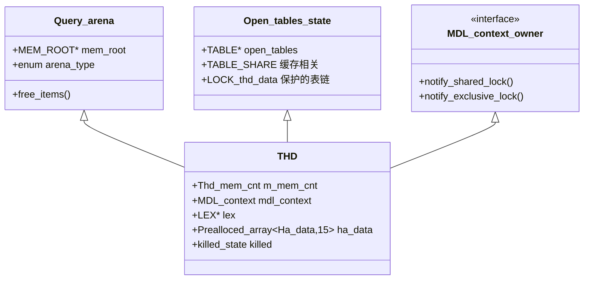
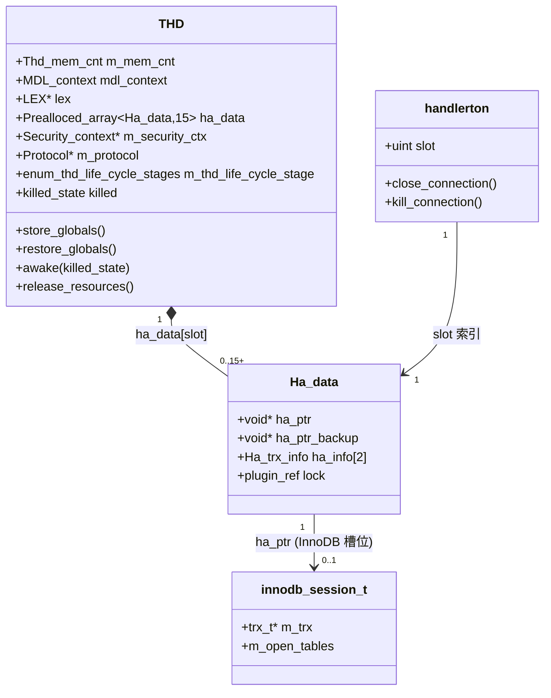

# THD 深度解析

> 基于 MySQL 8.0.39 源码，涵盖 `THD` 对象的结构、`ha_data[]` 引擎挂载点、插件 ABI 边界、生命周期状态机、KILL 与唤醒路径，以及 THD 与 OS 线程的解耦机制。
>
> **边界**：本篇讲 **`THD` 这个对象本身**——它是什么、怎么组织、怎么与引擎和插件交互、怎么生灭。
> 线程侧专题另立：连接线程模型（Per_thread）见 [`connection_threading.md`](connection_threading.md)；线程池（MySQL 26.7 源码级）见 [`thread_pool.md`](thread_pool.md)；MariaDB/Percona 线程池对比见 [`thread_pool_mariadb_percona.md`](thread_pool_mariadb_percona.md)；全栈线程全景（含 InnoDB 后台线程）见 [`threading_architecture.md`](threading_architecture.md)。
> 本篇不深剖"某线程在做什么"，只深剖"THD 这一载体如何支撑这一切"。

## 目录

- [概述](#概述)
- [理论基础](#理论基础)
- [核心实现](#核心实现)
- [★ 本机制里的工程实现技法](#-本机制里的工程实现技法)
- [可观测性](#可观测性)
- [Misc](#misc)
- [参考](#参考)

---

## 概述

### 是什么

⚠️ **勘误**：
- **是三个基类，不是两个**：`MDL_context_owner` → **`Query_arena`** → `Open_tables_state`
- **`variables` 的类型是 `struct System_variables`（大驼峰）**，不是 `system_variables`（定义在 `sql/system_variables.h:205`）
- **THD 里没有 `m_mem_root`**——`mem_root` 指针来自基类 `Query_arena`（`sql_class.h:352`），THD 自己持有的是 **`MEM_ROOT main_mem_root`**（`:4347`）
- **不存在 `THD::m_lex`**——是 public 裸指针 `LEX *lex`，所有权在 private 的 `std::unique_ptr<LEX> main_lex`

```cpp
// sql/sql_class.h:923
/**
  @class THD
  For each client connection we create a separate thread with THD serving as
  a thread/connection descriptor
*/

class THD : public MDL_context_owner,
            public Query_arena,
            public Open_tables_state {
 public:
  /**
    Controlled memory stats for this session.
    This member is the first in THD,
    to initialize Thd_mem_cnt() before allocating more memory.
  */
  Thd_mem_cnt m_mem_cnt;   // ★★ 必须是第一个成员：内存计数器要早于任何内存分配完成初始化

 private:
  bool is_stmt_prepare() const = delete;
  bool is_stmt_prepare_or_first_sp_execute() const = delete;
  bool is_stmt_prepare_or_first_stmt_execute() const = delete;
  inline bool is_regular() const = delete;
  //  ★ 4 个被 =delete 的同名歧义函数，防止外层同名自由函数被误用

 public:
  MDL_context mdl_context;   // ★ THD 作为 MDL_context_owner 的实现载体
```

**三个基类各管什么**：

| 基类 | 位置 | 给 THD 带来什么 |
|---|---|---|
| `MDL_context_owner` | `sql/mdl.h:80` | **纯虚接口**（11 个虚函数），把 MDL 模块与 THD 解耦 |
| `Query_arena` | `sql_class.h:343` | `MEM_ROOT *mem_root` + `Item *m_item_list` + `enum_state`（`STMT_INITIALIZED` / `STMT_PREPARED` / `STMT_REGULAR_EXECUTION` / ...） |
| `Open_tables_state` | `sql_class.h:552` | `open_tables` / `lock` / `locked_tables_mode` 等开表状态 |

```cpp
// sql/mdl.h:80 —— MDL_context_owner 是纯虚接口，THD 是它的唯一实现
class MDL_context_owner {
 public:
  virtual ~MDL_context_owner() = default;
  virtual void enter_cond(mysql_cond_t *cond, mysql_mutex_t *mutex,
                          const PSI_stage_info *stage, PSI_stage_info *old_stage,
                          const char *src_function, const char *src_file,
                          int src_line) = 0;
  virtual void exit_cond(const PSI_stage_info *stage, const char *src_function,
                         const char *src_file, int src_line) = 0;
  virtual int is_killed() const = 0;
  virtual bool is_connected(bool = false) = 0;
  virtual bool might_have_commit_order_waiters() const = 0;
  /**
     Within MDL subsystem this one is only used for DEBUG_SYNC.
     Do not use it to peek/poke into other parts of THD from MDL.
     ...
     @warning For some derived classes implementation of this method
              can return nullptr.
   */
  virtual THD *get_thd() = 0;
  virtual void notify_shared_lock(MDL_context_owner *in_use,
                                  bool needs_thr_lock_abort) = 0;
  virtual bool notify_hton_pre_acquire_exclusive(const MDL_key *mdl_key,
                                                 bool *victimized) = 0;
  virtual void notify_hton_post_release_exclusive(const MDL_key *mdl_key) = 0;
  virtual uint get_rand_seed() const = 0;
};
```

**`Query_arena` 提供的 `mem_root`**（`sql_class.h:343`）：

```cpp
class Query_arena {
 private:
  /* List of items created for this query. Every item adds itself to the list
     on creation (see Item::Item() for details) */
  Item *m_item_list;
 public:
  MEM_ROOT *mem_root;  // Pointer to current memroot
```

**但 THD 自己的 MEM_ROOT 是另一个**（`sql_class.h:4339`）：

```cpp
  /**
    This memory root is used for two purposes:
    - for conventional queries, to allocate structures stored in main_lex
    during parsing, and allocate runtime data (execution plan, etc.)
    during execution.
    - for prepared queries, only to allocate runtime data. The parsed
    tree itself is reused between executions and thus is stored elsewhere.
  */
  MEM_ROOT main_mem_root;
```

> ★ 构造函数里绑定二者：`sql_class.cc:627` `Query_arena(&main_mem_root, STMT_REGULAR_EXECUTION)`；`store_globals()` 里 `THR_MALLOC = &mem_root;`（取的是**指针的地址**，二级指针）。
>
> ⚠️ **THD 里没有"成员函数分区"的 doxygen 分组**——只有 2 处 `/**@{*/ ... /**@}*/`（`1878-1882` binlog 事务位点数据、`2589-2635` 事务位点函数）。THD 的组织方式是 **90 个 `public:` / `private:` 块交替**。

**命令类型**（`include/my_command.h:48`）——⚠️ **不在 `sql_class.h`**：

```cpp
enum enum_server_command {
  /** Currently refused by the server. See ::dispatch_command.
      Also used internally to mark the start of a session. */
  COM_SLEEP,
  COM_QUIT, COM_INIT_DB, COM_QUERY, COM_FIELD_LIST,
  ...
  /**
    Currently refused by the server. See ::dispatch_command.
    Also used internally to mark the session as a "daemon",
    i.e. non-client THD. Currently the scheduler and the GTID
    code does use this state.
    These threads won't be killed by `KILL`
  */
  COM_DAEMON,
  ...
  COM_END /**< Not a real command. Refused. */
};
```

> ★ ⚠️ **不存在 `enum enum_thd_stmt_type`**（全仓 0 命中）；`enum_mark_columns` 在 **`sql/sql_const.h:230`** 不在 `sql_class.h`。
>
> ★ `COM_DAEMON` 注释明说"这类线程不会被 KILL 掉"——这是后台线程用 `COM_DAEMON` 的原因。
>
> 🧹 工作区污染提示：本副本 `sql_class.h:1113`、`sql_thd_api.cc` 等处夹有后来添加的中英文批注，非上游原文。

`THD`（**Thread Handler**，源码里也常读作 *Thread Descriptor*）是 MySQL server 层**最核心的对象**——它是**连接、线程、会话三者的合一载体**。

一个 `THD` 实例同时承担：

| 角色 | 含义 | 对应成员 |
|---|---|---|
| **会话**（session） | 用户的一次登录及其全部状态：当前库、用户变量、临时表、prepared statement | `m_db`、`user_vars`、`stmt_map` |
| **连接**（connection） | 与客户端的一条链路：协议、网络缓冲、认证上下文 | `m_protocol`、`m_main_security_ctx` |
| **线程**（thread） | 执行查询的执行体：栈、内存池、事务、MDL、当前语句 | `mem_root`、`mdl_context`、`lex`、`get_transaction()` |
| **语句执行上下文** | 当前 SQL 的解析树、执行计划、错误与警告 | `lex`、`query_plan`、`m_query_string` |

反直觉的第一件事：**`THD` 不等于一个 OS 线程**。在 Per_thread 模型下二者恰好一一对应（这是绝大多数人的心智模型），但 MySQL 的架构并不保证这一点——线程池、`Attachable_transaction`、事件调度器都会让 `THD` 与 OS 线程的绑定关系发生变化。真正把二者缝合起来的是一对函数 `store_globals()` / `restore_globals()`，它们是理解整个 THD 体系的钥匙（见「THD 与线程」一节）。

反直觉的第二件事：**`sql_class.h` 里定义的 `THD` 是一个巨大的类**（继承三个基类、数百个成员），但它对存储引擎和插件**完全不可见**。引擎拿到的 `MYSQL_THD` 在 C 编译下就是一个 `void*`。这条不可见的边界，是 MySQL 插件体系的基石（见「插件 ABI 边界」一节）。

### 用途

⚠️ **勘误**：
- **`Global_THD_manager` 不在 `sql_class.h`**——在 **`sql/mysqld_thd_manager.h:201`**
- **`thd_list` / `LOCK_thd_list` / `LOCK_thd_remove` / `COND_thd_list` 全是 8 分区数组**（`NUM_PARTITIONS = 8`），**没有 `thd_length` 成员**
- **不存在 `get_thd_from_id()`**——真名是两个重载 `find_thd(Find_THD_Impl*)` / `find_thd(Find_thd_with_id*)`
- 线程 ID 的保护锁是 **`LOCK_thread_ids`**，不是 `LOCK_thd_count`

```cpp
// sql/mysqld_thd_manager.h:350（private 段）
 private:
  // Singleton instance.
  static Global_THD_manager *thd_manager;

  // Array of current THDs. Protected by LOCK_thd_list.
  typedef Prealloced_array<THD *, 60> THD_array;
  THD_array thd_list[NUM_PARTITIONS];      // ★★ 8 个分区，不是单一链表

  // Array of thread ID in current use. Protected by LOCK_thread_ids.
  typedef Prealloced_array<my_thread_id, 1000> Thread_id_array;
  Thread_id_array thread_ids;

  mysql_cond_t COND_thd_list[NUM_PARTITIONS];

  // Mutexes that guard thd_list partitions
  mysql_mutex_t LOCK_thd_list[NUM_PARTITIONS];
  // Mutexes used to guard removal of elements from thd_list partitions.
  mysql_mutex_t LOCK_thd_remove[NUM_PARTITIONS];
  // Mutex protecting thread_ids
  mysql_mutex_t LOCK_thread_ids;

  std::atomic<int> atomic_num_thread_running;      // Threads_running（无锁）
  std::atomic<ulonglong> atomic_thread_created;    // Threads_created（无锁）
  my_thread_id thread_id_counter;                  // Connections 的来源
  bool unit_test;

 public:
  static const int NUM_PARTITIONS = 8;             // ★★ 分区数
```

**为什么是 8 分区**：`add_thd()` / `remove_thd()` / `find_thd()` 都按 `thread_id` 分区，`SHOW PROCESSLIST` 与 `KILL` 的锁争用被摊薄到 8 把锁上。已知 id 时可直接定位分区（`find_thd(Find_thd_with_id*)` 是 O(1) 定位桶）。

```cpp
// mysqld_thd_manager.cc:218
void Global_THD_manager::add_thd(THD *thd) {
  // Should have an assigned ID before adding to the list.
  assert(thd->thread_id() != reserved_thread_id);
  const int partition = thd_partition(thd->thread_id());
  MUTEX_LOCK(lock_list, &LOCK_thd_list[partition]);
  std::pair<THD_array::iterator, bool> insert_result =
      thd_list[partition].insert_unique(thd);
  if (insert_result.second) ++atomic_global_thd_count;
  // Adding the same THD twice is an error.
  assert(insert_result.second);
}

void Global_THD_manager::remove_thd(THD *thd) {
  const int partition = thd_partition(thd->thread_id());
  MUTEX_LOCK(lock_remove, &LOCK_thd_remove[partition]);   // ★ 两把锁：remove 在外，list 在内
  MUTEX_LOCK(lock_list, &LOCK_thd_list[partition]);

  assert(unit_test || thd->release_resources_done());     // ★★ 强制契约

  const size_t num_erased = thd_list[partition].erase_unique(thd);
  if (num_erased == 1) --atomic_global_thd_count;
  assert(1 == num_erased);
  mysql_cond_broadcast(&COND_thd_list[partition]);        // 唤醒 wait_till_no_thd()
}

my_thread_id Global_THD_manager::get_new_thread_id() {
  my_thread_id new_id;
  MUTEX_LOCK(lock, &LOCK_thread_ids);
  do {
    new_id = thread_id_counter++;
  } while (!thread_ids.insert_unique(new_id).second);     // ★ 跳过仍在使用中的 id
  return new_id;
}
```

**遍历的两个版本**（`mysqld_thd_manager.cc:290`）：

```cpp
void Global_THD_manager::do_for_all_thd_copy(Do_THD_Impl *func) {
  Do_THD doit(func);
  for (int i = 0; i < NUM_PARTITIONS; i++) {
    MUTEX_LOCK(lock_remove, &LOCK_thd_remove[i]);
    mysql_mutex_lock(&LOCK_thd_list[i]);
    /* Take copy of global_thread_list. */
    THD_array thd_list_copy(thd_list[i]);
    /*
      Allow inserts to global_thread_list. Newly added thd
      will not be accounted for when executing func.
    */
    mysql_mutex_unlock(&LOCK_thd_list[i]);   // ★★ 拷完立即放锁，func 可在无锁下慢跑
    std::for_each(thd_list_copy.begin(), thd_list_copy.end(), doit);
  }
}

void Global_THD_manager::do_for_all_thd(Do_THD_Impl *func) {
  Do_THD doit(func);
  for (int i = 0; i < NUM_PARTITIONS; i++) {
    MUTEX_LOCK(lock, &LOCK_thd_list[i]);     // ★ 全程持锁版本：func 必须极短
    std::for_each(thd_list[i].begin(), thd_list[i].end(), doit);
  }
}
```

**`find_thd()` 与 `THD_ptr` RAII**（`mysqld_thd_manager.cc:321`）：

```cpp
THD_ptr Global_THD_manager::find_thd(Find_THD_Impl *func) {
  Find_THD find_thd(func);
  for (int i = 0; i < NUM_PARTITIONS; i++) {
    MUTEX_LOCK(lock, &LOCK_thd_list[i]);
    THD_array::const_iterator it =
        std::find_if(thd_list[i].begin(), thd_list[i].end(), find_thd);
    if (it != thd_list[i].end()) {
      THD_ptr thd_ptr(*it);
      if (!thd_ptr->is_being_disposed()) return thd_ptr;  // ★★ 正在销毁的 THD 对 KILL 不可见
      break;
    }
  }
  return THD_ptr{nullptr};
}

// Optimized version ... when we know the thread_id of the THD we are looking for.
THD_ptr Global_THD_manager::find_thd(Find_thd_with_id *func) {
  Find_THD find_thd(func);
  // Since we know the thread_id, we can check the correct partition directly.
  const int partition = thd_partition(func->m_thread_id);   // ★ O(1) 定位桶
  MUTEX_LOCK(lock, &LOCK_thd_list[partition]);
  THD_array::const_iterator it = std::find_if(
      thd_list[partition].begin(), thd_list[partition].end(), find_thd);
  if (it != thd_list[partition].end()) {
    THD_ptr thd_ptr(*it);
    if (!thd_ptr->is_being_disposed()) return thd_ptr;
  }
  return THD_ptr{nullptr};
}
```

```cpp
// mysqld_thd_manager.h:93 —— THD_ptr 构造即持锁
/**
  This class encapsulates THD instance, controls access to the actual THD.
  It also ensures that THD::LOCK_thd_data mutex is acquired at instantiation and
  released at destruction.
*/
class THD_ptr {
```

> ★★ **`THD_ptr` 存在的原因**：8.0 不再需要"长持 `LOCK_thd_list` 直到 KILL 完成"。`find_thd()` 返回的 `THD_ptr` 在构造时就拿到目标 THD 的 `LOCK_thd_data`，`LOCK_thd_list` 立即释放——目标 THD 在整个 KILL 期间不会被 delete。这是把"全局锁"降级为"对象锁"的经典手法。
>
> ★ `is_being_disposed()` 检查（`sql_class.cc`）要求非属主线程先持 `LOCK_thd_data`——`THD_ptr` 正好提供了这个前提。

`THD` 解决的根本问题是：**一条 SQL 从解析到落盘，全程需要访问几十个"属于当前连接"的状态，如何把它们组织并传递下去？**

三种可选的工程路线：

| 路线 | 做法 | MySQL 为什么没选 |
|---|---|---|
| 全局变量 / TLS | 每个状态一个线程局部变量 | 无法支持线程复用与 THD 迁移；线程退出时清理极易漏；无法被另一线程检查（KILL 需要） |
| 参数透传 | 把状态打包成 context，逐层函数传参 | 调用链极深（dispatch_command → 执行器 → handler → 引擎），每层都要加参数，且引擎侧也要接 |
| **统一上下文对象** | 一个 `THD` 承载全部，靠 TLS 指针 `current_thd` 拿 | MySQL 选了这个 |

代价立刻出现：**`current_thd` 是一个全局的线程局部指针**，等于把"上下文"变成了一个隐式全局量。这带来的所有麻烦（谁可以改、什么时候解绑、迁移线程时怎么办）构成了本篇的很大篇幅。

`THD` 在整条链路上的位置：

```
客户端连接
  → Connection_handler 建 THD（Per_thread 或线程池）
    → store_globals()        THD 绑定到当前 OS 线程（current_thd = this）
      → dispatch_command()
        → 解析 → contextualize → 优化 → 执行
          → handler::*  → 存储引擎（引擎侧通过 thd_ha_data 找自己的 per-connection 数据）
      → restore_globals()    THD 与 OS 线程解绑
  → release_resources() → ~THD()
```

### 版本演进

| 版本 | 变化 |
|---|---|
| 5.7 | `THD` 已是 session/thread/connection 合一体；但元数据仍在 `.frm` 文件，THD 不持有 DD 客户端 |
| 8.0 | **数据字典（DD）引入**：`THD` 持有 `dd::cache::Dictionary_client`（`m_dd_client`），元数据访问从文件系统转到 DD 表；同时引入 `Thd_mem_cnt` 做会话级内存记账 |
| 8.0.x | 生命周期被显式建模为状态机（`enum_thd_life_cycle_stages` 六态），`release_resources()` 与析构分离，为"THD 可被复用/可被迁移"打底 |
| 26.7 | 线程池插件进社区版（WL #17296）。`THD` 侧的相关变化是：线程不再"一个连接一个"，`store_globals`/`restore_globals` 从"启动时绑一次"变成**每次被调度执行时都要绑/解绑**，THD 与 OS 线程的一一对应被正式打破 |

> 演进的主线：**`THD` 从一个"线程的附属描述"演进成"一个可独立于线程存在的会话对象"**。8.0 的生命周期状态机是它的制度化，26.7 的线程池是它的实战化。

---

## 理论基础

### 设计思想与权衡

#### 权衡一：为什么不把会话状态做成纯 TLS？

MySQL 选了"统一对象 + 单根 TLS 指针"。代价是 `current_thd` 成为隐式全局量，收益是：

1. **可被其他线程检查**：`KILL` 需要由一个线程去读另一个线程的 `thd->killed`、去 `shutdown_active_vio()`。纯 TLS 做不到。
2. **可整体迁移**：线程模型切换（Per_thread ↔ 线程池）时，只要重新绑定一次指针，会话状态原样保留。
3. **可整体序列化/备份**：`backup_ha_data()` / `restore_ha_data()` 能把引擎侧的 per-connection 数据整块搬走（`Attachable_transaction` 靠它实现"临时接管别人的事务"）。

**这个权衡的失效场景**：`current_thd` 的存在使得"一段代码能不能安全访问 THD"变成隐式约定。源码里到处是 `assert(thd == current_thd)`。一旦代码在错误时机访问（如 THD 已 `restore_globals()` 但仍在用 `thd->mem_root`），就会踩到悬空或错绑。这是线程池引入后最容易出问题的地方。

#### 权衡二：`ha_data[]` 为什么是"槽位数组 + `void*`"而不是"接口"?

引擎需要为每个连接保存私有数据（InnoDB 的 `innodb_session_t`、binlog 的 cache manager…）。两条路线：

| 路线 | 做法 | 评价 |
|---|---|---|
| 面向对象 | 定义一个 `SessionExtension` 虚基类，各引擎继承实现 | 类型安全，但**会把引擎的 C++ 类型引入 server 头文件**，破坏 ABI（见下） |
| **槽位数组 + `void*`** | `ha_data[slot].ha_ptr`，`slot` 由 server 在引擎初始化时分配 | 类型不安全，但 server 完全不知道引擎的数据长什么样 |

MySQL 选了后者，因为**另一个约束压倒了类型安全**：存储引擎是**独立编译的动态库**（`.so`），server 不能依赖它的任何布局。`void*` 是这层隔离的唯一解。

代价落到具体后果：**没有任何编译期检查能发现"引擎 A 拿了引擎 B 的槽位"**，也没有检查能发现 `ha_ptr` 被解释成了错误的类型。全部依赖 `handlerton::slot` 的正确性。而 `slot` 是运行时分配的整数——所以引擎必须先 `xxx_init()` 拿到 slot 才能用。

#### 权衡三：为什么 THD 对插件是"不透明指针"？

⚠️ **勘误**：`MYSQL_THD` **不是 typedef，是宏**；而且 **`sql/sql_class.h` 里 grep `MYSQL_THD` 是 0 命中**——插件永远不 include 它。

```cpp
// include/mysql/plugin.h:74
#ifdef __cplusplus
class THD;                 // ★★ 只有前置声明！插件永远看不到 class THD 的定义
class Item;
#define MYSQL_THD THD *    // C++ 侧：强类型 THD*（但不可解引用，因为只有前置声明）
#else
#define MYSQL_THD void *   // C 侧：完全不透明的 void*
#endif

typedef void *MYSQL_PLUGIN;
```

**ABI 还原的两种做法**：

```cpp
// ① sql_thd_api.cc 是 C++ 编译单元 → MYSQL_THD 直接就是 THD*，零成本解引用
THD *thd_get_current_thd() { return current_thd; }          // sql_thd_api.cc:171

void *thd_get_ha_data(const MYSQL_THD thd, const struct handlerton *hton) {
  return *thd_ha_data(thd, hton);                            // 直接 thd->...
}

// ② sql_thd_internal_api.cc 的 4 个函数是真正的 C 边界：显式 void* + static_cast
extern "C" void thd_enter_cond(void *opaque_thd, mysql_cond_t *cond,
                               mysql_mutex_t *mutex,
                               const PSI_stage_info *stage,
                               PSI_stage_info *old_stage,
                               const char *src_function, const char *src_file,
                               int src_line) {
  THD *thd = static_cast<THD *>(opaque_thd);     // ★ void* → THD*
  if (!thd) thd = current_thd;                   // ★ 没传就回落到 TLS
  return thd->enter_cond(cond, mutex, stage, old_stage, src_function, src_file,
                         src_line);
}
extern "C" void thd_exit_cond(void *opaque_thd, ...);
extern "C" void thd_enter_stage(void *opaque_thd, ...);
extern "C" void thd_set_waiting_for_disk_space(void *opaque_thd, const bool waiting);
```

> ★★ 所有 `thd_*` 声明都在 `plugin.h:736-877` 的 `extern "C" { }` 块内（`thd_get_thread_id` 在 826、`thd_get_ha_data` 在 839、`thd_set_ha_data` 在 862）。

**① 号做法的完整函数表**（`sql/sql_thd_api.cc`）——全部"一行转发"：

```cpp
void *thd_get_scheduler_data(THD *thd) { return thd->scheduler.data; }
void thd_set_scheduler_data(THD *thd, void *data) { thd->scheduler.data = data; }

PSI_thread *thd_get_psi(THD *thd) { return thd->get_psi(); }
ulong thd_get_net_wait_timeout(THD *thd) { return thd->variables.net_wait_timeout; }
void thd_set_psi(THD *thd, PSI_thread *psi) { thd->set_psi(psi); }

void thd_set_killed(THD *thd) {
  /*
    TODO: This method just sets the state of the THD::killed member. Now used
          for the idle threads. To awake and set killed status for active
          threads, THD::awake() should be used ...
          Setting KILL state for a thread in a kill immune mode is handled
          as part of THD::awake(). Direct KILL state set for active thread
          breaks it.
  */
  thd->killed = THD::KILL_CONNECTION;      // ★ 只置位，不唤醒 —— 所以只能用于空闲线程
}

void thd_close_connection(THD *thd) {
  mysql_mutex_assert_owner(&thd->LOCK_thd_data);   // ★ 前置条件
  thd->shutdown_active_vio();
}

THD *thd_get_current_thd() { return current_thd; }

void reset_thread_globals(THD *thd) {
  thd->restore_globals();
  thd->set_is_killable(false);
}
void thd_lock_data(THD *thd) { mysql_mutex_lock(&thd->LOCK_thd_data); }
void thd_unlock_data(THD *thd) { mysql_mutex_unlock(&thd->LOCK_thd_data); }

bool thd_is_transaction_active(THD *thd) {
  return thd->get_transaction()->is_active(Transaction_ctx::SESSION);
}
int thd_connection_has_data(THD *thd) {
  Vio *vio = thd->get_protocol_classic()->get_vio();
  return vio->has_data(vio);
}

my_socket thd_get_fd(THD *thd) { return thd->get_protocol_classic()->get_socket(); }
void thd_store_globals(THD *thd) { thd->store_globals(); }
ulong get_max_connections() { return max_connections; }

void thd_binlog_pos(const MYSQL_THD thd, const char **file_var,
                    unsigned long long *pos_var) {
  thd->get_trans_pos(file_var, pos_var);
}
int mysql_tmpfile(const char *prefix) { return mysql_tmpfile_path(mysql_tmpdir, prefix); }
int thd_in_lock_tables(const MYSQL_THD thd) { return thd->in_lock_tables; }
```

**② 号做法（返回 `void**` 让插件直接写槽位）**：

```cpp
// sql_thd_api.cc:367
void **thd_ha_data(const MYSQL_THD thd, const struct handlerton *hton) {
  return &(const_cast<THD *>(thd))->get_ha_data(hton->slot)->ha_ptr;
  //  ★ 返回"指针的指针"：外部 *p = xxx 即写入槽位
}

void *thd_get_ha_data(const MYSQL_THD thd, const struct handlerton *hton) {
  return *thd_ha_data(thd, hton);
}

void thd_set_ha_data(MYSQL_THD thd, const struct handlerton *hton,
                     const void *ha_data) {
  plugin_ref *lock = &thd->get_ha_data(hton->slot)->lock;   // ★ Ha_data::lock
  if (ha_data && !*lock)
    *lock = ha_lock_engine(nullptr, hton);                  // ★ 首次设非空 → 锁住引擎插件，禁止 UNINSTALL
  else if (!ha_data && *lock) {
    plugin_unlock(nullptr, *lock);
    *lock = nullptr;
  }
  *thd_ha_data(thd, hton) = const_cast<void *>(ha_data);
}
```

```cpp
// sql_thd_api.cc:398 —— 一批简单 getter
long long thd_test_options(const MYSQL_THD thd, long long test_options) {
  return thd->variables.option_bits & test_options;
}
int thd_sql_command(const MYSQL_THD thd) { return (int)thd->lex->sql_command; }
int thd_tx_isolation(const MYSQL_THD thd) { return (int)thd->tx_isolation; }
int thd_tx_is_read_only(const MYSQL_THD thd) { return (int)thd->tx_read_only; }
int thd_tx_is_dd_trx(const MYSQL_THD thd) {
  return (int)thd->is_attachable_ro_transaction_active();
}
void thd_inc_row_count(MYSQL_THD thd) {
  thd->get_stmt_da()->inc_current_row_for_condition();
}
int thd_killed(const void *v_thd) {          // ★ 唯一显式用 void* 的
  const THD *thd = static_cast<const THD *>(v_thd);
  if (thd == nullptr) thd = current_thd;
  if (thd == nullptr) return 0;
  return thd->killed;
}
unsigned long thd_get_thread_id(const MYSQL_THD thd) {
  return ((unsigned long)thd->thread_id());
}
```

**mem_root 分配器四件套**（插件最常用）——全走 `THD::alloc` 系列：

```cpp
void *thd_alloc(MYSQL_THD thd, size_t size) { return thd->alloc(size); }
void *thd_calloc(MYSQL_THD thd, size_t size) { return thd->mem_calloc(size); }
char *thd_strdup(MYSQL_THD thd, const char *str) { return thd->mem_strdup(str); }
char *thd_strmake(MYSQL_THD thd, const char *str, size_t size) {
  return thd->strmake(str, size);
}
void *thd_memdup(MYSQL_THD thd, const void *str, size_t size) {
  return thd->memdup(str, size);
}
```

> ⚠️ **不存在 `thd_get_client_version()`**（全仓 0 命中）。
> ⚠️ **不存在 `thd_get_thread_variables()`**（真名 `intern_sys_var_ptr()` / `alloc_and_copy_thd_dynamic_variables()`）。
> ⚠️ **不存在 `thd_lock_thread*`（只到 `thd_lock_data()`）。
>
> ★ `plugin_ref` 有两种形态：`NDEBUG` 下 `typedef st_plugin_int *plugin_ref;`，debug 下 `typedef st_plugin_int **plugin_ref;`（`sql/sql_plugin_ref.h:63-103`)——**这是 debug 下多做一层间接以校验引用计数的经典手法**。

这是本篇最重要的一条。`include/mysql/plugin.h` 里：

```c
#ifdef __cplusplus
class THD;
#define MYSQL_THD THD *
#else
#define MYSQL_THD void *
#endif
```

对 C++ 编译的插件，`MYSQL_THD` 是 `THD*`（只有前向声明，无定义）；对 C 编译的插件，干脆是 `void*`。

**为什么必须这样**：插件是独立编译的 `.so`。如果 `thd_get_ha_data()` 写成头文件里的 inline 函数，插件编译时会被**内联展开**，把 `THD` 内部成员的偏移**固化进 `.so` 的机器码**。此后 server 只要给 `THD` 加一个成员，`ha_data` 的偏移变了，旧 `.so` 还在用旧偏移寻址 → 内存损坏。

所以 MySQL 的做法是：**实现留在 server 内，对外只给函数声明 + 不透明指针**。插件编译出的是一条 `call thd_get_ha_data` 指令，实际地址由动态链接器在加载时填进 GOT（全局偏移表）；真正访问 `THD` 内部的代码在 `mysqld` 里，每次发布都重新编译，偏移永远正确。

这条边界的简化假设与失效阈值：

- **保护范围内**：`THD` 内部随便改（加成员、改布局、`Ha_data` 改结构）→ 旧插件 `.so` 不用重新编译，仍可工作。
- **保护范围外**：改了**函数签名**（如 `thd_get_ha_data` 的参数类型）或 **`MYSQL_THD` 的语义**（从 `void*` 变成结构体）→ 旧插件必须重新编译，否则崩溃。

这就是为什么 `plugin.h` 的接口极简、只用基本类型和 `void*`——**契约越窄越难被意外破坏**。

### 理论溯源

| 理论 / 模式 | 源码落点 | 说明 |
|---|---|---|
| **Pimpl / Cheshire Cat**（不透明指针隐藏实现） | `MYSQL_THD` 对 C 是 `void*`；`class THD;` 前向声明 | 把实现细节藏在指针后，头文件只暴露声明，实现放另一编译单元 |
| **Compilation Firewall**（编译防火墙） | `sql_thd_api.cc` 是唯一同时看到"插件 C 世界"和"server C++ 世界"的文件 | 改 `THD` 内部只需重编 server，插件侧零影响 |
| **Facade**（门面） | `sql_thd_api.cc` 把 `THD` 的数百个方法挑出几十个包装成 C 函数 | 对外呈现简化接口面 |
| **Thread-Local Storage + 显式绑定** | `store_globals()` / `restore_globals()` 与 `current_thd` | 不是教科书模式，而是 MySQL 对"上下文对象 + TLS 单根指针"的落地 |
| **Registry / Slot allocator** | `handlerton::slot` + `ha_data[slot]` | 引擎注册时分配槽位，之后按槽位索引——类似文件描述符表 |

### 算法与数据结构

| 结构 | 选择理由 | 复杂度 |
|---|---|---|
| `Ha_data`（四个字段） | 引擎私有数据 + XA detach 备份 + 两级事务注册 + 插件引用锁，四件事都挂在"这个引擎 × 这个连接"上，合一个结构最自然 | 定长，`O(1)` 访问 |
| `Prealloced_array<Ha_data, 15>` | 引擎数量通常很少（<15），预分配在 THD 内避免额外堆分配；超过 15 才溢出到堆 | 访问 `O(1)`；扩容罕见 |
| `handlerton::slot` 整数索引 | 比"按名字查"、"按指针查"都快；整数索引天然支持数组 | `O(1)` |
| 六态生命周期枚举 | 把"能不能被访问"显式化，避免并发下访问半销毁的 THD | `O(1)` 判定 |

`PREALLOC_NUM_HA = 15`，源码注释直言 **"15 should be enough for most use cases"**——这是一个典型的"经验上界 + 溢出兜底"设计，而不是理论最优。

### 他库对比与演进动机

| 维度 | MySQL | PostgreSQL | MariaDB / Percona |
|---|---|---|---|
| 会话对象 | `THD`（连接+线程+会话合一） | `PGPROC` + `MyProc`，后端进程本身即会话 | 同为 `THD`（同源 fork） |
| 线程模型 | Per_thread（8.0.39 社区版默认）；26.7 起有线程池插件 | **每连接一进程**（fork），无线程 | Per_thread 或内建线程池 |
| 引擎访问会话 | `ha_data[slot].ha_ptr`（`void*` + 槽位） | 无"插件引擎"概念，FDW 用 `ForeignScanState` 显式传参 | 同 MySQL |
| 跨二进制边界 | 强：**插件 ABI**，`MYSQL_THD` 不透明 | 弱：扩展通常编译进服务器或同工具链编译 | 线程池**内建**，无此边界 |

**为什么要演进**：社区版长期只有 Per_thread，导致万级连接时线程栈吃满内存、上下文切换爆炸。线程池需要"THD 脱离固定线程"这个前提，而 8.0 已经把生命周期状态机、`store_globals/restore_globals` 都准备好了——26.7 只是把插件补上。这也解释了为什么线程池**能做成插件**：内核早已把 THD 与 OS 线程的绑定抽象成一对函数。

---

## 核心实现

### 主链路

一条连接的完整 THD 生命周期（Per_thread 模型）：

```
连接到达
  → Channel_info::create_thd()              ① 分配 THD 对象
    → THD::THD(enable_plugins)              构造：mem_root / lex / mdl_context / ha_data(15)
    → thd->set_new_thread_id()              从 Global_THD_manager 领 thread id
  → 认证（Security_context 填充）
  → 循环：每条命令
      → store_globals()                     ② current_thd = this; THR_MALLOC = &mem_root
        → dispatch_command(thd, ...)
          → 引擎侧：thd_ha_data(thd, hton) → ha_data[slot].ha_ptr
      → ...（Per_thread 下不解绑，一直绑到连接结束）
  → 连接结束
      → THD::release_resources()            ③ 六态推进到 RESOURCES_RELEASED
          → ha_close_connection(thd)        遍历所有引擎，回调 close_connection 并清空 ha_data
          → restore_globals()
      → THD::~THD()                         ④ 销毁 mutex / mem_root
```

线程池模型下，第 ② 步变成**每次被调度执行前 bind、执行后 unbind**，THD 对象本身在多轮调度间保持不变——这正是 THD 与线程解耦的价值。

### THD 对象的结构：三层继承与内存布局

```cpp
class THD : public MDL_context_owner,
            public Query_arena,
            public Open_tables_state {
 public:
  /**
    Controlled memory stats for this session.
    This member is the first in THD,
    to initialize Thd_mem_cnt() before allocating more memory.
  */
  Thd_mem_cnt m_mem_cnt;

 private:
  bool is_stmt_prepare() const = delete;
  bool is_stmt_prepare_or_first_sp_execute() const = delete;
  bool is_stmt_prepare_or_first_stmt_execute() const = delete;
  inline bool is_regular() const = delete;

 public:
  MDL_context mdl_context;
  ...
  enum enum_mark_columns mark_used_columns;
  Access_bitmask want_privilege;

 private:
  std::unique_ptr<LEX> main_lex;

 public:
  LEX *lex;                                        // parse tree descriptor
  dd::cache::Dictionary_client *dd_client() const
  {
    return m_dd_client.get();
  }
```

三个基类各有明确职责，构成"THD = 内存 + 元数据锁 + 表状态"的组合：



- **`Query_arena`**：内存 arena 抽象，持有 `mem_root`。语句执行期间的所有 `Item`、字符串都从这里分配，语句结束一次性释放（Arena 模式），不做逐个 `free`。
- **`Open_tables_state`**：本会话打开的表链、临时表、`TABLE_SHARE` 引用，表缓存相关状态。
- **`MDL_context_owner`**：纯接口（回调），让 MDL 子系统在锁状态变化时通知 THD——**这是 THD 与锁系统的双向挂钩**：THD 持有 `mdl_context`，同时又要接收锁子系统的通知，用接口继承避免 MDL 反向依赖 THD 定义。

**`m_mem_cnt` 为什么必须是第一个成员**——注释写得很直白：`to initialize Thd_mem_cnt() before allocating more memory`。C++ 保证**成员按声明顺序初始化**，把内存计数器放第一位，就能让后续成员（尤其是 `main_lex` 这个 `new LEX`）的分配被计入统计。这是一处**靠声明顺序表达的初始化顺序依赖**，极其脆弱但有用：任何人把成员往前插就会破坏内存记账。

`is_stmt_prepare() const = delete` 这四个 `= delete` 也很值得注意——它们删掉的是**带 const 限定**的版本，目的是防止在某个 `const THD&` 上意外调到重载，把编译期错误前移。

### ha_data：引擎私有数据的挂载点

#### Ha_data 的四字段

```cpp
struct Ha_data {
  /**
    Storage engine specific thread local data.
    Lifetime: one user connection.
    ha_innobase is 'innodb_session_t'
  */
  void *ha_ptr;

  /**
    A memorizer to engine specific "native" transaction object to provide
    storage engine detach-re-attach facility.
    ...
    For instance in the case of slave server applier handling XA transaction
    it is from XA START to XA PREPARE.
  */
  void *ha_ptr_backup;

  /**
    0: Life time: one statement within a transaction. If @@autocommit is
    on, also represents the entire transaction.
    1: Life time: one transaction within a connection.
    ...
  */
  Ha_trx_info ha_info[2];

  /**
    NULL: engine is not bound to this thread
    non-NULL: engine is bound to this thread, engine shutdown forbidden
  */
  plugin_ref lock;

  Ha_data() : ha_ptr(nullptr), ha_ptr_backup(nullptr), lock(nullptr) {}
};
```

四个字段分别解决四件事：

| 字段 | 解决什么 | 生命周期 |
|---|---|---|
| `ha_ptr` | 引擎的 per-connection 私有数据 | 一个用户连接 |
| `ha_ptr_backup` | **XA 的 detach/re-attach**：server 层事务对象与引擎原生事务可以临时解绑，解绑后的引用存在这里 | 由调用 `replace_native_transaction_in_thd` 者决定（如 XA START → XA PREPARE） |
| `ha_info[2]` | 两级事务注册：`[0]` 语句级、`[1]` 事务级 | `[0]` 一个语句；`[1]` 一个事务 |
| `lock` | **插件引用计数锁**：非空表示引擎正被该连接使用，**禁止卸载** | 随绑定/解绑 |

`lock` 这一条容易被忽略但很关键：它保证"引擎正在被某个连接使用时不能被 `UNINSTALL PLUGIN`"。

#### 槽位与数组

⚠️ **勘误**：
- **不存在 `MAX_HA`**——真名是 **`PREALLOC_NUM_HA = 15`**（`sql_class.h:186`）。而且它是 **Prealloced_array 的栈上预分配容量，不是上限**，超过 15 个引擎会堆扩容
- **不存在 `THD::set_ha_data()` / `THD::get_ha_data_ptr()`**——只有 `THD::get_ha_data(int slot)`；写入走自由函数 `thd_set_ha_data()`，取 `void**` 走 `thd_ha_data()`
- **`ha_data` 不是裸数组**，是 `Prealloced_array<Ha_data, PREALLOC_NUM_HA>`，且在 **private** 段

```cpp
// sql/sql_class.h:186
/*
  We preallocate data for several storage engine plugins.
  so: innodb + bdb + ndb + binlog + myisam + myisammrg + archive +
      example + csv + heap + blackhole + federated + 0
  (yes, the sum is deliberately inaccurate)
*/
constexpr size_t PREALLOC_NUM_HA = 15;
//  ★ 注释自己承认 "the sum is deliberately inaccurate"
```

**`struct Ha_data` 全文**（`sql_class.h:781`）——4 个成员，构造函数只显式初始化 3 个：

```cpp
/**
  Storage engine specific thread local data.
*/
struct Ha_data {
  /**
    Storage engine specific thread local data.
    Lifetime: one user connection.
    ha_innobase is 'innodb_session_t'
  */
  void *ha_ptr;                    // ★ 槽位主指针：InnoDB 下即 innodb_session_t*，整个连接生命周期有效

  /**
    A memorizer to engine specific "native" transaction object to provide
    storage engine detach-re-attach facility.
    ...
    For instance in the case of slave server applier handling XA transaction
    it is from XA START to XA PREPARE.
  */
  void *ha_ptr_backup;             // ★ XA + 复制 applier 的 detach/reattach 暂存位

  /**
    0: Life time: one statement within a transaction. If @@autocommit is
    on, also represents the entire transaction.
    1: Life time: one transaction within a connection.
  */
  Ha_trx_info ha_info[2];          // ★ [0]=STMT 级 [1]=SESSION 级（Transaction_ctx::STMT/SESSION）

  /**
    NULL: engine is not bound to this thread
    non-NULL: engine is bound to this thread, engine shutdown forbidden
  */
  plugin_ref lock;                 // ★ 非空即"禁止 UNINSTALL 该引擎"

  Ha_data() : ha_ptr(nullptr), ha_ptr_backup(nullptr), lock(nullptr) {}
  //                                    ★ ha_info[2] 不在初始化列表里，走值初始化
};
```

```cpp
// sql_class.h:1620
 private:
  /* note: container for handler's private per-connection data */
  Prealloced_array<Ha_data, PREALLOC_NUM_HA> ha_data;

 public:
  /**
    Retrieve Ha_data for a given slot. Each handler has a fixed slot nr.
  */
  Ha_data *get_ha_data(int slot) { return &ha_data[slot]; }
  //  ★★ 唯一的访问器，无锁！并发安全靠调用方（整块 backup/restore 时才加 LOCK_thd_data）
```

**槽位从哪来**：`handlerton::slot`（`sql/handler.h:2644`），由 `ha_initialize_handlerton()` 分配（`handler.cc:823`）：

```cpp
      /*
        In case a plugin is uninstalled and re-installed later, it should
        reuse an array slot. Otherwise the number of uninstall/install
        cycles would be limited. So look for a free slot.
      */
      for (fslot = 0; fslot < se_plugin_array.size(); fslot++) {
        if (!se_plugin_array[fslot]) break;      // ★ 找第一个空洞
      }
      if (fslot < se_plugin_array.size())
        hton->slot = fslot;                      // ★ 复用空洞
      else
        hton->slot = se_plugin_array.size();     // ★ 否则用尾部新槽

      if (se_plugin_array.assign_at(hton->slot, plugin) ||
          builtin_htons.assign_at(hton->slot, (plugin->plugin_dl == nullptr)))
        goto err_deinit;                         // builtin 标记 = 无 dl 句柄
      ...
      hton->savepoint_offset = savepoint_alloc_size;
      savepoint_alloc_size += tmp;
      if (hton->prepare) total_ha_2pc++;
```

```cpp
// handler.h:584 —— 未初始化的哨兵值
/*
  Use this instead of 0 as the initial value for the slot number of
  handlerton, so that we can distinguish uninitialized slot number
  from slot 0.
*/
#define HA_SLOT_UNDEF ((uint)-1)
```

```cpp
// handler.cc:223 —— 两个平行数组，容量都用 PREALLOC_NUM_HA，与 THD::ha_data 同构
static Prealloced_array<st_plugin_int *, PREALLOC_NUM_HA> se_plugin_array(
    PSI_NOT_INSTRUMENTED);
static Prealloced_array<bool, PREALLOC_NUM_HA> builtin_htons(
    PSI_NOT_INSTRUMENTED);
```

**引擎侧怎么用它**（`storage/innobase/handler/ha_innodb.cc:2017`）——这是"槽位"最典型的消费方式：

```cpp
[[nodiscard]] innodb_session_t *&thd_to_innodb_session(THD *thd) {
  innodb_session_t *&innodb_session =
      *(innodb_session_t **)thd_ha_data(thd, innodb_hton_ptr);
      //  ★ thd_ha_data() 返回 void**，强转后即 Ha_data::ha_ptr 的引用

  if (innodb_session != nullptr) {
    return (innodb_session);
  }
  innodb_session = ut::new_withkey<innodb_session_t>(UT_NEW_THIS_FILE_PSI_KEY);
  //  ★★ 首次调用惰性 new —— 这就是"槽位 + 惰性构造"
  return (innodb_session);
}

// THD → ha_data[innodb_slot] → innodb_session_t* → m_trx
[[nodiscard]] trx_t *&thd_to_trx(THD *thd) {
  innodb_session_t *&innodb_session = thd_to_innodb_session(thd);
  ut_ad(innodb_session != nullptr);
  return (innodb_session->m_trx);
}
```

**`ha_ptr_backup` 的真实用途**（XA detach/reattach，`sql/xa.cc:625`）：

```cpp
bool detach_native_trx(THD *thd, plugin_ref plugin, void *) {
  handlerton *hton = plugin_data<handlerton *>(plugin);
  if (hton->replace_native_transaction_in_thd) {
    /* Ensure any active backup engine ha_data won't be overwritten */
    assert(!thd->get_ha_data(hton->slot)->ha_ptr_backup);
    hton->replace_native_transaction_in_thd(
        thd, nullptr, &thd->get_ha_data(hton->slot)->ha_ptr_backup);
  }
  return false;
}

bool reattach_native_trx(THD *thd, plugin_ref plugin, void *) {
  handlerton *hton = plugin_data<handlerton *>(plugin);
  if (hton->replace_native_transaction_in_thd) {
    /* restore the saved original engine transaction's link with thd */
    void **trx_backup = &thd->get_ha_data(hton->slot)->ha_ptr_backup;
    hton->replace_native_transaction_in_thd(thd, *trx_backup, nullptr);
    *trx_backup = nullptr;
  }
  return false;
}
```

**整块备份/恢复**——`Attachable_trx` 用它把引擎私有数据整体搬走：

```cpp
// sql_class.h:1630
  void backup_ha_data(Prealloced_array<Ha_data, PREALLOC_NUM_HA> *backup) {
    /* Protect with LOCK_thd_data avoid accessing ha_data while it
       is being modified. */
    mysql_mutex_lock(&this->LOCK_thd_data);
    *backup = ha_data;
    mysql_mutex_unlock(&this->LOCK_thd_data);
  }

  void restore_ha_data(const Prealloced_array<Ha_data, PREALLOC_NUM_HA> &backup) {
    /* Protect with LOCK_thd_data to avoid e.g. KILL CONNECTION
       reading ha_data while it is being modified. */
    mysql_mutex_lock(&this->LOCK_thd_data);
    ha_data = backup;
    mysql_mutex_unlock(&this->LOCK_thd_data);
  }
```

```cpp
// sql_class.cc:433 —— attachable trx 结束时一次性清空（而不是逐个置 NULL）
  // LOCK_thd_data must be locked to prevent e.g. KILL CONNECTION from
  // reading ha_data after clear() but before resize().
  mysql_mutex_lock(&m_thd->LOCK_thd_data);
  m_thd->ha_data.clear();
  m_thd->ha_data.resize(m_thd->ha_data.capacity());
  mysql_mutex_unlock(&m_thd->LOCK_thd_data);
  //  ★★ 注意这两行的顺序：clear() 后必须立刻 resize() 回原容量，否则槽位数变 0
```

> ★★ **两套 slot 完全不同**：① **引擎 slot** = `hton->slot`（`ha_initialize_handlerton` 分配，小整数，可复用空洞）；② **thdvar slot** = dynamic_variables 块内的**字节偏移**（`register_var()` 分配）。二者都叫 "slot"，但一个用于 `ha_data[]` 下标，一个用于 `THDVAR()` 寻址。

```cpp
  Prealloced_array<Ha_data, PREALLOC_NUM_HA> ha_data;
  ...
  Ha_data *get_ha_data(int slot) { return &ha_data[slot]; }
```

其中 `constexpr size_t PREALLOC_NUM_HA = 15;`。`slot` 来自 `handlerton::slot`，源码注释说明其语义：

> It is accessed as `thd->ha_data[xxx_hton.slot]` — **slot number is initialized by MySQL after `xxx_init()` is called**.

即：引擎插件初始化时由 server 分配一个整数槽位，之后引擎就用这个整数索引自己的格子。

```
THD
 └─ ha_data : Prealloced_array<Ha_data, 15>     （前 15 个内联在 THD 内，超出才堆分配）
      ├─ [slot=0]  Ha_data { ha_ptr → binlog_cache_mngr* }      ← binlog 也是一个 handlerton
      ├─ [slot=1]  Ha_data { ha_ptr → innodb_session_t* }       ← InnoDB
      ├─ [slot=2]  Ha_data { ha_ptr → st_keycache_thread_var* } ← MyISAM
      ├─ [slot=N]  Ha_data { ha_ptr → ... }                      ← 其他引擎
      └─ [slot=?]  Ha_data { ha_ptr = nullptr }                  ← 该引擎没碰过这个连接
```

**各引擎实际挂载的内容**（源码实证）：

| 引擎 / handlerton | `ha_ptr` 指向 | 用途 |
|---|---|---|
| **InnoDB** | `innodb_session_t*` | 内含 `m_trx`（`trx_t*` 事务对象）、`m_open_tables`、`m_usr_temp_tblsp`/`m_intrinsic_temp_tblsp`。`thd_to_trx()` 从这里取事务 |
| **binlog** | `binlog_cache_mngr*` | 管理 statement cache + transaction cache 两块缓冲 |
| **MyISAM** | `st_keycache_thread_var*` | keycache 的线程局部变量（含 `suspend` cond），用于 keycache 切换时挂起线程 |
| **Federated** | `ha_federated*`（链表头） | 本连接所有 federated 表 handler 的链表，commit/rollback 时遍历做远程提交/回滚 |
| **Temptable** | shared block pool 指针 | 临时表内存池 |
| **NDB** | NDB 事务对象 | 分布式事务 |

#### 整块备份与恢复

```cpp
    Copy ha_data into the provided argument. Used by Attachble_transaction.
  void backup_ha_data(Prealloced_array<Ha_data, PREALLOC_NUM_HA> *backup) {
      Protect with LOCK_thd_data avoid accessing ha_data while it is ...
    *backup = ha_data;
  }
```

`backup_ha_data()` / `restore_ha_data()` 把整个数组拷走/拷回，用于 `Attachable_transaction`——一个事务需要"临时接管另一个会话的事务上下文"时（如 InnoDB 后台线程代替用户线程做某些操作），靠这两函数整体切换引擎侧数据。注意它必须持 `LOCK_thd_data`，因为别的线程可能在读。

### THD 的生命周期：从创建到 DISPOSED

生命周期被显式建模为六态：

```cpp
  enum enum_thd_life_cycle_stages {
    ACTIVE = 0,
    ACTIVE_AND_CLEAN,
    SCHEDULED_FOR_DISPOSAL,
    CLEANED_UP,
    RESOURCES_RELEASED,
    DISPOSED
  };
```

```mermaid
stateDiagram-v2
  [*] --> ACTIVE : THD::THD()
  ACTIVE --> ACTIVE_AND_CLEAN : cleanup_after_query()
  ACTIVE --> SCHEDULED_FOR_DISPOSAL : start_disposal()
  ACTIVE_AND_CLEAN --> SCHEDULED_FOR_DISPOSAL : start_disposal()
  SCHEDULED_FOR_DISPOSAL --> CLEANED_UP : cleanup()
  CLEANED_UP --> RESOURCES_RELEASED : release_resources()
  RESOURCES_RELEASED --> DISPOSED : ~THD()
  DISPOSED --> [*]
```

分成"资源释放"和"析构"两步是刻意的：**`release_resources()` 可以在连接仍归属某线程时先把资源还回去，THD 对象本身稍后再销毁**。这给线程池留下了空间——可以先把 THD 的资源释放掉、把对象回收进池。

#### release_resources() 的顺序即依赖图

```cpp
void THD::release_resources() {
  Global_THD_manager::get_instance()->release_thread_id(m_thread_id);

  /* Ensure that no one is using THD */
  mysql_mutex_lock(&LOCK_query_plan);
  mysql_mutex_lock(&LOCK_thd_data);

  // Mark THD life cycle state as "SCHEDULED_FOR_DISPOSAL".
  start_disposal();

  /* Close connection */
  if (is_classic_protocol() && get_protocol_classic()->get_vio()) {
    vio_delete(get_protocol_classic()->get_vio());
    get_protocol_classic()->end_net();
  }
  ...
  mysql_mutex_unlock(&LOCK_thd_data);
  mysql_mutex_unlock(&LOCK_query_plan);
  mysql_mutex_lock(&LOCK_thd_query);
  mysql_mutex_unlock(&LOCK_thd_query);

  mysql_audit_free_thd(this);

  stmt_map.reset(); /* close all prepared statements */
  if (!is_cleanup_done()) cleanup();

  mdl_context.destroy();
  ha_close_connection(this);
  ...
  if (current_thd == this) restore_globals();

  mysql_mutex_lock(&LOCK_status);
  /* Add thread status to the global totals. */
  add_to_status(&global_status_var, &status_var);
#ifdef HAVE_PSI_THREAD_INTERFACE
  /* Aggregate thread status into the Performance Schema. */
  if (m_psi != nullptr) {
    PSI_THREAD_CALL(aggregate_thread_status)(m_psi);
  }
#endif
  /* Ensure that the thread status is not re-aggregated to the global totals. */
  status_var_aggregated = true;

  mysql_mutex_unlock(&LOCK_status);

  m_thd_life_cycle_stage = enum_thd_life_cycle_stages::RESOURCES_RELEASED;
  disable_mem_cnt();
}
```

几个必须按此顺序的点：

1. **先 `start_disposal()` 再动别的**：把状态推到 `SCHEDULED_FOR_DISPOSAL`，让其他线程（正在做 KILL 检查的）立刻知道这个 THD 要没了。
2. **`mdl_context.destroy()` 必须在 `ha_close_connection()` 之前**：MDL 持有表引用，先关引擎连接会让表的清理失去上下文。
3. **`ha_close_connection()` 必须在 `debug_sync_end_thread()` 之前**：源码注释明写 —— *"Debug sync system must be closed after ha_close_connection, because DEBUG_SYNC is used in InnoDB connection handlerton close"*。
4. **`restore_globals()` 带条件**：`if (current_thd == this)` —— 只有当前线程仍绑着这个 THD 时才解绑。线程池下 THD 可能在别的线程手上，不能乱动别人的 TLS。
5. **状态汇总到全局后再 `status_var_aggregated = true`**：防止重复汇总（有 `assert(!status_var_aggregated)` 兜底）。

#### 引擎侧的清理回调

```cpp
  if (hton->state == SHOW_OPTION_YES && thd_get_ha_data(thd, hton)) {
    if (hton->close_connection) hton->close_connection(hton, thd);
    /* make sure ha_data is reset and ha_data_lock is released */
    thd_set_ha_data(thd, hton, nullptr);
  }
```

`ha_close_connection()` 遍历所有存储引擎插件，对每个"启用了且 `ha_ptr` 非空"的引擎回调 `close_connection`，然后把 `ha_data` 清空。

**这里藏着一个反直觉的约定**：条件里有 `thd_get_ha_data(thd, hton)` 非空判断——也就是说，**引擎哪怕不需要存任何东西，也必须设一个非空的 `ha_ptr` 标记，否则收不到 `close_connection` 回调**。`handler.h` 里的注释把这一点写死了：`close_connection` 只在 `ha_data[slot]` 非零时才被调用。

### THD 与线程：current_thd、TLS 与 store_globals

这是理解线程池和 THD 迁移的关键一对：

```cpp
void THD::store_globals() {
  /*
    Assert that thread_stack is initialized: it's necessary to be able
    to track stack overrun.
  */
  assert(thread_stack);

  current_thd = this;
  THR_MALLOC = &mem_root;
  /*
    is_killable is concurrently readable by a killer thread.
    It is protected by LOCK_thd_data, it is not needed to lock while the
    value is changing from false not true. If the kill thread reads
    true we need to ensure that the thread doesn't proceed to assign
    another thread to the same TLS reference.
  */
  is_killable = true;
#ifndef NDEBUG
  /*
    Let mysqld define the thread id (not mysys)
    This allows us to move THD to different threads if needed.
  */
  set_my_thread_var_id(m_thread_id);
#endif
  real_id = my_thread_self();
}

/*
  Remove the thread specific info (THD and mem_root pointer) stored during
  store_global call for this thread.
*/
void THD::restore_globals() {
  // Remove reference to specific OS thread.
  real_id = 0;
  assert(thread_stack);

  /* Undocking the thread specific data. */
  current_thd = nullptr;
  THR_MALLOC = nullptr;
}
```

三个 TLS 槽被同时管理：`current_thd`（THD 指针）、`THR_MALLOC`（内存池指针）、`real_id`（OS 线程 id）。

**那段 NDEBUG 注释是整篇文档的题眼**：

> Let mysqld define the thread id (not mysys) — **This allows us to move THD to different threads if needed.**

MySQL 刻意不让 mysys 层（底层线程库）来定义线程 id，就是为了保留"把一个 THD 从一个 OS 线程搬到另一个 OS 线程"的能力。Per_thread 模型下这套能力用不上；线程池、`Attachable_transaction`、事件调度器都要靠它。

```
Per_thread 模型：
  OS 线程 T1 ────────────────────────► THD A        （整个连接期间固定）
                                        store_globals 一次，restore 一次

线程池模型：
  OS 线程 T1 ──► THD A (执行) ──restore──┐
  OS 线程 T2 ──► THD A (下一轮调度，重新 store_globals)
  OS 线程 T3 ──► THD B
                                          ↑
                       同一个 THD 在不同时刻被不同 OS 线程执行
```

`is_killable` 的注释还揭示了一个并发细节：**它是给"杀别人的线程"读的**，从 false→true 不需要加锁（因为只有在绑好之后才可能被杀），但反向必须受 `LOCK_thd_data` 保护——否则杀线程可能读到"true"而目标线程正准备把 TLS 让给另一个 THD。

### KILL 与唤醒：THD::awake

`KILL` 的全部复杂性都在 `THD::awake()`：目标线程可能正在执行、正阻塞在 socket、正阻塞在引擎、正阻塞在条件变量——四者唤醒方式完全不同。

```cpp
void THD::awake(THD::killed_state state_to_set) {
  DBUG_TRACE;
  THD_CHECK_SENTRY(this);
  mysql_mutex_assert_owner(&LOCK_thd_data);

  /* Shutdown clone vio always, to wake up clone waiting for remote. */
  shutdown_clone_vio();

  /*
    If THD is in kill immune mode (i.e. operation on new DD tables is in
    progress) then just save state_to_set with THD::kill_immunizer object.

    While exiting kill immune mode, awake() is called again with the killed
    state saved in THD::kill_immunizer object.
  */
  if (kill_immunizer && kill_immunizer->is_active()) {
    kill_immunizer->save_killed_state(state_to_set);
    return;
  }

  /*
    Set killed flag if the connection is being killed (state_to_set
    is KILL_CONNECTION) or the connection is processing a query
    (state_to_set is KILL_QUERY and m_server_idle flag is not set).
    If the connection is idle and state_to_set is KILL QUERY, the
    the killed flag is not set so that it doesn't affect the next
    command incorrectly.
  */
  if (this->m_server_idle && state_to_set == KILL_QUERY) { /* nothing */
  } else {
    killed = state_to_set;
  }
```

三个要点：

1. **必须先持有 `LOCK_thd_data`**（`mysql_mutex_assert_owner`）——因为要并发写 `killed`、要读目标 THD 的状态。
2. **kill immune 模式**：DD 表操作期间不可被打断，此时只把状态记下来，退出免疫时补一次 `awake()`。
3. **`KILL QUERY` 打在空闲连接上时故意不设 `killed`**——否则这个 kill 会错误地影响下一条命令。这是一个很细但必须的行为。

接下来是四类唤醒：

```cpp
  if (state_to_set != THD::KILL_QUERY && state_to_set != THD::KILL_TIMEOUT) {
    if (this != current_thd || kill_immunizer) {
      assert(!kill_immunizer || !kill_immunizer->is_active());
      /*
        Before sending a signal, let's close the socket of the thread
        that is being killed ("this", which is not the current thread).
        This is to make sure it does not block if the signal is lost.
        ...
        On the other hand, without closing the socket we have a race
        condition. If "this" target thread passes the check of
        thd->killed, and then the current thread runs through
        THD::awake(), sets the 'killed' flag and completes the
        signaling, and then the target thread runs into read(), it will
        block on the socket. As a result of the discussions around
        Bug#37780, it has been decided that we accept the race
        condition. A second KILL awakes the target from read().
        ...
      */
      shutdown_active_vio();
    }

    /* Send an event to the scheduler that a thread should be killed. */
    if (!slave_thread)
      MYSQL_CALLBACK(Connection_handler_manager::event_functions,
                     post_kill_notification, (this));
  }

  /* Interrupt target waiting inside a storage engine. */
  if (state_to_set != THD::NOT_KILLED) ha_kill_connection(this);
```

| 阻塞位置 | 唤醒手段 | 代码 |
|---|---|---|
| socket `read()` | 关闭 vio（`shutdown_active_vio()`） | 注释承认这里有竞态，需要**第二次 KILL** 才能唤醒（Bug#37780 讨论后的决定） |
| 调度器（线程池队列） | `post_kill_notification` 回调 | 通过 `Connection_handler_manager::event_functions` 派发——**正是线程池插件提供的钩子** |
| 存储引擎内部等待 | `ha_kill_connection()` | 遍历引擎的 `kill_connection` 回调；同样只在 `ha_data` 非空时调用 |
| 条件变量 `current_cond` | `mysql_cond_broadcast()` | 见下 |

最后一段处理条件变量唤醒，注释把并发陷阱讲得很透：

```cpp
  /* Broadcast a condition to kick the target if it is waiting on it. */
  if (is_killable) {
    mysql_mutex_lock(&LOCK_current_cond);
    /*
      This broadcast could be up in the air if the victim thread
      exits the cond in the time between read and broadcast, but that is
      ok since all we want to do is to make the victim thread get out
      of waiting on current_cond.
      ...
      Note that there is a small chance we fail to kill. If victim has locked
      current_mutex, but hasn't yet entered enter_cond() (which means that
      current_cond and current_mutex are 0), then the victim will not get
      a signal and it may wait "forever" on the cond (until
      we issue a second KILL or the status it's waiting for happens).
      ...
      However, where possible, we test for killed once again after
      enter_cond(). This should make the signaling as safe as possible.
    */
    if (current_cond.load() && current_mutex.load()) {
      mysql_mutex_lock(current_mutex);
      mysql_cond_broadcast(current_cond);
```

**这是一个诚实的"已知不完美"**：存在极小概率 kill 失败（目标线程已锁 mutex 但还没进 `enter_cond()`），只能靠第二次 KILL 或等待条件自然满足。源码用"在 `enter_cond()` 之后再查一次 killed"来把概率压到最小，但无法消除——因为内存重排序。

`THD::awake` 的这一整段是 MySQL 里少见的、把"我们接受这个竞态"的理由（Bug#37780）直接写进注释的地方。

### 插件 ABI 边界：sql_thd_api.cc 与 MYSQL_THD

`sql/sql_thd_api.cc` 是**唯一同时看到两端**的文件：它 include 了内部头（`sql_class.h` 全套），实现的函数却声明在**公开插件头**里。文件用注释分成明确的段落：

```
  Definitions of functions declared in thread_pool_priv.h
  Definitions of functions declared in plugin.h
  Definitions of functions declared in service_thd_alloc.h
  Definitions of functions declared in service_thd_wait.h
  Definitions of functions declared in service_thd_engine_lock.h
```

五段对应五个不同的公开头——这就是"Facade + 编译防火墙"的物理形状。

`ha_data` 相关的三个函数：

```cpp
void **thd_ha_data(const MYSQL_THD thd, const struct handlerton *hton) {
  return &(const_cast<THD *>(thd))->get_ha_data(hton->slot)->ha_ptr;
}

void thd_storage_lock_wait(MYSQL_THD thd, long long value) {
  thd->inc_lock_usec(value);
}

/**
  Provide a handler data getter to simplify coding
*/
void *thd_get_ha_data(const MYSQL_THD thd, const struct handlerton *hton) {
  return *thd_ha_data(thd, hton);
}
```

`thd_get_ha_data` 只是 `thd_ha_data` 的一次解引用。**注意 `const_cast`**——`MYSQL_THD` 是 `const` 的（`const MYSQL_THD thd` 即 `THD *const`），但要取 `ha_ptr` 的地址做读写，必须去掉 const。

三层结构：

```
┌─────────────────────────────────────────────────────────┐
│ 插件 .so（InnoDB / 审计 / 线程池 …）                      │
│   只 include include/mysql/*.h                            │
│   看到：MYSQL_THD（C 下 = void*）+ 函数声明               │
│   编译产物：call thd_get_ha_data   ← 符号待解析           │
└───────────────────────┬─────────────────────────────────┘
                        │ 动态链接器：加载时把 mysqld 里的
                        │ 函数地址填进 .so 的 GOT
┌───────────────────────▼─────────────────────────────────┐
│ sql_thd_api.cc（编译进 mysqld）                           │
│   void *thd_get_ha_data(thd, hton) {                      │
│     return *thd_ha_data(thd, hton);                       │
│   }                                                        │
│   ← 这里才访问 THD 内部                                   │
└───────────────────────┬─────────────────────────────────┘
                        │
┌───────────────────────▼─────────────────────────────────┐
│ THD（sql_class.h 定义，每次发布重新编译）                  │
│   get_ha_data(slot)->ha_ptr                               │
└─────────────────────────────────────────────────────────┘
```

对比"如果写成 inline"会发生什么——插件编译时内联展开，`ha_data` 在 `THD` 里的**字节偏移被固化进 `.so` 机器码**；server 下次加个成员，偏移变了，旧 `.so` 用旧偏移寻址 → 读到别的成员 → 崩溃。这就是不这么做的原因。

**两层 API 的划分**（这点容易混淆）：

| 层 | 头文件 | 稳定性 | 使用者 |
|---|---|---|---|
| 公开插件 API | `include/mysql/plugin.h`、`include/mysql/service_*.h` | **有稳定性承诺** | 第三方插件 |
| 内部 API | `sql/sql_thd_internal_api.h` | **"There are therefore no stability guarantees"**（头文件原话） | InnoDB、线程池等紧耦合内部组件 |

`sql_thd_internal_api.h` 开头就把立场写得很清楚：这些调用"只给内部用（如 InnoDB、Thread Pool）"，因此**没有任何稳定性保证**。所以 InnoDB 能用一些不保证兼容的接口，第三方插件不行。

### THD 的并发保护：多把 mutex 的分工

**完整清单**（grep `class THD` 范围内的 `mysql_mutex_t` / `mysql_cond_t` / `std::atomic`）：

| 行号 | 成员 | 类型 | 保护对象（分工） |
|---|---|---|---|
| 1199 | `LOCK_thd_data` | `mysql_mutex_t` | 跨线程读写的 THD 数据：`is_killable`、`user_vars`、`ha_data`、`query_id`、`open_tables`、`active_vio`/`m_SSL`/`clone_vio`、`m_db`、生命周期阶段 |
| 1205 | `LOCK_thd_query` | `mysql_mutex_t` | `m_query_string` 与 `m_rewritten_query` |
| 1211 | `LOCK_thd_sysvar` | `mysql_mutex_t` | `THD::variables`（更新时） |
| 1220 | `LOCK_thd_protocol` | `mysql_mutex_t` | `THD::m_protocol`（x plugin 摘除 protocol 时） |
| 1226 | `LOCK_thd_security_ctx` | `mysql_mutex_t` | `m_security_ctx`（COM_CHANGE_USER 期间被 SHOW PROCESSLIST 窥视） |
| 1252 | `LOCK_query_plan` | `mysql_mutex_t`（**private**） | `Query_plan`、`Modification_plan`、`Query_block::join`、`JOIN::plan_state`、`JOIN_TAB::select->quick` — 供 `EXPLAIN CONNECTION` |
| 1505 | `LOCK_current_cond` | `mysql_mutex_t` | `current_mutex` + `current_cond` **这两个指针本身** |
| 1510 | `current_mutex` | `std::atomic<mysql_mutex_t *>` | 不是锁，是被保护对象 |
| 1520 | `current_cond` | `std::atomic<mysql_cond_t *>` | 不是锁，是被保护对象；`awake()` 会对它 broadcast |
| 1524 | `COND_thr_lock` | `mysql_cond_t` | THR_LOCK.c 子系统等待用 |
| 4694/4695 | `LOCK_group_replication_connection_mutex` / `COND_...` | | GR 连接 |
| 2668 | `killed` | `std::atomic<killed_state>` | 被 kill 状态（**无锁，原子**） |
| 3978 | `m_psi` | `std::atomic<PSI_thread *>` | PFS 线程探针 |
| 999 | `m_safe_to_display` | `std::atomic<bool>` | 查询串是否可安全显示 |

**带注释的原文**（`sql_class.h:1191`）：

```cpp
  THR_LOCK_INFO lock_info;  // Locking info of this thread
  /**
    Protects THD data accessed from other threads.
    The attributes protected are:
    - thd->is_killable (used by KILL statement and shutdown).
    - thd->user_vars (user variables, inspected by monitoring)
    Is locked when THD is deleted.
  */
  mysql_mutex_t LOCK_thd_data;

  /**
    Protects THD::m_query_string. No other mutexes should be locked
    while having this mutex locked.
  */
  mysql_mutex_t LOCK_thd_query;

  /**
    Protects THD::variables while being updated. This should be taken inside
    of LOCK_thd_data and outside of LOCK_global_system_variables.
  */
  mysql_mutex_t LOCK_thd_sysvar;   // ★★ 锁顺序：LOCK_thd_data → LOCK_thd_sysvar → LOCK_global_system_variables

  /**
    Protects THD::m_protocol when it gets removed in x plugin.
  */
  mysql_mutex_t LOCK_thd_protocol;

  /**
    Protects THD::m_security_ctx from inspection (e.g. by old-style
    SHOW PROCESSLIST) while COM_CHANGE_USER changes the context.
  */
  mysql_mutex_t LOCK_thd_security_ctx;
```

**`LOCK_query_plan` 是 private**（`sql_class.h:1228`），外部只能走包装函数：

```cpp
  /**
    Protects query plan (SELECT/UPDATE/DELETE's) from being freed/changed
    while another thread explains it. Following structures are protected by
    this mutex:
      THD::Query_plan
      Modification_plan
      Query_block::join
      JOIN::plan_state
      Tree of Query_expression after THD::Query_plan was set till
        THD::Query_plan cleanup
      JOIN_TAB::select->quick
    Code that changes objects above should take this mutex.
    Explain code takes this mutex to block changes to named structures to
    avoid crashes in following functions:
      explain_single_table_modification
      explain_query
      Sql_cmd_explain_other_thread::execute
    When doing EXPLAIN CONNECTION:
      all explain code assumes that this mutex is already taken.
    When doing ordinary EXPLAIN:
      the mutex does need to be taken (no need to protect reading my own data,
      moreover EXPLAIN CONNECTION can't run on an ordinary EXPLAIN).
  */
 private:
  mysql_mutex_t LOCK_query_plan;

 public:
  /// Locks the query plan of this THD
  void lock_query_plan() { mysql_mutex_lock(&LOCK_query_plan); }
  void unlock_query_plan() { mysql_mutex_unlock(&LOCK_query_plan); }
```

**`LOCK_current_cond` 这一组**（`sql_class.h:1501`）——KILL 唤醒机制的核心：

```cpp
  bool is_killable;
  /**
    Mutex protecting access to current_mutex and current_cond.
  */
  mysql_mutex_t LOCK_current_cond;
  /**
    The mutex used with current_cond.
    @see current_cond
  */
  std::atomic<mysql_mutex_t *> current_mutex;
  /**
    Pointer to the condition variable the thread owning this THD
    is currently waiting for. If the thread is not waiting, the
    value is NULL. Set by THD::enter_cond().

    If this thread is killed (shutdown or KILL stmt), another
    thread will broadcast on this condition variable so that the
    thread can be unstuck.
  */
  std::atomic<mysql_cond_t *> current_cond;
  /**
    Condition variable used for waiting by the THR_LOCK.c subsystem.
  */
  mysql_cond_t COND_thr_lock;
```

**★ 加锁顺序的硬约束**（`release_resources()` 里最明显）：

```cpp
  /* Ensure that no one is using THD */
  mysql_mutex_lock(&LOCK_query_plan);
  mysql_mutex_lock(&LOCK_thd_data);
  // Mark THD life cycle state as "SCHEDULED_FOR_DISPOSAL".
  start_disposal();
  ...
  mysql_mutex_unlock(&LOCK_thd_data);
  mysql_mutex_unlock(&LOCK_query_plan);
  mysql_mutex_lock(&LOCK_thd_query);   // ★ 先 query_plan → thd_data → thd_query
  mysql_mutex_unlock(&LOCK_thd_query);
```

**`LOCK_thd_query` 的读写规则**（`sql_class.h:4083`）——一个精妙的三条规则：

```cpp
  /**
    For safe and protected access to the query string, the following
    rules should be followed:
    1: Only the owner (current_thd) can set the query string.
       This will be protected by LOCK_thd_query.
    2: The owner (current_thd) can read the query string without
       locking LOCK_thd_query.
    3: Other threads must lock LOCK_thd_query before reading
       the query string.

    This means that write-write conflicts are avoided by LOCK_thd_query.
    Read(by owner or other thread)-write(other thread) are disallowed.
    Read(other thread)-write(by owner) conflicts are avoided by LOCK_thd_query.
    Read(by owner)-write(by owner) won't happen as THD=thread.

    We want to keep current_thd out of header files, so the debug assert,
    is moved to the .cc file. In optimized mode, we want this getter to
    be fast, so we inline it.
  */
  void debug_assert_query_locked() const;
  const LEX_CSTRING &query() const {
#ifndef NDEBUG
    debug_assert_query_locked();
#endif
    return m_query_string;
  }
```

```cpp
// sql_class.cc:2486
void THD::debug_assert_query_locked() const {
  if (current_thd != this) mysql_mutex_assert_owner(&LOCK_thd_query);
}

void THD::set_query(LEX_CSTRING query_arg) {
  assert(this == current_thd);     // ★ 只有属主线程能改 query
  mysql_mutex_lock(&LOCK_thd_query);
  m_query_string = query_arg;
  mysql_mutex_unlock(&LOCK_thd_query);
}
```

**受 `LOCK_thd_data` 保护的标量们**（`sql_class.h:2917`、`:4210`）——全部"加锁-赋值-解锁"三行式：

```cpp
  inline void set_active_vio(Vio *vio) {
    mysql_mutex_lock(&LOCK_thd_data);
    active_vio = vio;
    mysql_mutex_unlock(&LOCK_thd_data);
  }
  inline void set_ssl(Vio *vio) {
    mysql_mutex_lock(&LOCK_thd_data);
    m_SSL = (SSL *)vio->ssl_arg;
    mysql_mutex_unlock(&LOCK_thd_data);
  }
  inline void clear_active_vio() {
    mysql_mutex_lock(&LOCK_thd_data);
    active_vio = nullptr;
    m_SSL = nullptr;
    mysql_mutex_unlock(&LOCK_thd_data);
  }
  ...
  void set_query_id(query_id_t new_query_id) {
    mysql_mutex_lock(&LOCK_thd_data);
    query_id = new_query_id;
    mysql_mutex_unlock(&LOCK_thd_data);
    MYSQL_SET_STATEMENT_QUERY_ID(m_statement_psi, new_query_id);
  }
  void set_open_tables(TABLE *open_tables_arg) {
    mysql_mutex_lock(&LOCK_thd_data);
    open_tables = open_tables_arg;
    mysql_mutex_unlock(&LOCK_thd_data);
  }
  void set_is_killable(bool is_killable_arg) {
    mysql_mutex_lock(&LOCK_thd_data);
    is_killable = is_killable_arg;
    mysql_mutex_unlock(&LOCK_thd_data);
  }
```

> ★★ **`LOCK_thd_data` 全仓约 225 处**（不含 mysql-test 的 lock_order 依赖表），是 THD 上最繁忙的一把锁。核心矛盾：它同时保护"KILL 路径"和"SHOW PROCESSLIST 路径"，两者都不能持锁太久。
>
> ★ `~THD()` 里那两对"加锁-立即解锁"（`sql_class.cc:1424-1430`）不是无意义代码——**是"确认无人再用 THD"的屏障式握手**。

`THD` 内部不是一把大锁，而是**按字段族分工的多把锁**：

| mutex | 保护什么 | 典型场景 |
|---|---|---|
| `LOCK_thd_data` | `killed`、`is_killable`、部分 ha_data 访问、THD 生命周期状态 | `THD::awake()` 要求调用者**已持有**此锁 |
| `LOCK_thd_query` | `m_query_string`、`rewritten_query` | 改写 query（密码脱敏）时 |
| `LOCK_query_plan` | `query_plan` | UPDATE/DELETE 的执行计划 |
| `LOCK_current_cond` | `current_cond` / `current_mutex` 这一对指针 | KILL 时广播条件变量 |
| `LOCK_status` | 状态变量汇总到全局 | `release_resources()` 末尾 |
| `LOCK_thd_security_ctx` | `Security_context` | 切换用户（`SET role`、definer） |
| `LOCK_thd_sysvar` | 会话系统变量 | `SET @@session` |

**为什么要拆这么多**：`LOCK_thd_data` 是热锁（每次 KILL 检查都可能碰），如果把 query、plan、status 都塞进去，会把不相关的路径串行化。拆分后每条路只锁自己那一段。

析构时逐个 `mysql_mutex_destroy`：

```cpp
  mysql_mutex_destroy(&LOCK_query_plan);
  mysql_mutex_destroy(&LOCK_thd_data);
  mysql_mutex_destroy(&LOCK_thd_query);
  mysql_mutex_destroy(&LOCK_thd_sysvar);
  mysql_mutex_destroy(&LOCK_thd_protocol);
  mysql_mutex_destroy(&LOCK_thd_security_ctx);
  mysql_mutex_destroy(&LOCK_current_cond);
  mysql_mutex_destroy(&LOCK_group_replication_connection_mutex);
```

---

## ★ 本机制里的工程实现技法

### 一、C++ 特性

#### 声明顺序即初始化顺序（脆弱但必要）

**构造函数只有一行声明**——⚠️ 8.0.39 **只有一个参数**，没有旧版的 `THD(PSI_thread_key, bool)` 多参版本：

```cpp
// sql_class.h:2831
  explicit THD(bool enable_plugins = true);
```

**初始化列表原文**（`sql/sql_class.cc:626`）——**声明顺序必须与 `sql_class.h` 里的成员声明顺序一致**，否则 `-Wreorder` 报错且语义错误：

```cpp
THD::THD(bool enable_plugins)
    : Query_arena(&main_mem_root, STMT_REGULAR_EXECUTION),   // ① 第一个基类
      mark_used_columns(MARK_COLUMNS_READ),
      want_privilege(0),
      main_lex(new LEX),                                     // ② 所有权容器先 new
      lex(main_lex.get()),                                   // ③ 裸指针指向它
      m_dd_client(new dd::cache::Dictionary_client(this)),
      m_query_string(NULL_CSTR),
      m_db(NULL_CSTR),
      rli_fake(nullptr),
      rli_slave(nullptr),
      copy_status_var_ptr(nullptr),
      initial_status_var(nullptr),
      status_var_aggregated(false),
      m_connection_attributes(),
      m_current_query_cost(0),
      m_current_query_partial_plans(0),
      m_main_security_ctx(this),
      m_security_ctx(&m_main_security_ctx),
      protocol_text(new Protocol_text),
      protocol_binary(new Protocol_binary),
      query_plan(this),
      m_current_stage_key(0),
      current_mutex(nullptr),
      current_cond(nullptr),
      ...
      ha_data(PSI_NOT_INSTRUMENTED, ha_data.initial_capacity),   // ★ 按 PREALLOC_NUM_HA 预分配
      ...
      m_transaction(new Transaction_ctx()),
      m_attachable_trx(nullptr),
      ...
      m_enable_plugins(enable_plugins),
      ...
      main_mem_root(key_memory_thd_main_mem_root,
                    global_system_variables.query_alloc_block_size),
      //  ★★ main_mem_root 在列表最后，但 &main_mem_root 在列表最前就传给了 Query_arena
      //       —— 这是合法的：取地址不需要对象已构造，用到时才解引用
      main_da(false),
      m_parser_da(false),
      m_query_rewrite_plugin_da(false),
      m_query_rewrite_plugin_da_ptr(&m_query_rewrite_plugin_da),
      m_stmt_da(&main_da),
      ...
      external_store_() {
```

**三个"声明顺序即正确"的硬依赖**：

| 依赖 | 说明 |
|---|---|
| `main_mem_root` → `Query_arena(&main_mem_root, ...)` | 基类构造早于成员，拿到的是**未构造**的 `MEM_ROOT*`。合法但危险：基类在构造期**绝不能**解引用它 |
| `main_lex` → `lex` | `lex(main_lex.get())` 要求 `main_lex` 已构造，所以 `main_lex` 必须声明在前 |
| `m_stmt_da(&main_da)` | `main_da` 必须在 `m_stmt_da` 之前声明 |

**函数体第 1 段：标量赋值**（`sql_class.cc:721`）：

```cpp
  main_lex->reset();
  set_psi(nullptr);
  mdl_context.init(this);                  // ★★ MDL_context 绑定到 owner（this）
  stmt_arena = this;
  thread_stack = nullptr;
  m_catalog.str = "std";
  m_catalog.length = 3;
  password = 0;
  query_start_usec_used = false;
  check_for_truncated_fields = CHECK_FIELD_IGNORE;
  killed = NOT_KILLED;                     // ★ 另一条状态线：killed
  is_slave_error = thread_specific_used = false;
  ...
  m_thread_id = Global_THD_manager::reserved_thread_id;
  //  ★★ 构造期还是"保留 ID"，真 ID 在 set_new_thread_id() 才发
  is_killable = false;                     // ★ 构造期不可被 KILL；store_globals() 才置 true
  ...
  mysql_audit_init_thd(this);
  net.vio = nullptr;
  system_thread = NON_SYSTEM_THREAD;
  peer_port = 0;  // For SHOW PROCESSLIST
  get_transaction()->m_flags.enabled = true;
```

> ⚠️ **`m_thread_id` 在构造函数里是 `reserved_thread_id`**（不是 0）——所以构造函数里 `thr_lock_info_init(&lock_info, m_thread_id, &COND_thr_lock)` 用的是保留值，`set_new_thread_id()` 会再调一次。

**函数体第 2 段：7 把锁 + 2 个 cond**（`sql_class.cc:773`）：

```cpp
  mysql_mutex_init(key_LOCK_thd_data, &LOCK_thd_data, MY_MUTEX_INIT_FAST);
  mysql_mutex_init(key_LOCK_thd_query, &LOCK_thd_query, MY_MUTEX_INIT_FAST);
  mysql_mutex_init(key_LOCK_thd_sysvar, &LOCK_thd_sysvar, MY_MUTEX_INIT_FAST);
  mysql_mutex_init(key_LOCK_thd_protocol, &LOCK_thd_protocol, MY_MUTEX_INIT_FAST);
  mysql_mutex_init(key_LOCK_thd_security_ctx, &LOCK_thd_security_ctx, MY_MUTEX_INIT_FAST);
  mysql_mutex_init(key_LOCK_query_plan, &LOCK_query_plan, MY_MUTEX_INIT_FAST);
  mysql_mutex_init(key_LOCK_current_cond, &LOCK_current_cond, MY_MUTEX_INIT_FAST);
  mysql_cond_init(key_COND_thr_lock, &COND_thr_lock);

  /*Initialize connection delegation mutex and cond*/
  mysql_mutex_init(key_LOCK_group_replication_connection_mutex,
                   &LOCK_group_replication_connection_mutex, MY_MUTEX_INIT_FAST);
  mysql_cond_init(key_COND_group_replication_connection_cond_var,
                  &COND_group_replication_connection_cond_var);

  /* Variables with default values */
  set_proc_info("login");
  where = THD::DEFAULT_WHERE;
  server_id = ::server_id;
  unmasked_server_id = server_id;
  set_command(COM_CONNECT);
  *scramble = '\0';
```

**函数体第 3 段：`init()` 与协议装配**（`sql_class.cc:801`）：

```cpp
  /* Call to init() below requires fully initialized Open_tables_state. */
  reset_open_tables_state();

  init();                                  // ★ session 默认值（见下）
  ...
  m_protocol = protocol_text.get();        // Default protocol
  protocol_text->init(this);
  protocol_binary->init(this);
  protocol_text->set_client_capabilities(0);  // minimalistic client
  m_cached_is_connection_alive.store(m_protocol->connection_alive());

  /*
    Make sure thr_lock_info_init() is called for threads which do not get
    assigned a proper thread_id value but keep using reserved_thread_id.
  */
  thr_lock_info_init(&lock_info, m_thread_id, &COND_thr_lock);
  ...
  m_token_array = nullptr;
  if (max_digest_length > 0) {
    m_token_array = (unsigned char *)my_malloc(PSI_INSTRUMENT_ME,
                                               max_digest_length, MYF(MY_WME));
    //  ★ digest 数组按 max_digest_length 分配
  }
  set_system_user(false);
  set_connection_admin(false);
  m_mem_cnt.set_thd(this);
```

> ⚠️ **构造函数不做 `store_globals()`，也不注册进 `Global_THD_manager`**——这两步都在 `thd_init()`（`sql_thd_internal_api.cc:113`）里。
>
> ★ 为什么 `init_query_mem_roots()` 要独立于构造函数（`sql_class.h:2902`）：
> ```cpp
>   /**
>     Initialize memory roots necessary for query processing and (!)
>     pre-allocate memory for it. We can't do that in THD constructor because
>     there are use cases (acl_init, watcher threads,
>     killing mysqld) where it's vital to not allocate excessive and not used
>     memory. ...
>   */
> ```

**`~THD()` 的销毁顺序**（`sql_class.cc:1417`）——**与构造严格逆序**：

```cpp
THD::~THD() {
  THD_CHECK_SENTRY(this);
  if (!release_resources_done()) release_resources();   // ★ 幂等保护

  clear_next_event_pos();

  /* Ensure that no one is using THD */
  mysql_mutex_lock(&LOCK_thd_data);
  mysql_mutex_unlock(&LOCK_thd_data);
  mysql_mutex_lock(&LOCK_thd_query);
  mysql_mutex_unlock(&LOCK_thd_query);

  assert(!m_attachable_trx);

  my_free(const_cast<char *>(m_db.str));
  m_db = NULL_CSTR;
  get_transaction()->free_memory();

  mysql_mutex_destroy(&LOCK_query_plan);
  mysql_mutex_destroy(&LOCK_thd_data);
  mysql_mutex_destroy(&LOCK_thd_query);
  mysql_mutex_destroy(&LOCK_thd_sysvar);
  mysql_mutex_destroy(&LOCK_thd_protocol);
  mysql_mutex_destroy(&LOCK_thd_security_ctx);
  mysql_mutex_destroy(&LOCK_current_cond);
  mysql_mutex_destroy(&LOCK_group_replication_connection_mutex);
  mysql_cond_destroy(&COND_thr_lock);
  mysql_cond_destroy(&COND_group_replication_connection_cond_var);
  ...
  main_mem_root.Clear();                               // ★★ 最后才清 mem_root
  if (m_token_array != nullptr) my_free(m_token_array);
  m_thd_life_cycle_stage = enum_thd_life_cycle_stages::DISPOSED;
}                                                      // ★ 六态终点
```

```cpp
class THD : public MDL_context_owner, ... {
 public:
  /**
    Controlled memory stats for this session.
    This member is the first in THD,
    to initialize Thd_mem_cnt() before allocating more memory.
  */
  Thd_mem_cnt m_mem_cnt;
```

C++ 保证非静态成员**按声明顺序**初始化。把 `m_mem_cnt` 放第一位，使得后续任何成员的构造分配都被计入内存统计。

| 特性 | 用在哪 | 收益 | 代价 / 反直觉处 |
|---|---|---|---|
| 声明顺序依赖 | `m_mem_cnt` 必须第一 | 零额外代码完成"先建计数器再计数" | **任何人插入成员到前面就静默破坏内存记账**；无编译期保护 |
| `= delete` 指定重载 | `is_stmt_prepare() const = delete` 等四个 | 把误用从运行期前移到编译期 | 读者会困惑"为什么删掉 const 版"；需看注释才懂 |
| `unique_ptr` + 裸指针别名 | `std::unique_ptr<LEX> main_lex;` 与 `LEX *lex;` | 所有权归 THD，但到处用裸指针避免 `.get()` 噪音 | 两个成员必须同步；`lex` 悬空难查 |
| `Prealloced_array<T, 15>` | `ha_data` | 常见情况零堆分配（15 个内联） | 第 16 个引擎才溢出到堆，行为分叉但调用方无感 |

#### C 与 C++ 的边界

```c
#ifdef __cplusplus
class THD;
#define MYSQL_THD THD *
#else
#define MYSQL_THD void *
#endif
```

这是全库最典型的一处 C/C++ 边界：

- **同一个头文件被两种编译器读**：C 插件看到 `void*`，C++ 插件看到前向声明的 `THD*`。
- **谁拥有指针**：永远是 server（`THD` 由 server 分配释放），插件只借用。所以不存在跨边界的所有权问题。
- **`const_cast` 的位置**：`thd_ha_data` 里对 `MYSQL_THD` 做 `const_cast` 去 const——因为公开签名是 `const MYSQL_THD`（指针本身 const），但要拿到 `ha_ptr` 的**可写地址**。

对比"跨编译器插件"场景（需要 `extern "C"` 禁名称修饰）：MySQL **对 `plugin.h` 的函数不用 `extern "C"`**，因为假定宿主与插件同编译器；但对 `service_*.h` 的函数指针表用了 `extern "C"`，因为函数指针签名必须跨编译单元严格一致。

### 二、经典算法的落地

#### Registry / Slot 分配（而非查找）

**thdvar 的 slot 是字节偏移，不是数组下标**（`sql/sql_plugin.cc:2784`）：

```cpp
/*
  returns a bookmark for thd-local variables, creating if necessary.
  returns null for non thd-local variables.
  Requires that a write lock is obtained on LOCK_system_variables_hash
*/
static st_bookmark *register_var(const char *plugin, const char *name, int flags) {
  size_t length = strlen(plugin) + strlen(name) + 3, size = 0, offset, new_size;
  st_bookmark *result;
  char *varname, *p;

  if (!(flags & PLUGIN_VAR_THDLOCAL)) return nullptr;   // ★ 非 THDLOCAL 变量不占 slot

  switch (flags & PLUGIN_VAR_TYPEMASK) {
    case PLUGIN_VAR_BOOL:     size = sizeof(bool);       break;
    case PLUGIN_VAR_INT:      size = sizeof(int);        break;
    case PLUGIN_VAR_LONG:
    case PLUGIN_VAR_ENUM:     size = sizeof(long);       break;
    case PLUGIN_VAR_LONGLONG:
    case PLUGIN_VAR_SET:      size = sizeof(ulonglong);  break;
    case PLUGIN_VAR_STR:      size = sizeof(char *);     break;
    case PLUGIN_VAR_DOUBLE:   size = sizeof(double);     break;
    default: assert(0); return nullptr;
  };

  varname = ((char *)my_alloca(length));
  strxmov(varname + 1, plugin, "_", name, NullS);
  for (p = varname + 1; *p; p++)
    if (*p == '-') *p = '_';                            // ★ key 规范化：'-' → '_'

  if (!(result = find_bookmark(nullptr, varname + 1, flags))) {
    result = (st_bookmark *)plugin_mem_root.Alloc(sizeof(st_bookmark) + length - 1);
    varname[0] = flags & PLUGIN_VAR_TYPEMASK;
    memcpy(result->key, varname, length);
    result->name_len = length - 2;
    result->offset = -1;

    assert(size && !(size & (size - 1))); /* must be power of 2 */

    offset = global_system_variables.dynamic_variables_size;   // ★① 取当前已用尾部
    offset = (offset + size - 1) & ~(size - 1);                // ★② 按类型 size 自然对齐
    result->offset = (int)offset;                              // ★③ 这就是该 thdvar 的 slot

    new_size = (offset + size + 63) & ~63;                     // ★④ 64 字节向上取整，批量扩容

    if (new_size > global_variables_dynamic_size) {
      global_system_variables.dynamic_variables_ptr = (char *)my_realloc(...);
      max_system_variables.dynamic_variables_ptr = (char *)my_realloc(...);
      /* Clear the new variable value space. This is required for string
         variables. If their value is non-NULL, it must point to a valid string. */
      memset(...);
      global_variables_dynamic_size = new_size;
    }

    global_system_variables.dynamic_variables_head = offset;   // ★ head = 最大合法 offset
    max_system_variables.dynamic_variables_head = offset;
    global_system_variables.dynamic_variables_size = offset + size;
    max_system_variables.dynamic_variables_size = offset + size;
    global_system_variables.dynamic_variables_version++;       // ★★ 版本号 +1 → 触发各 THD 懒扩容
    max_system_variables.dynamic_variables_version++;

    result->version = global_system_variables.dynamic_variables_version;
    bookmark_hash->emplace(std::string(result->key, result->name_len + 1), result);
    ...
  }
  return result;
}
```

```cpp
// sql/sql_plugin_var.h:161 —— slot 的真正载体
/*
  stored in bookmark_hash, this structure is never removed from the
  hash and is used to mark a single offset for a thd local variable
  even if plugins have been uninstalled and reinstalled, repeatedly.
  This structure is allocated from plugin_mem_root.

  The key format is as follows:
    1 byte         - variable type code
    name_len bytes - variable name
    '\0'           - end of key
*/
struct st_bookmark {
  size_t name_len;
  int offset;      // ★★ 这就是 "thdvar slot"：dynamic_variables 块内的字节偏移
  uint version;
  char key[1];
};
```

> ★★ **bookmark 永不从 hash 移除**——即使插件被卸载再重装，同一个变量名的偏移永久保留。这是为了防止"卸载后重装导致旧 THD 的 dynamic_variables_ptr 语义错乱"。
>
> ⚠️ **不是 `LOCK_plugin`**——`register_var()` 要求的是 **`LOCK_system_variables_hash` 写锁**（注释原文）。`plugin_thdvar_init()` 里的 `LOCK_plugin` 只用于 `table_plugin` / `temp_table_plugin` 的 plugin_lock/unlock。

**宏里的 `offset` 初值是 `-1`**（`include/mysql/plugin.h:287`）：

```cpp
#define DECLARE_THDVAR_FUNC(type) type *(*resolve)(MYSQL_THD thd, int offset)

#define DECLARE_MYSQL_THDVAR_BASIC(name, type) \
  struct {                                     \
    MYSQL_PLUGIN_VAR_HEADER;                   \
    int offset;                                \
    const type def_val;                        \
    DECLARE_THDVAR_FUNC(type);                 \
  } MYSQL_SYSVAR_NAME(name)
//  ★★ int offset 紧跟在 MYSQL_PLUGIN_VAR_HEADER 之后
//     —— 这正是 *(int *)(plugin_var + 1) 能取到偏移的原因

#define MYSQL_THDVAR_BOOL(name, opt, comment, check, update, def)      \
  DECLARE_MYSQL_THDVAR_BASIC(name, bool) = {                           \
      PLUGIN_VAR_BOOL | PLUGIN_VAR_THDLOCAL | ((opt)&PLUGIN_VAR_MASK), \
      #name, comment, check, update,                                   \
      -1,                        /* ★ offset 初值 -1，随后由 register_var() 填真值 */ \
      def, NULL}
```

**消费者：三件套宏 + 两个函数**（`include/mysql/plugin.h:617`）：

```cpp
#define SYSVAR(name) (*(MYSQL_SYSVAR_NAME(name).value))

/* when thd == null, result points to global value */
#define THDVAR(thd, name) \
  (*(MYSQL_SYSVAR_NAME(name).resolve(thd, MYSQL_SYSVAR_NAME(name).offset)))

#define THDVAR_SET(thd, name, value)                 \
  plugin_thdvar_safe_update(thd, MYSQL_SYSVAR(name), \
                            (char **)&THDVAR(thd, name), (const char *)value);
```

```cpp
// sql_plugin_var.cc:184 —— THDVAR() 的终点（"thd_get_thread_variables" 的真身）
uchar *intern_sys_var_ptr(THD *thd, int offset, bool global_lock) {
  assert(offset >= 0);
  assert((uint)offset <= global_system_variables.dynamic_variables_head);

  if (!thd)
    return (uchar *)global_system_variables.dynamic_variables_ptr + offset;

  /*
    dynamic_variables_head points to the largest valid offset
  */
  if (!thd->variables.dynamic_variables_ptr ||
      (uint)offset > thd->variables.dynamic_variables_head) {
    /* Current THD only. Don't trigger resync on remote THD. */
    if (current_thd == thd)
      alloc_and_copy_thd_dynamic_variables(thd, global_lock);   // ★★ 懒扩容
    else
      return (uchar *)global_system_variables.dynamic_variables_ptr + offset;
  }
  return (uchar *)thd->variables.dynamic_variables_ptr + offset;
}
```

```cpp
// sql_plugin.cc:2907 —— 懒扩容：只 memcpy "新增部分"，老字节保持本线程已改的值
void alloc_and_copy_thd_dynamic_variables(THD *thd, bool global_lock) {
  mysql_mutex_assert_not_owner(&LOCK_plugin);
  mysql_rwlock_rdlock(&LOCK_system_variables_hash);
  if (global_lock) mysql_mutex_lock(&LOCK_global_system_variables);

  thd->variables.dynamic_variables_ptr = (char *)my_realloc(
      key_memory_THD_variables, thd->variables.dynamic_variables_ptr,
      global_variables_dynamic_size, MYF(MY_WME | MY_FAE | MY_ALLOW_ZERO_PTR));

  DBUG_EXECUTE_IF("verify_innodb_thdvars", assert(0););
  //  ★ 调试钩子：验证连接建立后不会因 InnoDB thdvar 而再次扩容

  memcpy(thd->variables.dynamic_variables_ptr +
             thd->variables.dynamic_variables_size,
         global_system_variables.dynamic_variables_ptr +
             thd->variables.dynamic_variables_size,
         global_system_variables.dynamic_variables_size -
             thd->variables.dynamic_variables_size);
  ...
  thd->variables.dynamic_variables_version =
      global_system_variables.dynamic_variables_version;
  thd->variables.dynamic_variables_head =
      global_system_variables.dynamic_variables_head;
  thd->variables.dynamic_variables_size =
      global_system_variables.dynamic_variables_size;
  mysql_rwlock_unlock(&LOCK_system_variables_hash);
}
```

**resolve 回调的类型分派**（`sql_plugin.cc:2986`）——每个标量类型一个函数：

```cpp
static bool *mysql_sys_var_bool(THD *thd, int offset) {
  return (bool *)intern_sys_var_ptr(thd, offset, true);
}
static int *mysql_sys_var_int(THD *thd, int offset) { ... }
static unsigned int *mysql_sys_var_uint(THD *thd, int offset) { ... }
static unsigned long *mysql_sys_var_ulong(THD *thd, int offset) { ... }
static unsigned long long *mysql_sys_var_ulonglong(THD *thd, int offset) { ... }
static char **mysql_sys_var_str(THD *thd, int offset) { ... }
static double *mysql_sys_var_double(THD *thd, int offset) { ... }
```

```cpp
// sql_plugin.cc:3277 —— 赋值点（第一趟只为 THDLOCAL 变量登记 bookmark）
    Two passes as the 2nd pass will take pointer addresses for use
    by my_getopt and register_var() in the first pass uses realloc
  */
  for (plugin_option = tmp->plugin->system_vars; ...) {
    opt = *plugin_option;
    if (!(opt->flags & PLUGIN_VAR_THDLOCAL)) continue;
    if (!(register_var(plugin_name_ptr, opt->name, opt->flags))) continue;
    switch ((opt = *plugin_option)->flags & PLUGIN_VAR_TYPEMASK) {
      case PLUGIN_VAR_BOOL:    ((thdvar_bool_t *)opt)->resolve = mysql_sys_var_bool; break;
      case PLUGIN_VAR_INT:     ... mysql_sys_var_int / mysql_sys_var_uint ...
      case PLUGIN_VAR_LONG:    ((thdvar_ulong_t *)opt)->resolve = mysql_sys_var_ulong; break;
      case PLUGIN_VAR_LONGLONG: ((thdvar_ulonglong_t *)opt)->resolve = mysql_sys_var_ulonglong; break;
      case PLUGIN_VAR_STR:     ((thdvar_str_t *)opt)->resolve = mysql_sys_var_str; break;
      case PLUGIN_VAR_ENUM:    ((thdvar_enum_t *)opt)->resolve = mysql_sys_var_ulong; break;
      case PLUGIN_VAR_SET:     ((thdvar_set_t *)opt)->resolve = mysql_sys_var_ulonglong; break;
      case PLUGIN_VAR_DOUBLE:  ((thdvar_double_t *)opt)->resolve = mysql_sys_var_double; break;
    };
  }
```

> ★★ **`plugin_thdvar_init()` 把 version 置 0**（`sql_plugin.cc:3039`），所以每个新连接的第一次 `THDVAR()` 都会触发 `alloc_and_copy_thd_dynamic_variables()` —— 这就是"分配一次，之后全是加法"的 registry 模式。引擎侧典型用法：`ulong thd_parallel_read_threads(THD *thd) { return THDVAR(thd, parallel_read_threads); }`。

引擎找自己的 per-connection 数据，用的是**整数槽位索引**，不是名字查找或哈希：

```cpp
void **thd_ha_data(const MYSQL_THD thd, const struct handlerton *hton) {
  return &(const_cast<THD *>(thd))->get_ha_data(hton->slot)->ha_ptr;
}
```

| 维度 | 教科书原型（符号表 / registry） | 本实现的落地 | 差异原因 / 代价 |
|---|---|---|---|
| 查找键 | 字符串名字 → hash 查找 | **整数 slot → 数组下标** | 每次访问都在热路径（引擎每次操作都要取事务对象），不能承受哈希开销 |
| 分配时机 | 运行时注册 | 引擎 `xxx_init()` 后由 server 分配 | 引擎数固定且极少，无需动态扩容语义 |
| 冲突处理 | 哈希冲突链 | 无（slot 唯一） | slot 由 server 统一发放，天然唯一 |
| 容量 | 动态 | **预分配 15，溢出才堆分配** | 经验上界；注释直言 "15 should be enough" |

代价：**类型信息完全丢失**。`ha_ptr` 是 `void*`，引擎自己 `reinterpret_cast`。引擎 A 若误用引擎 B 的 slot，编译期查不出，运行期直接内存损坏。

#### 六态生命周期状态机

不是教科书算法，但是"把隐式约定显式化"的典型工程手段。收益是**让"能不能访问这个 THD"变成可判定的**：

```cpp
  if (!release_resources_done()) release_resources();
```

析构函数第一句就是这个兜底——允许"只析构不显式释放资源"的调用路径，靠状态判定补做。

### 三、复杂体系与设计模式的代码结构



| 模式 / 体系 | 代码落点 | 结构说明 |
|---|---|---|
| **Facade + 编译防火墙** | `sql_thd_api.cc` 五段 | 把 `THD` 数百方法挑出几十个包装成 C 函数；五个公开头各一段 |
| **Pimpl（ABI 版）** | `MYSQL_THD` / `class THD;` 前向声明 | 头文件只给声明，实现在同编译单元；插件拿不到布局 |
| **Registry + slot** | `handlerton::slot` + `ha_data[slot]` | 引擎注册分槽，之后整数索引 |
| **接口回调（避免反向依赖）** | `MDL_context_owner` | MDL 子系统通过接口通知 THD，不需要 include `sql_class.h` |
| **状态机** | `enum_thd_life_cycle_stages` | 六态显式化"能否访问" |
| **多锁分工** | `LOCK_thd_data` / `LOCK_thd_query` / `LOCK_current_cond` … | 按字段族拆分，避免热锁串行化不相关路径 |

---

## 可观测性

### 系统变量与状态变量

⚠️ **勘误**：`thread_cache_size` 在 8.0.39 **默认值已改为 0**；`thread_handling` 社区版只有 3 个值（**`sql/threadpool*` 不存在**）。

**与 THD 直接相关的系统变量**（`sql/sys_vars.cc`）：

```cpp
static Sys_var_ulong Sys_max_allowed_packet(
    "max_allowed_packet",
    "Max packet length to send to or receive from the server",
    SESSION_VAR(max_allowed_packet), CMD_LINE(REQUIRED_ARG),
    VALID_RANGE(1024, 1024 * 1024 * 1024), DEFAULT(64 * 1024 * 1024),
    BLOCK_SIZE(1024), NO_MUTEX_GUARD, NOT_IN_BINLOG,
    ON_CHECK(check_max_allowed_packet));
//  ★ SESSION 级（每 THD 一份，存在 THD::variables）；范围 1KB~1GB，默认 64MB

static Sys_var_ulong Sys_max_connections(
    "max_connections", "The number of simultaneous clients allowed",
    GLOBAL_VAR(max_connections), CMD_LINE(REQUIRED_ARG), VALID_RANGE(1, 100000),
    DEFAULT(MAX_CONNECTIONS_DEFAULT), BLOCK_SIZE(1), NO_MUTEX_GUARD,
    NOT_IN_BINLOG, ON_CHECK(nullptr), ON_UPDATE(nullptr), nullptr,
    /* max_connections is used as a sizing hint by the performance schema. */
    sys_var::PARSE_EARLY);
//  ★ GLOBAL；范围 1~100000，默认 151；PARSE_EARLY 因 PFS 用它做容量预估

static Sys_var_long Sys_max_digest_length(
    "max_digest_length", "Maximum length considered for digest text.",
    READ_ONLY GLOBAL_VAR(max_digest_length), CMD_LINE(REQUIRED_ARG),
    VALID_RANGE(0, 1024 * 1024), DEFAULT(1024), BLOCK_SIZE(1));
//  ★ READ_ONLY，默认 1024；THD::THD() 末尾按它 my_malloc(m_token_array)

static Sys_var_ulong Sys_net_buffer_length(
    "net_buffer_length", "Buffer length for TCP/IP and socket communication",
    SESSION_VAR(net_buffer_length), CMD_LINE(REQUIRED_ARG),
    VALID_RANGE(1024, 1024 * 1024), DEFAULT(16384), BLOCK_SIZE(1024),
    NO_MUTEX_GUARD, NOT_IN_BINLOG, ON_CHECK(check_net_buffer_length));
//  ★ SESSION 级；默认 16KB；ON_CHECK 会警告大于 max_allowed_packet

static Sys_var_ulong Sys_thread_stack(
    "thread_stack", "The stack size for each thread",
    READ_ONLY GLOBAL_VAR(my_thread_stack_size), CMD_LINE(REQUIRED_ARG),
#if defined(__clang__) && defined(HAVE_UBSAN)
    // Clang with DEBUG needs more stack, esp. with UBSAN.
    VALID_RANGE(DEFAULT_THREAD_STACK, ULONG_MAX),
#else
    VALID_RANGE(128 * 1024, ULONG_MAX),
#endif
    DEFAULT(DEFAULT_THREAD_STACK), BLOCK_SIZE(1024));
//  ★ READ_ONLY + GLOBAL；决定 THD::thread_stack 溢出检测的基准

static const char *thread_handling_names[] = {
    "one-thread-per-connection", "no-threads", "loaded-dynamically", nullptr};
static Sys_var_enum Sys_thread_handling(
    "thread_handling",
    "Define threads usage for handling queries, one of "
    "one-thread-per-connection, no-threads, loaded-dynamically",
    READ_ONLY GLOBAL_VAR(Connection_handler_manager::thread_handling),
    CMD_LINE(REQUIRED_ARG), thread_handling_names, DEFAULT(0));
//  ★ "loaded-dynamically" 才是线程池插件的落点

static Sys_var_ulong Sys_thread_cache_size(
    "thread_cache_size", "How many threads we should keep in a cache for reuse",
    GLOBAL_VAR(Per_thread_connection_handler::max_blocked_pthreads),
    CMD_LINE(REQUIRED_ARG, OPT_THREAD_CACHE_SIZE), VALID_RANGE(0, 16384),
    DEFAULT(0), BLOCK_SIZE(1), NO_MUTEX_GUARD, NOT_IN_BINLOG, nullptr,
    ON_UPDATE(modify_thread_cache_size));
//  ★★ 8.0.39 默认改为 0（旧版本常见默认是 -1/自动）
```

**状态变量表项**（`sql/mysqld.cc:10027`）：

```cpp
    {"Threads_cached",
     (char *)&Per_thread_connection_handler::blocked_pthread_count,
     SHOW_LONG_NOFLUSH, SHOW_SCOPE_GLOBAL},
    {"Threads_connected", (char *)&Connection_handler_manager::connection_count,
     SHOW_INT, SHOW_SCOPE_GLOBAL},
    {"Threads_created", (char *)&show_num_thread_created, SHOW_FUNC,
     SHOW_SCOPE_GLOBAL},
    {"Threads_running", (char *)&show_num_thread_running, SHOW_FUNC,
     SHOW_SCOPE_GLOBAL},
```

**取值回调**（`mysqld.cc:9379`）：

```cpp
static int show_num_thread_running(THD *, SHOW_VAR *var, char *buff) {
  var->type = SHOW_LONGLONG;
  var->value = buff;
  *reinterpret_cast<long long *>(buff) = static_cast<long long>(
      Global_THD_manager::get_instance()->get_num_thread_running());
  return 0;
}

static int show_thread_id_count(THD *, SHOW_VAR *var, char *buff) {
  var->type = SHOW_LONG;
  var->value = buff;
  *reinterpret_cast<long *>(buff) = static_cast<long>(
      Global_THD_manager::get_instance()->get_thread_id() - 1);
  //  ★★ Connections = thread_id_counter - 1
  return 0;
}
```

**自增/自减点一览**：

| 状态变量 | 自增点 | 自减点 |
|---|---|---|
| `Threads_running` | `sql_parse.cc:1770` `thd_manager->inc_thread_running();` | `sql_parse.cc:2505` `dec_thread_running();`；另有 `event_scheduler.cc:175/195` |
| `Threads_created` | `connection_handler_per_thread.cc:434`（`mysql_thread_create` 成功后） | 无（累计量） |
| `Threads_connected` | `connection_handler_manager.cc:120` `++connection_count;` | `connection_handler_manager.h:188` `connection_count--`，归零时 `mysql_cond_signal(&COND_connection_count)` |
| `Connections` | 等价于 `get_new_thread_id()` 的 `thread_id_counter++`（`mysqld_thd_manager.cc:258`） | 无（累计量，`release_thread_id` 不影响 counter） |
| `Aborted_connects` | `connection_handler_per_thread.cc:256`（`my_thread_init()` 失败）/ `:268`（`init_new_thd()` 返回 NULL）/ `:302`（鉴权失败） | 无 |
| `Threads_cached` | `Per_thread_connection_handler::blocked_pthread_count` | 同左 |

```cpp
// connection_handler_manager.cc:93 —— Threads_connected 自增现场
bool Connection_handler_manager::check_and_incr_conn_count(
    bool is_admin_connection) {
  bool connection_accepted = true;
  mysql_mutex_lock(&LOCK_connection_count);
  /*
    Here we allow max_connections + 1 clients to connect
    (by checking before we increment by 1).

    The last connection is reserved for SUPER users. This is
    checked later during authentication where valid_connection_count()
    is called for non-SUPER users only.
  */
  if (connection_count > max_connections && !is_admin_connection) {
    connection_accepted = false;
    m_connection_errors_max_connection++;
  } else {
    ++connection_count;                       // ★ 自增点
    if (connection_count > max_used_connections) {
      max_used_connections = connection_count;
      max_used_connections_time = time(nullptr);
    }
  }
  mysql_mutex_unlock(&LOCK_connection_count);
  return connection_accepted;
}
```

> ★★ **`max_connections + 1` 的"最后一席留给 SUPER"**就落在这个 `>`（不是 `>=`）判断上——非 admin 连接在第 `max_connections+1` 个就被拒，admin 连接可以再多一个。

**一整条连接生命周期现场**（`connection_handler_per_thread.cc:246`）——所有 ++/-- 与三段式的完整上下文：

```cpp
static void *handle_connection(void *arg) {
  ...
  if (my_thread_init()) {                                  // ① mysys TLS（与 THD 无关）
    connection_errors_internal++;
    channel_info->send_error_and_close_channel(ER_OUT_OF_RESOURCES, 0, false);
    handler_manager->inc_aborted_connects();               // Aborted_connects ++
    Connection_handler_manager::dec_connection_count();
    delete channel_info;
    my_thread_exit(nullptr);
    return nullptr;
  }

  for (;;) {
    THD *thd = init_new_thd(channel_info);                 // ② 内部 thd_init() → store_globals()
    if (thd == nullptr) {
      connection_errors_internal++;
      handler_manager->inc_aborted_connects();
      Connection_handler_manager::dec_connection_count();
      break;
    }
    thd_manager->add_thd(thd);                             // ③ 进全局 THD 表

    if (thd_prepare_connection(thd))
      handler_manager->inc_aborted_connects();             // 鉴权失败
    else {
      while (thd_connection_alive(thd)) {
        if (do_command(thd)) break;
      }
      end_connection(thd);
    }
    close_connection(thd, 0, false, false);

    thd->release_resources();                              // ★★ 三段式第 1 步
    thd_manager->remove_thd(thd);                          // ★★ 第 2 步
    Connection_handler_manager::dec_connection_count();    // Threads_connected --
#ifdef HAVE_PSI_THREAD_INTERFACE
    thd->set_psi(nullptr);
    mysql_thread_set_psi_THD(nullptr);
#endif
    delete thd;                                            // ★★ 第 3 步
    ...
    if (connection_events_loop_aborted()) break;
    channel_info = Per_thread_connection_handler::block_until_new_connection();
    if (channel_info == nullptr) break;                    // 线程可能入缓存（Threads_cached）
    pthread_reused = true;
  }
  my_thread_end();                                         // ④ mysys TLS 清理
  my_thread_exit(nullptr);
  return nullptr;
}
```

> ⚠️ **`my_thread_init()` 与 THD 完全无关**（这是最常见的误解）。8.0.39 里它**整个函数体被 `#ifndef NDEBUG` 包住**，release 构建下只做"检查全局已初始化 + Win 装 SIGABRT handler"。它构造的 `st_my_thread_var` 只有 `{my_thread_id id; CODE_STATE *dbug;}` 两个字段，**不是 THD**。THD 侧的 TLS 绑定完全由 `THD::store_globals()` 负责。二者是两条互不干扰的 TLS 线。
>
> ⚠️ **不存在 `THR_THD` 宏 / `my_thread_set_THR_THD()`**（全仓只剩 2 条过时注释：`sql/sql_reload.cc:41`、`sql/rpl_table_access.cc:36`）。现在是真正的 C++11 TLS：`thread_local THD *current_thd`（`sql/current_thd.h:27`）。
> ⚠️ **`THR_MALLOC` 不是宏**，是 TLS 变量：`extern thread_local MEM_ROOT **THR_MALLOC;`（`sql/thr_malloc.h:32`）——**二级指针**，所有 `(*THR_MALLOC)->Alloc()` 走的就是它。

| 变量名 | 默认值 | 作用域 | 说明 |
|---|---|---|---|
| `max_connections` | 151 | Global | 连接数上限；THD 的两段式校验（接纳闸 + 认证闸）见 [`connection_threading.md`](connection_threading.md) |
| `thread_cache_size` | — | Global | 空闲 THD 缓存数量，决定连接关闭后 THD 是否被复用 |
| `max_execution_time` | 0 | Global/Session | 触发 `KILL_TIMEOUT` 路径，`THD::awake` 里累加 `max_execution_time_exceeded` |

| 状态变量 | 说明 |
|---|---|
| `Threads_connected` | 当前连接数（对应 `Connection_handler_manager::connection_count`） |
| `Threads_running` | 正在执行语句的连接数 |
| `Threads_cached` | 线程缓存中空闲的 THD 数 |
| `Max_used_connections` | 历史峰值连接数（带 `Max_used_connections_time`） |
| `Aborted_connects` / `Aborted_clients` | 认证失败 / 客户端异常断开 |

### 观测对象 → 手段 速查

| 我想看 | 手段 | 入口 |
|---|---|---|
| 当前有哪些会话、各自在做什么 | SQL | `SHOW PROCESSLIST` / `information_schema.PROCESSLIST`（每行一个 THD；State 来自 THD 的 stage） |
| 某会话的内存占用 | PFS | `memory/sql/*` 按 THD 归属聚合（`Thd_mem_cnt` 是会话级记账的源头） |
| 会话持有的 MDL | PFS | `performance_schema.metadata_locks`（`THD::mdl_context` 的展开） |
| 会话的事务状态 | SQL | `information_schema.innodb_trx`（InnoDB 侧由 `thd_to_innodb_session` 取 `m_trx`） |
| KILL 是否生效 | SQL | `SHOW PROCESSLIST` 看 State 是否变 `Killed`；配合 `thd->killed` 的 DBUG 打印 |
| 引擎 per-connection 数据是否泄漏 | DBUG | 引擎 `close_connection` 回调里的调试输出；`ha_data` 非空却没清理是典型泄漏 |
| 线程池下的 THD 调度 | PFS | 线程池四张表（`tp_thread_group_state` / `tp_thread_group_stats` / `tp_thread_state` / `tp_connections`），见 [`thread_pool.md`](thread_pool.md) |

---

## Misc

### 术语表

| 术语 | 含义 |
|---|---|
| `THD` | Thread Handler，连接+线程+会话的合一对象 |
| `MYSQL_THD` | 插件可见的 THD 句柄：C++ 下是 `THD*`（前向声明），C 下是 `void*` |
| `handlerton` | "handler singleton"，一个存储引擎在 server 里的单例描述，持有 `slot` 与一组函数指针 |
| `slot` | 引擎被分配到的整数槽位，用于索引 `ha_data` |
| `Ha_data` | 一个"引擎 × 连接"格子：私有数据 + XA 备份 + 两级事务注册 + 插件引用锁 |
| `ha_ptr` | `Ha_data` 里的引擎私有数据指针 |
| `current_thd` | 线程局部指针，指向当前 OS 线程正在服务的 THD |
| `store_globals` / `restore_globals` | THD 与 OS 线程的绑定 / 解绑 |
| `kill_immunizer` | DD 操作期间的 KILL 免疫器，暂存 killed 状态 |

### 易混淆命名

| 此 X | 非彼 X | 说明 |
|---|---|---|
| `ha_data`（THD 成员） | `Ha_data`（结构名） | 前者是 `Prealloced_array<Ha_data,15>` 数组，后者是元素类型 |
| `queued_queries`（线程池） | `queued_trans`（线程池） | **命名反直觉**：`queued_queries` 是**高优先级**队列（事务内连接），`queued_trans` 是低优先级。见 [`thread_pool.md`](thread_pool.md) |
| `thd_get_ha_data` | `thd_ha_data` | 前者返回 `void*`（值），后者返回 `void**`（`ha_ptr` 的地址，可写）。后者是前者的实现基础 |
| `plugin.h` 的 THD API | `sql_thd_internal_api.h` 的 THD API | 前者有稳定性承诺给第三方；后者**明确无稳定性保证**，只给 InnoDB/线程池 |
| `killed`（THD 成员） | `KILL` 语句 | `killed` 是状态位；`KILL` 语句最终调 `THD::awake()` 设它 |
| `THD` | OS 线程 | 二者在 Per_thread 下重合，但架构上**不等价**；线程池下会分离 |

### 扩展点

加一个新存储引擎时，与 THD 相关的必改处：

1. 实现 `xxx_init()`，让 server 分配 `handlerton::slot`。
2. 若需要 per-connection 数据：在首次使用时 `thd_set_ha_data(thd, hton, ptr)` 挂上自己的结构。
3. **必须保证 `ha_ptr` 在连接期间至少设过一次非空**，否则收不到 `close_connection()` 回调（`ha_close_connection` 的条件里包含 `thd_get_ha_data(thd, hton)` 非空判断）。
4. 实现 `close_connection` 回调清理 per-connection 数据；否则泄漏。
5. 若引擎内部有可阻塞的等待，实现 `kill_connection` 回调，让 `ha_kill_connection()` 能打断。
6. 若引擎会阻塞（行锁、IO），需要配合 `THD_event_functions` 的 `wait_begin`/`wait_end` 上报——这是线程池能精确调度的前提（见 [`thread_pool.md`](thread_pool.md)）。

### 坑与已知缺陷

1. **`ha_ptr` 为空则收不到 `close_connection`**：`ha_close_connection` 的 `closecon_handlerton` 里显式判断 `thd_get_ha_data(thd, hton)` 非空。引擎哪怕不需要存数据也要设个哨兵值。
2. **KILL 有极小概率失败**：`THD::awake` 注释承认——目标线程已锁 `current_mutex` 但还没进 `enter_cond()` 时，广播落空，可能"wait forever"，需第二次 KILL。这是内存重排序导致的，无法完全消除。
3. **`shutdown_active_vio()` 的竞态是被接受的**：注释引用 Bug#37780，决定接受"目标线程可能刚检查完 `killed` 就进 `read()` 阻塞"的竞态，靠第二次 KILL 兜底。
4. **`m_mem_cnt` 的声明顺序依赖无编译期保护**：在它之前插入任何成员都会静默破坏内存记账。
5. **社区边界澄清**：`THD` 的这些内部机制对插件**完全不可见**；第三方插件只能走 `plugin.h` / `service_*.h`。`sql_thd_internal_api.h` 明确声明无稳定性保证，只有 InnoDB、线程池等内部组件可用。
6. **`ha_data` 超过 15 个引擎会溢出到堆**：`PREALLOC_NUM_HA = 15`，注释称"15 should be enough for most use cases"。装载极多引擎时行为分叉（堆分配），但调用方无感。

---

## 参考

**官方文档**
- *MySQL 8.0 Reference Manual → MySQL Server Plugins*（插件 API 与 `MYSQL_THD` 的语义基准）
- WorkLog: [WL#17296](https://dev.mysql.com/worklog/task/?id=17296) Thread Pool plugin in Community Edition（26.7 起线程池进社区版，是 THD 与线程解耦的实战化）

**Bug 论坛**
- [Bug#37780](https://bugs.mysql.com/bug.php?id=37780) —— `THD::awake` 中 "accept the race condition" 决策的讨论出处

**相关文档**
- 上游（连接如何 accept、THD 如何被创建与复用）：[`connection_threading.md`](connection_threading.md)
- 下游（线程池如何调度 THD、如何靠 `wait_begin/wait_end` 感知阻塞）：[`thread_pool.md`](thread_pool.md)
- 横向对比（MariaDB / Percona 的线程模型）：[`thread_pool_mariadb_percona.md`](thread_pool_mariadb_percona.md)
- 全栈线程全景（含 InnoDB 26 类后台线程）：[`threading_architecture.md`](threading_architecture.md)
- THD 持有的 MDL 上下文：[`../lock/transactional/mdl.md`](../lock/transactional/mdl.md)
- 会话内存记账的底层分配器：[`../memory/allocator.md`](../memory/allocator.md)
