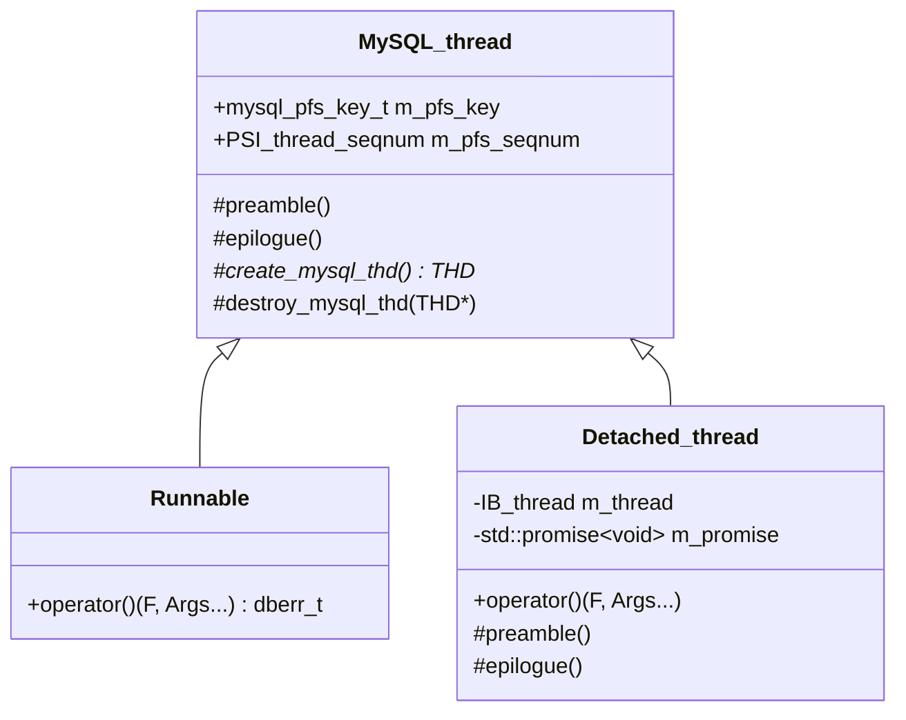
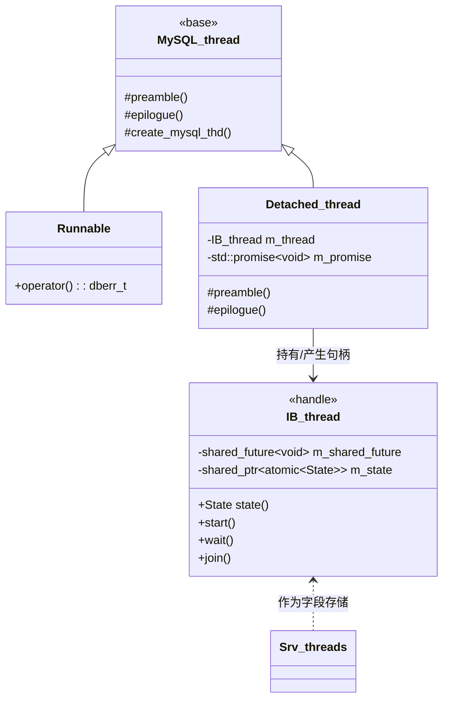

# 线程生命周期深度解析（创建 · 注册 · 停止 · 回收）

> 基于 MySQL 8.0.39 源码，纵向贯穿**四个层次**的线程原语：`pthread_create`/`_beginthreadex` → mysys `my_thread_create` → server/PSI `mysql_thread_create`（宏）→ InnoDB `IB_thread` 体系；并覆盖线程"生、活、死"三阶段：创建与启动分离、TLS 与 PSI 注册、停止协议与回收。
>
> **边界**：本篇讲**线程是怎么被创建出来、注册进系统、又被停掉回收的**——即线程机制本身。
> 各类线程在做什么另立：[`threading_architecture.md`](threading_architecture.md)（全栈线程全景）、[`connection_threading.md`](connection_threading.md)（连接线程 Per_thread 模型）、[`thread_pool.md`](thread_pool.md)（线程池调度）、[`thd.md`](thd.md)（THD 对象与 `ha_data`）。
> 线程的**同步与等待原语**（`os_event` / `mysql_cond_t` / latch）属锁域，见 [`../lock/primitives/innodb_sync.md`](../lock/primitives/innodb_sync.md) 与 [`../lock/primitives/mysys_primitives.md`](../lock/primitives/mysys_primitives.md)；本篇只在"停止协议"处交代它们如何被用于唤醒。

## 目录

- [概述](#概述)
- [理论基础](#理论基础)
- [核心实现](#核心实现)
- [★ 本机制里的工程实现技法](#-本机制里的工程实现技法)
- [可观测性](#可观测性)
- [Misc](#misc)
- [参考](#参考)

---

## 概述

### 是什么

MySQL 里"创建一个线程"这件事，**没有任何一处是直接调 `pthread_create` 的业务代码**。它被包了四层：

| 层 | 原语 | 所在 | 加的东西 |
|---|---|---|---|
| 0 | `pthread_create` / `_beginthreadex` | OS | — |
| 1 | `my_thread_create` | mysys | 跨平台统一、detach/joinable 属性 |
| 2 | `mysql_thread_create`（**宏**） | PSI 头 | PSI 线程插桩（可编译期关掉） |
| 3 | `os_thread_create`（**宏**）→ `create_detached_thread` | InnoDB | `std::thread` 封装、状态机、线程计数、`preamble`/`epilogue` |

反直觉的第一件事：**第 2 层和第 3 层的入口都是宏，不是函数。**

```c
/* include/mysql/psi/mysql_thread.h */
#define mysql_thread_create(K, P1, P2, P3, P4) \
  inline_mysql_thread_create(K, 0, P1, P2, P3, P4)

/* storage/innobase/include/os0thread-create.h */
#ifdef UNIV_PFS_THREAD
#define os_thread_create(...) create_detached_thread(__VA_ARGS__)
#else
#define os_thread_create(k, s, ...) create_detached_thread(0, 0, __VA_ARGS__)
#endif
```

这解释了一个常见困惑：为什么在源码里 grep `os_thread_create` 只能找到调用点、找不到定义——因为它根本不是函数。同理 `mysql_thread_create`。

反直觉的第二件事：**InnoDB 的"detached 线程"其实是可以 `join()` 的。** `std::thread::detach()` 之后原生句柄就丢了，按标准无法再 join；InnoDB 用一个 `std::promise<void>` 把"线程结束"这件事重新暴露成 future，于是 `IB_thread::join()` 依然成立。这个技巧是理解 InnoDB 线程体系的钥匙。

反直觉的第三件事：**创建 ≠ 启动。** `create_detached_thread()` 返回的是一个**尚未开始执行**的线程句柄，必须再显式 `start()`。这个"两段式"不是冗余，而是被并发正确性逼出来的（见「创建与启动分离」）。

### 用途

这套分层解决四件各自独立的事：

1. **跨平台**：Unix 是 pthread，Windows 是 `_beginthreadex`（不是 `CreateThread`）+ HANDLE 语义，两者资源回收规则完全不同——必须有一层抹平。
2. **可观测**：PFS 要知道每个线程的创建/销毁才能记账，但**不插桩时必须零开销**——用宏在编译期分流。
3. **线程注册**：MySQL 的 mysys 层有大量线程局部状态（`my_thread_init`/`my_thread_end`），新线程**必须**先初始化它，否则 DBUG、错误号、TLS 全错。
4. **生命周期可查询**：InnoDB 需要在 shutdown 时知道"这个线程还在跑吗"——于是有了 `IB_thread` 五态机。

### 版本演进

| 版本 | 变化 |
|---|---|
| 5.7 | InnoDB 线程创建基于 **pthread**（`os_thread_create` 是函数）；server 侧同样是 `mysql_thread_create` 宏 → pthread |
| 8.0 | **InnoDB 线程创建迁移到 `std::thread`**：引入 `IB_thread` / `MySQL_thread` / `Runnable` / `Detached_thread` 一套 C++ 封装，`os_thread_create` 退化为指向 `create_detached_thread` 的宏。这是 8.0 最彻底的 C++ 化之一 |
| 8.0.x | 状态判定从 `shared_future.wait_for(0)` 改为 `std::atomic<State>` 状态机（**实测驱动**：MTR 从 63 分钟降到 75 分钟的反面教训，见 Misc） |
| 26.7 | 线程池进社区版后，server 侧线程创建仍是 `mysql_thread_create`，但**线程与 THD 的绑定关系变成动态的**（`store_globals`/`restore_globals` 每次调度都要做），见 [`thd.md`](thd.md) |

> 演进主线：**从"调个 pthread 就完事"演进到"创建—注册—启动—停止—回收"全程可管可查**。驱动因素是 shutdown 正确性与可观测性，不是性能。

---

## 理论基础

### 设计思想与权衡

#### 权衡一：为什么 InnoDB 要自己再包一层 C++（而不直接用 `mysql_thread_create`）？

InnoDB 有三个需求是 mysys 层满足不了的：

1. **线程计数与上限**：`os_thread_count` 要精确统计活跃线程数，并在超过 `srv_max_n_threads` 时断言失败——这需要包在 preamble/epilogue 里。
2. **状态可查询**：shutdown 要问"这个线程还在吗"。pthread 句柄做不到（detach 后更是彻底丢失）。
3. **要能创建 THD**：InnoDB 后台线程访问 server 层设施（DD、权限、审计）需要 THD，于是封装里直接提供 `create_mysql_thd()`。

代价：**两套并存的线程创建体系**。server 侧用 `mysql_thread_create`，InnoDB 侧用 `os_thread_create`——二者不共享封装，只有最底层的 `my_thread_create` 是公共的。这就是为什么"MySQL 线程"没有一个统一的线程对象：server 侧线程靠 THD 标识，InnoDB 侧靠 `IB_thread`。

#### 权衡二：为什么要"创建与启动分离"（two-phase）？

`create_detached_thread` 创建线程后立即 `detach()`，线程体做的第一件事是**自旋等待状态变为 `ALLOWED_TO_START`**：

```cpp
  template <typename F, typename... Args>
  void operator()(F &&f, Args &&... args) {
    while (m_thread.state() == IB_thread::State::NOT_STARTED) {
      UT_RELAX_CPU();
    }
    ut_a(m_thread.state() == IB_thread::State::ALLOWED_TO_START);
    preamble();
    m_thread.set_state(IB_thread::State::STARTED);
    std::invoke(std::forward<F>(f), std::forward<Args>(args)...);
    epilogue();
    m_thread.set_state(IB_thread::State::STOPPED);
  }
```

为什么要这样？因为调用方是这么用的（典型模式，如 `Srv_threads` 的字段赋值）：

```
auto worker = os_thread_create(pfs_key, i, f, b, e, i, args...);   // ① 创建（未启动）
worker.start();                                                     // ② 启动
workers.push_back(std::move(worker));                               // ③ 存句柄
```

**如果不分离**：线程 ① 创建后立刻跑，可能在 ③ 把句柄存进字段之前就跑完并销毁了——调用方拿到的句柄指向已死线程，且无法再 `join()`。分离后，创建者有充足时间把句柄安放好，再 `start()` 放它走。

代价：**每个 detached 线程启动时都要自旋一小段**（`UT_RELAX_CPU()` 忙等）。这是对生命周期正确性的付费——用一次短暂的忙等换"句柄绝不丢失"。

#### 权衡三：PSI 插桩为什么用宏而不是函数？

```c
static inline int inline_mysql_thread_create(
    PSI_thread_key key [[maybe_unused]],
    unsigned int sequence_number [[maybe_unused]], my_thread_handle *thread,
    const my_thread_attr_t *attr, my_start_routine start_routine, void *arg) {
  int result;
#ifdef HAVE_PSI_THREAD_INTERFACE
  result = PSI_THREAD_CALL(spawn_thread)(key, sequence_number, thread, attr,
                                         start_routine, arg);
#else
  result = my_thread_create(thread, attr, start_routine, arg);
#endif
  return result;
}
```

用宏 + `inline` 函数，让 `HAVE_PSI_THREAD_INTERFACE` 在**编译期**就把分支消掉：不开 PFS 时，`mysql_thread_create(...)` 直接变成 `my_thread_create(...)`，PSI 参数被 `[[maybe_unused]]` 吞掉，运行期零判断。

**代价 / 失效场景**：宏不是函数，所以**不能取地址、不能作为函数指针传递、在调试器里看不到这个符号**。这也导致 grep 时容易误判"这个函数不存在"。同理 `os_thread_create`。

#### 权衡四：detached 线程为什么还要能 join？

`std::thread::detach()` 的语义是"放弃对线程的控制"。但 InnoDB 的 shutdown 必须能等待后台线程结束。

| 方案 | 评价 |
|---|---|
| 用 joinable 线程，保留所有 `std::thread` 对象 | 需要长期持有对象；且 `Srv_threads` 是值语义结构体，存 `std::thread` 会引入不可拷贝性 |
| **detach + promise/future 自己实现 join** | InnoDB 选这个。`IB_thread` 因此是**可拷贝的轻量句柄**（`shared_ptr` + `shared_future`），可以放进结构体字段、可以 move |

代价：多一个 `std::promise<void>` 的分配与引用计数；且"真 detach"和"逻辑 join"并存，语义上有轻微分裂——线程资源在 `epilogue` 后即释放，但 future 仍可被等待。

### 理论溯源

| 理论 / 模式 | 源码落点 | 说明 |
|---|---|---|
| **RAII / Scope guard** | `MySQL_thread::preamble()` / `epilogue()` | 线程函数的首尾配对：`my_thread_init` ↔ `my_thread_end`、PSI `new_thread` ↔ `delete_current_thread`、`os_thread_count` +1 ↔ -1 |
| **Future/Promise 作为完成通知** | `Detached_thread::m_promise` + `IB_thread::m_shared_future` | 把"线程结束"从原生句柄转成可等待的 future，使 detached 线程仍可 join |
| **Two-phase construction**（创建与启动分离） | `create_detached_thread` + `IB_thread::start()` | 先建后启，保证句柄先落地 |
| **Fork-join 并行** | `par_for` | 教科书 fork-join：n 个 worker + 调用方自己干最后一段 |
| **Spin-then-proceed 握手** | `while (state == NOT_STARTED) UT_RELAX_CPU();` | 用忙等完成创建者与新建线程之间的启动握手 |
| **条件编译的零开销抽象** | `inline_mysql_thread_create` 的 `#ifdef` | 编译期分流，运行期零分支 |

### 算法与数据结构

| 结构 | 选择理由 | 复杂度 |
|---|---|---|
| `IB_thread`（`shared_ptr<atomic<State>>` + `shared_future<void>`） | 需要**可拷贝的轻量句柄**：能放进结构体字段、能 move、多处能查状态 | 状态查询 `O(1)`；拷贝只是引用计数 |
| 五态枚举 `INVALID/NOT_STARTED/ALLOWED_TO_START/STARTED/STOPPED` | 覆盖"创建前→已建未启→已启→已停"全生命周期，且能区分"未赋值"（`INVALID`） | `O(1)` |
| `std::atomic<State>` | 状态被创建者与线程体并发读写 | 原子 load/store |
| `std::atomic_int os_thread_count` + `relaxed` | 计数只需趋势正确，用于断言与 warning，不参与同步 | `O(1)` |
| `std::promise<void>` | 一次性完成通知，天然匹配"线程结束"这一事件 | `O(1)` |

`IB_thread` 的完整定义：

```cpp
class IB_thread {
 public:
  enum class State { INVALID, NOT_STARTED, ALLOWED_TO_START, STARTED, STOPPED };

  State state() const {
    return (m_state == nullptr ? State::INVALID : m_state->load());
  }

  void start();
  void wait(State state_to_wait_for = State::STOPPED);
  void join();

 private:
  std::shared_future<void> m_shared_future;
  std::shared_ptr<std::atomic<State>> m_state;

  void init(std::promise<void> &promise);
  void set_state(State state);

  friend class Detached_thread;
};
```

注意 `m_state == nullptr ? State::INVALID : ...`——**空指针被赋予语义**（"这个句柄还没被赋值"），于是 `IB_thread` 默认构造后是合法对象，可以直接放进结构体。

### 他库对比与演进动机

| 维度 | MySQL 8.0.39 | PostgreSQL | MariaDB / Percona |
|---|---|---|---|
| 线程/进程模型 | 线程（server + InnoDB 各自封装） | **进程**（fork），无线程创建封装 | 同 MySQL（同源） |
| 引擎侧封装 | `IB_thread` + promise 模拟 join | 无 | 5.5~10.x 仍是 pthread 封装，8.0 系的 Percona 与 MySQL 8.0 同构 |
| 可观测挂钩 | PSI 宏层（编译期可关） | 无对等机制 | 同 MySQL |

**为什么要演进成今天这样**：5.7 时代 InnoDB 直接管 pthread 句柄，shutdown 时判断线程状态只能靠自定义标志位，散落在各线程实现里，既重复又容易漏。8.0 把"状态机 + 计数 + 注册"统一收敛进 `IB_thread`/`MySQL_thread`，shutdown 路径才可能做成表驱动（见 [`threading_architecture.md`](threading_architecture.md) 的 shutdown 九阶段）。

---

## 核心实现

### 主链路

从业务代码到 OS 的完整调用链（创建侧）：

```
【server 侧】
mysql_thread_create(key, &thread, &attr, func, arg)      ← 宏
  → inline_mysql_thread_create(key, 0, ...)
      ├─ HAVE_PSI_THREAD_INTERFACE 开：PSI_THREAD_CALL(spawn_thread)(...)
      │    → pfs_spawn_thread 包装器 → my_thread_create
      └─ 关：my_thread_create(...)
           ├─ Unix：pthread_create
           └─ Windows：_beginthreadex（detached 立刻 CloseHandle）

【InnoDB 侧】
os_thread_create(pfs_key, seqnum, f, args...)            ← 宏
  → create_detached_thread(pfs_key, seqnum, f, args...)
      → Detached_thread{pfs_key, seqnum}         构造（状态 NOT_STARTED，promise 已建）
      → std::thread t(std::move(detached_thread), f, args...)
      → t.detach()                               立刻放弃原生句柄
      → 返回 IB_thread 句柄（未启动）
  → 调用方 .start()                               状态 NOT_STARTED → ALLOWED_TO_START
      → 线程体自旋结束 → preamble() → STARTED → std::invoke(f, args...)
        → epilogue() → STOPPED
```

配图（四层与三阶段）：

```
        ┌─────────── 业务代码（server 后台线程 / InnoDB 后台线程）───────────┐
        │                                                                    │
   server 侧                                                        InnoDB 侧
        │                                                                    │
 mysql_thread_create (宏)                                  os_thread_create (宏)
        │                                                                    │
 inline_mysql_thread_create                                  create_detached_thread
        │                                                                    │
   PSI spawn_thread  或  ──────────┐              ┌─── Detached_thread / Runnable
        │                          │              │         (std::thread)
        ▼                          ▼              ▼
   ┌──────────────────────────────────────────────────────┐
   │  my_thread_create（mysys：跨平台 + detach/joinable）  │
   └──────────────────────────────────────────────────────┘
        │                                    │
    Unix: pthread_create            Windows: _beginthreadex
```

### 创建原语：从 pthread 到 IB_thread

#### mysys 层：`my_thread_create` 与跨平台分叉

```cpp
int my_thread_create(my_thread_handle *thread, const my_thread_attr_t *attr,
                     my_start_routine func, void *arg) {
#ifndef _WIN32
  return pthread_create(&thread->thread, attr, func, arg);
#else
  struct thread_start_parameter *par;
  unsigned int stack_size;

  par = (struct thread_start_parameter *)malloc(sizeof(*par));
  if (!par) goto error_return;

  par->func = func;
  par->arg = arg;
  stack_size = attr ? attr->dwStackSize : 0;

  thread->handle =
      (HANDLE)_beginthreadex(NULL, stack_size, win_thread_start, par, 0,
                             (unsigned int *)&thread->thread);

  if (thread->handle) {
    /* Note that JOINABLE is default, so attr == NULL => JOINABLE. */
    if (attr && attr->detachstate == MY_THREAD_CREATE_DETACHED) {
      /*
        Close handles for detached threads right away to avoid leaking
        handles. For joinable threads we need the handle during
        my_thread_join. It will be closed there.
      */
      CloseHandle(thread->handle);
      thread->handle = NULL;
    }
    return 0;
  }

  my_osmaperr(GetLastError());
  free(par);

error_return:
  thread->thread = 0;
  thread->handle = NULL;
  return 1;
#endif
}
```

三个必须注意的点：

1. **Windows 用 `_beginthreadex` 而不是 `CreateThread`**——CRT（C runtime）有自己的线程局部状态，`CreateThread` 创建的线程在调用某些 CRT 函数时会泄漏或出错。这是 Windows C 编程的经典约束。
2. **detached 线程立即 `CloseHandle`**——注释原话 "avoid leaking handles"。Windows 的线程句柄是内核对象，不关会累积；joinable 的必须留着（join 要用），所以延后到 `my_thread_join` 里关。
3. **`attr == NULL` 意味着 JOINABLE**——注释明写。所以"不传属性"不是"默认 detached"，而是相反。这与 InnoDB 的"detached 是常态"形成对比（见下）。

#### server/PSI 层：`mysql_thread_create` 是宏不是函数

```c
#define mysql_thread_create(K, P1, P2, P3, P4) \
  inline_mysql_thread_create(K, 0, P1, P2, P3, P4)
#define mysql_thread_create_seq(K, S, P1, P2, P3, P4) \
  inline_mysql_thread_create(K, S, P1, P2, P3, P4)
```

带 `_seq` 的版本多一个 sequence number（`S`），用于给同类线程编号（如线程池里的第 N 个线程）。展开后：

```cpp
static inline int inline_mysql_thread_create(
    PSI_thread_key key [[maybe_unused]],
    unsigned int sequence_number [[maybe_unused]], my_thread_handle *thread,
    const my_thread_attr_t *attr, my_start_routine start_routine, void *arg) {
  int result;
#ifdef HAVE_PSI_THREAD_INTERFACE
  result = PSI_THREAD_CALL(spawn_thread)(key, sequence_number, thread, attr,
                                         start_routine, arg);
#else
  result = my_thread_create(thread, attr, start_routine, arg);
#endif
  return result;
}
```

`[[maybe_unused]]` 是这个设计的关键：不开 PFS 时 `key` 和 `sequence_number` 完全没被使用，没有它编译器会警告。加上之后，同一个函数签名在两种编译配置下都干净。

同一族里还有两个"事后补充 PSI 信息"的宏，它们揭示了 server 侧线程与 THD 的关系：

```cpp
static inline void inline_mysql_thread_set_psi_id(my_thread_id id [[maybe_unused]]) {
#ifdef HAVE_PSI_THREAD_INTERFACE
  struct PSI_thread *psi = PSI_THREAD_CALL(get_thread)();
  PSI_THREAD_CALL(set_thread_id)(psi, id);
#endif
}

#ifdef __cplusplus
class THD;
static inline void inline_mysql_thread_set_psi_THD(THD *thd [[maybe_unused]]) {
#ifdef HAVE_PSI_THREAD_INTERFACE
  struct PSI_thread *psi = PSI_THREAD_CALL(get_thread)();
  PSI_THREAD_CALL(set_thread_THD)(psi, thd);
#endif
}
#endif /* __cplusplus */
```

`inline_mysql_thread_set_psi_THD` 把 **THD 挂到 PSI 线程对象上**——这正是 PFS 表里能按 THD 关联线程的技术来源。注意它用 `class THD;` 前向声明，避免在公开头里引入 `sql_class.h`（与 [`thd.md`](thd.md) 里讲的 ABI 隔离是同一套纪律）。

#### InnoDB 层：`IB_thread` / `MySQL_thread` / `Runnable` / `Detached_thread`

三个类构成一个小继承体系：



**`MySQL_thread` 是基类**，只做两件事：持有 PSI key，提供 `preamble`/`epilogue` 这对注册钩子：

```cpp
  /** Register the thread with the server */
  void preamble() {
    const bool ret = my_thread_init();
    ut_a(!ret);

#if defined(UNIV_PFS_THREAD) && !defined(UNIV_HOTBACKUP)
    if (m_pfs_key.m_value != PFS_NOT_INSTRUMENTED.m_value) {
      auto &value = m_pfs_key.m_value;
      auto psi = PSI_THREAD_CALL(new_thread)(value, m_pfs_seqnum, this, 0);

      PSI_THREAD_CALL(set_thread_os_id)(psi);
      PSI_THREAD_CALL(set_thread)(psi);
    }
#endif
  }

  /** Deregister the thread */
  void epilogue() {
    my_thread_end();

#if defined(UNIV_PFS_THREAD) && !defined(UNIV_HOTBACKUP)
    if (m_pfs_key.m_value != PFS_NOT_INSTRUMENTED.m_value) {
      PSI_THREAD_CALL(delete_current_thread)();
    }
#endif
  }

  /** @return a THD instance. */
  THD *create_mysql_thd() noexcept {
#ifdef UNIV_PFS_THREAD
    return create_thd(false, true, true, m_pfs_key.m_value, m_pfs_seqnum);
#else
    return create_thd(false, true, true, 0, 0);
#endif
  }

  void destroy_mysql_thd(THD *thd) noexcept { destroy_thd(thd); }
```

- `my_thread_init()` 返回**非 0 表示失败**（`ut_a(!ret)`），初始化 mysys 的线程局部状态。
- PSI 注册有三步：`new_thread` → `set_thread_os_id` → `set_thread`。
- `PFS_NOT_INSTRUMENTED` 时不注册——又是编译期/运行期双重分流的零开销思路。
- **`create_mysql_thd()` 是 InnoDB 能访问 server 层设施的根**：后台线程要读 DD、要过权限、要被审计，都得有 THD。这是"THD 横跨两层"最硬的证据（详见 [`thd.md`](thd.md)）。

**`Runnable` 是 joinable 版本**，最朴素：

```cpp
class Runnable : public MySQL_thread {
 public:
  template <typename F, typename... Args>
  dberr_t operator()(F &&f, Args &&... args) {
    MySQL_thread::preamble();
    auto r = std::invoke(std::forward<F>(f), std::forward<Args>(args)...);
    MySQL_thread::epilogue();
    return r;
  }
};
```

没有状态机、没有 detach、没有 promise——因为它由 `std::thread` 直接持有，可以原生 join。

**`Detached_thread` 是 detached 版本**，状态机 + promise 都在这里：

```cpp
class Detached_thread : public MySQL_thread {
 public:
  template <typename F, typename... Args>
  void operator()(F &&f, Args &&... args) {
    while (m_thread.state() == IB_thread::State::NOT_STARTED) {
      UT_RELAX_CPU();
    }
    ut_a(m_thread.state() == IB_thread::State::ALLOWED_TO_START);
    preamble();
    m_thread.set_state(IB_thread::State::STARTED);
    std::invoke(std::forward<F>(f), std::forward<Args>(args)...);
    epilogue();
    m_thread.set_state(IB_thread::State::STOPPED);
  }

  IB_thread thread() const { return (m_thread); }

 private:
  void init() { m_thread.init(m_promise); }

  /** Register the thread with the server */
  void preamble() {
    MySQL_thread::preamble();
    std::atomic_thread_fence(std::memory_order_release);
    auto old = os_thread_count.fetch_add(1, std::memory_order_relaxed);
    ut_a(old <= static_cast<int>(srv_max_n_threads) - 1);
  }

  /** Deregister the thread */
  void epilogue() {
    m_promise.set_value();
    std::atomic_thread_fence(std::memory_order_release);
    auto old = os_thread_count.fetch_sub(1, std::memory_order_relaxed);
    ut_a(old > 0);
    MySQL_thread::epilogue();
  }

 private:
  /** Future object which keeps the ref counter >= 1 at least
  as long as the Detached_thread is not-destroyed. */
  mutable IB_thread m_thread;
  /** Promise which is set when task is done. */
  std::promise<void> m_promise;
};
```

四个细节值得逐个说：

1. **`UT_RELAX_CPU()` 忙等**——新建线程在等 `start()`。这是"创建与启动分离"的另一半（创建者那边是 `start()`，线程这边是自旋）。
2. **`preamble` 里的 release fence**——确保 `MySQL_thread::preamble()` 的注册动作（mysys TLS + PSI）在 `os_thread_count` 递增**之前**对其他线程可见。顺序反了的话，别的线程可能看到计数已增但线程尚未注册完成。
3. **`ut_a(old <= srv_max_n_threads - 1)`**——线程数上限的硬断言。超过 `srv_max_n_threads` 直接崩（debug 下 assert，release 下 `ut_a` 的行为取决于构建）。
4. **`m_promise.set_value()` 在 `epilogue` 开头**（而不是末尾）——设值之后仍要跑 `os_thread_count` 递减和 `MySQL_thread::epilogue()`。这意味着 **`join()` 返回后线程可能还有收尾动作未完成**。这是有意的：future 表达的是"任务已完成"，不是"资源已回收"。

#### ★ 创建与启动分离（two-phase）为什么必须

`create_detached_thread` 的完整实现：

```cpp
template <typename F, typename... Args>
IB_thread create_detached_thread(mysql_pfs_key_t pfs_key,
                                 PSI_thread_seqnum pfs_seqnum, F &&f,
                                 Args &&... args) {
  Detached_thread detached_thread{pfs_key, pfs_seqnum};
  auto thread = detached_thread.thread();

  std::thread t(std::move(detached_thread), f, args...);
  t.detach();

  /* Thread t is doing busy waiting until the state is changed
  from NOT_STARTED to ALLOWED_TO_START. That will happen when
  thread.start() will be called. */
  ut_a(thread.state() == IB_thread::State::NOT_STARTED);

  return thread;
}
```

注意 `std::thread t(std::move(detached_thread), f, args...)`——**`Detached_thread` 对象本身就是可调用物**（有 `operator()`），被 move 进 `std::thread` 作为线程体。这是"把执行器对象整体搬进线程"的写法，而不是传函数指针 + `void*`。

再看 `thread_is_active()` 的注释，它解释了 `ALLOWED_TO_START` 为什么必须算"活跃"：

```cpp
inline bool thread_is_active(const IB_thread &thread) {
  switch (thread.state()) {
    case IB_thread::State::NOT_STARTED:
      /* Not yet started. */
      return false;

    case IB_thread::State::ALLOWED_TO_START:
      /* Thread "thread" is already active, but start() has not been called.
      Note that when start() is called, the thread's routine may decide to
      check if it is active or trigger other thread to do similar check
      regarding "thread". That could happen faster than thread's state
      is advanced from ALLOWED_TO_START to STARTED. Therefore we must
      already consider such thread as "active". */
      return true;

    case IB_thread::State::STARTED:
      /* Note, that potentially the thread might be doing its cleanup after
      it has already ended its task. We still consider it active, until the
      cleanup is finished. */
      return true;

    case IB_thread::State::STOPPED:
      return false;

    case IB_thread::State::INVALID:
    default:
      return false;
  }
  /* Note that similar goal was achieved by the usage of shared_future:
  return (shared_future.valid() && shared_future.wait_for(std::chrono::seconds(
                                       0)) != std::future_status::ready);
  However this resulted in longer execution of mtr tests (63minutes ->
  75minutes). You could try `mtr --mem collations.esperanto` (cmake
  WITH_DEBUG=1) */
}
```

两条都很关键：

- **`ALLOWED_TO_START` 算活跃**：因为 `start()` 之后，线程体可能比"状态推进到 `STARTED`"更快地去查询别人的状态。如果把 `ALLOWED_TO_START` 判为不活跃，就会出现"已 start 但被认为没跑"的窗口。
- **`STARTED` 也算活跃直到 cleanup 完成**：任务跑完了但在收尾（epilogue），此时仍算活跃——因为资源还没还。

末尾那段注释是**一份实测记录**：早期用 `shared_future.wait_for(0)` 判断活跃性，导致 MTR 从 63 分钟变成 75 分钟（+19%），于是改成 `atomic<State>` 状态机。这是"性能实测驱动设计改动"的教科书级注释，还贴心地留了复现命令。

### 活着：线程注册与 TLS

一个线程被创建出来之后、执行业务逻辑之前，必须完成三件注册：

| 注册项 | 函数 | 作用 |
|---|---|---|
| mysys TLS | `my_thread_init()` | 初始化 mysys 的线程局部状态（DBUG、错误号、内存分配器等）；**漏了会导致后续所有 mysys 调用行为异常** |
| PSI 线程对象 | `PSI_THREAD_CALL(new_thread)` + `set_thread_os_id` + `set_thread` | 让 PFS 能看见这个线程并记账 |
| InnoDB 线程计数 | `os_thread_count.fetch_add(1)` | 供 `os_thread_any_active()` 与上限断言使用 |

三者全部集中在 `MySQL_thread::preamble()` 里，配对的反操作在 `epilogue()` 里——**RAII 式的首尾配对**，只不过因为跨了"线程函数的整个生命周期"，没法用构造函数/析构函数表达，只能写成显式两个钩子。

`os_thread_count` 的声明与两个辅助函数：

```cpp
extern std::atomic_int os_thread_count;

inline bool os_thread_any_active() {
  return os_thread_count.load(std::memory_order_relaxed) > 0;
}

inline void os_thread_close() {
  ...
    ib::warn(ER_IB_MSG_1274, os_thread_count.load(std::memory_order_relaxed));
  ...
}
```

`os_thread_close()` 在还有线程没停时打 warning 并报告数量——这是 shutdown 路径上的兜底告警（详见 [`threading_architecture.md`](threading_architecture.md) 的 shutdown 九阶段）。

### 死亡：停止协议与回收

#### detach / join / cancel 的跨平台差异

```cpp
int my_thread_join(my_thread_handle *thread, void **value_ptr) {
#ifndef _WIN32
  return pthread_join(thread->thread, value_ptr);
#else
  (void)value_ptr;  // maybe unused
  DWORD ret;
  int result = 0;
  ret = WaitForSingleObject(thread->handle, INFINITE);
  if (ret != WAIT_OBJECT_0) {
    my_osmaperr(GetLastError());
    result = 1;
  }
  if (thread->handle) CloseHandle(thread->handle);
  thread->thread = 0;
  thread->handle = NULL;
  return result;
#endif
}

int my_thread_cancel(my_thread_handle *thread) {
#ifndef _WIN32
  return pthread_cancel(thread->thread);
#else
  bool ok = false;
  if (thread->handle) {
    ok = TerminateThread(thread->handle, 0);
    CloseHandle(thread->handle);
  }
  if (ok) return 0;
  errno = EINVAL;
  return -1;
#endif
}
```

| 操作 | Unix | Windows |
|---|---|---|
| join | `pthread_join` | `WaitForSingleObject(INFINITE)` + `CloseHandle` |
| cancel | `pthread_cancel` | **`TerminateThread`** |

`TerminateThread` 是 Windows 上公认的危险 API——它不给线程清理机会（不跑析构、不释放锁、TLS 不清理）。MySQL 在 Windows 上用它只是保持接口对称，**正常路径不走 cancel**（停止靠协作式协议，见下）。

#### 协作式停止协议（不是 kill）

MySQL 停止一个后台线程的标准模式**不是** `my_thread_cancel`，而是**协作式**：

```
1. 设置停止标志（如 srv_shutdown_state 或线程专属 flag）
2. 唤醒线程：os_event_set(该线程等待的 event)      ← 线程正阻塞在等待上
3. 等待线程自己走到退出点：IB_thread::join() / wait(STOPPED)
4. 线程体：醒来 → 检查标志 → 退出循环 → 跑 epilogue → 状态置 STOPPED
```

这就是为什么"等待原语"在本篇会出场：停止协议依赖"能唤醒阻塞中的线程"。InnoDB 侧靠 `os_event_set`（见 [`../lock/primitives/innodb_sync.md`](../lock/primitives/innodb_sync.md)），server 侧靠 `mysql_cond_broadcast`。

`IB_thread` 提供两种等待方式：

```cpp
  void wait(State state_to_wait_for = State::STOPPED);
  void join();
```

`wait()` 可以等任意一个状态（默认等 `STOPPED`），`join()` 等价于等"任务完成"（即 `m_promise` 被 set）。

**停止协议最容易踩的坑**：如果线程阻塞在一个**没有对应唤醒源**的等待上（纯超时等待、或事件被漏发），`join()` 就会一直挂着。源码里 `compress_gtid_table` 就是一个特例——它被注明为"纯事件驱动、无超时兜底"，signal 丢失会睡到 shutdown（详见 [`threading_architecture.md`](threading_architecture.md)）。

### 批量与并行：`par_for` 的 fork-join

```cpp
template <typename Container, typename F, typename... Args>
void par_for(mysql_pfs_key_t pfs_key, const Container &c, size_t n, F &&f,
             Args &&... args) {
  if (c.empty()) {
    return;
  }

  size_t slice = (n > 0) ? c.size() / n : 0;

  using Workers = std::vector<IB_thread>;
  Workers workers;
  workers.reserve(n);

  for (size_t i = 0; i < n; ++i) {
    auto b = c.begin() + (i * slice);
    auto e = b + slice;
    auto worker = os_thread_create(pfs_key, i, f, b, e, i, args...);
    worker.start();
    workers.push_back(std::move(worker));
  }

  f(c.begin() + (n * slice), c.end(), n, args...);

  for (auto &worker : workers) {
    worker.join();
  }
}
```

标准 fork-join，两个细节：

1. **调用线程自己干最后一段**：`f(c.begin() + (n * slice), c.end(), n, args...)`——不浪费一个 worker 线程，主线程也参与计算。
2. **创建-启动-存入的顺序是固定的**：`os_thread_create` → `start()` → `push_back`。这正是"两段式"存在的理由——如果创建后自动启动，`push_back` 之前线程可能已经跑完。

`n == 0` 时 `slice = 0`，于是循环不建线程，主线程用 `f(c.begin(), c.end(), 0, args...)` 干全部——**线程数为 0 就退化成串行**，这个退化路径让"并行读"在配置关闭时仍能正确工作。

`par_for` 也有一层 PSI 宏包装：

```cpp
#if defined(UNIV_PFS_THREAD) && !defined(UNIV_HOTBACKUP)
#define par_for(...) par_for(__VA_ARGS__)
#else
#define par_for(k, ...) par_for(0, __VA_ARGS__)
#endif
```

### DETACHED vs JOINABLE 全景

| 层 | 默认 | 谁选 detached | 谁选 joinable | 原因 |
|---|---|---|---|---|
| mysys `my_thread_create` | **JOINABLE**（`attr == NULL` 时） | 连接线程 | — | 注释明写 "JOINABLE is default" |
| server 连接线程 | **DETACHED** | 连接线程 | — | 线程缓存复用靠条件变量，不需要 join（详见 [`connection_threading.md`](connection_threading.md)） |
| InnoDB `Detached_thread` | **DETACHED** | 绝大多数后台线程 | — | 句柄进 `Srv_threads` 字段，需可拷贝；靠 promise 补 join 能力 |
| InnoDB `Runnable` | JOINABLE | — | 需要返回值的临时线程 | `operator()` 返回 `dberr_t` |
| `signal_hand` (server) | **JOINABLE** | — | 信号处理线程 | 全栈唯一 JOINABLE 的常驻线程（详见 [`threading_architecture.md`](threading_architecture.md)） |

Windows 上的资源含义不同：detached 立即关句柄（不泄漏），joinable 留到 join 时关。**忘记 join 一个 joinable 线程在 Windows 上会泄漏内核句柄**，Unix 上则是泄漏线程资源（pthread 的 joinable 线程结束后资源不释放直到被 join）。

---

## ★ 本机制里的工程实现技法

### 一、C++ 特性

| 特性 | 用在哪 | 为什么（收益） | 代价 / 反直觉处 |
|---|---|---|---|
| **可变参数模板 + 完美转发** | `create_detached_thread(F &&f, Args &&... args)`、`std::invoke(std::forward<F>(f), std::forward<Args>(args)...)` | 任意可调用物 + 任意参数，无类型擦除开销 | 编译错误信息极长；模板必须在头文件（也是它这么长的原因） |
| **`std::move` 对象进 `std::thread`** | `std::thread t(std::move(detached_thread), f, args...)` | 执行器对象（含 promise）整体搬进线程 | 对象必须可移动；`m_promise` 不能拷贝，只能 move |
| **`shared_ptr` + `shared_future` 做可拷贝句柄** | `IB_thread` | 让"线程句柄"能放进结构体字段、能拷贝多份 | 每次拷贝是引用计数操作；状态实际共享 |
| **`std::promise<void>` 做一次性完成通知** | `Detached_thread::m_promise` | 使 detached 线程仍可 join | `set_value()` 只能调一次；调两次会抛异常 |
| **`atomic_thread_fence(release)`** | `Detached_thread::preamble/epilogue` | 保证注册动作先于计数变化对其他线程可见 | 容易被误删（看起来"多余"，实际防的是重排序） |
| **`std::atomic` + `relaxed`** | `os_thread_count` | 计数只需趋势正确，不需要同步语义，省掉屏障开销 | 不能用于任何需要"读到即生效"的场合 |
| **`[[maybe_unused]]`** | `inline_mysql_thread_create` 的 PSI 参数 | 条件编译下参数可能未使用，消除警告 | 掩盖了"这个参数真的没用"的语义 |
| **宏包装函数** | `mysql_thread_create` / `os_thread_create` | 编译期分流 + 隐藏 PSI 参数 | **不能取地址、不能做函数指针、grep 不到定义** |
| **空指针赋予语义** | `m_state == nullptr ? State::INVALID : ...` | 让默认构造的 `IB_thread` 是合法对象 | 需要记得判空，否则空指针解引用 |

**C 与 C++ 的边界**：`my_thread_init()` / `my_thread_end()` 是 `extern "C"`（见 `include/my_thread.h`），因为 mysys 层是 C 风格的；而 InnoDB 的封装是纯 C++。边界就在 `MySQL_thread::preamble()` 里那句 `my_thread_init()`——C++ 侧调用 C 侧的 TLS 初始化。

### 二、经典算法的实现落地

#### Fork-join（`par_for`）

| 维度 | 教科书原型 | 本实现的落地 | 差异原因 / 代价 |
|---|---|---|---|
| 任务划分 | 动态调度（work stealing） | **静态等分**：`slice = c.size() / n` | 任务粒度均匀（都是同构数据块）；无窃取开销 |
| 主线程角色 | 只做 coordinator | **自己也干一段**（最后一段） | 少建一个线程；代价是负载不均时主线程可能最后才完成 |
| 线程数 0 | 通常不支持 | **退化成串行**（`slice=0`，主线程干全部） | 让"并行"可被配置关闭而不改调用方 |
| 等待方式 | join 所有 worker | `IB_thread::join()`（走 promise） | 因为 worker 是真 detach 的 |

#### Future 作为完成通知（而非数据传递）

教科书里 `promise<T>` 用于传值；这里用 `promise<void>` **只传"完成了"这个信号**，把 detached 线程的不可 join 性补回来。

| 维度 | 教科书原型 | 本实现 | 差异原因 |
|---|---|---|---|
| future 用途 | 传递计算结果 | 只传完成信号 | 结果已通过共享数据结构（容器原地修改）传出 |
| 等待者 | 通常是创建者 | 任意持有 `IB_thread` 拷贝者 | `shared_future` 允许多处等待 |
| 完成时机 | 任务返回时 | `epilogue()` **开头**（早于资源回收） | 语义是"任务完成"而非"资源已释放"；等待者醒来时线程可能还在收尾 |

### 三、复杂体系与设计模式的代码结构



| 模式 / 体系 | 代码落点 | 结构说明 |
|---|---|---|
| **模板方法** | `MySQL_thread::preamble/epilogue` 被 `Detached_thread` 覆写并调用基类版本 | 基类定义"注册"骨架，子类追加自己的计数逻辑 |
| **Handle/Body**（句柄-体） | `IB_thread`（句柄）vs `Detached_thread`（体） | 体被 move 进 `std::thread` 后销毁，句柄通过 `shared_ptr`/`shared_future` 继续存活 |
| **命令模式 / 可调用物** | `Detached_thread::operator()`、`Runnable::operator()` | 对象自身即线程体，被 move 进 `std::thread` |
| **两段式构造** | `create_detached_thread` + `IB_thread::start()` | 保证句柄先落地再启动 |
| **编译期策略选择** | `#ifdef HAVE_PSI_THREAD_INTERFACE` / `UNIV_PFS_THREAD` | 零开销分流，两套代码路径只留一套 |

---

## 可观测性

### 系统变量与状态变量

| 变量名 | 默认值 | 作用域 | 说明 |
|---|---|---|---|
| `innodb_max_threads`（对应 `srv_max_n_threads`） | — | Global | InnoDB 线程数硬上限；`Detached_thread::preamble` 里有 `ut_a(old <= srv_max_n_threads - 1)` 兜底 |
| `thread_stack` | — | Global | 线程栈大小，传给 `my_thread_create` 的 attr |
| `thread_cache_size` | — | Global | 影响连接线程（DETACHED）的复用，见 [`connection_threading.md`](connection_threading.md) |

| 状态变量 | 说明 |
|---|---|
| `Threads_created` | 累计创建的线程数（对应 `my_thread_create` 调用次数） |
| `Threads_cached` | 线程缓存中空闲线程数 |
| `Threads_connected` / `Threads_running` | 当前连接数 / 活跃数 |

### 观测对象 → 手段 速查

| 我想看 | 手段 | 入口 |
|---|---|---|
| 系统里有哪些线程、各自 PSI key | PFS | `performance_schema.threads`（每个 PSI 注册过的线程一行；`THREAD_OS_ID` 由 `set_thread_os_id` 填） |
| 某线程当前绑的 THD | PFS | `threads` 表的 `PROCESSLIST_ID`（由 `inline_mysql_thread_set_psi_THD` 关联） |
| InnoDB 当前活跃线程数是否归零 | DBUG / 日志 | shutdown 时 `os_thread_close()` 打的 `ER_IB_MSG_1274` warning（带计数值） |
| 线程创建的开销 | PFS | `wait/synch/...` 相关；创建本身不单独计时 |
| 有没有线程没停干净 | 日志 | 上述 `ER_IB_MSG_1274`：正常关闭时不应出现 |
| 并行读用了几个线程 | SQL / PFS | `par_for` 的 worker 线程在 `threads` 表可见 |

---

## Misc

### 术语表

| 术语 | 含义 |
|---|---|
| `my_thread_create` | mysys 层跨平台线程创建函数 |
| `mysql_thread_create` | **宏**，展开为 `inline_mysql_thread_create`，决定走 PSI 还是裸创建 |
| `os_thread_create` | **宏**，展开为 `create_detached_thread`（InnoDB 侧入口） |
| `IB_thread` | InnoDB 线程句柄（可拷贝），含五态状态机 + shared_future |
| `MySQL_thread` | 封装基类，提供 `preamble`/`epilogue`/`create_mysql_thd` |
| `Runnable` | joinable 的线程体封装，`operator()` 返回 `dberr_t` |
| `Detached_thread` | detached 的线程体封装，含状态机与 promise |
| `os_thread_count` | InnoDB 活跃线程计数（`atomic_int`） |
| `preamble` / `epilogue` | 线程函数的首尾注册/注销钩子（RAII 的手写版） |
| `UT_RELAX_CPU()` | 忙等时的 CPU 放松提示（自旋用） |

### ★ 本篇核实出的"流传但不准确 / 不存在"的名字

| 流传的名字 | 实际情况 |
|---|---|
| `ib_thread` | **不存在**。真实类型是 **`IB_thread`**（大写，是类名）。小写 grep 得 0 命中 |
| `os_thread_create`（当函数用） | 8.0.39 里**是宏**，展开为 `create_detached_thread`。源码里 grep 不到函数定义，只有宏定义与调用点 |
| `mysql_thread_create`（当函数用） | **是宏**，展开为 `inline_mysql_thread_create(K, 0, ...)` |
| `pthread_create`（业务代码里） | 业务代码从不直接调；只在 `my_thread_create` 的 Unix 分支里出现一次 |
| `CreateThread`（Windows 实现） | 实际用 **`_beginthreadex`**（CRT 兼容性要求），不是 `CreateThread` |
| "detached 线程不能 join" | InnoDB 的 detached 线程**可以** `IB_thread::join()`——靠 `promise`/`shared_future` 补齐 |
| "attr == NULL 表示 detached" | 相反：注释明写 **"JOINABLE is default, so attr == NULL => JOINABLE"** |

### 易混淆概念对比

| 此 X | 非彼 X | 说明 |
|---|---|---|
| `IB_thread::wait()` | `IB_thread::join()` | `wait()` 可等任意状态（默认 `STOPPED`）；`join()` 等"任务完成"（promise 被 set）。`join()` 返回时线程可能仍在收尾 |
| `thread_is_stopped()` | `thread_is_active()` | 前者严格判 `STOPPED`；后者把 `ALLOWED_TO_START` 和 `STARTED` 都算活跃（含收尾期） |
| `my_thread_cancel` (Unix `pthread_cancel`) | `my_thread_cancel` (Windows `TerminateThread`) | 同一个函数名，语义危险程度完全不同；正常停止走协作式协议不用它 |
| `os_thread_count` | `Threads_running` | 前者是 InnoDB 后台线程计数，后者是 server 连接里正在执行语句的数 |
| `Runnable` | `Detached_thread` | 前者 joinable、无状态机、有返回值；后者 detached、有五态机、靠 promise join |

### 扩展点

新增一个 InnoDB 后台线程要改的地方：

1. 在 PSI 注册表里加一个线程 key（否则 `PFS_NOT_INSTRUMENTED`，PFS 看不见）。
2. 在 `Srv_threads`（或对应持有者）里加一个 `IB_thread` 字段——**必须是可拷贝的句柄**，这正是 `IB_thread` 用 `shared_ptr` 的原因。
3. 用 `os_thread_create(key, seqnum, callable, args...)` 创建 → `start()` → 存入字段。
4. 线程体里若需访问 server 层设施，调 `create_mysql_thd()`；结束时 `destroy_mysql_thd()`。
5. 在 shutdown 路径里加一条：设停止标志 → 唤醒（`os_event_set`）→ `join()`。
6. 若线程会阻塞在无超时等待上，考虑加超时兜底（否则 join 可能挂住）。

### 坑与已知缺陷

1. **`join()` 返回后线程可能仍在收尾**：`m_promise.set_value()` 在 `epilogue()` 开头，之后还要跑 `os_thread_count` 递减和 `MySQL_thread::epilogue()`。语义是"任务完成"不是"资源已释放"。
2. **`my_thread_cancel` 在 Windows 上是 `TerminateThread`**：不给清理机会。正常路径绝不使用，只作接口对称。
3. **忘记 join joinable 线程会泄漏**：Windows 泄漏内核句柄，Unix 泄漏线程资源。
4. **`os_thread_count` 超过 `srv_max_n_threads` 会 `ut_a` 失败**：`ut_a(old <= srv_max_n_threads - 1)`，超过即终止。
5. **"纯事件驱动无超时兜底"的线程可能因漏发 signal 而永不退出**：`compress_gtid_table` 是实例（详见 [`threading_architecture.md`](threading_architecture.md)）。
6. **宏包装导致 grep 困难**：`os_thread_create` / `mysql_thread_create` 都不是函数，不能取地址，调试器里也看不到符号——排查时要去展开后的名字。
7. **`thread_is_active` 曾用 `shared_future.wait_for(0)`，实测让 MTR 从 63 分钟涨到 75 分钟**，才改成状态机。这是一个"看似等价的实现，性能差 19%"的真实案例。
8. **`par_for` 是静态等分，无 work stealing**：数据块耗时不均时，最慢的 worker 决定总时长，主线程干完自己那段只能干等。

---

## 参考

**官方文档**
- *MySQL 8.0 Reference Manual → Performance Schema Thread Instrumentation*（`threads` 表与 PSI 线程 key 的语义基准）

**相关文档**
- 线程全景（谁被创建、shutdown 顺序）：[`threading_architecture.md`](threading_architecture.md)
- 连接线程的创建与复用（DETACHED 的由来）：[`connection_threading.md`](connection_threading.md)
- 线程池如何调度已创建的线程：[`thread_pool.md`](thread_pool.md)
- THD 与线程的绑定/解绑（`store_globals`/`restore_globals`）：[`thd.md`](thd.md)
- 停止协议依赖的等待原语（InnoDB `os_event`）：[`../lock/primitives/innodb_sync.md`](../lock/primitives/innodb_sync.md)
- 停止协议依赖的等待原语（server `mysql_cond_t`）：[`../lock/primitives/mysys_primitives.md`](../lock/primitives/mysys_primitives.md)
- PFS 如何记录线程：[`../../server/infra/pfs.md`](../observability/pfs/pfs.md)
