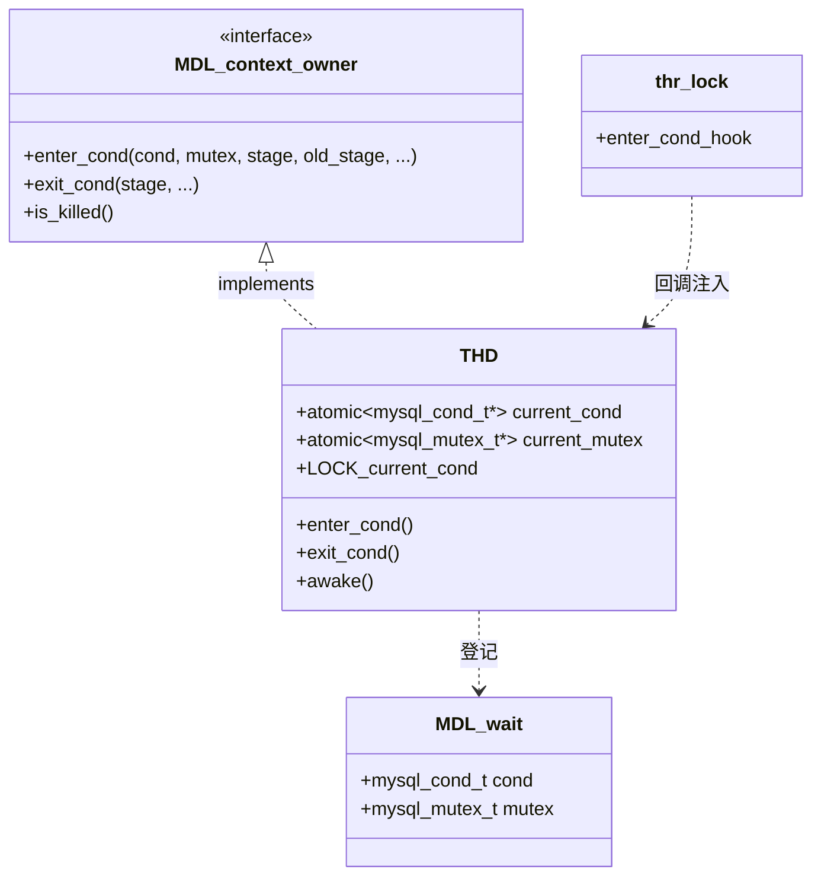

# 线程等待登记与唤醒协议深度解析

> 基于 MySQL 8.0.39 源码，覆盖 `THD::enter_cond()` / `exit_cond()` 如何登记"本线程正在等什么"、★ 为什么 `enter_cond` **故意不加锁**（避开与 `THD::awake()` 的 AB-BA 死锁）、`exit_cond` 的"先解锁再加锁"契约、★ 由此产生的竞态及"enter_cond 后再查一次 killed"的应对、PFS stage 上报，以及引擎侧 `thd_wait_begin`/`wait_end` 与 `os_event` 的对照。
>
> **边界**：本篇讲**线程在等待时如何登记自己、以及如何被别人找到并唤醒**——即"等待的协议"。
> **不写等待原语本身的实现**（mutex/rw_lock/cond/`os_event`/sync_array 怎么实现）→ [`../lock/primitives/mysys_primitives.md`](../lock/primitives/mysys_primitives.md)、[`../lock/primitives/innodb_sync.md`](../lock/primitives/innodb_sync.md)；
> **不写 KILL 的广播端**（`THD::awake()` 的四类唤醒）→ [`thd.md`](thd.md)；
> **不列"各类线程各等什么"的清单表** → [`threading_architecture.md`](threading_architecture.md) 的等待模型横向对照表；
> `thd_enter_cond` 的 **C ABI 签名**见 [`internal_thd.md`](internal_thd.md)，本篇讲它的**语义**。
>
> 一句话区分：lock 域讲"锁怎么做"，`thd.md` 讲"怎么杀"，本篇讲"**怎么被找到**"。

## 目录

- [概述](#概述)
- [理论基础](#理论基础)
- [核心实现](#核心实现)
- [★ 本机制里的工程实现技法](#-本机制里的工程实现技法)
- [可观测性](#可观测性)
- [Misc](#misc)
- [参考](#参考)

---

## 概述

### 是什么

一个线程阻塞在条件变量上时，它**对外界是失联的**——没人知道它在等哪把锁、哪个条件。而 MySQL 有三件事必须能"找到"一个阻塞中的线程：

| 需求 | 场景 | 需要什么信息 |
|---|---|---|
| **KILL** | `KILL QUERY` 打断一个正在等锁的查询 | 它等的是哪个 cond、配合哪把 mutex |
| **shutdown** | 关闭时唤醒所有阻塞线程 | 同上 |
| **可观测** | `SHOW PROCESSLIST` 显示 "Waiting for table metadata lock" | 它当前处于什么阶段 |

解决方案是**一对登记字段**：

```cpp
  std::atomic<mysql_mutex_t *> current_mutex;
  /**
    Pointer to the condition variable the thread owning this THD
    is currently waiting for. If the thread is not waiting, the
    value is NULL. Set by THD::enter_cond().

    If this thread is killed (shutdown or KILL stmt), another
    thread will broadcast on this condition variable so that the
    thread can be unstuck.
  */
  std::atomic<mysql_cond_t *> current_cond;
```

注释把用途写得很直白：**"If this thread is killed, another thread will broadcast on this condition variable so that the thread can be unstuck."**（本线程被杀时，别的线程会在这个条件变量上广播，把它"拔"出来。）

反直觉的第一件事：**`enter_cond()` 完全不加锁**。它只写两个原子变量，注释专门解释：

> Sic: We don't lock LOCK_current_cond here. If we did, we could end up in deadlock with `THD::awake()` which locks current_mutex while LOCK_current_cond is locked.

反直觉的第二件事：**`exit_cond()` 要求调用方先把 `current_mutex` 释放掉**，并且用断言强制：

```cpp
    mysql_mutex_assert_not_owner(current_mutex.load());
```

反直觉的第三件事：**这套协议有已知竞态，且无法消除**——源码明确要求调用方"在 `enter_cond()` 之后再查一次 killed"。这不是疏忽，是内存重排序下的必然。

### 用途

一句话：**把"线程正在等什么"从隐式状态变成显式登记**，从而使 KILL、shutdown、观测三者成为可能。

在整条链路上的位置：等待发生**前**调 `enter_cond` 登记，等待结束**后**调 `exit_cond` 清除；`THD::awake()` 在中间任意时刻读这两个字段做广播。

### 版本演进

| 版本 | 变化 |
|---|---|
| 5.x | `enter_cond`/`exit_cond` 已是 THD 的方法，服务于 KILL 与 `PROCESSLIST` 的 State 显示 |
| 8.0 | `current_cond`/`current_mutex` 改为 **`std::atomic`**（此前是普通指针）——因为并发读（KILL 线程）与并发写（本线程）必须无数据竞争 |
| 8.0.x | 引入 `MDL_context_owner` 接口，`enter_cond`/`exit_cond` 成为 **`override`**（MDL 子系统通过接口回调，不依赖 THD 定义） |
| 26.7 | 线程池进社区版后，又多了一套**引擎侧**上报通道 `thd_wait_begin`/`thd_wait_end`——但那是给线程池用的，与本篇的 `enter_cond` **不是同一条路**（见「引擎侧对照」） |

> 演进主线：从"KILL 用的辅助字段"演进为"**跨子系统共享的等待契约**"——MDL、thr_lock、GTID、复制都靠它。

---

## 理论基础

### 设计思想与权衡

#### 权衡一：为什么是"字段登记"而不是"全局等待表"？

| 方案 | 评价 |
|---|---|
| 全局表记录"谁在等什么" | ❌ 每次等待都要加锁改表，热路径不可接受；且表本身要并发保护 |
| **每个 THD 自带两个原子字段** | ✅ 无竞争写入（只有本线程写），别线程只读；无需额外锁 |

代价：**没有全局视图**。要找出"所有阻塞线程"必须遍历 THD 链表（而后台线程不在链表里，见 [`internal_thd.md`](internal_thd.md)）。shutdown 因此只能遍历 `Global_THD_manager` 里的连接线程，后台线程要靠各自的停止协议。

#### 权衡二：为什么 `enter_cond` 不加 `LOCK_current_cond`？

这是全篇最精妙的一处。看三方的加锁顺序：

| 函数 | 加锁顺序 |
|---|---|
| `THD::awake()`（杀别人的线程） | `LOCK_current_cond` → `current_mutex` |
| `THD::exit_cond()`（自己退出等待） | 先**释放** `current_mutex` → 再 `LOCK_current_cond` |
| `THD::enter_cond()`（自己进入等待） | **完全不锁** `LOCK_current_cond` |

如果 `enter_cond` 也去锁 `LOCK_current_cond`，而此时它**已持有 `current_mutex`**（调用 `enter_cond` 前必然持有，因为要先锁 mutex 才能 wait），就形成：

```
enter_cond:  持有 current_mutex → 想要 LOCK_current_cond
awake:       持有 LOCK_current_cond → 想要 current_mutex
```

**经典 AB-BA 死锁**。所以 `enter_cond` 选择完全不锁——只写两个 `atomic` 变量，靠原子性保证不会读到半个指针。

代价：写入**不受** `LOCK_current_cond` 保护，于是与 `awake()` 的读取形成竞态（见「竞态」一节）。这是**用竞态换无死锁**——源码认为死锁比竞态严重得多。

#### 权衡三：为什么 `exit_cond` 必须"先解锁 mutex 再加锁 LOCK_current_cond"？

```cpp
    /*
      current_mutex must be unlocked _before_ LOCK_current_cond is
      locked (if that would not be the case, you'll get a deadlock if someone
      does a THD::awake() on you).
    */
    mysql_mutex_assert_not_owner(current_mutex.load());
    mysql_mutex_lock(&LOCK_current_cond);
```

同一个死锁问题，但 `exit_cond` 需要**清空**字段，所以必须加锁保护（否则与 `awake` 的读冲突到"读到一半被清空"）。解法是**调整顺序**：先确保 `current_mutex` 已释放（断言强制），再锁 `LOCK_current_cond`。

于是加锁顺序变成：

```
exit_cond:   （已释放 current_mutex）→ LOCK_current_cond
awake:        LOCK_current_cond → current_mutex
```

**同向**了，不会死锁。这是一处靠"插入一个断言 + 调整顺序"解决的死锁，非常有代表性。

#### 权衡四：为什么"enter_cond 后再查 killed"是必须的？

`sql_class.h` 里 `killed_state` 定义上方那段注释：

> If checking this in conjunction with a wait condition, please include a check after `enter_cond()` if you want to avoid a race condition. For details see the implementation of `awake()`, especially the "broadcast" part.

时间线：

```
T1（目标线程）              T2（杀线程）
检查 killed → 未设置
                            awake(): killed = KILL_QUERY
                            awake(): 读 current_cond → 还是 NULL（T1 尚未登记）
                            awake(): 不广播（跳过）
T1: enter_cond() 登记
T1: cond_wait()  ← 永远睡着，没人会来广播
```

**这就是"killed 已设但广播落空"的窗口**。解法是 `enter_cond()` 之后再查一次 `killed`——此时登记已完成，若发现被杀就不进入等待。

`THD::awake()` 里的注释也承认了这点（见 [`thd.md`](thd.md)）：

> However, there is a small chance we fail to kill... It's true that we have set its thd->killed but it may not see it immediately and so may have time to reach the cond_wait().

**这是无法完全消除的**——因为涉及内存写重排序。源码的应对是"尽力而为"：在 `enter_cond()` 后补查一次，把概率压到最低。

### 理论溯源

| 理论 / 模式 | 源码落点 | 说明 |
|---|---|---|
| **锁序（Lock Ordering）契约** | `enter_cond` 不加锁 / `exit_cond` 先解锁 | 通过统一加锁顺序避免 AB-BA 死锁 |
| **条件竞争的可接受化** | "enter_cond 后再查 killed" | 承认竞态不可消除，改为降低概率 |
| **接口回调（避免反向依赖）** | `MDL_context_owner::enter_cond` 是 `override` | MDL 子系统不 include `sql_class.h`，通过接口回调 |
| **原子指针** | `std::atomic<mysql_cond_t *>` | 无锁发布/读取指针 |
| **RAII 的手写版** | `enter_cond`/`exit_cond` 配对 | 跨函数边界，无法用构造/析构 |

### 算法与数据结构

| 结构 | 用途 | 复杂度 |
|---|---|---|
| `std::atomic<mysql_cond_t *> current_cond` | 当前等待的条件变量 | 读/写 `O(1)` |
| `std::atomic<mysql_mutex_t *> current_mutex` | 配套的 mutex（广播前要先锁它） | 读/写 `O(1)` |
| `LOCK_current_cond` | 保护"清空"操作（与 awake 的读互斥） | 只在 exit_cond/awake 用 |
| `PSI_stage_info *old_stage` | 保存进入前的 stage，退出时恢复 | `O(1)` |

为什么需要**两个**字段而不只是一个 cond？因为广播条件变量的标准做法是"先锁配套 mutex 再 broadcast"，否则可能丢唤醒。`THD::awake()` 里正是：

```cpp
    if (current_cond.load() && current_mutex.load()) {
      mysql_mutex_lock(current_mutex);
      mysql_cond_broadcast(current_cond);
```

**两个都非空才广播**——只锁 mutex 不 broadcast 会丢信号，不锁 mutex 直接 broadcast 也可能丢。

### 他库对比与演进动机

| 维度 | MySQL | PostgreSQL |
|---|---|---|
| 如何取消一个阻塞的查询 | `enter_cond` 登记 → KILL 时 broadcast | 用**信号/中断**（`CHECK_FOR_INTERRUPTS`、procarray 检查），配合 latch 等待循环 |
| 等待可见性 | `PROCESSLIST` State + PFS stage | `pg_stat_activity.wait_event_type/wait_event` |
| 是否需要显式登记 | **需要**（MySQL 的 cond 没有内建取消语义） | 不需要（PG 有统一的 wait event 机制与中断检查点） |

**差异根因**：MySQL 大量使用裸 `mysql_cond_t` 等待，条件变量本身没有"被取消"的概念，只能靠外部 broadcast；PG 的等待循环内建了中断检查。所以 MySQL 必须额外建一套"登记 + 广播"协议。

---

## 核心实现

### 主链路

```
【进入等待前】调用方持有 mutex
  → THD::enter_cond(cond, mutex, stage, old_stage, ...)
      ├─ mysql_mutex_assert_owner(mutex)        断言已持 mutex
      ├─ current_mutex = mutex                  ★ 不加 LOCK_current_cond
      ├─ current_cond  = cond
      └─ enter_stage(stage, old_stage, ...)     PFS stage 上报
  → ★ 调用方应再查一次 killed（避免"已杀但广播落空"）
  → mysql_cond_wait(cond, mutex)

【被唤醒】KILL / shutdown / 条件满足
  → THD::awake() 读 current_cond + current_mutex → 锁 mutex → broadcast
     （详见 thd.md）

【退出等待后】
  → mysql_mutex_unlock(mutex)                   ★ 必须先释放
  → THD::exit_cond(stage, ...)
      ├─ mysql_mutex_assert_not_owner(current_mutex)   ★ 断言已释放
      ├─ lock LOCK_current_cond
      ├─ current_mutex = nullptr
      ├─ current_cond  = nullptr
      ├─ unlock LOCK_current_cond
      └─ enter_stage(stage, nullptr, ...)       恢复 stage
```

配图（三方加锁顺序）：

```
   awake()（杀线程）          exit_cond()（本线程）        enter_cond()（本线程）
        │                          │                          │
   LOCK_current_cond          （已释放 current_mutex）    【完全不加锁】
        │                          │                          │
   current_mutex              LOCK_current_cond          只写两个 atomic
        │                          │                          │
   broadcast                  current_* = nullptr         current_* = cond/mutex
        │                          │                          │
   unlock                     unlock                      enter_stage()
        │                          │
        └──── 同向（LOCK_current_cond → current_mutex）────┘
                    ⇒ 不会 AB-BA 死锁
```

### 一、`enter_cond()`：登记三件事

```cpp
  void enter_cond(mysql_cond_t *cond, mysql_mutex_t *mutex,
                  const PSI_stage_info *stage, PSI_stage_info *old_stage,
                  const char *src_function, const char *src_file,
                  int src_line) override {
    DBUG_TRACE;
    mysql_mutex_assert_owner(mutex);
    /*
      Sic: We don't lock LOCK_current_cond here.
      If we did, we could end up in deadlock with THD::awake()
      which locks current_mutex while LOCK_current_cond is locked.
    */
    current_mutex = mutex;
    current_cond = cond;
    enter_stage(stage, old_stage, src_function, src_file, src_line);
    return;
```

三件事：

1. **`mysql_mutex_assert_owner(mutex)`**——断言调用方已持有配套 mutex。这是 `cond_wait` 的前提，也保证了后续 broadcast 的正确性。
2. **写两个 atomic 字段**——发布"我在等这个 cond"。**不加 `LOCK_current_cond`**（理由见权衡二）。
3. **`enter_stage(...)`**——上报 PFS stage，并把旧 stage 存进 `old_stage` 供 `exit_cond` 恢复。这就是 `SHOW PROCESSLIST` 能看到 "Waiting for ..." 的原因。

注意它是 **`override`**——实现的是 `MDL_context_owner` 接口。这让 MDL 子系统能在不 include `sql_class.h` 的前提下回调进来（与 [`thd.md`](thd.md) 讲的 ABI 隔离同一条纪律）。

### 二、★ 锁序契约：为什么 `enter_cond` 故意不加锁

把三个函数的加锁行为并列看，设计意图就清楚了：

| 函数 | 是否持 `current_mutex` | 是否锁 `LOCK_current_cond` | 顺序 |
|---|---|---|---|
| `enter_cond` | **是**（调用方持有） | **否** | 只写 atomic |
| `exit_cond` | **否**（断言强制已释放） | 是 | 先释放 mutex，再锁 |
| `awake` | 是（`LOCK_current_cond` 内锁） | 是 | `LOCK_current_cond` → `current_mutex` |

`awake` 与 `exit_cond` **同向**（都是 `LOCK_current_cond` 在 `current_mutex` 之前/之外），所以不死锁。`enter_cond` 如果参与加锁就会反向——所以它被设计成完全不参与。

这是"**通过让一方退出锁协议来打破死锁环**"的典型手法。代价是 `enter_cond` 的写入没有锁保护，只能靠 atomic 的原子性——而原子性只保证"不会读到半个指针"，**不保证与 `awake` 读操作的时序**，这正是竞态的来源。

### 三、`exit_cond()` 与"先解锁再加锁"

```cpp
  void exit_cond(const PSI_stage_info *stage, const char *src_function,
                 const char *src_file, int src_line) override {
    DBUG_TRACE;
    /*
      current_mutex must be unlocked _before_ LOCK_current_cond is
      locked (if that would not be the case, you'll get a deadlock if someone
      does a THD::awake() on you).
    */
    mysql_mutex_assert_not_owner(current_mutex.load());
    mysql_mutex_lock(&LOCK_current_cond);
    current_mutex = nullptr;
    current_cond = nullptr;
    mysql_mutex_unlock(&LOCK_current_cond);
    enter_stage(stage, nullptr, src_function, src_file, src_line);
    return;
  }
```

四个要点：

1. **`mysql_mutex_assert_not_owner(current_mutex.load())`**——用断言把"必须先释放 mutex"这条契约固化下来。debug 构建下违反立刻崩。
2. **清空在锁内**——与 `awake()` 的读取互斥，避免 `awake` 读到"cond 非空但已被清空的 mutex"这类中间态。
3. **两个字段一起清**——保持一致性（`awake` 要求两个都非空才广播，清一个留一个会导致广播跳过）。
4. **`enter_stage(stage, nullptr, ...)`**——恢复 stage，第二个参数传 `nullptr`（不需要保存旧值了）。

对比 `enter_cond` 用 `old_stage` 保存、`exit_cond` 用 `nullptr`：因为进入时需要"可回退"，退出时已经是回到起点。

### 四、★ 竞态与"enter_cond 后再查一次 killed"

源码在 `killed_state` 定义上方给出的指引：

```cpp
  /*
    If checking this in conjunction with a wait condition, please
    include a check after enter_cond() if you want to avoid a race
    condition. For details see the implementation of awake(),
    especially the "broadcast" part.
  */
  enum killed_state {
    NOT_KILLED = 0,
    ...
```

正确的等待姿势：

```
lock(mutex);
while (!condition) {
  if (thd->killed) break;          ← 第一次查
  thd->enter_cond(cond, mutex, ...);
  if (thd->killed) {               ← ★ 第二次查（登记后）
    thd->exit_cond(...);
    break;
  }
  mysql_cond_wait(cond, mutex);
}
thd->exit_cond(...);
unlock(mutex);
```

**为什么第二次查是必须的**——见「权衡四」的时间线。这是唯一能缩小"killed 已设但广播落空"窗口的手段。

**为什么仍然无法完全消除**：`awake()` 读 `current_cond` 与本线程写 `current_cond` 之间没有同步关系，编译器/CPU 都可能重排。源码在 `awake()` 里也明说：

> However, there is still a small chance of failure on platforms with instruction or memory write reordering.

### 五、PFS stage 上报

`enter_cond` 的第三个动作 `enter_stage(stage, old_stage, ...)` 是**可观测性的入口**：

- PFS 记录当前线程的 stage（如 `stage_waiting_for_table_metadata_lock`）
- `PROCESSLIST` 的 State 列来源于此
- `old_stage` 用于退出时恢复

这就是为什么"等待"这件事能被看见——**登记与上报是同一次调用完成的**。设计上把"让 KILL 能找到我"和"让管理员能看见我"合并成一个动作，避免调用方漏做其中一件。

### 六、三类等待挂靠

`enter_cond` 是**通用协议**，各子系统按自己的方式挂上去：

| 子系统 | 挂靠方式 | 等待对象 |
|---|---|---|
| **MDL** | 通过 `MDL_context_owner` 接口回调 `enter_cond` | `MDL_wait`（内含 cond + mutex） |
| **thr_lock** | `enter_cond_hook`（函数指针注入） | 表锁的 cond |
| **GTID / 复制** | `Mutex_cond_array::enter_cond(thd, n, stage, ...)` | GTID 等待数组 |
| **引擎侧** | 见下（不同路） | `os_event` / `sync_array` |

`thr_lock` 那处（见 [`../lock/transactional/thr_lock.md`](../lock/transactional/thr_lock.md)）用的是**回调注入**：`enter_cond_hook` 把线程 stage 设为 `stage_waiting_for_table_level_lock` 等。这证明协议是**可扩展的**——不只 MDL 能用。

`Mutex_cond_array`（GTID）则展示了一个变体：等待对象不是单个 cond，而是**一组**（`Mutex_cond_array` 管理多个 mutex+cond 对，按索引选）。

### 七、引擎侧对照：`thd_wait_begin` / `wait_end` 与 `os_event`

**这是最容易混淆的一组**——引擎侧的等待上报与 server 侧的 `enter_cond` **不是同一条路**：

| 维度 | server 侧 `enter_cond` | 引擎侧 `thd_wait_begin`/`wait_end` |
|---|---|---|
| 目的 | 让 KILL/shutdown 能 broadcast | 让**线程池**知道"这个线程要睡了"，从而释放 credit |
| 消费者 | `THD::awake()` | 线程池插件（`thd_pool_wait_begin`） |
| 通道 | `MDL_context_owner` 接口 / 直接调用 | `THD_event_functions` 回调（插件注册） |
| 时机 | 进入 server 层条件等待前 | 引擎即将阻塞（行锁、IO）前 |
| 不做的后果 | KILL 可能失效 | 线程池误以为线程还在忙，credit 不释放 ⇒ 吞吐下降 |

关键：**两者都需要，且互不替代**。一个线程可能先在 server 层等 MDL（走 `enter_cond`），拿到锁后在引擎里等行锁（走 `thd_wait_begin`）。

InnoDB 自己的等待（`os_event`、`sync_array`）**既不走** `enter_cond` **也不走** `thd_wait_begin`——它有自己的停止协议（见 [`thread_lifecycle.md`](thread_lifecycle.md)）。所以"InnoDB 后台线程怎么被停"与本篇无关。

> 引擎侧上报的深剖（含 26.7 线程池怎么用）见 [`thread_pool.md`](thread_pool.md)；`os_event` 的实现见 [`../lock/primitives/innodb_sync.md`](../lock/primitives/innodb_sync.md)。

### 八、shutdown 如何复用这套协议

关闭时的唤醒与 KILL 走**同一条路**：遍历 THD → 对每个有 `current_cond` 的做 broadcast。源码形态（见 [`../../server/lifecycle/03_shutdown.md`](../../server/lifecycle/03_shutdown.md)）：

```cpp
      mysql_mutex_lock(&killing_thd->LOCK_current_cond);
      if (killing_thd->current_cond.load()) {
        mysql_mutex_lock(killing_thd->current_mutex);
        mysql_cond_broadcast(killing_thd->current_cond);
        mysql_mutex_unlock(killing_thd->current_mutex);
      }
      mysql_mutex_unlock(&killing_thd->LOCK_current_cond);
```

注意它**完整复刻了 `awake()` 的加锁顺序**（`LOCK_current_cond` → `current_mutex`），这正是锁序契约必须在多处一致遵守的原因——任何一处写反都会引入死锁。

---

## ★ 本机制里的工程实现技法

### 一、C++ 特性

| 特性 | 用在哪 | 为什么（收益） | 代价 / 反直觉处 |
|---|---|---|---|
| **`override` 实现接口** | `enter_cond`/`exit_cond` 是 `MDL_context_owner` 的 override | MDL 不需要 include `sql_class.h`，避免反向依赖 | 调用方拿到的是接口引用，看不到 THD 其余部分 |
| **`std::atomic<T *>`** | `current_cond` / `current_mutex` | 无锁发布指针；不参与 `LOCK_current_cond` 也能安全读写 | 只保证原子性，**不保证与 awake 的时序** ⇒ 竞态残留 |
| **断言固化契约** | `assert_owner` / `assert_not_owner` | 把"加锁顺序"从注释变成 debug 期可检查的断言 | release 构建下断言消失，契约回归纯约定 |
| **出参保存旧值** | `PSI_stage_info *old_stage` | 进入时保存、退出时恢复 | 调用方必须保证 `old_stage` 生命周期覆盖整段等待 |

**C 与 C++ 的边界**：`thd_enter_cond` 是 `extern "C"` 且首参是 `void *opaque_thd`，内部 `static_cast<THD *>` 恢复（见 [`internal_thd.md`](internal_thd.md)）。这让 C 侧代码（以及不便于 include C++ 头的地方）也能登记等待。

### 二、经典算法的实现落地

#### 死锁避免：锁序（Lock Ordering）

| 维度 | 教科书原型 | 本实现的落地 | 差异原因 / 代价 |
|---|---|---|---|
| 手段 | 全局锁序编号，按序获取 | **局部约定**：`LOCK_current_cond` 永远在 `current_mutex` 之前 | 只涉及两把锁，不需要全局编号系统 |
| 违反检测 | 运行期检测（如 MySQL 的 LOCK ORDER 工具） | **断言 + 注释** | 轻量；release 下无检测 |
| 特殊处理 | 通常要求所有参与者遵守 | **`enter_cond` 直接退出协议**（完全不加锁） | 因为它已持有 `current_mutex`，无法按序；代价是引入竞态 |

**这个"让一方退出锁协议"的解法值得记住**：当某个调用点因已持有锁而无法遵守全局顺序时，与其强行重排，不如让它不参与——只要它只做原子写。

#### 条件变量广播的正确姿势

教科书：`lock(mutex); broadcast(cond); unlock(mutex);`——必须先锁配套 mutex，否则唤醒可能丢失。

本实现完全遵守：

```cpp
    if (current_cond.load() && current_mutex.load()) {
      mysql_mutex_lock(current_mutex);
      mysql_cond_broadcast(current_cond);
```

**两个字段都非空才广播**——这解释了为什么必须登记**两个**而不是一个。

### 三、复杂体系与设计模式的代码结构



| 模式 / 体系 | 代码落点 | 结构说明 |
|---|---|---|
| **接口回调（依赖倒置）** | `MDL_context_owner` | MDL 定义接口，THD 实现；MDL 不依赖 THD |
| **策略注入** | `enter_cond_hook`（thr_lock） | 用函数指针注入"怎么登记"，便于复用 |
| **成对钩子（手写 RAII）** | `enter_cond`/`exit_cond` | 跨函数边界的配对，无语言级保证 |
| **锁序契约** | `LOCK_current_cond` → `current_mutex` | 多处（awake、shutdown、exit_cond）必须一致遵守 |

---

## 可观测性

### 观测对象 → 手段 速查

| 我想看 | 手段 | 入口 |
|---|---|---|
| 某线程正在等什么 | SQL | `SHOW PROCESSLIST` / `information_schema.PROCESSLIST` 的 **State** 列（来自 `enter_stage`） |
| 等待的详细信息与历史 | PFS | `events_waits_*`、`events_stages_*`（`enter_stage` 上报的 stage 事件） |
| 一个 KILL 是否真的广播了 | DBUG | `THD::awake` 的调试输出；观察目标线程 State 是否变 `Killed` |
| 线程是否在等待（供 KILL 判断） | SQL | `PROCESSLIST` 的 State 是否形如 "Waiting for ..." |
| MDL 等待的具体锁 | PFS | `performance_schema.metadata_locks`（见 [`../lock/transactional/mdl.md`](../lock/transactional/mdl.md)） |

### 系统变量与状态变量

本机制没有专属系统变量。相关的是 KILL 行为的观察：

| 状态变量 | 说明 |
|---|---|
| `Com_kill` | `KILL` 语句执行次数 |
| `Max_execution_time_exceeded`（per-THD） | `THD::awake` 在 `KILL_TIMEOUT` 时累加（见 [`thd.md`](thd.md)） |

---

## Misc

### 术语表

| 术语 | 含义 |
|---|---|
| `enter_cond` | 登记"本线程即将在这个 cond 上等待" |
| `exit_cond` | 清除登记，恢复 stage |
| `current_cond` / `current_mutex` | THD 上的两个原子字段，记录当前等待对象 |
| `LOCK_current_cond` | 保护"清空"操作的 mutex（`awake` 与 `exit_cond` 共用） |
| `MDL_context_owner` | 接口，`enter_cond`/`exit_cond` 是其 override |
| `enter_cond_hook` | thr_lock 用的函数指针注入 |
| `enter_stage` | 上报 PFS stage（PROCESSLIST State 的来源） |
| `old_stage` | 进入等待前的 stage，供退出时恢复 |

### ★ 本篇核实出的"易误判"的说法

| 流传的说法 | 实际情况 |
|---|---|
| "`enter_cond` 会锁 `LOCK_current_cond`" | **不会**。注释明说 "Sic: We don't lock LOCK_current_cond here"，理由是避免与 `awake()` 死锁 |
| "KILL 能保证杀掉等待中的线程" | **不能保证**。存在"killed 已设但广播落空"的窗口；源码要求 `enter_cond` 后再查一次，且仍承认"small chance of failure" |
| "登记 `current_cond` 就够了" | 不够，必须**同时**登记 `current_mutex`——`awake` 要求两个都非空才广播 |
| "`exit_cond` 可以持着 mutex 调用" | 不行，有 `assert_not_owner(current_mutex)` 强制 |
| "引擎的 `thd_wait_begin` 就是 `enter_cond`" | **不是同一条路**。前者给线程池释放 credit，后者给 KILL 广播；用途、消费者、通道都不同 |
| "所有等待都会被登记" | 不会。InnoDB 内部的 `os_event` 等待不走这套（有自己的停止协议） |

### 易混淆概念对比

| 此 X | 非彼 X | 说明 |
|---|---|---|
| `enter_cond`（server 登记） | `thd_wait_begin`（引擎上报） | 前者为 KILL 广播，后者为线程池 credit；互不替代 |
| `current_cond` | `LOCK_current_cond` | 前者是被等待的条件变量指针，后者是保护字段清空的 mutex |
| `enter_stage` | `enter_cond` | `enter_cond` **内部调用** `enter_stage`；前者只管 PFS stage |
| `exit_cond` | `mysql_cond_wait` 返回 | 被唤醒后仍需显式调 `exit_cond` 清除登记 |
| `is_killed()`（接口方法） | `killed` 字段 | 前者是 `MDL_context_owner` 接口方法（`final`），后者是状态位 |

### 扩展点

新增一处需要"可被 KILL 打断"的等待：

1. 在 `mysql_cond_wait` **之前**调 `enter_cond(cond, mutex, stage, &old_stage, ...)`，并确保调用方已持有 mutex。
2. **在 `enter_cond` 之后再查一次 `killed`**（否则有漏杀窗口）。
3. 被唤醒后先 `unlock(mutex)`，**再** `exit_cond(stage, ...)`（顺序反了会触发 `assert_not_owner`）。
4. 若不在 THD 上下文（如纯引擎线程），走 `thd_enter_cond` 的 C ABI，首参可传 `nullptr` 表示用 `current_thd`。
5. 若该等待需要引擎侧感知（线程池场景），**额外**调 `thd_wait_begin`/`thd_wait_end`——与 `enter_cond` 是两条独立的路。

### 坑与已知缺陷

1. **KILL 有极小概率失败**："killed 已设但广播落空"，需第二次 KILL 或等待条件自然满足（源码承认，见 [`thd.md`](thd.md)）。
2. **必须 `enter_cond` 后再查 killed**：漏掉这个检查会显著增大漏杀概率。
3. **`exit_cond` 顺序敏感**：持着 `current_mutex` 调用会触发断言（debug）或死锁（release）。
4. **两个字段必须同时登记/清空**：只清一个会让 `awake` 跳过广播。
5. **release 构建下断言消失**：`assert_owner`/`assert_not_owner` 在 release 不生效，锁序契约退化为纯约定——这是"断言固化契约"的固有弱点。
6. **后台线程不在 `Global_THD_manager`**：shutdown 遍历不到它们，它们靠各自的停止协议（见 [`internal_thd.md`](internal_thd.md)）。
7. **PFS stage 与 KILL 登记耦合在一次调用**：好处是不会漏做，代价是即使不需要 KILL 也要走 `enter_cond` 才能上报 stage。

---

## 参考

**相关文档**
- KILL 的广播端（`THD::awake` 四类唤醒、已知竞态）：[`thd.md`](thd.md)
- 等待原语本身的实现：[`../lock/primitives/mysys_primitives.md`](../lock/primitives/mysys_primitives.md)、[`../lock/primitives/innodb_sync.md`](../lock/primitives/innodb_sync.md)
- MDL 如何用这套协议：[`../lock/transactional/mdl.md`](../lock/transactional/mdl.md)
- thr_lock 的 `enter_cond_hook` 注入：[`../lock/transactional/thr_lock.md`](../lock/transactional/thr_lock.md)
- 各类线程各等什么（清单表，与本篇机制视角互补）：[`threading_architecture.md`](threading_architecture.md)
- `thd_enter_cond` 的 C ABI 签名：[`internal_thd.md`](internal_thd.md)
- 引擎侧 `thd_wait_begin`/`wait_end` 的消费者（线程池）：[`thread_pool.md`](thread_pool.md)
- shutdown 复用同一协议：[`../../server/lifecycle/03_shutdown.md`](../../server/lifecycle/03_shutdown.md)
- 线程停止协议（后台线程不走这套）：[`thread_lifecycle.md`](thread_lifecycle.md)
