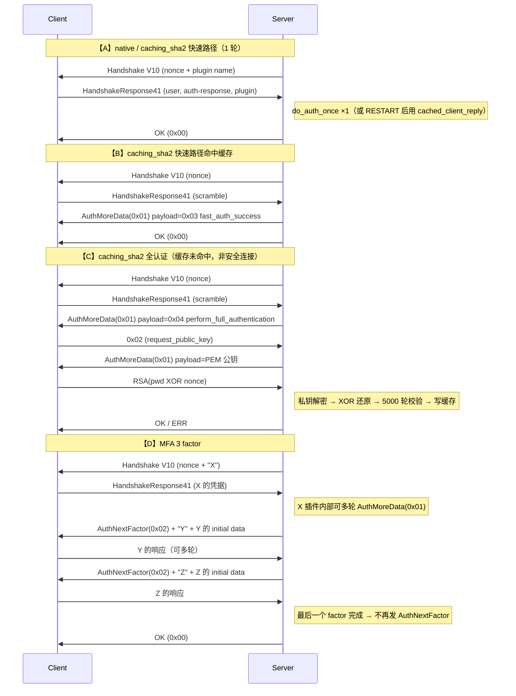

# 认证子系统深度解析：连接握手、插件协商与凭据校验

> 基于 MySQL 8.0.39 源码，涵盖连接建立与握手包的字节布局、`MPVIO_EXT` 对认证插件的 vio 抽象与四态分派状态机、三个内置插件的凭据校验算法（双重 SHA1 / SHA256 5000 轮 + RSA 交换）、多因素认证的串接、认证后 `Security_context` 的装配、`COM_CHANGE_USER` 再认证、以及失败防御（诱饵账号、host cache、账户锁定、密码过期）。
>
> **边界**：本篇讲**认证**（Authentication / AuthN，"你是谁"）——握手协议与凭据校验。认证之后 `Security_context` 各字段的**语义**见 [`security_context.md`](security_context.md)；多因素的**凭据存储**细节见 [`mfa.md`](mfa.md)；认证通过后权限如何判定见 [`authorization.md`](authorization.md)；通用包格式（4 字节包头 / 16MB 分片）与"握手在链路上的位置"见 [`../query/01_protocol_to_dispatch.md`](../query/01_protocol_to_dispatch.md)；VIO 通信抽象见 [`../infra/vio.md`](../infra/vio.md)；**本篇的上游**——连接如何被 accept、线程如何创建与缓存复用、`max_connections` 的两段式校验——见 [`../../infra/threading/connection_threading.md`](../../infra/threading/connection_threading.md)（★ 认证失败**不会**杀死线程，线程会归还缓存）。
>
> **官方术语对照**：MySQL 手册**不用** AuthN/AuthZ 缩写，而是把访问控制分成两"阶段"。本篇对应 [8.2.6 Access Control, Stage 1: Connection Verification](https://dev.mysql.com/doc/refman/8.0/en/connection-access.html) + [8.2.17 Pluggable Authentication](https://dev.mysql.com/doc/refman/8.0/en/pluggable-authentication.html) + [8.2.18 Multifactor Authentication](https://dev.mysql.com/doc/refman/8.0/en/multifactor-authentication.html)。
>
> ★ **本篇最反直觉的一条**：服务端在**读到用户名之前**不知道该账号用什么认证插件，所以它只能先用**自己的默认插件**发握手包做一个"乐观猜测"，收到用户名后才发现猜错、必须换插件。整个认证协议的核心复杂度都来自这个"先猜后换"，而 `MPVIO_EXT::RESTART` 与 `cached_client_reply` 就是为此设计的。

## 目录

- [概述](#概述)
  - [是什么](#是什么)
  - [用途](#用途)
  - [版本演进](#版本演进)
- [理论基础](#理论基础)
  - [设计思想与权衡](#设计思想与权衡)
  - [理论溯源](#理论溯源)
  - [算法与数据结构](#算法与数据结构)
  - [他库对比与演进动机](#他库对比与演进动机)
- [核心实现](#核心实现)
  - [主链路](#主链路)
  - [一、连接建立与握手包](#一连接建立与握手包)
  - [二、`MPVIO_EXT`：插件视角的 vio 与四态分派](#二mpvio_ext插件视角的-vio-与四态分派)
  - [三、凭据校验：两个核心插件的深度剖析](#三凭据校验两个核心插件的深度剖析)
  - [四、认证之后：上下文装配与 AuthN → AuthZ 的交界](#四认证之后上下文装配与-authn--authz-的交界)
  - [五、连接生命周期与再认证](#五连接生命周期与再认证)
  - [六、失败、防御与诊断](#六失败防御与诊断)
  - [七、认证插件全景](#七认证插件全景)
- [★ 本机制里的工程实现技法](#-本机制里的工程实现技法)
- [可观测性](#可观测性)
- [Misc](#misc)
- [参考](#参考)

---

## 概述

### 是什么

认证子系统把"证明你是谁"这件事做成了一条**可协商的、插件化的协议**：服务端先发一个携带随机数的握手包，客户端按约定算法用口令与随机数算出应答，服务端在不接触明文口令的前提下验证应答。协议的具体算法由**账号上绑定的认证插件**决定（`mysql.user.plugin` 列），插件可以在一次连接里被更换、可以多轮交互、也可以串联多个（多因素）。

它的三个组成部分是：

- **握手协议**——`Handshake V10` / `HandshakeResponse41` / `AuthSwitchRequest(0xFE)` / `AuthMoreData(0x01)` / `AuthNextFactor(0x02)` 五个包的字节布局与时序；
- **`MPVIO_EXT` 抽象**——把"插件看到的收发包接口"适配到 server 的 `NET`/`Protocol_classic`，并用一个四态枚举驱动"要不要换插件 / 要不要进下一个因子"；
- **认证插件**——服务端内置三个（`mysql_native_password` / `sha256_password` / `caching_sha2_password`），社区版另有 `plugin/auth/` 下 7 个（`auth_socket`、`mysql_no_login`、`dialog` 等），外部认证（PAM / LDAP / Kerberos / FIDO）由插件承担。

### 用途

从一个几乎每个 DBA 都遇到过的现象开场：

```sql
-- 场景 1：改完密码，旧连接还能用，新连接用旧密码竟然也能登？
ALTER USER 'app'@'%' IDENTIFIED BY 'newpass';
-- 某些情况下旧密码仍可登录 → caching_sha2_password 的缓存没失效

-- 场景 2：客户端报 "Authentication requires secure connection"
-- 非加密连接 + caching_sha2 首次认证 → 必须 TLS 或 RSA 公钥交换

-- 场景 3：某台应用机器突然连不上
-- ERROR 1129 (HY000): Host 'x.x.x.x' is blocked because of many connection errors
-- → host cache 把来源 IP 封了（而且注意：只有握手错误才计数，密码错不算）

-- 场景 4：升级 8.0 后老驱动连不上
-- Client does not support authentication protocol requested by server
-- → 8.0.4 起默认插件从 mysql_native_password 换成 caching_sha2_password
```

四个现象分别对应本篇的四个核心机制：**缓存失效**、**全认证路径**、**host cache 的计数口径**、**默认插件的演进**。

在整条链路上的位置：认证发生在 `thd_prepare_connection()` → `login_connection()` → `check_connection()` → `acl_authenticate()`，之后才 `prepare_new_connection_state()` 并进入 `while (thd_connection_alive(thd)) { do_command(thd); }` 命令循环。

### 版本演进

| 版本 | 变化 |
|------|------|
| **5.5** | **[WL#1054 Pluggable authentication support](https://dev.mysql.com/worklog/task/?id=1054)**：认证从"内置一种算法"变成"按账号绑定插件"。新增 `mysql.user.plugin` 与 `mysql.user.authentication_string` 两列（就是这两列让"可插拔"成为可能）；新增服务端插件类型 `MYSQL_AUTHENTICATION_PLUGIN` 与 `authenticate_user(MYSQL_PLUGIN_VIO*, MYSQL_SERVER_AUTH_INFO*)`；协议侧新增 `CLIENT_PLUGIN_AUTH` 能力位与握手包尾部的"服务端默认插件名"；猜错插件时发 "Use this plugin: XXX" 包（即后来的 AuthSwitchRequest）。该 WL 的 References 直接列出了 [Bug#4703](https://bugs.mysql.com/bug.php?id=4703)（外部认证）、[Bug#6733](https://bugs.mysql.com/bug.php?id=6733)（Kerberos）、[Bug#39397](https://bugs.mysql.com/bug.php?id=39397)（LDAP）、[Bug#49940](https://bugs.mysql.com/bug.php?id=49940)（Linux 系统账号）等一众"外部认证"诉求——这就是可插拔的**动机**。 |
| 5.6 / 5.7 | `sha256_password` 插件（更强的存储，但每次认证都要 RSA/SSL 交换，慢）。 |
| **8.0.4** | ★ **[WL#9591 Caching sha2 authentication plugin](https://dev.mysql.com/worklog/task/?id=9591)**：`caching_sha2_password` 成为**默认认证插件**（取代 `mysql_native_password`）。动机是 WL 原文的两条：`sha256_password` 存储更安全但"authentication process is slower than it needs to be"，且要修 trust-on-first-use 问题。核心创新是**内存缓存 `user@host → SHA256(SHA256(pwd))`** + 快速路径。存储格式 `$A$005$<salt><hash>`（005 = 5×1000 = **5000 轮**）。同时引入 [`caching_sha2_password_auto_generate_rsa_keys`](https://dev.mysql.com/doc/relnotes/mysql/8.0/en/news-8-0-4.html)（Bug#26751594 / WL#11057）。 |
| **8.0.16** | `sha256_password` 标记 deprecated。 |
| **8.0.27** | ★ **多因素认证（MFA）**，最多 3 个 factor。协议侧新增能力位 `MULTI_FACTOR_AUTHENTICATION`（`1UL << 28`）与命令码 **`AuthNextFactor = 0x02`**；`MPVIO_EXT::status` 新增 `START_MFA` 态；新增 `authentication_policy` 变量（默认 `'*,,'`：第 1 因子必需、第 2/3 可选）。★ 该变更的 WL 编号**未核实**（官方 WorkLog 检索无果），不要引用。 |
| **8.0.34** | `mysql_native_password` **deprecated**（官方原文："deprecated as of MySQL 8.0.34, disabled by default in MySQL 8.4, and removed as of MySQL 9.0.0"）。 |
| **8.0.35** | `authentication_fido` / `authentication_fido_client` deprecated；`'%'` 等价于 localhost 的行为 deprecated。 |
| 8.4 / 9.x | 8.4 起 `mysql_native_password` 默认禁用；**9.0 移除**（服务端）。9.x 新增 [WL#17160 "Support PBKDF2 storage format with Caching_sha2_password"](https://dev.mysql.com/worklog/task/?id=17160)——即把自研的 5000 轮 SHA256 换成标准 PBKDF2（★ 该 WL 仅从列表页标题读取，正文未核实）。 |

---

## 理论基础

### 设计思想与权衡

#### 1）为什么是"服务端先发"，而不是客户端先发

**约束**：认证必须防**重放**。如果客户端主动发一个"用口令算出的固定串"，攻击者录下来重放即可登录。

**选定方案**：服务端先发一个**每次连接都不同的 20 字节随机数（scramble / nonce）**，客户端的应答必须绑定这个 nonce。于是同一个口令在网络上每次出现的形式都不同。

**代价**：多出一个 RTT，且服务端必须为"尚未认证的连接"保存一份 per-connection 状态（nonce 存在 `THD::scramble`，`MPVIO_EXT::scramble` 只是指向它的指针）。

这个 nonce 就是 `send_server_handshake_packet()` 里的 `auth-plugin-data-part-1/2`，由 `generate_user_salt()` 生成。

#### 2）为什么用挑战-应答（challenge-response）而不是直接发密文口令

**约束**：口令不能在网上明文传（无 TLS 时）。但"客户端用口令算个哈希发过去"也不行——那个哈希本身就成了口令等价物（pass-the-hash）。

**选定方案**：服务端存的是**双重哈希** `H(H(pwd))`，客户端证明自己知道 `H(pwd)`（而 `H(pwd)` 从未落盘、从未上网）。具体见 [三、凭据校验](#三凭据校验两个核心插件的深度剖析)。

**代价**：协议不对称——服务端库里存的东西**不能**直接用于登录（这正是目的），但也意味着**无法做双向认证**（客户端从不验证服务端知道口令），MySQL 的认证是**单向**的。这与 SCRAM 的双向认证形成对照（见 [他库对比](#他库对比与演进动机)）。

#### 3）为什么认证要可插拔

**约束**：企业要接入已有的身份体系（PAM / LDAP / Kerberos / Windows AD / Unix socket peer-credential / FIDO）。这些机制**不是"口令哈希比对"**，无法用任何一种内置算法表达。

**选定方案**（WL#1054）：把认证抽象成插件接口，账号行上带 `plugin` 列指定用哪个。服务端只负责"找到账号 → 调插件 → 接受/拒绝"。

**代价**：
- **服务端在读到用户名之前不知道用哪个插件** ⇒ 必须先做一次"乐观猜测"（用默认插件发握手包），收到用户名后才知道该换不换。**这是整个协议最核心的复杂度来源**。
- 插件丢失 = 账号锁死（官方手册明写："如果找不到插件就报错并拒绝连接"）。
- 协议必须支持"换插件"（AuthSwitchRequest），客户端必须支持。

#### 4）为什么 `caching_sha2_password` 要加一层内存缓存

**约束**：`sha256_password` 的安全性强，但它**每次**认证都要把明文口令送到服务端（走 TLS 或用 RSA 加密），成本高（RSA 解密 + 5000 轮哈希）。

**选定方案**：绝大多数连接其实是"同一个账号反复连"。缓存 `user@host → SHA256(SHA256(pwd))` 后，第二次起可以走**快速路径**：用和服务端握手 nonce 绑定的挑战-应答，1 轮完成，无需明文口令、无需 RSA。

**代价（这是运维最常踩的坑）**：
- 缓存是**纯内存**的，重启即失；`FLUSH PRIVILEGES` 全清；改密码/`RENAME USER`/`DROP USER` 清对应条目（通过审计插件 `sha2_cache_cleaner` 监听 `MYSQL_AUDIT_AUTHENTICATION_CLASS`）。
- **首次连接（缓存未命中）必须走全认证**，即必须安全连接或 RSA。官方手册把这个说得很直白：账号创建后、改密后、`RENAME USER` 后、`FLUSH PRIVILEGES` 后的第一次连接都需要安全连接或 RSA 交换。
- 缓存里存的是 `SHA256(SHA256(pwd))`——**等价于口令的验证凭据**，与 `mysql.user` 里的哈希同级别敏感。它只存在于内存，不落盘、不进 core 之外的任何地方。

#### 5）为什么要有"诱饵账号"（decoy user）

**约束**：如果"用户不存在"立即返回、`"密码错误"`才走完整认证，攻击者可以用**响应时间 / 包序列**区分两者，从而枚举出哪些用户名存在。

**选定方案**：`find_mpvio_user()` 找不到账号时**不报错**，而是用 `decoy_user()` 造一个假账号（salt 全 0、auth_string 空、`can_authenticate = false`），让插件照常跑完整个协议流程。

**更细的一层**：假账号的**插件名**要随机选并**按 `user@host` 缓存**（`unknown_accounts` map，`MAX_UNKNOWN_ACCOUNTS` 上限）——否则攻击者可以用"这个账号被分配了哪个插件"做侧信道。

**代价**：未知用户名会消耗一次完整的认证计算；`unknown_accounts` 需要额外的内存与上限保护。

#### 6）为什么 host cache 只把"握手错误"计入封禁计数

源码里 `Host_errors::sum_connect_errors()` 只有一行：

```cpp
void sum_connect_errors() {
  /* Current (historical) behavior: */
  m_connect = m_handshake;
}
```

即**只有 `m_handshake` 计入 `m_connect`**，而 `acl_authenticate()` 里密码错走的是 `errors.m_authentication = 1`。

★ **这条非常反直觉**：**密码错误不会让 host 被封**（`ER_HOST_IS_BLOCKED` 由 `m_connect >= max_connect_errors` 触发）。真正会封的是**握手/协议层错误**（包格式错、协议版本不对、客户端行为异常）——也就是"坏客户端/扫描器"，而不是"猜密码的人"。

**代价 / 后果**：`max_connect_errors` 对暴力破解口令的防护作用有限（它防的是协议攻击）；而且一旦被误封，需要 `FLUSH HOSTS` 或 `mysqladmin flush-hosts` 解封。另外 **loopback 地址永不计数、永不被封**（`ip_to_hostname()` 里显式豁免），避免把自己锁在外面。

#### 7）简化假设带来的失效与退化阈值

| 简化假设 | 失效场景 | 阈值 / 触发条件 |
|---|---|---|
| 缓存让绝大多数连接走快速路径 | 缓存未命中 → 必须安全连接或 RSA，否则 `ERROR 2061 Authentication requires secure connection` | 首次连接 / 改密后 / `FLUSH PRIVILEGES` 后 / 重启后 |
| 服务端单向认证 | 无法防中间人（需 TLS 补） | 任何非 TLS 连接 |
| host cache 只算握手错误 | 口令暴力破解不会触发 `ER_HOST_IS_BLOCKED` | 任何场景 |
| `connect_timeout` 是握手总预算 | 极慢的客户端（网络极差）会被断 | 默认 10 秒 |
| `decoy_user` 的插件名随机但缓存 | 理论上可用"插件名是否一致"做弱侧信道 | `unknown_accounts` 有 `MAX_UNKNOWN_ACCOUNTS` 上限，满了整表清空 |
| RSA 密钥自动生成 | 密钥文件缺失/生成失败时，非安全连接的 caching_sha2 全认证**直接失败** | `caching_sha2_password_auto_generate_rsa_keys=ON`（默认）但 datadir 不可写 |

### 理论溯源

| 理论 / 标准 | 源码落点 |
|---|---|
| **Challenge-Response / CHAP（RFC 1994）**：服务端发 nonce，客户端用共享秘密与 nonce 算应答 | `generate_user_salt()` 生成 20 字节 nonce → `send_server_handshake_packet()` → 客户端应答 → `check_scramble_sha1()` / `Validate_scramble::validate()` |
| **Pass-the-hash 防御**：库里存的哈希**不能**直接用于认证 | `mysql.user` 存 `SHA1(SHA1(pwd))`（native）/ `$A$005$<salt><hash>`（caching_sha2），服务端校验时只需重现 `SHA1(nonce ‖ stored)`，从不接触明文 |
| **PBKDF2（RFC 2898）的简化版**：加盐 + 迭代 N 次抵抗离线暴力 | `caching_sha2_password` 的 `digest_rounds`（默认 **5000**，最小也等于默认 5000，最大 `0xFFF*1000 = 4,095,000`）+ 每账号 20 字节随机 salt。★ 它不是标准 PBKDF2（无 HMAC 结构），9.x 的 WL#17160 正在往标准 PBKDF2 迁移 |
| **SCRAM / SASL**（RFC 5802 / 7677） | ★ **MySQL 没有用**。MySQL 是自研的挑战-应答（见 [他库对比](#他库对比与演进动机)） |
| **Fail2ban 式速率限制** | host cache：`max_connect_errors`（默认 100）+ `ER_HOST_IS_BLOCKED` + `FLUSH HOSTS` 解封 |
| **LRU + 哈希索引** | hostname cache：`hostname_cache_lru`（`std::list<unique_ptr<Host_entry>>`）+ `hostname_cache_by_ip`（`malloc_unordered_map<ip, list::iterator>`） |
| **Strategy 模式 + 依赖倒置（DIP）** | `st_mysql_auth::authenticate_user` 是策略接口；`MPVIO_EXT` 是插件与 server 之间的倒置层（插件不知道 `NET` 的存在） |

### 算法与数据结构

| 结构 / 算法 | 类型 | 为什么选它 | 复杂度 |
|---|---|---|---|
| nonce | `char scramble[SCRAMBLE_LENGTH + 1]`（20 + 1） | `SCRAMBLE_LENGTH = 20`，历史包袱（老协议只认前 8 字节） | O(1) |
| 挑战-应答（native） | 双重 SHA1 + XOR | 见上文 pass-the-hash | 2 次 SHA1 |
| 挑战-应答（caching_sha2） | SHA256 + `digest_rounds` 次迭代 + 每账号 salt | 抗离线暴力 | 默认 5000 轮 |
| 密码哈希缓存 | `std::unordered_map<std::string, sha2_cache_entry>` + `mysql_rwlock_t` | 主键是 `authorization_id`（`user\0host\0`）；读写分离，快速路径只加读锁 | O(1) |
| 未知账号缓存 | `unknown_accounts`（`Map_with_rw_lock<Auth_id, uint>`） | 让假账号的插件名对同一 user@host 稳定 | O(1) |
| host cache | LRU list + hash | 需要按 IP 快速查找 + 按容量淘汰 | O(1) 查 / O(1) 淘汰 |
| 能力位集合 | `uint32`（`CLIENT_*`） | 一次握手用 32 位表达全部能力协商 | O(1) |
| 插件指针缓存 | `Cached_authentication_plugins::cached_plugins[3]` | 把插件名字符串比较降级为**指针比较**（`optimize_plugin_compare_by_pointer`） | O(1) |

### 他库对比与演进动机

| 维度 | MySQL 8.0 | PostgreSQL |
|---|---|---|
| **框架** | 自研的可插拔认证（WL#1054），插件由 `mysql.user.plugin` 列按账号绑定 | **SASL 框架**（`pg_hba.conf` 里指定 `scram-sha-256` / `md5` / `peer` / `ldap` / `pam`…），方法由**连接来源**决定而非按账号 |
| **默认算法** | `caching_sha2_password`：自研挑战-应答 + 内存缓存 | **`SCRAM-SHA-256`**（RFC 7677） |
| **是否双向认证** | **否**——客户端从不验证服务端 | **是**——SCRAM 有 `ServerSignature`，客户端验证服务端确实知道口令 |
| **Channel binding** | **无**（MySQL 的挑战-应答不绑定 TLS 通道） | SCRAM 支持 `tls-server-end-point` / `tls-unique` channel binding（`scram-sha-256-plus`），防 TLS 终止代理的 MITM |
| **缓存** | 有（`SHA2_password_cache`，内存，按认证事件失效） | 无（SCRAM 每次都是完整的挑战-应答，不需要缓存，因为不需要传输明文口令） |
| **为什么 MySQL 要缓存而 PG 不需要** | 因为 MySQL 的**全认证路径需要明文口令**（走 TLS 或 RSA），成本高；缓存命中后可走挑战-应答 | SCRAM 天生就是挑战-应答，任何时候都不需要明文口令，所以没有"昂贵路径"要绕开 |

★ **这是两者设计分野的根因**：MySQL 在 8.0 之前只有"口令哈希比对"模型，加缓存是为了在不改动协议的前提下把 SHA256 的强存储变便宜；PG 直接采用了标准的 SCRAM，代价是要引入 SASL 框架。

**演进动机小结**：MySQL 的认证演进是一条"**在不破坏协议兼容性的前提下逐步加安全**"的路——5.5 加可插拔（为外部认证开门）、8.0.4 换默认插件（更强存储）+ 加缓存（把成本摊掉）、8.0.27 加多因子、8.0.34 起废弃 native。每一步都要保证"老客户端连老账号"仍然可用，这就是为什么 `mysql_native_password` 到 9.0 才真正移除（给了 4 个大版本的迁移期）。

---

## 核心实现

### 主链路

```
mysqld_socket_acceptor->connection_event_loop()          [sql/mysqld.cc]
  → Connection_acceptor::connection_event_loop()
    → Mysqld_socket_listener::listen_for_connection_event()   poll()/select()
      → accept_connection()                                   mysql_socket_accept()
      → new Channel_info_tcpip_socket(...) / Channel_info_local_socket(...)
    → Connection_handler_manager::process_new_connection()
      → check_and_incr_conn_count()                ★ 连接数上限在此判定
      → Per_thread_connection_handler::add_connection()
        → check_idle_thread_and_enqueue_connection()   （命中线程缓存则唤醒）
        → mysql_thread_create(..., handle_connection, channel_info)
          ────────────────── 新线程 ──────────────────
          handle_connection()                      [connection_handler_per_thread.cc]
            → init_new_thd(channel_info) → create_thd() / store_globals()
            → Global_THD_manager::add_thd(thd)
            → thd_prepare_connection(thd)          [sql/sql_connect.cc]
               ├─ lex_start(thd)
               ├─ login_connection(thd)
               │    ├─ set_read_timeout(connect_timeout, true)   ★ 整包预算
               │    ├─ set_write_timeout(connect_timeout)
               │    └─ check_connection(thd)
               │         ├─ vio_peer_addr() → assign_ip()
               │         ├─ ip_to_hostname() → assign_host()   ★ 可能被 RC_BLOCKED_HOST 拒
               │         ├─ acl_check_host()                   ★ 无账号匹配该 host → ER_HOST_NOT_PRIVILEGED
               │         ├─ mysql_audit_notify(PRE_AUTHENTICATE)
               │         ├─ ★ acl_authenticate(thd, COM_CONNECT)
               │         │    ├─ server_mpvio_initialize()      装填 read/write/info 回调
               │         │    ├─ do_auth_once(默认插件)           第 1 次：发 HandshakeV10
               │         │    ├─ if (status == RESTART) do_auth_once(账号插件)  第 2 次
               │         │    ├─ do_multi_factor_auth()          第 2/3 因子
               │         │    ├─ server_mpvio_update_thd()
               │         │    ├─ check_and_update_password_lock_state()
               │         │    ├─ proxy / 默认角色 / checkout_access_maps()
               │         │    ├─ SSL / 锁定 / 过期 / 资源 / 连接数 检查
               │         │    └─ my_ok(thd)                      回 OK 包
               │         ├─ mysql_audit_notify(CONNECT)
               │         └─ reset_host_connect_errors()          ★ 成功后清零 host 错误计数
               ├─ set_read_timeout(net_read_timeout) / set_write_timeout(net_write_timeout)
               └─ prepare_new_connection_state(thd)   压缩初始化 + 会话变量快照 + init_connect
            → while (thd_connection_alive(thd)) { if (do_command(thd)) break; }   ★ 命令循环
            → end_connection(thd) → close_connection() → release_resources() → delete thd
            → Per_thread_connection_handler::block_until_new_connection()   线程回缓存
```

★ 注意 `check_and_incr_conn_count()` 与 `acl_authenticate()` 里的 `check_restrictions_for_com_connect_command()` **两处**都涉及连接数：前者是"accept 后立刻粗判"，后者是"认证成功后按权限精判"（`SUPER`/`CONNECTION_ADMIN`/`SERVICE_CONNECTION_ADMIN` 可突破上限）。

---

### 一、连接建立与握手包

#### 编码原语：所有包共享的三层 framing

在看具体包之前先统一约定，后面所有字段表都依赖它。

**① 4 字节包头 + 16MB 分片**（`NET_HEADER_SIZE = 4`）

```
[3B payload_length（小端 int3store，不含这 4 字节）][1B sequence_id]
```

```cpp
// sql-common/net_serv.cc  my_net_write()
while (len >= MAX_PACKET_LENGTH) {          // MAX_PACKET_LENGTH = 256^3-1 = 0xFFFFFF
  int3store(buff, MAX_PACKET_LENGTH);
  buff[3] = (uchar)net->pkt_nr++;
  ... 发一片 ...
}
int3store(buff, static_cast<uint>(len));
buff[3] = (uchar)net->pkt_nr++;
```

分片条件是 `>=`（不是 `>`）：长度恰好 0xFFFFFF 时会**再补一个 0 长度包**作为结束标记。读侧 `net_read_uncompressed_packet()` 用 `while (len == MAX_PACKET_LENGTH)` 循环拼接。

**② sequence_id**：收发共用同一个计数器 `net->pkt_nr`。写时 `buff[3] = net->pkt_nr++`；读时先**校验**再自增，不匹配直接 `ER_NET_PACKETS_OUT_OF_ORDER`。

★ **`net_new_transaction(net)`（= `net->pkt_nr = 0`）只在命令阶段调用**（`dispatch_command()` 读命令前）。**整个连接/认证阶段从不重置**——握手包 seq=0，客户端响应 seq=1，服务端再发 seq=2 …… 一路递增到认证结束。这是"为什么抓包时认证阶段 seq 是连续递增的"。

**③ 长度编码整数（length-encoded integer）**——MySQL 协议里最核心的编码，OK/ERR/连接属性/auth_response 都用它：

```cpp
// mysys/pack.cc
ulong net_field_length(uchar **packet) {
  const uchar *pos = *packet;
  if (*pos < 251) { (*packet)++; return (ulong)*pos; }
  if (*pos == 251) { (*packet)++; return NULL_LENGTH; }   // 251 = NULL
  if (*pos == 252) { (*packet) += 3; return uint2korr(pos + 1); }
  if (*pos == 253) { (*packet) += 4; return uint3korr(pos + 1); }
  (*packet) += 9;                                        // Must be 254 when here
  return uint4korr(pos + 1);
}
uchar *net_store_length(uchar *packet, ulonglong length) {
  if (length < 251)        { *packet = (uchar)length; return packet + 1; }
  if (length < 65536)      { *packet++ = 252; int2store(packet, (uint)length); return packet + 2; }
  if (length < 16777216)   { *packet++ = 253; int3store(packet, (ulong)length); return packet + 3; }
  *packet++ = 254; int8store(packet, length); return packet + 8;
}
```

| 首字节 | 总字节 | 值 |
|---|---|---|
| `0x00`–`0xFA`（<251） | 1 | 该字节即值 |
| `0xFB`（251） | 1 | **NULL**（`NULL_LENGTH`） |
| `0xFC`（252） | 3 | 后 2 字节小端 |
| `0xFD`（253） | 4 | 后 3 字节小端 |
| `0xFE`（254） | 9 | 后 8 字节小端 |
| `0xFF` | — | **不属于本编码**（0xFF 是 ERR 包头），源码里 255 会落到 254 分支 |

配套函数：读 `net_field_length()` / `net_field_length_ll()`，写 `net_store_length()`，预计算长度 `net_length_size()`。官方 dev 文档的规则表与源码一致（[Integer Types](https://dev.mysql.com/doc/dev/mysql-server/latest/page_protocol_basic_dt_integers.html)），但**官方表没有 0xFF 这一档**。

**④ 压缩只在认证之后才生效**：`prepare_new_connection_state()` 里才 `net->compress = true`，所以**连接阶段所有包都是未压缩的 4 字节头**。压缩后头变 7 字节：`[3B 压缩后长度][1B seq(compress_pkt_nr)][3B 压缩前长度]`，压缩前长度为 0 表示未压缩。

#### 协议包总览：连接与认证阶段的 9 个包

| 包 | 方向 | 标识字节 | 发送 / 解析函数（源码） | 何时出现 |
|---|---|---|---|---|
| **Handshake V10** | S→C | 首字节 `10` | `send_server_handshake_packet()` | 总是第一个包 |
| **SSLRequest** | C→S | 无标识（靠 `CLIENT_SSL` 位区分） | 客户端 `mysql_fill_packet_header()` | 客户端要 TLS 时（32 字节） |
| **HandshakeResponse41** | C→S | 无 | 服务端 `parse_client_handshake_packet()` | 总是（SSL 时在 TLS 之上重发） |
| **AuthSwitchRequest** | S→C | **`0xFE`** | `send_plugin_request_packet()` | 客户端插件 ≠ 账号插件 |
| **AuthSwitchResponse** | C→S | 无（裸插件数据） | `server_mpvio_read_packet()` 通用分支 | 上者的回应 |
| **AuthMoreData** | S→C | **`0x01`** | `wrap_plguin_data_into_proper_command()` | 插件多轮交互（含 RSA 公钥） |
| **AuthNextFactor** | S→C | **`0x02`** | `send_auth_next_factor_packet()` | MFA 第 2/3 因子 |
| **OK** | S→C | **`0x00`** | `net_send_ok()`（`protocol_classic.cc`，static） | 认证成功 |
| **ERR** | S→C | **`0xFF`** | `net_send_error_packet()`（同名 static） | 认证失败 |

> 老协议另有 `HandshakeResponse320` 与 `OldAuthSwitchRequest`（也是 `0xFE`，但不含插件名，隐含 `mysql_native_password`）——8.0 只作为兼容分支保留。

★ **为什么需要 0x01 / 0x02 这两个额外的标识字节**：官方文档解释得很清楚——插件数据对协议不透明，如果直接裸发，首字节可能被误判成 `OK(0x00)` / `ERR(0xFF)` / `AuthSwitchRequest(0xFE)` 这类带内命令。所以服务端把插件数据**包装**在 `0x01` 命令里，客户端读包时剥掉这一个字节：

```cpp
// sql-common/client.cc  client_mpvio_read_packet()
if (pkt_len && **buf == 1) { (*buf)++; pkt_len--; }
```

而客户端的回复仍是**裸的**（unwrapped），这就是时序图里"服务端发 `0x01 0x03`、客户端只回一个 `0x02`"的不对称来源。

#### Handshake V10 的字节布局

`send_server_handshake_packet()` 的实际写入顺序（源码顺序，含长度）：

```
偏移   长度   字段
─────────────────────────────────────────────────────────────
 0      1     protocol_version          = PROTOCOL_VERSION = 10 (0x0A)
 1     ≤61    server_version            NUL 结尾（SERVER_VERSION_LENGTH = 60）
 +4     4     thread_id (connection_id)
 +8     8     auth-plugin-data-part-1   ← 前 8 字节 nonce
 +1     1     filler                    = 0x00
 +2     2     capability_flags_1        （低 16 位）
 +1     1     character_set
 +2     2     status_flags
 +2     2     capability_flags_2        （高 16 位）
 +1     1     auth_plugin_data_len      ★ 默认 = 21（不是 20！见下）
 +10   10     reserved                  全 0
        ── 以上 6 项合计 18 字节 ──
 +13   13     auth-plugin-data-part-2   ★ 默认 13 字节 = 12 字节 nonce + 1 字节 NUL
 +N     N     auth_plugin_name          NUL 结尾（客户端侧插件名）
```

★ **`auth_plugin_data_len` 与 part-2 的长度由插件决定**，源码里没有硬编码 20/12：

- 三个内置插件（`mysql_native_password` / `caching_sha2_password` / `sha256_password`）都传 **`SCRAMBLE_LENGTH + 1` = 21 字节**（`sha2_password.cc` 的注释明说："Native authentication sent 20 bytes + '\0' character = 21 bytes. This plugin must do the same to stay consistent with historical behavior"）⇒ `auth_plugin_data_len = 21`，part-2 = `21 - 8 = ` **13 字节**，第 13 字节就是那个 `'\0'`；
- 只有插件给的 data **少于 20 字节**时，`send_server_handshake_packet()` 才补零并把 `data_len` 设为 20 ⇒ 此时 part-2 = 12 字节。

官方 dev 文档写的是 `$len = MAX(13, length of auth-plugin-data - 8)`，与代码等价。**以代码为准，别照抄"12"。**

```cpp
static bool send_server_handshake_packet(MPVIO_EXT *mpvio, const char *data,
                                         uint data_len) {
  assert(mpvio->status == MPVIO_EXT::FAILURE);
  assert(data_len <= 255);
  Protocol_classic *protocol = mpvio->protocol;

  char *buff = (char *)my_alloca(1 + SERVER_VERSION_LENGTH + data_len + 64);
  char scramble_buf[SCRAMBLE_LENGTH];
  char *end = buff;

  *end++ = protocol_version;

  protocol->set_client_capabilities(CLIENT_BASIC_FLAGS);
  if (opt_using_transactions)
    protocol->add_client_capability(CLIENT_TRANSACTIONS);
  protocol->add_client_capability(CAN_CLIENT_COMPRESS);

  bool have_ssl = false;
  if (current_thd->is_admin_connection() && g_admin_ssl_configured == true) {
    Lock_and_access_ssl_acceptor_context context(mysql_admin);
    have_ssl = context.have_ssl();
  } else {
    Lock_and_access_ssl_acceptor_context context(mysql_main);
    have_ssl = context.have_ssl();
  }
  if (have_ssl) {
    protocol->add_client_capability(CLIENT_SSL);
    protocol->add_client_capability(CLIENT_SSL_VERIFY_SERVER_CERT);
  }
  /* ... 压缩算法协商（protocol_compression_algorithms）... */

  if (data_len) {                                   // 缓存插件给的 scramble
    mpvio->cached_server_packet.pkt =
        (char *)memdup_root(mpvio->mem_root, data, data_len);
    mpvio->cached_server_packet.pkt_len = data_len;
  }

  if (data_len < SCRAMBLE_LENGTH) {                 // 生成 / 补齐 nonce
    if (data_len) {
      memcpy(scramble_buf, data, data_len);
      memset(scramble_buf + data_len, 0, SCRAMBLE_LENGTH - data_len);
      data = scramble_buf;
    } else {
      generate_user_salt(mpvio->scramble, SCRAMBLE_LENGTH + 1);
      data = mpvio->scramble;
    }
    data_len = SCRAMBLE_LENGTH;
  }

  end = my_stpnmov(end, server_version, SERVER_VERSION_LENGTH) + 1;
  assert(sizeof(my_thread_id) == 4);
  int4store((uchar *)end, mpvio->thread_id); end += 4;

  /* Old clients does not understand long scrambles, but can ignore packet
     tail: that's why first part of the scramble is placed here, and second
     part at the end of packet. */
  end = (char *)memcpy(end, data, AUTH_PLUGIN_DATA_PART_1_LENGTH);
  end += AUTH_PLUGIN_DATA_PART_1_LENGTH;
  *end++ = 0;

  int2store(end, static_cast<uint16>(protocol->get_client_capabilities()));
  end[2] = (char)default_charset_info->number;
  int2store(end + 3, mpvio->server_status[0]);
  int2store(end + 5, protocol->get_client_capabilities() >> 16);
  end[7] = data_len;
  memset(end + 8, 0, 10);
  end += 18;

  end = (char *)memcpy(end, data + AUTH_PLUGIN_DATA_PART_1_LENGTH,
                       data_len - AUTH_PLUGIN_DATA_PART_1_LENGTH);
  end += data_len - AUTH_PLUGIN_DATA_PART_1_LENGTH;
  end = strmake(end, client_plugin_name(mpvio->plugin),
                strlen(client_plugin_name(mpvio->plugin)));

  int res = protocol->write((uchar *)buff, (size_t)(end - buff + 1)) ||
            protocol->flush();
  return res;
}
```

**★ 为什么 nonce 要拆成 8 + 12 两段**——源码注释就是答案：

```cpp
  /* Old clients does not understand long scrambles, but can ignore packet
     tail: that's why first part of the scramble is placed here, and second
     part at the end of packet. */
```

4.0 以前的老客户端只认前 8 字节 nonce，且会忽略包尾。把前 8 字节放在固定位置（紧随 thread_id），老客户端按旧格式解析正好读到；后 12 字节放包尾，老客户端直接忽略。**一份 V10 包同时服务新旧客户端**，这是协议兼容性的经典手法。

**nonce 的生成**（`mysys/crypt_genhash_impl.cc`）：

```cpp
void generate_user_salt(char *buffer, int buffer_len) {
  char *end = buffer + buffer_len - 1;
  RAND_bytes((unsigned char *)buffer, buffer_len);
  /* Sequence must be a legal UTF8 string */
  for (; buffer < end; buffer++) {
    *buffer &= 0x7f;
    if (*buffer == '\0' || *buffer == '$') *buffer = *buffer + 1;
  }
  /* Make sure the buffer is terminated properly */
  *end = '\0';
}
```

用 OpenSSL `RAND_bytes`（不是 `rand()`）；避开 `'\0'` 与 `'$'`（后者是旧 crypt 格式的分隔符），并强制最高位清零保证是合法 UTF8。

**`auth_plugin_name` 是无条件写的**（外面没有 `if (CLIENT_PLUGIN_AUTH)` 包裹），因为 8.0 起 `CLIENT_PLUGIN_AUTH` 已包含在 `CLIENT_BASIC_FLAGS` 里。写的是 `client_plugin_name(mpvio->plugin)`——**客户端侧**插件名。

#### HandshakeResponse41 的解析

`parse_client_handshake_packet()` 先按 2 字节试探读能力位，再按 `CLIENT_PROTOCOL_41` 决定头部是 32 还是 5 字节：

```cpp
#define AUTH_PACKET_HEADER_SIZE_PROTO_41 32
#define AUTH_PACKET_HEADER_SIZE_PROTO_40 5
```

```
HandshakeResponse41 布局（41 形态）
─────────────────────────────────────────────────────────────
 0      4     capability_flags
 4      4     max_packet_size
 8      1     character_set
 9     23     filler（跳过）
── 32 字节头部结束 ──
32      N     username                    NUL 结尾
        N     auth-response               长度编码（见下）
        N     database                    NUL 结尾（仅 CLIENT_CONNECT_WITH_DB）
        N     client auth plugin name     NUL 结尾
        N     connect attrs               长度编码（仅 CLIENT_CONNECT_ATTRS）
        1     zstd compression level      （仅 zstd 分支）
```

`auth-response` 的编码方式由能力位决定：

```cpp
  get_proto_string_func_t get_length_encoded_string;
  if (protocol->has_client_capability(CLIENT_PLUGIN_AUTH_LENENC_CLIENT_DATA))
    get_length_encoded_string = get_56_lenc_string;   // 真 length-encoded
  else
    get_length_encoded_string = get_41_lenc_string;   // 1 字节长度
```

**SSL 切换的精确时机**——读了 SSLRequest **之后**、读 HandshakeResponse41 **之前**：

```cpp
skip_to_ssl:
  if (protocol->has_client_capability(CLIENT_SSL)) {
    /* ... Lock_and_access_ssl_acceptor_context ... */
    if (!context.get()->have_ssl()) return packet_error;
    if (sslaccept(*(context.get()), protocol->get_vio(),
                  protocol->get_net()->read_timeout, &errptr)) {
      return packet_error;
    }
    int rc = protocol->read_packet();          // ★ 再读一个包
    pkt_len = protocol->get_packet_length();
    if (rc) return packet_error;
    mpvio->vio_is_encrypted = 1;

    /* ... 对第二个包只做长度 + charset 一致性校验 ... */
    if (charset_code != ssl_charset_code || !packet_has_required_size)
      return packet_error;
  }
```

★ 注意源码注释说得很清楚：第二个包**不再重复解析字段**（"because of legacy reasons we chose not to parse the packet fields a second time"），只校验 charset 一致——防止 SSL 前后被篡改。

另外还有 **JDBC 特例**（源码里的兼容补丁）：

```cpp
  /* JConnector only sends server capabilities before starting SSL negotiation. */
  if (bytes_remaining_in_packet == 4 &&
      protocol->has_client_capability(CLIENT_SSL)) {
    protocol->set_client_capabilities(uint4korr(end));
    mpvio->max_client_packet_length = 0xfffff;
    charset_code = global_system_variables.character_set_client->number;
    goto skip_to_ssl;
  }
```

#### ★ 尾部两个决定"要不要换插件"的分支（全篇最关键）

```cpp
  /* 情况 A：账号插件 ≠ 服务器默认插件 → 服务端自己换插件 */
  if (my_strcasecmp(system_charset_info, mpvio->acl_user_plugin.str,
                    plugin_name(mpvio->plugin)->str) != 0) {
    mpvio->cached_client_reply.pkt = passwd;        // ★ 把刚收到的密码缓存下来
    mpvio->cached_client_reply.pkt_len = passwd_len;
    mpvio->cached_client_reply.plugin = client_plugin;
    mpvio->status = MPVIO_EXT::RESTART;
    return packet_error;                            // → read_packet 返回 -1 → 插件返回 CR_AUTH_HANDSHAKE
  }

  /* 情况 B：账号插件 == 默认插件，但客户端用的客户端插件不对 → 只让客户端换 */
  plugin_ref user_plugin =
      g_cached_authentication_plugins->get_cached_plugin_ref(&mpvio->acl_user_plugin);
  if (user_plugin == nullptr) return packet_error;
  auto user_client_plugin_name = client_plugin_name(user_plugin);
  if (my_strcasecmp(system_charset_info, client_plugin, user_client_plugin_name)) {
    mpvio->cached_client_reply.plugin = client_plugin;
    if (send_plugin_request_packet(mpvio,
                                   (uchar *)mpvio->cached_server_packet.pkt,
                                   mpvio->cached_server_packet.pkt_len))
      return packet_error;                          // 发 0xFE AuthSwitchRequest
    mpvio->protocol->read_packet();                 // 读 AuthSwitchResponse
    passwd_len = protocol->get_packet_length();
    passwd = (char *)protocol->get_net()->read_pos;
  }

  *buff = (uchar *)passwd;
  return passwd_len;
```

**两种情况的本质区别**：
- **A**：服务端自己用错了插件（默认插件 ≠ 账号插件）⇒ 要**重启服务端的认证流程**（`RESTART` 态，`acl_authenticate()` 会再调一次 `do_auth_once()`）。
- **B**：服务端插件对了，但客户端用的客户端插件不对 ⇒ 只需让**客户端**换（发 AuthSwitchRequest），服务端不重启。

#### ★ 其余五个包的字段布局

握手包与响应包之外，认证阶段还有五个包。逐个给出**字段级布局**（官方 dev 文档与源码交叉核实）。

**① AuthSwitchRequest（S→C，`0xFE`）**

```
1 字节   status tag        = 0xFE（254）
N 字节   plugin name       NUL 结尾（客户端侧插件名，取自 st_mysql_auth::client_auth_plugin）
剩余     plugin data       该插件的第一份挑战数据（string[EOF]）
```

发送函数 `send_plugin_request_packet()`：

```cpp
static uchar switch_plugin_request_buf[] = {254};
...
return net_write_command(net, switch_plugin_request_buf[0],
                         client_auth_plugin.c_str(), client_auth_plugin.size() + 1,
                         data, data_len);
```

`net_write_command()` 把命令字节放进第一个分片（`buff[4] = command`），所以线上字节是 `[3B len][1B seq][0xFE][name][0x00][data]`。

**② AuthSwitchResponse（C→S）**

**没有额外字段**，payload 就是裸的插件数据（`string[EOF]`），对协议不透明。客户端侧印证：`client_mpvio_write_packet()` 直接 `my_net_write` 插件数据，不包任何头。

> 这就是时序图里"服务端发 `0x01 0x03`（带包装）、客户端只回一个 `0x02`（裸）"的不对称来源——**只有服务端→客户端方向需要包装**。

**③ AuthMoreData（S→C，`0x01`）**

```
1 字节   status tag        = 0x01
剩余     plugin data       插件额外数据（string[EOF]）
```

包装函数（★ 注意源码里函数名拼错了，少一个 `e`）：

```cpp
static inline int wrap_plguin_data_into_proper_command(NET *net,
                                                       const uchar *packet,
                                                       int packet_len) {
  return net_write_command(net, 1, (const uchar *)"", 0, packet, packet_len);
}
```

★ **`caching_sha2_password` 的 payload 首字节常量**（`sql/auth/sha2_password.cc`，注意是 `static char`，不是枚举）：

| 常量名 | 值 | 方向 | 含义 |
|---|---|---|---|
| `request_public_key` | **`0x02`** | C→S（裸，不带 `0x01`） | 客户端请求 RSA 公钥 |
| `fast_auth_success` | **`0x03`** | S→C（包成 `01 03`） | 缓存命中且校验通过，随后紧跟 OK |
| `perform_full_authentication` | **`0x04`** | S→C（包成 `01 04`） | 要求客户端发明文口令（走 RSA） |
| RSA 公钥 PEM | — | S→C（包成 `01 <PEM>`） | `get_public_key_as_pem()` |

⚠️ **别和 `sha256_password` 搞混**：后者判断公钥请求用的是**字面量 `1`**（`if (pkt_len == 1 && *pkt == 1)`），不是 `0x02`。

**④ AuthNextFactor（S→C，`0x02`，MFA）**

```
1 字节   packet type       = 0x02
N 字节   plugin name       NUL 结尾（下一个因子的客户端侧插件名）
剩余     plugin data       该因子的第一份挑战数据（string[EOF]）
```

```cpp
static uchar auth_next_factor_request_buf[] = {2};
static bool send_auth_next_factor_packet(MPVIO_EXT *mpvio, const uchar *data,
                                         uint data_len) {
  ...
  if (!(mpvio->protocol->has_client_capability(MULTI_FACTOR_AUTHENTICATION)))
    return false;                       // 老客户端：不发这个包
  return net_write_command(net, auth_next_factor_request_buf[0],
                           client_auth_plugin.c_str(), client_auth_plugin.size() + 1,
                           data, data_len);
}
```

★ **三个易错点**：

1. 这个函数**在 `sql_authentication.cc`，不在 `sql_mfa.cc`** —— 对 `sql_mfa.cc` 全文 grep 发包相关的符号（`write_packet` / `read_packet` / `net_write` / `get_protocol`）**结果为空**：该文件只管多因子的列表管理与策略校验，完全不碰协议。
2. 门控能力位是 **`MULTI_FACTOR_AUTHENTICATION`（`1UL << 28`）**——**注意它没有 `CLIENT_` 前缀**，其余能力位都叫 `CLIENT_*`。官方 dev 文档里条目名同样是 `MULTI_FACTOR_AUTHENTICATION`。
3. 发完后立刻 `mpvio->status = MPVIO_EXT::FAILURE`，避免同一因子重复发 AuthNextFactor。

**⑤ OK（S→C，`0x00`）**

```
1 字节   header            = 0x00（★ 若 eof_identifier && CLIENT_DEPRECATE_EOF 则是 0xFE）
lenenc   affected_rows
lenenc   last_insert_id
2 字节   status_flags      （仅 CLIENT_PROTOCOL_41）
2 字节   warnings          （仅 CLIENT_PROTOCOL_41）
lenenc   info（human readable）        可选：message 非空时
lenenc   session state info 总长 + 条目  可选：仅当 SERVER_SESSION_STATE_CHANGED
```

★ **认证成功那个 OK 包实际只有 7 字节 payload**：`my_ok(thd)` 默认全 0、message 为空，且连接阶段 session tracker 未变更（不会置 `SERVER_SESSION_STATE_CHANGED`），所以 info 与 session state 两段**都不写**：

```
00 00 00 02 00 00 00
│  │  │  └──┬──┘ └┬┘
│  │  │     │     └─ warnings = 0
│  │  │     └─────── status_flags = 0x0002（SERVER_STATUS_AUTOCOMMIT）
│  │  └───────────── last_insert_id = 0（lenenc）
│  └─────────────── affected_rows = 0（lenenc）
└────────────────── header = 0x00
```

（用 OK 包代替 EOF 包是 `CLIENT_DEPRECATE_EOF` 的结果，但那只出现在结果集结束/COM_BINLOG_DUMP 场景，**连接阶段的 OK 恒为 `0x00`**。）

**⑥ ERR（S→C，`0xFF`）**

```
1 字节   header            = 0xFF
2 字节   error_code        小端
1 字节   sql_state_marker  = '#'（仅 CLIENT_PROTOCOL_41）
5 字节   sql_state         SQLSTATE_LENGTH = 5，★ 不 NUL 结尾
N 字节   message           ≤ MYSQL_ERRMSG_SIZE-1，★ 包里不写结尾 NUL
```

★ **认证失败的 SQLSTATE**（`share/messages_to_clients.txt` 声明行）：

| 错误码 | SQLSTATE | 触发点 |
|---|---|---|
| `ER_ACCESS_DENIED_ERROR` | **`28000`** | `login_failed_error()` 默认分支（口令错/无权限） |
| `ER_ACCESS_DENIED_NO_PASSWORD_ERROR` | **`28000`** | `passwd_used == 2`（账号无口令） |
| `ER_ACCESS_DENIED_CHANGE_USER_ERROR` | `28000` | COM_CHANGE_USER 失败 |
| `ER_HANDSHAKE_ERROR` | **`08S01`** | `server_mpvio_read_packet()` 的 `err:` 分支 |
| `ER_NOT_SUPPORTED_AUTH_MODE` | `08004` | 客户端不支持服务端认证方式 |

> ★ 官方文档里**没有** OK/ERR/EOF 的标识字节汇总（Generic Response Packets 页只列三个子页链接）。`0x00` / `0xFF` / `0xFE` 这三个值是从源码 `net_send_ok()` / `net_send_error_packet()` / `net_send_eof()` 核实的。

#### 连接阶段其余的协议：命令码与 `COM_CHANGE_USER`

上面 9 个包覆盖了"建连接 + 认证"。同一阶段还有几条**命令**也走协议，一并列出。

**① 连接相关的命令码**（`include/my_command.h` 的 `enum enum_server_command`，从 0 顺序编号）

| 命令 | 值 | 作用 |
|---|---|---|
| `COM_QUIT` | `1`（0x01） | 断开连接 |
| `COM_INIT_DB` | `2`（0x02） | 切换默认库（≈ `USE`） |
| `COM_PING` | `14`（0x0E） | 心跳 |
| **`COM_CHANGE_USER`** | **`17`（0x11）** | 不重连换账号 |
| **`COM_RESET_CONNECTION`** | **`31`（0x1F）** | 重置会话状态（**不认证**） |

★ 这个枚举上方有一条**协议兼容性的硬约束**注释：

```cpp
  @par Warning
  Add new commands to the end of this list, otherwise old
  servers won't be able to handle them as 'unsupported'.
```

即：**命令码的值本身就是线上协议的一部分**，新增命令只能**追加到末尾**，不能插队——否则老服务端会把新命令误判成另一个命令。这正是枚举里 `COM_DEPRECATED_1`、`COM_DELAYED_INSERT` 这些"死"槽位**必须保留而不能复用**的原因。

**② `COM_CHANGE_USER` 的包格式：与 HandshakeResponse41 同构，但编码不同**

| 字段 | 编码 |
|---|---|
| `user` | NUL 结尾 |
| **auth-response** | **1 字节长度 + 数据**（★ **不是 length-encoded**） |
| `db` | NUL 结尾 |
| `charset` | 2 字节（可选，`if (ptr + 1 < end)`） |
| `client_plugin_name` | NUL 结尾 |
| `attrs` | 可选 |

```cpp
  /*
    Clients send the size (1 byte) + string (not null-terminated).

    Cast *passwd to an unsigned char, so that it doesn't extend the sign for
    *passwd > 127 and become 2**32-127+ after casting to uint.
  */
  size_t passwd_len = (uchar)(*passwd++);
```

★ **两个关键差异**（容易写错）：

| | HandshakeResponse41 | `COM_CHANGE_USER` |
|---|---|---|
| auth-response 编码 | **lenenc**（默认带 `CLIENT_PLUGIN_AUTH_LENENC_CLIENT_DATA`）或 1 字节 | **固定 1 字节长度** |
| 长度上限 | lenenc 可达 8 字节整数 | **255** |
| 能力位 | 有（头部 4 字节） | **无**（所以没有能力位可协商） |

★ 那行 `(uchar)` cast 是个真实的坑：不做 unsigned cast 的话，长度 > 127 时 `char` 的符号位会扩展出一个巨大的 `size_t`（注释原文 "become 2**32-127+"）。

**③ 老协议：8.0 只作为兼容分支保留**

- **Handshake V9** —— 8.0.39 的 `protocol_version` 全局变量恒为 `PROTOCOL_VERSION` = **10**（`include/mysql_version.h`，全仓唯一定义），源码中**没有任何发送 V9 的路径**。它只在官方 dev 文档里作为历史形态存在。
- **`HandshakeResponse320`** —— 客户端**不带** `CLIENT_PROTOCOL_41` 时走这条（`AUTH_PACKET_HEADER_SIZE_PROTO_40 = 5`）：能力位 2 字节、`max_packet_size` 3 字节，后续字符串用 `get_40_protocol_string()`（**包尾可无 NUL**，与 4.1 的 `get_41_protocol_string()` 不同）。
- **`OldAuthSwitchRequest`** —— 同样是 `0xFE`，但**不含插件名**（隐含 `mysql_native_password`）、**也不含认证数据**，客户端复用握手里的随机数生成 hash。只在缺 `CLIENT_PLUGIN_AUTH` 时作为兼容路径；对应回应是 `HandshakeResponse320`。

#### 官方文档在哪：协议包的一手出处

MySQL 8.0 Reference Manual **没有**独立的 Client/Server Protocol 章节（8.2 章只讲使用视角）。协议规范在**源码文档**里：

| 页面 | URL |
|---|---|
| Client/Server Protocol 入口 | https://dev.mysql.com/doc/dev/mysql-server/latest/PAGE_PROTOCOL.html |
| Connection Phase（包序列） | https://dev.mysql.com/doc/dev/mysql-server/latest/page_protocol_connection_phase.html |
| Connection Phase Packets（包清单） | https://dev.mysql.com/doc/dev/mysql-server/latest/page_protocol_connection_phase_packets.html |
| Protocol Basics | https://dev.mysql.com/doc/dev/mysql-server/latest/page_protocol_basics.html |
| MySQL Packets（4 字节头/分片） | https://dev.mysql.com/doc/dev/mysql-server/latest/page_protocol_basic_packets.html |
| Integer Types（含 length-encoded） | https://dev.mysql.com/doc/dev/mysql-server/latest/page_protocol_basic_dt_integers.html |
| Capabilities Flags | https://dev.mysql.com/doc/dev/mysql-server/latest/group__group__cs__capabilities__flags.html |
| HandshakeV10 | https://dev.mysql.com/doc/dev/mysql-server/latest/page_protocol_connection_phase_packets_protocol_handshake_v10.html |
| HandshakeResponse41 / 320 | https://dev.mysql.com/doc/dev/mysql-server/latest/page_protocol_connection_phase_packets_protocol_handshake_response.html |
| AuthSwitchRequest | https://dev.mysql.com/doc/dev/mysql-server/latest/page_protocol_connection_phase_packets_protocol_auth_switch_request.html |
| AuthMoreData | https://dev.mysql.com/doc/dev/mysql-server/latest/page_protocol_connection_phase_packets_protocol_auth_more_data.html |
| AuthNextFactor | https://dev.mysql.com/doc/dev/mysql-server/latest/page_protocol_connection_phase_packets_protocol_auth_next_factor_request.html |

★ **引用这些页面时的三个坑**：

1. **这些页面标注的是 MySQL 26.7.0，不是 8.0 快照**——官方把 8.0 的 "Source Code Documentation" 链到了 latest（当前 trunk）。里面夹杂 9.0+ 的说明（如"9.0 移除了 `mysql_native_password`"），**不适用于 8.0**。
2. ★ **文档与代码不一致的一处**：官方 HandshakeV10 页写 `auth_plugin_name` 是 *"if capabilities & CLIENT_PLUGIN_AUTH"*，但 **8.0.39 代码是无条件写**的（doxygen 注释已过时）。同理官方写 part-2 长度为 `MAX(13, len-8)`，代码里是 `data_len - 8`。**一律以代码为准。**
3. `CLIENT_SECURE_CONNECTION` 在官方能力位页上已改名为 `CLIENT_RESERVED2 = 32768` 并标 DEPRECATED，HandshakeResponse 页注明 "removed in 8.0"——写 8.0 代码时别再用这个名。

#### 能力位（capability flags）

与认证/握手强相关的（`include/mysql_com.h`，值是 `1UL << n`）：

| 宏 | 值 | 作用 |
|---|---|---|
| `CLIENT_LONG_PASSWORD` | `0x00000001` | |
| `CLIENT_CONNECT_WITH_DB` | `0x00000008` | 握手包里带 database |
| `CLIENT_COMPRESS` | `0x00000020` | zlib 压缩 |
| `CLIENT_PROTOCOL_41` | `0x00000200` | 41 协议（决定头部 32 vs 5 字节） |
| `CLIENT_SSL` | `0x00000800` | SSL |
| `CLIENT_TRANSACTIONS` | `0x00002000` | OK/EOF 包带状态标志 |
| `CLIENT_RESERVED2` | `0x00008000` | ★ 旧名 `CLIENT_SECURE_CONNECTION`（4.1 认证），8.0 已改名，宏定义不存在 |
| `CLIENT_PLUGIN_AUTH` | `0x00080000` | ★ 支持可插拔认证（8.0 已在 `CLIENT_BASIC_FLAGS` 里） |
| `CLIENT_CONNECT_ATTRS` | `0x00100000` | 连接属性 |
| `CLIENT_PLUGIN_AUTH_LENENC_CLIENT_DATA` | `0x00200000` | auth-response 用真 length-encoded |
| `CLIENT_CAN_HANDLE_EXPIRED_PASSWORDS` | `0x00400000` | ★ 客户端能处理过期密码（否则服务端直接断连） |
| `CLIENT_ZSTD_COMPRESSION_ALGORITHM` | `0x04000000` | zstd 压缩 |
| `MULTI_FACTOR_AUTHENTICATION` | `0x10000000` | ★ **没有 `CLIENT_` 前缀**，MFA（8.0.27） |
| `CLIENT_SSL_VERIFY_SERVER_CERT` | `0x40000000` | |

★ 一个易错点：`Protocol_classic` 里那份 `client_capabilities` 在发握手包前存的是**服务端能力集**（`set_client_capabilities(CLIENT_BASIC_FLAGS)`），被客户端的真实能力位覆盖后才是客户端能力。所以 `parse_client_handshake_packet()` 开头必须先"抢救"服务端的能力位：

```cpp
  /* save server capabilities before setting client capabilities */
  bool is_server_supports_zlib = protocol->has_client_capability(CLIENT_COMPRESS);
  bool is_server_supports_zstd = protocol->has_client_capability(CLIENT_ZSTD_COMPRESSION_ALGORITHM);
```

#### 压缩：握手期只协商，认证后才启用

`parse_client_handshake_packet()` 里只记录算法与级别，**真正的开关在 `prepare_new_connection_state()`**：

```cpp
  if (thd->get_protocol()->has_client_capability(CLIENT_COMPRESS) ||
      thd->get_protocol()->has_client_capability(CLIENT_ZSTD_COMPRESSION_ALGORITHM)) {
    net->compress = true;  // Use compression
    enum enum_compression_algorithm algorithm = get_compression_algorithm(...);
    NET_SERVER *server_extn = static_cast<NET_SERVER *>(net->extension);
    if (server_extn != nullptr)
      mysql_compress_context_init(&server_extn->compress_ctx, algorithm,
                                  thd->get_protocol()->get_compression_level());
    ...
  }
```

即**认证阶段全程不压缩**——这也符合直觉：压缩上下文还没建立，且认证包很小。

**协商之后怎么压/解压**（`mysql_compress_context` 装载后所有包走 `mysys/my_compress.cc`，完整实现）：

**上下文结构**（`include/my_compress.h:40-80`）：

```cpp
typedef struct mysql_zlib_compress_context {
  unsigned int compression_level;              // zlib 只存 level
} mysql_zlib_compress_context;

typedef struct mysql_zstd_compress_context {
  ZSTD_CCtx *cctx;        // 压缩上下文（懒加载）
  ZSTD_DCtx *dctx;        // 解压上下文（懒加载）
  unsigned int compression_level;
} mysql_zstd_compress_context;

typedef struct mysql_compress_context {
  enum enum_compression_algorithm algorithm;   // MYSQL_ZLIB / MYSQL_ZSTD / MYSQL_UNCOMPRESSED
  union {
    mysql_zlib_compress_context zlib_ctx;
    mysql_zstd_compress_context zstd_ctx;
  } u;
} mysql_compress_context;
```

zstd 的 `cctx`/`dctx` **懒加载**（`mysql_compress_context_init`，注释 "This is set after connect phase during first network i/o"）——复用上下文而非每包重建，`deinit` 负责释放。

**zstd 压缩**（`my_compress.cc:107-144`）：

```cpp
uchar *zstd_compress_alloc(mysql_zstd_compress_context *comp_ctx,
                           const uchar *packet, size_t *len, size_t *complen) {
  if (comp_ctx->cctx == nullptr) {               // 懒加载
    if (!(comp_ctx->cctx = ZSTD_createCCtx())) return nullptr;
  }
  size_t zstd_len = ZSTD_compressBound(*len);    // 最坏上界分配
  void *compbuf = my_malloc(PSI_NOT_INSTRUMENTED, zstd_len, MYF(MY_WME));
  if (!compbuf) return nullptr;
  size_t zstd_res = ZSTD_compressCCtx(comp_ctx->cctx, compbuf, zstd_len,
                                      packet, *len, comp_ctx->compression_level);
  if (ZSTD_isError(zstd_res)) { my_free(compbuf); return nullptr; }
  if (zstd_res > *len) {
    /* Packet got longer on zstd compression; Not compressed */
    *complen = 0;                                // 压缩反而变大 → 整包原样发
    my_free(compbuf);
    return nullptr;
  }
  *complen = *len;                               // 记下未压缩长度
  *len = zstd_res;                               // 长度改为压缩后长度
  return compbuf;
}
```

**zlib 压缩**（`my_compress.cc:202-234`）：`*complen = *len * 120/100 + 12`（buffer 上限：zlib 最大膨胀率）→ `compress2(compbuf, &tmp_complen, packet, *len, comp_ctx->compression_level)` → `*complen >= *len`（不划算）同样 `*complen=0` 放弃 → `std::swap(*len, *complen)` 返回。

**入口 `my_compress` / `my_compress_alloc`**（:280-339）：`*len < MIN_COMPRESS_LENGTH(=50)` 直接 `*complen=0` 不压（小包压了更亏）；`MYSQL_UNCOMPRESSED` 也直接不压（"even if compress flag was set"）；否则按 algorithm 分派。默认级别 `mysql_default_compression_level`（:351-362）：zlib=6、zstd=3。

**包格式 `compress_packet`**（`sql-common/net_serv.cc:1248-1282`，完整）：

```cpp
static uchar *compress_packet(NET *net, const uchar *packet, size_t *length) {
  const uint header_length = NET_HEADER_SIZE + COMP_HEADER_SIZE;   // 4 + 3 = 7
  uchar *compr_packet = my_malloc(key_memory_NET_compress_packet,
                                  *length + header_length, MYF(MY_WME));
  memcpy(compr_packet + header_length, packet, *length);           // 原包垫后

  mysql_compress_context *compress_ctx = compress_context(net);
  if (my_compress(compress_ctx, compr_packet + header_length, length, &compr_length)) {
    /* 压缩后比原包还大 → 原样发送未压缩 */
    compr_length = 0;
  }
  int3store(&compr_packet[NET_HEADER_SIZE], compr_length);         // [4..6] 未压缩 payload 长，0=未压缩
  int3store(compr_packet, *length);                                // [0..2] 压缩包总长
  compr_packet[3] = (uchar)(net->compress_pkt_nr++);               // [3] 压缩包序号
  *length += header_length;
  return compr_packet;
}
```

即：7 字节头 = `[0..2]` 压缩包总长 + `[3]` 序号 + `[4..6]` 未压缩长度（**0 表示未压缩**）。调用点 `net_write_packet`（:1296）：`net->compress` 为真时先 `compress_packet` 再 `net_write_raw_loop`。

**解压 `my_uncompress`**（:324-339）：`*complen == 0` 原样返回；否则 zstd `ZSTD_decompressDCtx`（校验 `zstd_res != *complen` 即失败）或 zlib `uncompress`；读取侧 `my_net_read`（net_serv.cc:2203）拿到 `complen>0` 才调它，失败置 `ER_NET_UNCOMPRESS_ERROR` 并关闭 socket。

全景与其余机制对照见 [`../feat/compression.md`](../../feat/compression.md)。

#### 连接属性（connect attributes）

```cpp
  if (length > 65535) return true;                           // 人为 64K 上限
#ifdef HAVE_PSI_THREAD_INTERFACE
  if ((bytes_lost = PSI_THREAD_CALL(set_thread_connect_attrs)(
           *ptr, length, mpvio->charset_adapter->charset())))
    LogErr(WARNING_LEVEL, ER_CONN_ATTR_TRUNCATED, ...);
#endif
  thd->m_connection_attributes = std::vector<char>(length);
  std::copy(*ptr, *ptr + length, thd->m_connection_attributes.begin());
```

存储位置是 **`THD::m_connection_attributes`（`std::vector<char>`）**，同时经 PFS 暴露为 `performance_schema.session_connect_attrs`（大小受 `performance_schema_session_connect_attrs_size` 限制，超限写 `ER_CONN_ATTR_TRUNCATED`）。★ 不存在 `thd->connect_attrs` 这个成员。

#### 超时：三阶段切换

```cpp
static bool login_connection(THD *thd) {
  /* Use "connect_timeout" value during connection phase */
  thd->get_protocol_classic()->set_read_timeout(connect_timeout, true);
  thd->get_protocol_classic()->set_write_timeout(connect_timeout);
  error = check_connection(thd);
  thd->send_statement_status();
  if (error) { ... return true; }
  /* Connect completed, set read/write timeouts back to default */
  thd->get_protocol_classic()->set_read_timeout(thd->variables.net_read_timeout);
  thd->get_protocol_classic()->set_write_timeout(thd->variables.net_write_timeout);
  return false;
}
```

★ `set_read_timeout(connect_timeout, true)` 的第二个参数 `true` 是 `timeout_on_full_packet`——**整包超时**而非每次 `vio_read` 单独计时：

```cpp
  time_t start_time = 0;
  if (timeout_on_full_packet) start_time = time(&start_time);
  while (count) {
    size_t recvcnt = vio_read(net->vio, buf, count);
    ...
    if (timeout_on_full_packet) {
      time_t current_time = time(&current_time);
      if (static_cast<unsigned int>(current_time - start_time) > net->read_timeout) {
        is_packet_timeout = true; break;
      }
    }
  }
```

即 **`connect_timeout` 是整个握手阶段的"总预算"**，防止慢客户端一点点发字节把连接线程拖死（one-thread-per-connection 模型下这是 DoS 向量）。

| 阶段 | read timeout | write timeout | 备注 |
|---|---|---|---|
| 握手/认证 | `connect_timeout`（**10**） | `connect_timeout` | `timeout_on_full_packet = true` |
| 认证后—命令循环前 | `net_read_timeout`（**30**） | `net_write_timeout`（**60**） | `login_connection` 结尾恢复 |
| 阻塞等下一条命令 | `wait_timeout`（**28800**） | — | `do_command()` 开头设，读到命令后立刻恢复成 `net_read_timeout` |
| interactive 客户端 | `interactive_timeout` 替代 `wait_timeout` | — | `server_mpvio_update_thd()` 里替换 |

---

### 二、`MPVIO_EXT`：插件视角的 vio 与四态分派

#### 结构定义

```cpp
/**
  The internal version of what plugins know as MYSQL_PLUGIN_VIO,
  basically the context of the authentication session
  MP: mysql plugin, EXT: extension
*/
struct MPVIO_EXT : public MYSQL_PLUGIN_VIO {
  MYSQL_SERVER_AUTH_INFO auth_info;   // 用户名 / 当前 factor 的凭据 / authenticated_as / external_user
  const ACL_USER *acl_user;           // mysql.user 里匹配的账号（找不到时是 decoy_user 造的诱饵）
  Restrictions *restrictions;         // partial revokes 的限制集
  plugin_ref plugin;                  ///< what plugin we're under
  LEX_STRING db;                      ///< 客户端 --database=xxx 指定的默认库
  /** when restarting a plugin this caches the last client reply */
  struct {
    const char *plugin, *pkt;         ///< pointers into NET::buff
    uint pkt_len;
  } cached_client_reply;
  /** this caches the first plugin packet for restart request on the client */
  struct {
    char *pkt;
    uint pkt_len;
  } cached_server_packet;
  int packets_read, packets_written;  ///< counters for send/received packets
  /** when plugin returns a failure this tells us what really happened */
  enum { SUCCESS, FAILURE, RESTART, START_MFA } status;

  /* encapsulation members */
  char *scramble;                     // 指向 thd->scramble
  MEM_ROOT *mem_root;
  struct rand_struct *rand;           // 给 decoy_user() 用
  my_thread_id thread_id;
  uint *server_status;                // 指向 thd->server_status
  Protocol_classic *protocol;         // ★ 适配到 NET 的关键
  ulong max_client_packet_length;
  const char *ip;
  const char *host;
  Thd_charset_adapter *charset_adapter;
  LEX_CSTRING acl_user_plugin;        // 该账号在 mysql.user 里的 auth plugin
  int vio_is_encrypted;
  bool can_authenticate();
};
```

基类（`include/mysql/plugin_auth_common.h`）：

```cpp
typedef struct MYSQL_PLUGIN_VIO {
  int (*read_packet)(struct MYSQL_PLUGIN_VIO *vio, unsigned char **buf);
  int (*write_packet)(struct MYSQL_PLUGIN_VIO *vio, const unsigned char *packet,
                      int packet_len);
  void (*info)(struct MYSQL_PLUGIN_VIO *vio,
               struct MYSQL_PLUGIN_VIO_INFO *info);
  enum net_async_status (*read_packet_nonblocking)(...);
  enum net_async_status (*write_packet_nonblocking)(...);
} MYSQL_PLUGIN_VIO;
```

**★ 适配机制是"C++ 公有继承 + 函数指针向下转型"**：`MPVIO_EXT` 公有继承 `MYSQL_PLUGIN_VIO`，所以 `&mpvio` 可无损转成 `MYSQL_PLUGIN_VIO*` 传给插件；回调体第一行再 `(MPVIO_EXT *)param` 转回来：

```cpp
static void server_mpvio_initialize(THD *thd, MPVIO_EXT *mpvio,
                                    Thd_charset_adapter *charset_adapter) {
  memset(mpvio, 0, sizeof(MPVIO_EXT));
  mpvio->read_packet = server_mpvio_read_packet;
  mpvio->write_packet = server_mpvio_write_packet;
  mpvio->info = server_mpvio_info;

  mpvio->auth_info.password_used = PASSWORD_USED_NO;
  mpvio->auth_info.current_auth_factor = 0;        // ★ MFA：当前第几因子

  Vio *vio = thd->get_protocol_classic()->get_vio();
  if (vio->ssl_arg)                                // ★ 是否加密只看 Vio 层的 SSL 参数
    mpvio->vio_is_encrypted = 1;
  else
    mpvio->vio_is_encrypted = 0;

  mpvio->status = MPVIO_EXT::FAILURE;              // ★ 悲观初始化：默认失败，见下方说明
  mpvio->mem_root = thd->mem_root;
  mpvio->scramble = thd->scramble;                 // 挑战随机数：共享 THD 的，不拷贝
  mpvio->rand = &thd->rand;
  mpvio->thread_id = thd->thread_id();
  mpvio->server_status = &thd->server_status;
  mpvio->protocol = thd->get_protocol_classic();
  mpvio->ip = thd->security_context()->ip().str;
}
```

★ 三点值得单独说：

1. **三个回调就是插件 VIO 的全部接口**（见上文适配机制）。
2. ★ **`vio_is_encrypted` 直接取自 `vio->ssl_arg`** —— 认证插件自己不判断传输层，只读这个标志；它决定了插件是否接受明文密码（`PASSWORD_USED_*` 判定与"要求 SSL"的插件策略都建立在此字段上）。
3. ★ **初态 `FAILURE` 是"悲观初始化"，不是"正常进行中"**（旧注释有误，已订正）。枚举是 `enum { SUCCESS, FAILURE, RESTART, START_MFA }`（`sql_authentication.h:80`），`FAILURE` 就是失败——源码里也明确写着 `mpvio->status = MPVIO_EXT::FAILURE; // the status is no longer RESTART`（:1942）。⇒ 安全含义是：**默认失败，只有走完成功路径才置 `SUCCESS`**（:2563 / :3076），任何提前返回或异常分支都保持失败态，避免"忘了设置却被视为认证通过"。另两个状态：`RESTART` = 换插件重来（默认插件 → 账号插件，:2606/:3143），`START_MFA` = 进入多因素认证。

（其余字段如 `scramble` / `rand` / `server_status` **不拷贝，直接共享 THD 的指针**——插件通过 `mpvio->info` 看到的始终是当前 THD 的实时状态。）

```cpp
static void server_mpvio_info(MYSQL_PLUGIN_VIO *vio, MYSQL_PLUGIN_VIO_INFO *info) {
  MPVIO_EXT *mpvio = (MPVIO_EXT *)vio;
  mpvio_info(mpvio->protocol->get_net()->vio, info);
}
```

于是**插件完全不知道 `NET` / `Protocol_classic` / VIO 的存在**，只看到"收一个包 / 发一个包"。而"第一个包要按握手格式封装/解封装"这件事被埋在回调里，靠 `packets_written` / `packets_read` 两个计数器判断。

> 注：8.0.39 只填前三个函数指针，两个 nonblocking 指针保持 `nullptr`（`memset` 的结果）。

#### 四态分派：`server_mpvio_write_packet()`

```cpp
static int server_mpvio_write_packet(MYSQL_PLUGIN_VIO *param,
                                     const uchar *packet, int packet_len) {
  MPVIO_EXT *mpvio = (MPVIO_EXT *)param;
  int res;
  Protocol_classic *protocol = mpvio->protocol;

  /*
    Reset cached_client_reply if not an old client doing mysql_change_user,
    as this is where the password from COM_CHANGE_USER is stored.
  */
  if (!((!(protocol->has_client_capability(CLIENT_PLUGIN_AUTH))) &&
        mpvio->status == MPVIO_EXT::RESTART &&
        mpvio->cached_client_reply.plugin ==
            ((st_mysql_auth *)(plugin_decl(mpvio->plugin)->info))
                ->client_auth_plugin))
    mpvio->cached_client_reply.pkt = nullptr;

  /* for the 1st packet we wrap plugin data into the handshake packet */
  if (mpvio->packets_written == 0)
    res = send_server_handshake_packet(
        mpvio, pointer_cast<const char *>(packet), packet_len);
  else if (mpvio->status == MPVIO_EXT::RESTART)
    res = send_plugin_request_packet(mpvio, packet, packet_len);
  else if (mpvio->status == MPVIO_EXT::START_MFA) {
    res = send_auth_next_factor_packet(mpvio, packet, packet_len);
    /* reset the status to avoid sending AuthNextFactor again for the
       same factor authentication. */
    mpvio->status = MPVIO_EXT::FAILURE;
  } else
    res = wrap_plguin_data_into_proper_command(protocol->get_net(), packet,
                                               packet_len);
  mpvio->packets_written++;
  return res;
}

static inline int wrap_plguin_data_into_proper_command(NET *net,
                                                       const uchar *packet,
                                                       int packet_len) {
  return net_write_command(net, 1, pointer_cast<const uchar *>(""), 0, packet,
                           packet_len);
}
```

**分派表**（由 `packets_written` + `status` 共同决定）：

| 条件 | 发出的包 | 首字节 |
|---|---|---|
| `packets_written == 0` | Initial Handshake V10（插件给的 `packet` 被当作 nonce） | `0x0A` |
| `status == RESTART` | AuthSwitchRequest | `0xFE`（254） |
| `status == START_MFA` | AuthNextFactor（MFA，8.0.27+） | `0x02` |
| 其他 | AuthMoreData（把插件数据包成 command=1 的命令包） | `0x01` |

★ **AuthMoreData 的前缀 `0x01` 是为了与 OK(0x00) / ERR(0xFF) 区分**——插件可以在认证中途发任意数据，客户端必须能分辨"这是认证数据还是最终结果"。

`send_plugin_request_packet()` 里的两个细节：

```cpp
  if (initialized) mpvio->status = MPVIO_EXT::FAILURE;  // 不再是 RESTART

  /* 老客户端听不懂 0xFE */
  if (!(mpvio->protocol->has_client_capability(CLIENT_PLUGIN_AUTH))) {
    DBUG_PRINT("info", ("old client sent a COM_CHANGE_USER"));
    assert(mpvio->cached_client_reply.pkt);
    /* get the status back so the read can process the cached result */
    mpvio->status = MPVIO_EXT::RESTART;
    return false;      // 不发 0xFE，假装什么都没发生
  }
```

#### 读路径：`server_mpvio_read_packet()` 与"假的第 0 个包"

```cpp
static int server_mpvio_read_packet(MYSQL_PLUGIN_VIO *param, uchar **buf) {
  MPVIO_EXT *mpvio = (MPVIO_EXT *)param;
  Protocol_classic *protocol = mpvio->protocol;
  size_t pkt_len;

  if (mpvio->packets_written == 0) {
    /*
      plugin wants to read the data without sending anything first.
      send an empty packet to force a server handshake packet to be sent
    */
    if (mpvio->write_packet(mpvio, nullptr, 0))
      pkt_len = packet_error;
    else {
      protocol->read_packet();
      pkt_len = protocol->get_packet_length();
    }
  } else if (mpvio->cached_client_reply.pkt) {
    assert(mpvio->status == MPVIO_EXT::RESTART);
    assert(mpvio->packets_read > 0);
    /*
      If the data cached from the last server_mpvio_read_packet
      and a client has used the correct plugin, then we can return the
      cached data straight away and avoid one round trip.
    */
    auto client_auth_plugin_name = client_plugin_name(mpvio->plugin);
    if (client_auth_plugin_name == nullptr ||
        my_strcasecmp(system_charset_info, mpvio->cached_client_reply.plugin,
                      client_auth_plugin_name) == 0) {
      mpvio->status = MPVIO_EXT::FAILURE;
      *buf = const_cast<uchar *>(
          pointer_cast<const uchar *>(mpvio->cached_client_reply.pkt));
      mpvio->cached_client_reply.pkt = nullptr;
      mpvio->packets_read++;
      return (int)mpvio->cached_client_reply.pkt_len;
    }
    /* ... 缓存无用 → write_packet 发 0xFE → 再读 ... */
  } else if (mpvio->status == MPVIO_EXT::START_MFA) {
    /* 发 AuthNextFactor 并读响应 */
  } else {
    protocol->read_packet();
    pkt_len = protocol->get_packet_length();
  }

  if (pkt_len == packet_error) goto err;
  mpvio->packets_read++;

  /*
    the 1st packet has the plugin data wrapped into the client authentication
    handshake packet
  */
  if (mpvio->packets_read == 1) {
    pkt_len = parse_client_handshake_packet(current_thd, mpvio, buf, pkt_len);
    if (pkt_len == packet_error) goto err;
  } else
    *buf = protocol->get_net()->read_pos;

  return (int)pkt_len;

err:
  if (mpvio->status == MPVIO_EXT::FAILURE) {
    my_error(ER_HANDSHAKE_ERROR, MYF(0));
  }
  return -1;
}
```

**★ "假的第 0 个包"是什么**：插件如果**先读不写**（`packets_written == 0`），server 会代它 `write_packet(mpvio, nullptr, 0)`——这个 0 长度的调用会触发 `send_server_handshake_packet(mpvio, nullptr, 0)`，走 `data_len == 0` 分支现造一个 nonce。**它不是发给客户端的数据包，而是"触发握手包发送的空调用"**。

**★ 插件第一次 `read_packet()` 拿到的 `*buf` 是什么**：不是整个 HandshakeResponse 包，而是被剥掉包头/用户名/db/attrs 之后剩下的那一小段——就是 **auth-response（客户端用 nonce 算出的应答）**。`parse_client_handshake_packet()` 的返回值就是它的长度。第 2 次及以后（`packets_read > 1`）才直接返回 `protocol->get_net()->read_pos`（整包裸数据）。

#### `cached_client_reply`：省掉一次往返的优化

服务端收到第一个 HandshakeResponse 之前不知道用户名，只能用默认插件发握手包。收到用户名后发现"账号插件 ≠ 默认插件"要换插件时，客户端刚发来的 auth-response **可能就是对的**——缓存下来：

```
未优化：HandshakeV10 → Response(用默认插件算) → AuthSwitchRequest(0xFE) → Response(用账号插件算) → OK
        （2 次客户端应答，2 次往返）

优化后：HandshakeV10 → Response(用默认插件算)
        → 服务端发现要换插件，但若客户端已用对了客户端插件，
          直接把缓存的应答交给新插件                        → OK
        （1 次客户端应答）
```

这是"协议里最实用的一处优化"——现代客户端默认就是 `caching_sha2_password`，绝大多数情况下能命中。

`cached_server_packet` 则是反向的：把**原始 nonce** 缓存下来，以便发 AuthSwitchRequest 时带给客户端的是同一份 nonce（否则客户端算出的哈希会对不上）：

```cpp
    if (send_plugin_request_packet(mpvio,
                                   (uchar *)mpvio->cached_server_packet.pkt,
                                   mpvio->cached_server_packet.pkt_len))
      return packet_error;
```

#### `status` 四态与迁移

| 值 | 名字 | 含义 |
|---|---|---|
| 0 | `SUCCESS` | 认证成功（`--skip-grant-tables` 时也直接置位） |
| 1 | `FAILURE` | **默认/初始态**，表示"正常进行中"。★ 它**不等于"已失败"**——`send_server_handshake_packet()` 开头的 `assert(mpvio->status == MPVIO_EXT::FAILURE)` 和默认分派分支都依赖它 |
| 2 | `RESTART` | 需要**重启服务端认证**（账号插件 ≠ 默认插件）。下一次 `write_packet` 发 `0xFE`；`acl_authenticate()` 看到它会用 `mpvio->acl_user->plugin` 再调一次 `do_auth_once()` |
| 3 | `START_MFA` | 进入**下一因子**认证。`do_multi_factor_auth()` 切 factor 前置位，发完 `0x02` 立即复位为 `FAILURE` |

状态迁移的一个防呆（`do_auth_once()` 尾部）：

```cpp
  /*
    If the status was MPVIO_EXT::RESTART before the authenticate_user() call
    it can never be MPVIO_EXT::RESTART after the call, because any call
    to write_packet() or read_packet() will reset the status.
    But (!) if a plugin never called a read_packet() or write_packet(), the
    status will stay unchanged. We'll fix it, by resetting the status here.
  */
  if (old_status == MPVIO_EXT::RESTART && mpvio->status == MPVIO_EXT::RESTART)
    mpvio->status = MPVIO_EXT::FAILURE;  // reset to the default
```

#### `acl_authenticate()` 主流程（不是循环，最多两次）

```cpp
int acl_authenticate(THD *thd, enum_server_command command) {
  int res = CR_OK;
  int ret = 1;
  MPVIO_EXT mpvio;
  LEX_CSTRING auth_plugin_name = default_auth_plugin_name;   // caching_sha2_password
  Thd_charset_adapter charset_adapter(thd);
  assert(command == COM_CONNECT || command == COM_CHANGE_USER);

  server_mpvio_initialize(thd, &mpvio, &charset_adapter);
  thd->reset_db(NULL_CSTR);

  thd->get_protocol_classic()->get_net()->read_pos =
      thd->get_protocol_classic()->get_raw_packet();

  if (command == COM_CHANGE_USER) {
    mpvio.packets_written++;  // pretend that a server handshake packet was sent
    mpvio.packets_read++;     // take COM_CHANGE_USER packet into account
    thd->set_user_connect(nullptr);
    if (parse_com_change_user_packet(thd, &mpvio,
                                     mpvio.protocol->get_packet_length())) {
      login_failed_error(thd, &mpvio, mpvio.auth_info.password_used);
      server_mpvio_update_thd(thd, &mpvio);
      goto end;
    }
    assert(mpvio.status == MPVIO_EXT::RESTART ||
           mpvio.status == MPVIO_EXT::SUCCESS);
  } else { // COM_CONNECT
    /* mark the thd as having no scramble yet */
    mpvio.scramble[SCRAMBLE_LENGTH] = 1;
    res = do_auth_once(thd, auth_plugin_name, &mpvio);       // 第 1 次
  }

  /*
   retry the authentication, if - after receiving the user name -
   we found that we need to switch to a non-default plugin
  */
  if (mpvio.status == MPVIO_EXT::RESTART) {
    assert(mpvio.acl_user);
    auth_plugin_name = mpvio.acl_user->plugin;
    res = do_auth_once(thd, auth_plugin_name, &mpvio);       // 第 2 次（最后一次）
  }

  if (res == CR_OK) {
    res = do_multi_factor_auth(thd, &mpvio);                 // 2FA / 3FA
  }

  server_mpvio_update_thd(thd, &mpvio);
  check_and_update_password_lock_state(mpvio, thd, res);
  /* ... proxy / 默认角色 / master_access / SSL / 锁定 / 过期 / 资源 / 连接数 ... */
  my_ok(thd);                                                 // 回 OK 包
  ret = 0;
end:
  if (mpvio.restrictions) mpvio.restrictions->~Restrictions();
  return ret;
}
```

**为什么"最多两次"而不是循环**：
- 第 1 次：只能默认插件（不知道用户名）。
- 第 2 次：仅在 `RESTART` 时发生，用账号自己的插件。
- 第 2 次之后**不可能再 RESTART**：`do_auth_once()` 尾部强制复位；且 `RESTART` 只在 `parse_client_handshake_packet()` 里被设置，而它只在 `packets_read == 1` 时执行。
- **单个插件内部的往返不受此限制**——插件可以反复 `read_packet()/write_packet()`（caching_sha2 全认证、MFA 都靠这个）。

#### `do_auth_once()`：调插件

```cpp
static int do_auth_once(THD *thd, const LEX_CSTRING &auth_plugin_name,
                        MPVIO_EXT *mpvio) {
  int res = CR_OK, old_status = MPVIO_EXT::FAILURE;
  bool unlock_plugin = false;
  plugin_ref plugin =
      g_cached_authentication_plugins->get_cached_plugin_ref(&auth_plugin_name);

  if (!plugin) {
    if ((plugin = my_plugin_lock_by_name(thd, auth_plugin_name,
                                         MYSQL_AUTHENTICATION_PLUGIN)))
      unlock_plugin = true;
  }

  mpvio->plugin = plugin;
  old_status = mpvio->status;

  if (plugin) {
    st_mysql_auth *auth = (st_mysql_auth *)plugin_decl(plugin)->info;
    res = auth->authenticate_user(mpvio, &mpvio->auth_info);
    if (unlock_plugin) plugin_unlock(thd, plugin);
  } else {
    /* Server cannot load the required plugin. */
    Host_errors errors;
    errors.m_no_auth_plugin = 1;
    inc_host_errors(mpvio->ip, &errors);
    my_error(ER_PLUGIN_IS_NOT_LOADED, MYF(0), auth_plugin_name.str);
    res = CR_ERROR;
  }

  if (old_status == MPVIO_EXT::RESTART && mpvio->status == MPVIO_EXT::RESTART)
    mpvio->status = MPVIO_EXT::FAILURE;
  return res;
}
```

插件返回码（`include/mysql/plugin_auth_common.h`）：`CR_OK = -1`、`CR_OK_HANDSHAKE_COMPLETE = -2`、`CR_OK_AUTH_IN_SANDBOX_MODE = -3`、`CR_ERROR = 0`、`CR_AUTH_USER_CREDENTIALS = 1`、`CR_AUTH_HANDSHAKE = 2`、`CR_AUTH_PLUGIN_ERROR = 3`。

##### ★ 两级插件查找：为什么要缓存 `plugin_ref`

```cpp
  plugin_ref plugin =
      g_cached_authentication_plugins->get_cached_plugin_ref(&auth_plugin_name);

  if (!plugin) {                                    // 未命中缓存
    if ((plugin = my_plugin_lock_by_name(thd, auth_plugin_name,
                                         MYSQL_AUTHENTICATION_PLUGIN)))
      unlock_plugin = true;                         // ← 只有这条路才需要 unlock
  }
```

缓存类是 `Cached_authentication_plugins`（`sql/auth/sql_authentication.h`），在 `acl_init()` 里构建。存在的理由直接写在源码注释里：

```cpp
  /*
    cache built-in authentication plugins,
    to avoid hash searches and a global mutex lock on every connect
  */
  g_cached_authentication_plugins = new Cached_authentication_plugins();
```

即：**每条连接**都要找一次认证插件，不缓存的话每次都要走插件注册表的 hash 查找 + 全局 mutex。缓存的是**内置插件**（`PLUGIN_LAST` 个，`cached_plugins_enum` 枚举：native / sha256 / caching_sha2），它们的 `plugin_ref` 在启动时一次性锁住，**整个进程生命周期都持有**。

★ 这解释了那个容易被忽略的 `unlock_plugin` 标志：

| 来源 | 是否需要 `plugin_unlock` | 原因 |
|---|---|---|
| 缓存命中 | **否** | 引用是启动时锁的、长期持有，这里只是借用；unlock 会破坏计数 |
| `my_plugin_lock_by_name` | **是** | 本次调用新增了一次引用，用完必须还 |

★ 同一份缓存还被 `auth_plugin_is_built_in()`（判断能否写 `password_last_changed`）与 `server_mpvio_read_packet()`（取客户端插件名做比对）复用——所以它不是 `do_auth_once` 的私有优化，而是**认证路径的公共基础设施**。

**配套的一个小优化**：`optimize_plugin_compare_by_pointer()` 把 `LEX_CSTRING::str` 换成缓存里的**静态字符串指针**，于是后续比较插件名可以用**指针相等**代替 `strcmp`（`auth_plugin_is_built_in()` 就是这么比的）。

##### ★ 返回码的语义：不看值，看"谁还要继续"

这些值**大小关系被代码利用了**，但语义差别藏在注释里：

| 返回码 | 值 | 语义（源码注释原文精要） | 后续 |
|---|---|---|---|
| `CR_OK_HANDSHAKE_COMPLETE` | `-2` | *"Authentication was successful"* —— **整段握手结束** | 服务端发 OK |
| **`CR_OK`** | `-1` | *"Authentication (client part) was successful. **It does not mean that the authentication as a whole was successful**"* | libmysql **还要再读一个包**，期待 OK / ERROR / CHANGE_PLUGIN |
| `CR_OK_AUTH_IN_SANDBOX_MODE` | `-3` | 成功但**只允许有限操作**（登记设备） | 见 MFA 篇 |
| `CR_ERROR` ~ `CR_AUTH_PLUGIN_ERROR` | `0` ~ `3` | 失败 | 走 `login_failed_error()` |

★ **为什么 `acl_authenticate()` 里写成 `if (res > CR_OK && mpvio.status != MPVIO_EXT::SUCCESS)`**：因为 `CR_OK == -1`，所有"成功类"返回码（`-1`、`-2`、`-3`）都 **≤ -1**，而失败类（`0`~`3`）都 **≥ 0**。所以 `res > CR_OK` 就等价于"**这是个失败码**"——一个用数值顺序做的巧妙判定，但它**完全依赖"成功码为负"这个约定**，不读注释根本看不懂。

失败码还会被映射成 host cache 的错误分类（源码注释逐个写明）：

```cpp
      switch (res) {
        case CR_AUTH_PLUGIN_ERROR:      errors.m_auth_plugin = 1; break;    // COUNT_AUTH_PLUGIN_ERRORS
        case CR_AUTH_HANDSHAKE:        errors.m_handshake = 1; break;      // COUNT_HANDSHAKE_ERRORS
        case CR_AUTH_USER_CREDENTIALS: errors.m_authentication = 1; break; // COUNT_AUTHENTICATION_ERRORS
        case CR_ERROR: default:        errors.m_auth_plugin = 1; break;
      }
      inc_host_errors(mpvio.ip, &errors);
```

> 插件加载失败走的是另一侧：`errors.m_no_auth_plugin = 1` + `ER_PLUGIN_IS_NOT_LOADED`，**不会**进上面这个 switch。

##### `old_status` 那三行：一个防呆，不是主逻辑

```cpp
  /*
    If the status was MPVIO_EXT::RESTART before the authenticate_user() call
    it can never be MPVIO_EXT::RESTART after the call, because any call
    to write_packet() or read_packet() will reset the status.

    But (!) if a plugin never called a read_packet() or write_packet(), the
    status will stay unchanged. We'll fix it, by resetting the status here.
  */
  if (old_status == MPVIO_EXT::RESTART && mpvio->status == MPVIO_EXT::RESTART)
    mpvio->status = MPVIO_EXT::FAILURE;  // reset to the default
```

含义：状态是靠 `write_packet` / `read_packet` 副作用清掉的。**如果插件一次读写都没做**（例如只靠 `auth_info` 里已有的数据就直接判定），`RESTART` 会残留 ⇒ 外层 `if (mpvio.status == RESTART)` 会**再调一次** `do_auth_once()`。这三行把这个漏洞堵死——也正是"认证最多两次"这条保证的**真正落点**（不是靠约定，是靠这里强制复位）。

##### ★ 一个不对称：`COM_CHANGE_USER` 不走第 1 次

回看 `acl_authenticate()` 的分支：

```cpp
  if (command == COM_CHANGE_USER) {
    mpvio.packets_written++;  // pretend that a server handshake packet was sent
    mpvio.packets_read++;     // take COM_CHANGE_USER packet into account
    ...
    parse_com_change_user_packet(...);        // ← 不调 do_auth_once
  } else { // COM_CONNECT
    mpvio.scramble[SCRAMBLE_LENGTH] = 1;
    res = do_auth_once(thd, auth_plugin_name, &mpvio);   // ← 只有 COM_CONNECT 走这里
  }

  if (mpvio.status == MPVIO_EXT::RESTART) {
    auth_plugin_name = mpvio.acl_user->plugin;
    res = do_auth_once(thd, auth_plugin_name, &mpvio);
  }
```

即：**`COM_CHANGE_USER` 最多只有 1 次 `do_auth_once`（RESTART 时那次），而 `COM_CONNECT` 最多 2 次**。原因是 CHANGE USER 的报文本身就带用户名（`parse_com_change_user_packet` 一开始就解析出 `acl_user`），不需要"先用默认插件探测一次"；那两行 `packets_written++` / `packets_read++` 是**伪造计数**，让 MPVIO 的四态分派以为"握手包已发过、响应包已读过"。

> 顺带：`assert(mpvio.status == MPVIO_EXT::RESTART || mpvio.status == MPVIO_EXT::SUCCESS)` 说明 CHANGE USER 后只允许这两种状态。

#### 四种时序对照



#### MFA 的串接：`do_multi_factor_auth()`

```cpp
static int do_multi_factor_auth(THD *thd, MPVIO_EXT *mpvio) {
  int res = CR_OK;
  /* user is not configured with Multi factor authentication */
  if (!mpvio->acl_user->m_mfa) return res;
  /* 老客户端 + MFA 账号 → 直接拒绝 */
  if (!mpvio->protocol->has_client_capability(MULTI_FACTOR_AUTHENTICATION))
    return CR_AUTH_USER_CREDENTIALS;

  Multi_factor_auth_list *auth_factor =
      mpvio->acl_user->m_mfa->get_multi_factor_auth_list();
  for (auto m_it : auth_factor->get_mfa_list()) {
    Multi_factor_auth_info *af = m_it->get_multi_factor_auth_info();
    if (af->get_factor() == nthfactor::SECOND_FACTOR)
      mpvio->auth_info.current_auth_factor = 1;
    else if (af->get_factor() == nthfactor::THIRD_FACTOR)
      mpvio->auth_info.current_auth_factor = 2;
    /* reset cached_client_reply for 2nd and 3rd factors */
    mpvio->cached_client_reply.pkt = nullptr;
    plugin_ref plugin = my_plugin_lock_by_name(thd, af->plugin_name(),
                                               MYSQL_AUTHENTICATION_PLUGIN);
    if (plugin) {
      mpvio->plugin = plugin;
      mpvio->auth_info.auth_string = mpvio->auth_info
          .multi_factor_auth_info[mpvio->auth_info.current_auth_factor].auth_string;
      mpvio->auth_info.auth_string_length = ...;
      mpvio->status = MPVIO_EXT::START_MFA;          // ★ 关键：下一次 write 会发 0x02
      st_mysql_auth *auth = (st_mysql_auth *)plugin_decl(plugin)->info;
      res = auth->authenticate_user(mpvio, &mpvio->auth_info);
      if (res == CR_OK_AUTH_IN_SANDBOX_MODE) {
        if (af->get_requires_registration())
          thd->security_context()->set_registration_sandbox_mode(true);
        plugin_unlock(thd, plugin);
        return CR_OK;
      }
      plugin_unlock(thd, plugin);
      if (res != CR_OK) { mpvio->status = MPVIO_EXT::FAILURE; break; }
      else { mpvio->status = MPVIO_EXT::SUCCESS; }
    } else {
      Host_errors errors;
      errors.m_no_auth_plugin = 1;
      inc_host_errors(mpvio->ip, &errors);
      my_error(ER_PLUGIN_IS_NOT_LOADED, MYF(0), af->get_plugin_str());
      res = CR_ERROR;
      break;
    }
  }
  return res;
}
```

驱动串行的四样东西（★ 不存在 `m_current_auth_level` / `m_factor_being_authenticated` / `MFA_internal` 这些名字）：
1. `ACL_USER::m_mfa`（`I_multi_factor_auth *`）→ `get_multi_factor_auth_list()`，按 `sort_mfa()` 保证 2FA 在 3FA 之前；
2. `nthfactor` 枚举（`{ NONE = 1, SECOND_FACTOR, THIRD_FACTOR }`，`sql/auth/sql_mfa.h`）→ 决定 `current_auth_factor`（注意是 0-based，1FA 是 0）；
3. `MYSQL_SERVER_AUTH_INFO::current_auth_factor` + `multi_factor_auth_info[MAX_AUTH_FACTORS]`（`MAX_AUTH_FACTORS = 3`）——循环里把 `auth_string` **重新指向**当前 factor 的凭据，插件读到的就是自己那一份；
4. `MPVIO_EXT::START_MFA` 态——保证每个新 factor 的第一次 `write_packet()` 发 `0x02`。

**注册态（sandbox mode）**：插件返回 `CR_OK_AUTH_IN_SANDBOX_MODE (-3)` 且 `requires_registration` 为真时，允许先连进来但只放行 `ALTER USER` / `SET PASSWORD`（`ER_PLUGIN_REQUIRES_REGISTRATION`），用于 FIDO/WebAuthn 设备登记这类"先注册才能用"的场景。

---

### 三、凭据校验：两个核心插件的深度剖析

> 本节把 **`mysql_native_password`**（二十年基石）与 **`caching_sha2_password`**（8.0 默认插件）剖析到算法级——完整代码、逐步推导、以及它们各自的安全性质取舍。`sha256_password` 只在末尾做对照。插件的完整契约与其余插件清单见 [七、认证插件全景](#七认证插件全景)。

#### 3.0 先厘清：scramble / nonce / salt 的命名混战

读这一章前必须先把两件事分开：**① 同一个东西有五个名字**（本节的难点），**② 三个不同的东西都叫 salt**（且都是 20 字节）。

##### ① 一个东西，五个名字：scramble = nonce = challenge = public_seed = auth-plugin-data

握手包里那 20 字节随机数，**是同一个东西**，但不同视角叫法不同：

| 名字 | 谁在用 | 视角 |
|---|---|---|
| **`scramble`** | **MySQL 源码的正式用语** | `mpvio->scramble`、`SCRAMBLE_LENGTH`、`scramble()` / `check_scramble()` |
| `auth-plugin-data` | 协议字段的官方名 | 拆成 part-1(8) + part-2(13) 两段 |
| **`nonce`** | 密码学通用术语 | ⚠️ **源码里只在 3 处注释中出现**（`sql_authentication.cc`、`sha2_password.cc` 的流程图注释），不是正式标识符 |
| `challenge` | 密码学通用术语 | 角色名："挑战-应答"里的那个挑战 |
| `public_seed` | `password.cc` 的注释 | `SERVER: public_seed=generate_user_salt()` |

★ **所以"scramble 和 nonce 是什么关系"的答案是：同一个东西的两个名字**——`scramble` 是 MySQL 自己的方言，`nonce` 是它对应的密码学通用概念。本篇两者都用，视语境切换（讲源码时用 scramble，讲性质时用 nonce/挑战值）。

★★ **最坑的一点**：生成它的函数名叫 **`generate_user_salt()`**——**名字里带 salt，但它生成的不是盐，是 scramble**：

```cpp
// sql/auth/sql_authentication.cc
generate_user_salt(mpvio->scramble, SCRAMBLE_LENGTH + 1);
```

`password.cc` 那段流程注释里，同一段就用了两个名字：

```
SERVER:  public_seed=generate_user_salt()
         send(public_seed)
CLIENT:  recv(public_seed)
         reply=xor(hash_stage1, sha1(public_seed,hash_stage2))
         // this three steps are done in scramble()
```

即：**同一个 20 字节随机数，在这 10 行注释里既是 `public_seed`、又由 `..._salt()` 生成、又交给 `scramble()` 处理**。这就是本篇通篇要小心的命名泥潭。

##### ② 三个不同的东西都叫 salt，且都是 20 字节

| 叫什么 | 源码符号 | 长度 | 谁生成 | 落在哪 | 生命周期 | 是不是"盐" |
|---|---|---|---|---|---|---|
| **握手挑战值**（= scramble = nonce，见 ①） | `mpvio->scramble`、`SCRAMBLE_LENGTH` | 20（协议里拆 **8 + 12** 两段） | 服务端**每条连接**用 `RAND_bytes` 现生成（★ `generate_user_salt()`） | 只在握手包里，**不落盘** | 每条连接都不同 | ★ **是挑战值，不是盐**——防重放 |
| **native 的 `m_salt`** | `ACL_USER::credentials[].m_salt` | 20 | `set_native_salt()` 把 41 字符 `*+40hex` 还原而来 | ACL 缓存内存（源自 `mysql.user.authentication_string`） | 随改密码而变 | ✗ **不是盐**——存的是 `sha1(sha1(pwd))` 的**哈希**，字段名是 4.1 时代的历史遗留 |
| **caching_sha2 的 salt** | `sha2_password::SALT_LENGTH` = `CRYPT_SALT_LENGTH` | 20 | **设密码时**随机生成一次 | `$A$` + `005` + `$` + salt + digest 串里（`SHA256_AUTH_STRING_LEN = 59` 字节） | 随改密码而变 | ★ **是真正的盐**——KDF 的输入之一 |

**判别口诀**——**别看名字，看它"由谁生成、存在哪、活多久"**：

- 每次连接现生成、只在线上跑一趟就丢的 ⇒ **挑战值**（scramble / nonce）
- 跟密码一起存盘、作为哈希/KDF 的**输入**的 ⇒ **盐**
- 跟密码一起存盘、本身就是密码的**输出**（哈希）⇒ native 那个"伪盐"

（★ 三个判据里"名字"完全不可信：生成挑战值的函数叫 `generate_user_salt()`，而真正的盐在 `set_native_salt()` 里被塞进了哈希。）

★ 这正好解释了为什么 `caching_sha2_password` 的 `set_salt` 回调是 **NoOp**（`*salt_len = 0`）：它的盐在 `authentication_string` 里，认证时现场 `deserialize()` 取用（见 3.2 节），**根本不进 `ACL_USER.credentials[].m_salt` 这个字段**。而 native 反过来——它压根没有独立的盐，只能把哈希预解码进 `m_salt` 备用，于是造就了这个名不副实的字段名。

> 顺带把 `005` 也解释了：`ITERATION_LENGTH = 3`、`ITERATION_MULTIPLIER = 1000`、`ROUNDS_DEFAULT = 5000` ⇒ 串里存 `005`，读回时 ×1000 复原成 5000 轮。

#### 3.1 `mysql_native_password`：二十年基石

##### 历史定位

`mysql_native_password` 在源码里的代号是 **Authentication::Native41**（4.1.1 引入）。它是 MySQL 二十多年来的默认认证方式，直到 8.0.4 才被 `caching_sha2_password` 取代。

| 版本 | 协议 / 插件 | 哈希 | `m_salt_len` | 8.0.39 状态 |
|---|---|---|---|---|
| 3.20–3.22 | `mysql323` | `hash_password()`（两个 ulong，非加密） | 4 | **已移除**（仅 ABI 声明残留） |
| 4.0 | `mysql_old_password` | 8 字节专有算法 | 8 | **已移除**（仅 Doxygen 文档残留） |
| **4.1.1（2003）** | **`mysql_native_password`** | `sha1(sha1(pwd))` + 20 字节 nonce XOR | 20 | **唯一存活**，8.0.34 起 deprecated |
| 5.7 | `sha256_password` | crypt(3) 变体，SHA256 | — | 存在，也 deprecated |
| 8.0.4+ | `caching_sha2_password` | SHA256 + 5000 轮 KDF + 缓存 | — | **默认** |

★ **`m_salt_len` 的四个历史值**是这份代码里最好的"历史化石"（`sql/auth/sql_auth_cache.h` 注释原文，含原拼写错误）：

```cpp
  /**
    In the old protocol the salt_len indicated what type of autnetication
    protocol was used: 0 - no password, 4 - 3.20, 8 - 4.0,  20 - 4.1.1
  */
  uint8 m_salt_len;
```

★ **一个重要的核实结论**：`mysql323` 与 `mysql_old_password` 在 8.0.39 里**只剩文档，没有实现**。`include/mysql_com.h` 里仍有一批 323 系列声明（`make_scrambled_password_323` / `scramble_323` / `check_scramble_323` …），但**全部只有声明、无实现**，链接会 undefined reference——它们是纯 ABI 遗留。`OLD_PASSWORD()` SQL 函数也已彻底移除。`hash_password()`（3.20/4.0 那个）虽还在 `password.cc` 里，但**全仓库无调用者**。

##### 存盘格式：`*` + 40 位十六进制

```cpp
#define PVERSION41_CHAR '*'

void my_make_scrambled_password_sha1(char *to, const char *password,
                                     size_t pass_len) {
  uint8 hash_stage2[SHA1_HASH_SIZE];

  /* Two stage SHA1 hash of the password. */
  compute_two_stage_sha1_hash(password, pass_len, (uint8 *)to, hash_stage2);

  /* convert hash_stage2 to hex string */
  *to++ = PVERSION41_CHAR;
  octet2hex(to, (const char *)hash_stage2, SHA1_HASH_SIZE);
}
```

★ **这里有个很省事的缓冲复用技巧**：`compute_two_stage_sha1_hash()` 把 **stage1（20 字节裸二进制）写进了输出缓冲的前 20 字节**；紧接着 `*to++ = '*'` 与 `octet2hex(to, hash_stage2, 20)` 从 `to+1` 开始写 41 个字符，**正好把前面那 20 字节裸 stage1 完全覆盖掉**。所以调用方只需要一个 42 字节的缓冲，且 stage1 不会泄漏到输出里。

`PVERSION41_CHAR = '*'` 是**哈希格式版本号**：4.0 的哈希是 16 位十六进制且无前缀，4.1 起是 `'*' + 40` 位大写十六进制。服务端看到首字符是 `'*'` 就知道"这是 4.1 格式"。

反向的两个函数：

```cpp
void get_salt_from_password(uint8 *hash_stage2, const char *password) {
  hex2octet(hash_stage2, password + 1 /* skip '*' */, SHA1_HASH_SIZE * 2);
}

static int set_native_salt(const char *password, unsigned int password_len,
                           unsigned char *salt, unsigned char *salt_len) {
  /* for empty passwords salt_len is 0 */
  if (password_len == 0)
    *salt_len = 0;
  else {
    if (password_len == SCRAMBLED_PASSWORD_CHAR_LENGTH) {   // 41
      get_salt_from_password(salt, password);
      *salt_len = SCRAMBLE_LENGTH;                          // 20
    }
  }
  return 0;
}
```

`SCRAMBLED_PASSWORD_CHAR_LENGTH = SCRAMBLE_LENGTH * 2 + 1 = 41`。`set_native_salt()` 就是插件的 `set_salt` 回调——加载 ACL 缓存时把 41 字节字符串还原成 20 字节 `m_salt`。

##### 服务端认证主流程（完整代码）

```cpp
static int native_password_authenticate(MYSQL_PLUGIN_VIO *vio,
                                        MYSQL_SERVER_AUTH_INFO *info) {
  uchar *pkt;
  int pkt_len;
  MPVIO_EXT *mpvio = (MPVIO_EXT *)vio;

  native_password_authentication_deprecation_warning();

  /* generate the scramble, or reuse the old one */
  if (mpvio->scramble[SCRAMBLE_LENGTH])
    generate_user_salt(mpvio->scramble, SCRAMBLE_LENGTH + 1);

  /* send it to the client */
  if (mpvio->write_packet(mpvio, (uchar *)mpvio->scramble, SCRAMBLE_LENGTH + 1))
    return CR_AUTH_HANDSHAKE;

  /* <digression> ... 服务端已经把"包是否在缓存里 / 要不要发 switch 包"都处理好了 ... </digression> */

  /* read the reply with the encrypted password */
  if ((pkt_len = mpvio->read_packet(mpvio, &pkt)) < 0) return CR_AUTH_HANDSHAKE;

  if (mysql_native_password_proxy_users) {
    *info->authenticated_as = PROXY_FLAG;
  }

  if (pkt_len == 0) {
    info->password_used = PASSWORD_USED_NO;
    return mpvio->acl_user->credentials[PRIMARY_CRED].m_salt_len != 0
               ? CR_AUTH_USER_CREDENTIALS
               : CR_OK;
  } else
    info->password_used = PASSWORD_USED_YES;

  bool second = false;
  if (pkt_len == SCRAMBLE_LENGTH) {
    if (!mpvio->acl_user->credentials[PRIMARY_CRED].m_salt_len ||
        check_scramble(pkt, mpvio->scramble,
                       mpvio->acl_user->credentials[PRIMARY_CRED].m_salt)) {
      second = true;
      if (!mpvio->acl_user->credentials[SECOND_CRED].m_salt_len ||
          check_scramble(pkt, mpvio->scramble,
                         mpvio->acl_user->credentials[SECOND_CRED].m_salt)) {
        return CR_AUTH_USER_CREDENTIALS;
      } else {
        LogPluginErr(INFORMATION_LEVEL,
                     ER_MYSQL_NATIVE_PASSWORD_SECOND_PASSWORD_USED_INFORMATION,
                     ...);
        return CR_OK;
      }
    } else {
      return CR_OK;
    }
  }

  my_error(ER_HANDSHAKE_ERROR, MYF(0));
  return CR_AUTH_HANDSHAKE;
}
```

**★ `if (mpvio->scramble[SCRAMBLE_LENGTH])` —— 用第 21 个字节当布尔标志**

这是全篇最精巧的一个小技巧。`THD::scramble` 声明是 `char scramble[SCRAMBLE_LENGTH + 1]`（21 字节），但**真正发出去的 nonce 只有前 20 字节**；第 21 个字节（下标 20）被当作"**还没有 scramble**"的标志位：

- `acl_authenticate()` 的 `COM_CONNECT` 分支里显式打标记：`mpvio.scramble[SCRAMBLE_LENGTH] = 1;`（注释原文 `/* mark the thd as having no scramble yet */`）
- `generate_user_salt()` 生成后会把最后一字节写 `'\0'`（即清掉标记）

于是：
- `scramble[20] != 0` ⇒ 还没生成过，本插件必须自己生成；
- `scramble[20] == 0` ⇒ 已经生成过，**必须复用**（因为握手包里已经把这份 nonce 发给客户端了，客户端就是拿它算的应答，重发一份会导致校验失败）。

为什么要这么设计？看 `send_server_handshake_packet()` 里的配套注释：

```cpp
      /*
        if the default plugin does not provide the data for the scramble at
        all, we generate a scramble internally anyway, just in case the
        user account (that will be known only later) uses a
        mysql_native_password plugin (which needs a scramble). If we don't send
        a scramble now - wasting 20 bytes in the packet - mysql_native_password
        plugin will have to send it in a separate packet, adding one more round
        trip.
      */
```

即：**默认插件是 `caching_sha2_password` 时，服务器仍在初始握手包里"顺手"塞 20 字节随机数**。这样万一账号实际是 native，插件进来时看到 `scramble[20]==0` 就直接复用，**省掉一次额外的 nonce 往返**。这是"为兼容路径预留数据"的经典手法。

**空密码分支**：`pkt_len == 0` 表示客户端声明"我没密码"。此时服务端**没有任何可校验的应答**，唯一能做的是看 `m_salt_len != 0`（账号存了非空密码）⇒ 两边不一致 ⇒ `CR_AUTH_USER_CREDENTIALS`。所以这里不是在"校验密码"，而是在**校验"两边是否一致地都没有密码"**。

**双重密码（dual password）分支**：主密码失败后试 `SECOND_CRED`（`RETAIN CURRENT PASSWORD` 产生的第二密码），成功则打一条 INFO 日志。注意 `check_scramble()` 返回 **0 = 匹配**，所以 `if (!m_salt_len || check_scramble(...))` 读作"没设密码 **或** 不匹配"。

##### 校验算法与三步推导

```cpp
static bool check_scramble_sha1(const uchar *scramble_arg, const char *message,
                                const uint8 *hash_stage2) {
  uint8 buf[SHA1_HASH_SIZE];
  uint8 hash_stage2_reassured[SHA1_HASH_SIZE];

  /* create key to encrypt scramble */
  compute_sha1_hash_multi(buf, message, SCRAMBLE_LENGTH,
                          (const char *)hash_stage2, SHA1_HASH_SIZE);
  /* encrypt scramble */
  my_crypt((char *)buf, buf, scramble_arg, SCRAMBLE_LENGTH);

  /* now buf supposedly contains hash_stage1: so we can get hash_stage2 */
  compute_sha1_hash(hash_stage2_reassured, (const char *)buf, SHA1_HASH_SIZE);

  return (memcmp(hash_stage2, hash_stage2_reassured, SHA1_HASH_SIZE) != 0);
}
```

两个辅助函数：

```cpp
/* mysys/my_sha1.cc —— compute_sha1_hash_multi 就是 sha1(buf1 ‖ buf2)
   （两次 EVP_DigestUpdate 串在同一 context 上，等价于对拼接串做一次 SHA1） */
void compute_sha1_hash_multi(uint8 *digest, const char *buf1, int len1,
                             const char *buf2, int len2) { ... }

/* sql/auth/password.cc —— 纯 XOR */
static void my_crypt(char *to, const uchar *s1, const uchar *s2, uint len) {
  const uint8 *s1_end = s1 + len;
  while (s1 < s1_end) *to++ = *s1++ ^ *s2++;
}
```

记 `P` = 明文口令，`R` = 20 字节 nonce，`H1 = sha1(P)`，`H2 = sha1(H1)`：

```
服务端存的只有 H2（authentication_string = '*' + hex(H2)）；H1 从不落盘。

客户端 scramble()：
  ① H1 = sha1(P)
  ② H2 = sha1(H1)
  ③ K  = sha1(R ‖ H2)
  ④ reply = K XOR H1                       ← 发 20 字节

服务端 check_scramble_sha1(reply, R, H2)：
  ① buf = sha1(R ‖ H2) = K                 ← 服务端有 R（自己发的）和 H2（库里取的），能独立重现 K
  ② buf = buf XOR reply = K XOR (K XOR H1) = H1      ← 利用 XOR(s1, XOR(s1, s2)) == s2
  ③ H2' = sha1(buf) = sha1(H1)
  ④ memcmp(H2, H2') == 0 ? 通过 : 拒绝
```

**★ 服务端为什么不接触明文**：全过程只用过 `H2` 和 `R`，从没见过 `P`；`H1` 只在栈上短暂存在 20 字节，且是"恢复"出来的中间值。服务端要"验证 P 正确"被等价转换成"验证 `sha1(恢复出的 H1) == 库中 H2`"，而 H1 不需要明文参与即可被恢复。

##### 客户端侧：`scramble()`

```cpp
void scramble(char *to, const char *message, const char *password) {
  uint8 hash_stage1[SHA1_HASH_SIZE];
  uint8 hash_stage2[SHA1_HASH_SIZE];

  /* Two stage SHA1 hash of the password. */
  compute_two_stage_sha1_hash(password, strlen(password), hash_stage1,
                              hash_stage2);

  /* create crypt string as sha1(message, hash_stage2) */;
  compute_sha1_hash_multi((uint8 *)to, message, SCRAMBLE_LENGTH,
                          (const char *)hash_stage2, SHA1_HASH_SIZE);
  my_crypt(to, (const uchar *)to, hash_stage1, SCRAMBLE_LENGTH);
}
```

★ 它定义在 `sql/auth/password.cc`，但那个文件被 **server 与 libmysql 共享编译**（`libmysql/CMakeLists.txt` 里有 `../sql/auth/password.cc`）。所以服务端进程里也有 `scramble()` 符号，只是没人调——校验走的是方向相反的 `check_scramble()`。

| | `scramble()` | `my_make_scrambled_password_sha1()` |
|---|---|---|
| 输入 | 明文 **+ 服务端 nonce** | 只有明文 |
| 输出 | 20 字节二进制应答（上线，每次不同） | 41 字节 `'*'+hex(H2)`（落盘，恒定） |
| 谁用 | **客户端** | **服务端**生成哈希 |
| 含随机？ | 是 | 否（确定性） |

客户端插件 `native_password_auth_client()`（`sql-common/client.cc`）的两个硬约定：**必须收到 21 字节**（否则 `CR_SERVER_HANDSHAKE_ERR`），**只发 20 字节**（不发第 21 个 `\0`）。

##### ★ 安全性质：一份诚实的清单

源码注释给出的官方理由是两条：

```
This method fixes a 2 short-comings of the ... old_password_authentication
1. using a tested, crypto-graphic hashing function (SHA1)
2. knowing the content of the hash in the mysql.user table isn't enough
   to authenticate against the MySQL Server.
```

但第 2 条**在今天看并不成立**——库里存的 `H2` 恰好就是认证所需的全部秘密，拿到 `authentication_string` 就能冒充登录（**pass-the-hash**），根本不需要还原明文。诚实的安全性质清单：

| | 性质 | 说明 |
|---|---|---|
| ✅ | 明文口令不上线 | 网络上只有 `K XOR H1` |
| ✅ | 明文口令不落盘 | 库里只有 `H2` |
| ✅ | **抗重放** | nonce 每连接随机 ⇒ `reply` 每次不同，录下来重放无效 |
| ❌ | **不抗 pass-the-hash** | 拿到 `mysql.user.authentication_string` 即可直接登录 |
| ❌ | **无 salt、无 KDF、无迭代** | 固定 2 次 SHA1；现代 GPU 可高速暴力破解 + 彩虹表 |
| ❌ | **SHA1 已被攻破** | SHAttered / 选择前缀碰撞 |
| ❌ | **单向认证、无 channel binding** | 无法防恶意服务端 / TLS 终止代理的 MITM |

后三条正是它被 `caching_sha2_password`（SHA256 + 每账号 20 字节 salt + 5000 轮）取代、并在 8.0.34 标记 deprecated 的技术原因。

##### 存盘哈希的辅助 API：给 `ALTER USER` 用的，不是给登录用的

```cpp
static int validate_native_password_hash(char *const inbuf, unsigned int buflen) {
  /* empty password is also valid */
  if ((buflen && buflen == SCRAMBLED_PASSWORD_CHAR_LENGTH && inbuf[0] == '*') ||
      buflen == 0)
    return 0;
  return 1;
}
```

只校验"长度正好 41 且首字符 `'*`'，或长度 0"。**不校验后 40 位是不是合法十六进制**（`hex2octet` 的 `char_val()` 对非法字符会产出垃圾值）。

```cpp
static int compare_native_password_with_hash(const char *hash,
                                             unsigned long hash_length,
                                             const char *cleartext,
                                             unsigned long cleartext_length,
                                             int *is_error) {
  char buffer[SCRAMBLED_PASSWORD_CHAR_LENGTH + 1];
  /** empty password results in an empty hash */
  if (!hash_length && !cleartext_length) return 0;
  my_make_scrambled_password_sha1(buffer, cleartext, cleartext_length);
  *is_error = 0;
  return memcmp(hash, buffer, SCRAMBLED_PASSWORD_CHAR_LENGTH);
}
```

**纯离线比对**（不需要 nonce）：对明文重算一遍 41 字节串再 `memcmp`。它是 `st_mysql_auth::compare_password_with_hash` 回调，**全仓库只有两处调用，都在 `sql_user.cc`**：① 密码历史检查（`password_history` / `password_reuse_interval`）；② `ALTER USER ... REPLACE '<current password>'` 校验旧密码。**不参与登录**。

##### Deprecation：每个进程只打一次

```cpp
static void native_password_authentication_deprecation_warning() {
  static std::atomic<bool> warning_logged = false;

  if (warning_logged) return;

  LogPluginErr(WARNING_LEVEL, ER_SERVER_WARN_DEPRECATED,
               Cached_authentication_plugins::get_plugin_name(
                   PLUGIN_MYSQL_NATIVE_PASSWORD),
               Cached_authentication_plugins::get_plugin_name(
                   PLUGIN_CACHING_SHA2_PASSWORD));

  warning_logged = true;
}
```

- 文本：`'mysql_native_password' is deprecated and will be removed in a future release. Please use caching_sha2_password instead`
- **频率控制是 `static std::atomic<bool>`** ⇒ **每个 mysqld 进程一生只打一次**，不是每条连接。调用点只有 `native_password_authenticate()` 与 `generate_native_password()` 两处。
- ★ 一个不对称：`sha256_password` **只在** `generate_sha256_password()`（建账号/改密码）时打告警，**登录时不打**。
- ★ 8.0.39 **没有** `--mysql-native-password[=ON|OFF]` 开关（那是 8.4 才引入的）。相关变量只有 `mysql_native_password_proxy_users`（proxy 映射开关，与弃用无关）。

##### 为什么它至今无法下线

```cpp
  if (!(protocol->has_client_capability(CLIENT_PLUGIN_AUTH))) {
    /* An old client is connecting */
    client_plugin = Cached_authentication_plugins::get_plugin_name(
        PLUGIN_MYSQL_NATIVE_PASSWORD);
  }
```

**凡是不支持 `CLIENT_PLUGIN_AUTH` 的老客户端，一律假定它用 `mysql_native_password`**——native 是 wire protocol 的兜底。这就是它从 8.0.34 deprecated 到 9.0 才真正移除的原因（给了 4 个大版本的迁移期）。

##### 插件声明：一个宏注册两个插件

```cpp
static struct st_mysql_auth native_password_handler = {
    MYSQL_AUTHENTICATION_INTERFACE_VERSION,        // 0x0201
    "mysql_native_password",                       // client_auth_plugin（与服务端同名）
    native_password_authenticate,
    generate_native_password,
    validate_native_password_hash,
    set_native_salt,
    AUTH_FLAG_USES_INTERNAL_STORAGE,               // 密码存在 mysql.user.authentication_string
    compare_native_password_with_hash,
};

mysql_declare_plugin(mysql_password){
    MYSQL_AUTHENTICATION_PLUGIN, &native_password_handler,
    "mysql_native_password", PLUGIN_AUTHOR_ORACLE,
    "Native MySQL authentication", PLUGIN_LICENSE_GPL,
    nullptr, nullptr, nullptr, 0x0101, nullptr, nullptr, nullptr, 0,
},
{
    MYSQL_AUTHENTICATION_PLUGIN, &sha256_password_handler,
    "sha256_password", PLUGIN_AUTHOR_ORACLE,
    "SHA256 password authentication", PLUGIN_LICENSE_GPL,
    &init_sha256_password_handler, nullptr, nullptr,
    0x0101, nullptr, sha256_password_sysvars, nullptr, 0
} mysql_declare_plugin_end;
```

★ `mysql_declare_plugin(mysql_password)` 这一个宏里**同时注册了 native 与 sha256 两个插件**——所以 `mysql_password` 这个 library 名是"MySQL 自带密码插件包"的意思。注意 native 的 init 是 `nullptr`（无状态），而 sha256 有 `init_sha256_password_handler`（要生成/加载 RSA 密钥对）。

#### 3.2 `caching_sha2_password`：8.0 默认插件的完整剖析

##### 为什么需要它

[WL#9591](https://dev.mysql.com/worklog/task/?id=9591) 的动机原文是两条：`sha256_password` 存储更安全但 **"authentication process is slower than it needs to be"**，且要修 trust-on-first-use 问题。

代价分析：`sha256_password` 每次认证都要把明文口令送到服务端（TLS 或 RSA 加密），成本高。`caching_sha2_password` 的创新是——**大多数连接其实是同一个账号反复连**，把 `SHA256(SHA256(pwd))` 缓存在内存里，第二次起就能用挑战-应答完成，**不再需要明文口令**。这就是名字里 "caching" 的含义（源码注释原文）：

```
  If server has cached hash entry for given user in memory, it uses scramble
  sent by client to perform fast authentication. If it is a success,
  authentication is done ... If there is an error, server will signal client
  to switch to full authentication that involves sending password over a
  secure connection server.
```

以及插件自己定义的术语：

```
  Nonce       - 20 byte long random data
  Scramble    - XOR(SHA256(password), SHA256(SHA256(SHA256(password)), Nonce))
  Hash entry  - account_name -> SHA256(SHA256(user_password))
```

##### 服务端主函数：完整代码

```c
static int caching_sha2_password_authenticate(MYSQL_PLUGIN_VIO *vio,
                                              MYSQL_SERVER_AUTH_INFO *info) {
  uchar *pkt;
  int pkt_len;
  char scramble[SCRAMBLE_LENGTH + 1];
  int cipher_length = 0;
  unsigned char plain_text[MAX_CIPHER_LENGTH + 1];
  EVP_PKEY *private_key = nullptr;   /* OpenSSL < 3.0 时是 RSA* */
  EVP_PKEY *public_key = nullptr;

  /* ① 生成 nonce 并下发（21 字节 = 20 + '\0'） */
  generate_user_salt(scramble, SCRAMBLE_LENGTH + 1);
  if (vio->write_packet(vio, (unsigned char *)scramble, SCRAMBLE_LENGTH + 1))
    return CR_AUTH_HANDSHAKE;
  auth_save_scramble(vio, scramble);      // 存进 mpvio->scramble 供 RESTART 时复用

  /* ② 读客户端第一包 */
  if ((pkt_len = vio->read_packet(vio, &pkt)) == -1) return CR_AUTH_HANDSHAKE;

  /* ③ 空密码分支 */
  if (!pkt_len || (pkt_len == 1 && *pkt == 0)) {
    info->password_used = PASSWORD_USED_NO;
    return info->auth_string_length == 0 ? CR_OK : CR_AUTH_USER_CREDENTIALS;
  } else
    info->password_used = PASSWORD_USED_YES;

  /* ④ 构造缓存 key */
  MPVIO_EXT *mpvio = (MPVIO_EXT *)vio;
  std::string authorization_id;
  const char *hostname = mpvio->acl_user->host.get_host();
  make_hash_key(info->authenticated_as, hostname ? hostname : nullptr,
                authorization_id);

  /* ⑤ 长度必须是 32 字节 */
  if (pkt_len != sha2_password::CACHING_SHA2_DIGEST_LENGTH) return CR_ERROR;

  /* ⑥ 快速路径 */
  std::pair<bool, bool> fast_auth_result =
      g_caching_sha2_password->fast_authenticate(
          authorization_id, reinterpret_cast<unsigned char *>(scramble),
          SCRAMBLE_LENGTH, pkt,
          info->additional_auth_string_length ? true : false);

  if (fast_auth_result.first) {
    /* 失败或缓存未命中 → 转全认证 */
    if (vio->write_packet(vio, (uchar *)&perform_full_authentication, 1))
      return CR_AUTH_HANDSHAKE;
  } else {
    /* 快速成功：发 '\3' 后直接返回 CR_OK，不再读任何客户端包 */
    if (vio->write_packet(vio, (uchar *)&fast_auth_success, 1))
      return CR_AUTH_HANDSHAKE;
    if (fast_auth_result.second) { /* 用了第二密码 → INFO 日志 */ }
    return CR_OK;
  }

  /* ⑦ 读客户端第二包：可能是请求公钥(0x02)，也可能是密文/明文口令 */
  if ((pkt_len = vio->read_packet(vio, &pkt)) <= 0) return CR_AUTH_HANDSHAKE;

  /* ⑧ 非安全通道 → RSA */
  if (!my_vio_is_secure(vio)) {
    private_key = g_caching_sha2_rsa_keys->get_private_key();
    public_key = g_caching_sha2_rsa_keys->get_public_key();
    if (private_key == nullptr || public_key == nullptr) {
      LogPluginErr(ERROR_LEVEL, ER_SHA_PWD_AUTH_REQUIRES_RSA_OR_SSL);
      return CR_ERROR;
    }
    if ((cipher_length = g_caching_sha2_rsa_keys->get_cipher_length()) >
        MAX_CIPHER_LENGTH) {
      LogPluginErr(ERROR_LEVEL, ER_SHA_PWD_RSA_KEY_TOO_LONG, ...);
      return CR_ERROR;
    }

    /* 客户端要公钥 → 回 PEM → 再读一包 */
    if (pkt_len == 1 && *pkt == request_public_key) {
      uint pem_length = static_cast<uint>(
          strlen(g_caching_sha2_rsa_keys->get_public_key_as_pem()));
      if (vio->write_packet(vio,
              pointer_cast<const uchar *>(
                  g_caching_sha2_rsa_keys->get_public_key_as_pem()), pem_length))
        return CR_ERROR;
      if ((pkt_len = vio->read_packet(vio, &pkt)) <= 0) return CR_ERROR;
    }

    if (pkt_len != cipher_length) return CR_ERROR;
    if (decrypt_RSA_private_key(pkt, cipher_length, plain_text,
                                sizeof(plain_text) - 1, private_key))
      return CR_ERROR;

    plain_text[cipher_length] = '\0';
    xor_string((char *)plain_text, cipher_length, (char *)scramble, SCRAMBLE_LENGTH);

    pkt = plain_text;
    pkt_len = strlen((char *)plain_text) + 1;   // include \0 intentionally
    if (pkt_len == 1) return CR_AUTH_USER_CREDENTIALS;
  }

  /* ⑨ 全认证：取主/第二 authentication_string，与明文口令比对 */
  std::string serialized_string[] = {
      std::string(info->auth_string, info->auth_string_length),
      std::string(info->additional_auth_string_length
                      ? info->additional_auth_string : "",
                  info->additional_auth_string_length)};
  std::string plaintext_password((char *)pkt, pkt_len - 1);
  std::pair<bool, bool> auth_success = g_caching_sha2_password->authenticate(
      authorization_id, serialized_string, plaintext_password);
  if (auth_success.first) return CR_AUTH_USER_CREDENTIALS;

  return CR_OK;
}
```

**几个必须点出的细节**：

1. **发 21 字节**（`SCRAMBLE_LENGTH + 1`）。源码注释解释了原因：协议上 nonce 按 8+12 拆分，而 native 历史上发 `20 + '\0' = 21`，"为了作为默认插件时保持一致"。
2. **`auth_save_scramble()`** 把 nonce 存进 `mpvio->scramble`——注释说得很清楚：老 5.1 客户端（无 `CLIENT_PLUGIN_AUTH`）连到默认插件是 caching_sha2 的服务器时，需要把 scramble 传给 native 插件重放。**这与 3.1 里那个"第 21 字节标志位"是同一套机制的两面。**
3. **快速成功时只发 1 字节 `\3` 就返回 `CR_OK`**，不再读客户端包——"OK packet" 由 `acl_authenticate()` 框架在插件返回后发。
4. **`is_secure_transport()` 包含 SSL / SHARED_MEMORY / SOCKET**（不只是 TLS）。所以 Unix socket 连接也走"直接发明文口令"，不需要 RSA。
5. **`xor_string` 的作用**：客户端把 `password + '\0'` 与 nonce 逐字节异或后再 RSA 加密。因为 **RSA 是确定性的**（相同明文 → 相同密文），不做这层 XOR 就会有彩虹表问题。这个 XOR 是防重放的（nonce 每连接都变）。

**三个控制字节**（`char` 类型的全局可写变量，不是 `const`）：

```c
static char request_public_key = '\2';
static char fast_auth_success = '\3';
static char perform_full_authentication = '\4';
```

##### 快速路径的数学（完整代码）

客户端 `Generate_scramble::scramble()`：

```cpp
bool Generate_scramble::scramble(unsigned char *scramble,
                                 unsigned int scramble_length) {
  unsigned char *digest_stage1 = (unsigned char *)alloca(m_digest_length);
  unsigned char *digest_stage2 = (unsigned char *)alloca(m_digest_length);
  unsigned char *scramble_stage1 = (unsigned char *)alloca(m_digest_length);

  /* SHA2(src) => digest_stage1 */
  if (m_digest_generator->update_digest(m_src.c_str(), m_src.length()) ||
      m_digest_generator->retrieve_digest(digest_stage1, m_digest_length))
    return true;

  /* SHA2(digest_stage1) => digest_stage2 */
  m_digest_generator->scrub();
  if (m_digest_generator->update_digest(digest_stage1, m_digest_length) ||
      m_digest_generator->retrieve_digest(digest_stage2, m_digest_length))
    return true;

  /* SHA2(digest_stage2, m_rnd) => scramble_stage1 */
  m_digest_generator->scrub();
  if (m_digest_generator->update_digest(digest_stage2, m_digest_length) ||
      m_digest_generator->update_digest(m_rnd.c_str(), m_rnd.length()) ||
      m_digest_generator->retrieve_digest(scramble_stage1, m_digest_length))
    return true;

  /* XOR(digest_stage1, scramble_stage1) => scramble */
  for (uint i = 0; i < m_digest_length; ++i)
    scramble[i] = (digest_stage1[i] ^ scramble_stage1[i]);

  return false;
}
```

服务端 `Validate_scramble::validate()`：

```cpp
bool Validate_scramble::validate() {
  unsigned char *digest_stage1 = (unsigned char *)alloca(m_digest_length);
  unsigned char *digest_stage2 = (unsigned char *)alloca(m_digest_length);
  unsigned char *scramble_stage1 = (unsigned char *)alloca(m_digest_length);

  /* SHA2(known, m_rnd) => scramble_stage1 */
  if (m_digest_generator->update_digest(m_known, m_digest_length) ||
      m_digest_generator->update_digest(m_rnd, m_rnd_length) ||
      m_digest_generator->retrieve_digest(scramble_stage1, m_digest_length))
    return true;

  /* XOR(scramble, scramble_stage1) => digest_stage1 */
  for (unsigned int i = 0; i < m_digest_length; ++i)
    digest_stage1[i] = (m_scramble[i] ^ scramble_stage1[i]);

  /* SHA2(digest_stage1) => digest_stage2 */
  m_digest_generator->scrub();
  if (m_digest_generator->update_digest(digest_stage1, m_digest_length) ||
      m_digest_generator->retrieve_digest(digest_stage2, m_digest_length))
    return true;

  /* m_known == digest_stage2 */
  if (memcmp(m_known, digest_stage2, m_digest_length) == 0) return false;
  return true;
}
```

数学形式（设 `P` = 明文， `N` = 20 字节 nonce）：

```
X = SHA256(P)                       // digest_stage1
Y = SHA256(X) = SHA256(SHA256(P))   // digest_stage2 ← 缓存里存的就是它
Z = SHA256(Y ‖ N)                   // scramble_stage1（拼接后一次哈希，不是嵌套）
scramble = X XOR Z
```

服务端只需 `Y`（缓存里）与 `N`（自己发的），即可重现 `Z`，再从 `scramble` 恢复 `X`，最后 `SHA256(X) == Y` 判定。

**三个实现细节**：
- `retrieve_digest()` 内部 `EVP_DigestFinal_ex` + `EVP_MD_CTX_reset`，所以每轮之间**必须**调 `scrub()`（`deinit()` + `init()`）才能复用同一个生成器。
- `validate()` 返回 **`false` = 通过**（`true` = 失败）——与 `check_scramble` 的 "0 = 匹配" 是同一风格，极易写反。
- `alloca` 分配 32 字节栈缓冲，**无堆分配** ⇒ 快速路径极轻量。
- ★ 注释与实现有一处措辞差异：非成员包装函数 `validate_sha256_scramble()` 的注释写 `SHA2(XOR(rnd, SHA2(SHA2(secret))))`，而实现是 `SHA2(SHA2(secret) ‖ rnd)`（先 update known 再 update rnd）。**以代码为准**。

##### 存盘格式：`$A$005$<salt><digest>`

```
位置:   0    1    2   3..5   6     7..26        27..69
        $    A    $   005    $     <salt 20B>   <digest 43B>
```

| 字段 | 长度 | 值 / 规则 |
|---|---|---|
| 起始 `$` | 1 | `DELIMITER = '$'` |
| digest type | 1 | 固定 `"A"` = SHA256 |
| 分隔 `$` | 1 | |
| **轮数** | 3 | **3 位十六进制大写**，实际轮数 = 值 × `ITERATION_MULTIPLIER(1000)` |
| 分隔 `$` | 1 | |
| salt | 20 | 每账号随机，由 `generate_user_salt()` 生成 |
| digest | 43 | 32 字节 SHA256 的 **crypt 风格 base64** |

**为什么是"3 位十六进制 × 1000"**：3 位 hex 最大 `0xFFF = 4095`，× 1000 = `MAX_ITERATIONS = 4,095,000`。用 3 个字符表达 1000~4,095,000，粒度 1000。默认 5000 → `"005"`。`deserialize()` 用 `strtoul(..., 16)` 按**十六进制**解析（`005` = 5 → 5000），并钳到 `MAX_ITERATIONS`。

**digest 为什么 43**：32 字节 ÷ 3 = 10 余 2 ⇒ base64 为 `10×4 + 3 = 43` 字符（来自 `b64_from_24bit` 的 10 次 ×4 + 1 次 ×3）。**总长 70 字节**。

★ **一个真实的源码瑕疵**：`i_sha2_password.h` 里的 `SHA256_AUTH_STRING_LEN` 算出 **59**，因为它用了 `CACHING_SHA2_DIGEST_LENGTH`（32，内存二进制）而不是 `STORED_SHA256_DIGEST_LENGTH`（43，存盘 base64）。grep 确认该常量**全仓库无使用点**。写文章请以 70 为准。

★ **另一个真实的死代码**：`generate_sha2_multi_hash()` 开头 `generate_user_salt(salt, SALT_LENGTH + 1)` 生成了一个随机 salt，但**这个变量完全没被使用**——真正参与哈希的是形参 `random`（从 `authentication_string` 里 deserialize 出来的存盘 salt）。验证口令时必须用存盘 salt，所以形参才是对的；那个局部 `salt` 是遗留物。（对比：`caching_sha2_password_generate()` 里的同名调用是**真的被用到**的——新密码要用新随机 salt。）

##### 5000 轮从哪来：`my_crypt_genhash()`

`generate_sha2_multi_hash()` 最终调 `my_crypt_genhash()`（`mysys/crypt_genhash_impl.cc`），它是 **Ulrich Drepper 的 SHA-crypt 规范**（`$5$`）实现。核心是步骤 21 的循环：

```c
  /*  21. */
  for (i = 0; i < rounds; i++) {
    DIGESTInit(ctxC);

    if ((i & 1) != 0) {
      DIGESTUpdate(ctxC, P, plaintext_len);
    } else {
      if (i == 0) DIGESTUpdate(ctxC, A, MIXCHARS);
      else        DIGESTUpdate(ctxC, DP, MIXCHARS);
    }

    if (i % 3 != 0) DIGESTUpdate(ctxC, S, salt_len);
    if (i % 7 != 0) DIGESTUpdate(ctxC, P, plaintext_len);

    if ((i & 1) != 0) {
      if (i == 0) DIGESTUpdate(ctxC, A, MIXCHARS);
      else        DIGESTUpdate(ctxC, DP, MIXCHARS);
    } else {
      DIGESTUpdate(ctxC, P, plaintext_len);
    }
    DIGESTFinal(DP, ctxC);
  }
```

即 **`DP = SHA256(上一轮 DP 与 P/S/A 的交错组合)`**，严格串行、无法并行。步骤 1–20 是预处理（构造 A / B / DP / DS 并展开成 P / S 字节序列），其中步骤 13–15 是 `plaintext_len` 轮、每轮喂 `plaintext_len` 字节 ⇒ **O(n²)**。

输出：`"$5$" + salt(20) + "$" + 43 字符 base64`。base64 字母表是 **crypt 风格** `./0123456789ABC…XYZabc…xyz`（不是标准 `A-Za-z0-9+/`），且**字节顺序是打乱的**（`DP[0],DP[10],DP[20]` → `DP[21],DP[1],DP[11]` → …），这是 SHA-crypt 的规范。

轮数的决定逻辑：

```c
  unsigned int rounds =
      num_rounds && (*num_rounds <= ROUNDS_MAX && *num_rounds >= ROUNDS_MIN)
          ? *num_rounds
          : ROUNDS_DEFAULT;
```

`ROUNDS_MIN == ROUNDS_DEFAULT == 5000` ⇒ **最小值 = 默认值，无法调低**（这是 8.0.4 Security Notes 里 Bug #27099029 / #27194270 引入的上/下限，目的是限制 CPU 消耗）。

##### 缓存：写入、读取、失效

```cpp
typedef struct sha2_cache_entry {
  unsigned char digest_buffer[MAX_PASSWORDS][CACHING_SHA2_DIGEST_LENGTH]; // [2][32]
} sha2_cache_entry;

class SHA2_password_cache {
 public:
  typedef std::unordered_map<std::string, sha2_cache_entry> password_cache;
  bool add(const std::string authorization_id, const sha2_cache_entry &entry);
  bool remove(const std::string authorization_id);
  bool search(const std::string authorization_id, sha2_cache_entry &cache_entry);
  size_t size() { return m_password_cache.size(); }
  void clear_cache();
 private:
  password_cache m_password_cache;
};
```

**返回值语义（极易写反）**：

| 函数 | 返回 `false` | 返回 `true` |
|---|---|---|
| `add()` | 插入成功 | **key 已存在** |
| `remove()` | 找到并删除 | 没找到 |
| `search()` | 找到并拷贝 | 没找到 |

- **key**：`make_hash_key()` = `user + '\0' + host + '\0'`（用的是 **ACL 账号的 `authenticated_as` + host**，不是客户端自称的用户名）。两段都补 NUL 是为了避免 `("ab","c")` 与 `("a","bc")` 的拼接歧义。
- **写入时机**：只在**全认证成功**后（`Caching_sha2_password::authenticate()` 内），且加**写锁**。
- **dual password 的槽位更新**：`m_cache.add()` 返回 true（已存在）时，若当前槽摘要不同，就把**另一个槽**（`retain_index = i ? 0 : 1`）的旧摘要拷过来，再 `remove + add`——实现"只更新当前槽、保留另一槽"。
- **锁的分层约定**：`SHA2_password_cache` 自己的成员函数**内部不加锁**，锁完全由 `Caching_sha2_password` 层负责（读路径加读锁，写/删/清加写锁）。PSI 类别 `"sha2_auth"`、锁名 `"key_m_cache_lock"`，可在 PFS 看到争用。

**失效链路（观察者模式）**：

```cpp
static int sha2_cache_cleaner_notify(MYSQL_THD, mysql_event_class_t event_class,
                                     const void *event) {
  if (event_class == MYSQL_AUDIT_AUTHENTICATION_CLASS) {
    const struct mysql_event_authentication *authentication_event = ...;
    /* If status is set to true, it indicates an error. Don't touch the cache. */
    if (authentication_event->status) return 0;

    if (subclass == MYSQL_AUDIT_AUTHENTICATION_FLUSH) {
      g_caching_sha2_password->clear_cache();          // FLUSH PRIVILEGES → 全清
      return 0;
    }
    if (subclass == MYSQL_AUDIT_AUTHENTICATION_CREDENTIAL_CHANGE ||
        subclass == MYSQL_AUDIT_AUTHENTICATION_AUTHID_RENAME ||
        subclass == MYSQL_AUDIT_AUTHENTICATION_AUTHID_DROP) {
      make_hash_key(authentication_event->user.str,
                    authentication_event->host.str, authorization_id);
      g_caching_sha2_password->remove_cached_entry(authorization_id);
    }
  }
  return 0;
}
```

★ **用审计事件驱动缓存失效，是这份代码里最巧妙的解耦**：`sha2_password.cc` 不需要知道 `ALTER USER` / `RENAME USER` / `DROP USER` 的任何实现，只要订阅 `MYSQL_AUDIT_AUTHENTICATION_CLASS`。代价是**失效链路是隐式的**——读 `ALTER USER` 的代码看不出它会清 sha2 缓存。审计描述符的 mask 数组**只**打开 `MYSQL_AUDIT_AUTHENTICATION_CLASS`（全量 `MYSQL_AUDIT_AUTHENTICATION_ALL`）。

⚠️ **一个可观测性缺口**：`get_cache_count()` 已实现，但**在插件里没有任何调用点**（grep 确认）——所以**没有**状态变量暴露缓存条目数。外部只能靠 `rwlock` 争用间接推测。

##### RSA 密钥：加载、自动生成、崩溃恢复

| 环节 | 实现 |
|---|---|
| 类 | `Rsa_authentication_keys`（定义在 `sql_authentication.h`，**成员函数全部实现在 `sql_authentication.cc`**） |
| 路径解析 | `get_key_file_path()`：含路径分隔符 → 按绝对路径；否则 → 拼到 `mysql_real_data_home`（**datadir**）下 |
| 默认文件名 | `AUTH_DEFAULT_RSA_PRIVATE_KEY = "private_key.pem"` / `AUTH_DEFAULT_RSA_PUBLIC_KEY = "public_key.pem"` |
| 读取 | `read_key_file()`：`PEM_read_PrivateKey` / `PEM_read_PUBKEY`（OpenSSL 3.0 用 EVP_PKEY，1.x 用 RSA*）。文件不存在只是 WARNING（`ER_AUTH_RSA_CANT_FIND`），解析失败才是 ERROR |
| 两个都要 | `read_rsa_keys()`：公私**缺一不可**，否则全部释放（all-or-nothing） |
| 密文长度 | `get_cipher_length()` = `EVP_PKEY_get_size()` / `RSA_size()`（2048 bit → 256 字节）。> 1024 报 `ER_SHA_PWD_RSA_KEY_TOO_LONG` |
| 解密 | `decrypt_RSA_private_key()`（`auth_common.cc`）：填充是 **RSA_PKCS1_OAEP_PADDING**（不是 PKCS#1 v1.5） |
| 初始化时机 | `init_rsa_keys()` 由 `sql/mysqld.cc` 的 `init_ssl()` 调用（**不是**插件 init）；`deinit_rsa_keys()` 由 `end_ssl()` 调用 |
| 状态变量 | `Caching_sha2_password_rsa_public_key`（`show_caching_sha2_password_rsa_public_key()`）直接给出 PEM 文本 |

★ **自动生成有三个条件**（`generate_rsa_keys()`，任一不满足就跳过）：
1. `caching_sha2_password_auto_generate_rsa_keys = ON`（默认 true）；
2. 两个路径**都是默认名**——一旦自定义路径就不生成（`ER_AUTH_RSA_CONF_PREVENTS_KEY_GENERATION`）；
3. datadir 下两个文件**都不存在**——存在一个就跳过（`ER_AUTH_KEY_GENERATION_SKIPPED_PAIR_PRESENT`）。

生成位置是 **datadir**（`create_RSA_key_pair(rsa_gen, "private_key.pem", "public_key.pem", fcr)`），写文件是**原子的**：先写 `*.pem.temp` → `my_chmod`（私钥 0600 / 公钥 0644）→ 两次 `rename()` 转正。密钥长度按 OpenSSL security level 选：`rsa_key_sizes = {2048, 2048, 2048, 3072, 7680, 15360}`，默认 level 2 ⇒ **2048 位**。

★ **崩溃恢复逻辑**（`init_rsa_keys()` 开头）：如果只有 `private_key.pem` 且存在 `public_key.pem.temp` 而没有 `private_key.pem.temp`，说明上次"写完私钥 → 写公钥时"崩了，于是删掉私钥重新生成；随后无条件清理两个 `.temp`。

★ **一个共享细节**：`sha256_password` 与 `caching_sha2_password` **共用同一对文件**（都是 `private_key.pem` / `public_key.pem`）。`do_auto_rsa_keys_generation()` 先跑 sha256 那次（真正生成），第二次跑 caching_sha2 时 `my_stat` 发现文件已存在就跳过。

##### ★ 两档轮数：5000 vs 2

这是本插件最值得记住的设计：

| | 存盘哈希 | 缓存里的 fast digest |
|---|---|---|
| 轮数 | **5000**（`ROUNDS_DEFAULT`，且 `ROUNDS_MIN == ROUNDS_DEFAULT`，无法调低） | **2**（`DEFAULT_FAST_DIGEST_ROUNDS`） |
| 落盘？ | 是 | **否，只在内存** |
| 可独立使用？ | 是 | 否，必须配合当次 nonce 与挑战-应答 |

**为什么缓存里可以用 2 轮**：缓存里存的是 `SHA256(SHA256(pwd))`，它**只在内存中存在、不落盘**，且只能配合**服务端当次生成的 nonce** 使用——即使被泄露，攻击者也无法直接拿它登录（还差 nonce 与挑战-应答这步）。所以可以用很小的轮数换性能。**这是"威胁模型决定参数"的标准范例。**

##### 性能：命中 vs 未命中

| | 缓存命中（快速路径） | 缓存未命中（全认证） |
|---|---|---|
| 服务端计算 | 1 次 hash 查找 + **2 次 SHA256** + 32 次 XOR | `deserialize` + **5000 轮 SHA-crypt** + 2 次 SHA256（写缓存）+ 可能的 **1 次 RSA 私钥解密** |
| 内存分配 | `alloca` 栈分配，无堆 | 5 个 `EVP_MD_CTX` + 2 个 `unique_ptr<char[]>` |
| 网络 | 1 次往返 + 1 字节 `\3` | nonce → scramble → `\4` →（可选 `\2` + PEM）→ 密文 |
| 量级 | **几十微秒** | **数毫秒**（差 **2 个数量级**） |

★ 这解释了一个运维现象：**短连接密集时 `FLUSH PRIVILEGES` 会导致认证 CPU 尖峰**——因为它 `clear_cache()` 把整个缓存清空，之后所有连接都要走全认证。

##### 常量表

| 常量 | 值 |
|---|---|
| `SCRAMBLE_LENGTH` | 20 |
| `CACHING_SHA2_DIGEST_LENGTH` / `SHA256_DIGEST_LENGTH` | 32 |
| `STORED_SHA256_DIGEST_LENGTH` | 43 |
| `CRYPT_SALT_LENGTH` / `SALT_LENGTH` | 20 |
| `MAX_CIPHER_LENGTH` | 1024 |
| `MAX_PASSWORDS` | 2（主密码 + 第二密码） |
| `ITERATION_MULTIPLIER` | 1000 |
| `MAX_ITERATIONS` / `ROUNDS_MAX` | 4,095,000 |
| `ROUNDS_DEFAULT` / `ROUNDS_MIN` | 5000 |
| `DEFAULT_FAST_DIGEST_ROUNDS` / `MIN` / `MAX` | 2 / 2 / 1000 |
| `MAX_PLAINTEXT_LENGTH`（口令长度上限） | 256 |
| `request_public_key` / `fast_auth_success` / `perform_full_authentication` | `0x02` / `0x03` / `0x04` |
| `DIGEST_INFO_LENGTH` / `ITERATION_LENGTH` / `DELIMITER` | 1 / 3 / `'$'` |
| `MIXCHARS` / `CRYPT_MAX_PASSWORD_SIZE` | 32 / 79 |

##### 插件声明：一个宏注册两个插件（`caching_sha2_password`）

```c
static struct st_mysql_auth caching_sha2_auth_handler {
  MYSQL_AUTHENTICATION_INTERFACE_VERSION,
  "caching_sha2_password",                   // client_auth_plugin（与服务端同名）
  caching_sha2_password_authenticate,
  caching_sha2_password_generate,
  caching_sha2_password_validate,
  caching_sha2_password_salt,                // NoOp：*salt_len = 0
  AUTH_FLAG_USES_INTERNAL_STORAGE,
  compare_caching_sha2_password_with_hash
};

mysql_declare_plugin(caching_sha2_password){
    MYSQL_AUTHENTICATION_PLUGIN, &caching_sha2_auth_handler,
    "caching_sha2_password", PLUGIN_AUTHOR_ORACLE,
    "Caching sha2 authentication", PLUGIN_LICENSE_GPL,
    caching_sha2_authentication_init, nullptr,
    caching_sha2_authentication_deinit,
    0x0100, caching_sha2_password_status_variables,
    caching_sha2_password_sysvars, nullptr, 0,
},
{
    MYSQL_AUDIT_PLUGIN, &sha2_cache_cleaner, "sha2_cache_cleaner",
    PLUGIN_AUTHOR_ORACLE, "Cache cleaner for Caching sha2 authentication",
    PLUGIN_LICENSE_GPL, caching_sha2_cache_cleaner_init, nullptr,
    caching_sha2_cache_cleaner_deinit, 0x0100, nullptr, nullptr, nullptr, 0
} mysql_declare_plugin_end;
```

★ **一个块里注册了认证插件 + 审计插件 `sha2_cache_cleaner`**。init 只做两件事（保存插件句柄 + `new Caching_sha2_password(plugin_ref, caching_sha2_digest_rounds)`，**不初始化 RSA 密钥**——那是 `init_rsa_keys()` 的事）。

★ `caching_sha2_password_salt` 是 **NoOp**（`*salt_len = 0`）——因为 caching_sha2 不像 native 那样把哈希预解码成 20 字节 salt 放进 `ACL_USER.credentials[].m_salt`，而是每次从 `authentication_string` 现场 `deserialize()`。

##### 相关变量（注意 C 变量名与对外系统变量名前缀不同）

| 对外系统变量名 | C 变量 | 默认 |
|---|---|---|
| `caching_sha2_password_private_key_path` | `caching_sha2_rsa_private_key_path` | `private_key.pem` |
| `caching_sha2_password_public_key_path` | `caching_sha2_rsa_public_key_path` | `public_key.pem` |
| `caching_sha2_password_auto_generate_rsa_keys` | `caching_sha2_auto_generate_rsa_keys` | `true` |
| `caching_sha2_password_digest_rounds` | `caching_sha2_digest_rounds` | `5000` |

★ 两个易混淆点：
- `Cached_authentication_plugins`（`sql_authentication.h`）**不是密码缓存**，它只缓存三个内置插件的 `plugin_ref`，用于把插件名比较降级为**指针比较**。
- `show_rsa_public_key()`（服务于 `sha256_password`，读 `g_sha256_rsa_keys`）与 `show_caching_sha2_password_rsa_public_key()`（读 `g_caching_sha2_rsa_keys`）是**两个不同函数**。

#### 3.3 `sha256_password`：对照

| 维度 | `sha256_password` | `caching_sha2_password` |
|---|---|---|
| 服务端实现位置 | `sql/auth/sql_authentication.cc` | `sql/auth/sha2_password.cc` |
| 缓存 | **无** | 有 |
| 快速路径 | **无**，每次都全认证 | 有 |
| 哈希格式 | 老的 `$5$<salt><digest>` | `$A$<3位hex轮数>$<salt><digest>` |
| 索取公钥的字节 | `0x01` | `0x02` |
| RSA 密钥 | `g_sha256_rsa_keys`（独立一套） | `g_caching_sha2_rsa_keys` |
| 哈希校验 | `validate_sha256_password_hash()` 只查 `'$5$'` 前缀与长度，很宽松 | `deserialize()` 逐字段解析，严格 |
| deprecation 告警 | **只在** `generate_sha256_password()`（建账号/改密码）时打 | — |
| 状态 | 8.0.16 起 deprecated | **默认插件** |

---

### 四、认证之后：上下文装配与 AuthN → AuthZ 的交界

#### ★ 一个必须纠正的常见误解：`acl_getroot()` 不在登录路径上

grep `acl_getroot(` 的全部调用者：`Security_context::change_security_context()`（SQL SECURITY DEFINER）、`sql/table.cc`（suid 视图）、`service_security_context.cc` / `security_context_imp.cc`（组件服务）、`sql/rpl_rli.cc`（复制 `PRIVILEGE_CHECKS_USER`）。

**`sql/sql_connect.cc` 与 `acl_authenticate()` 里没有任何 `acl_getroot()` 调用。** 8.0 里"装配 Security_context"的逻辑被**内联复制**进了 `acl_authenticate()`。源码对 `acl_getroot()` 自己的评价：

```cpp
/*
  Gets user credentials without authentication and resource limit checks. This
  function is used to initialized a new Security_context. It's a terrible
  anti-pattern that needs to go.
*/
```

#### `acl_authenticate()` 里的装配段

```cpp
      assert(mpvio.restrictions);
      sctx->set_master_access(acl_user->access, *(mpvio.restrictions));
      assign_priv_user_host(sctx, const_cast<ACL_USER *>(acl_user));
      /* Assign default role */
      {
        List_of_auth_id_refs default_roles;
        if (!acl_cache_lock.lock()) return 1;
        Auth_id_ref authid = create_authid_from(acl_user);
        if (opt_always_activate_granted_roles) {
          activate_all_granted_and_mandatory_roles(acl_user, sctx);
        } else {
          /* The server policy is to only activate default roles */
          get_default_roles(authid, default_roles);
          List_of_auth_id_refs::iterator it = default_roles.begin();
          for (; it != default_roles.end(); ++it) {
            if (sctx->activate_role(it->first, it->second, true)) {   // ★ validate_access = true
              LogErr(WARNING_LEVEL, ER_AUTH_CANT_ACTIVATE_ROLE, ...);
            }
          }
        }
        acl_cache_lock.unlock();
      }
      sctx->checkout_access_maps();
      ...
      sctx->set_password_expired(mpvio.acl_user->password_expired ||
                                 password_time_expired);
```

与 `acl_getroot()` 的**四处差异**（登录路径更完整）：
1. 登录路径支持 `activate_all_roles_on_login`（`activate_all_granted_and_mandatory_roles`）；
2. 登录路径有 proxy user 分支；
3. `password_expired` = 显式过期 **或** `check_password_lifetime()` 判定的自动过期；
4. 登录路径用 `activate_role(..., true)`（**带权限校验**），`acl_getroot()` 用默认 `false`（默认角色本就从 `default_roles` 表读出，无需再校验）。

#### `--skip-grant-tables`：权限系统的总开关

```cpp
bool initialized = false;                       // sql/auth/sql_auth_cache.cc
bool skip_grant_tables(void) { return !initialized; }
```

`acl_init(true)` 时直接 return，`initialized` 保持 false ⇒ `skip_grant_tables()` 为真。连接路径上的判定点：

| 位置 | 行为 |
|---|---|
| `acl_getroot()` | `if (!initialized) { sctx->skip_grants(); return false; }` |
| `acl_authenticate()` | `if (initialized) { ...全部检查... } else { sctx->skip_grants(); reset_diagnostics_area(); }` |
| `parse_com_change_user_packet()` | `COM_CHANGE_USER` 直接置 `status = SUCCESS`，不查 `mysql.user` |
| `decoy_user()` | `user->can_authenticate = !initialized;`（见下） |
| `check_and_update_password_lock_state()` | 未初始化时不检查失败登录锁定 |
| `sql_parse.cc` | `command_satisfy_acl_cache_requirement()`：带 `CF_REQUIRE_ACL_CACHE` 的命令被拒（`ER_OPTION_PREVENTS_STATEMENT`） |

`skip_grants()` 的语义（**比"放行"更强**）：

```cpp
void Security_context::skip_grants(const char *user /*= "skip-grants user"*/,
                                   const char *host /*= "skip-grants host"*/) {
  /* privileges for the user are unknown everything is allowed */
  set_host_or_ip_ptr("", 0);
  assign_priv_user(user, strlen(user));
  assign_priv_host(host, strlen(host));
  m_master_access = ALL_ACCESS;
  m_is_skip_grants_user = true;

  if (m_thd && m_thd->security_context() == this) {
    m_thd->set_system_user(true);
    m_thd->set_connection_admin(true);
  }
}
```

即 skip-grant-tables 下的连接**天生拥有 `SYSTEM_USER` 与 `CONNECTION_ADMIN` 的行为**（不受 offline_mode / max_connections 限制、可 kill 任意连接）。★ **`FLUSH PRIVILEGES` 不在禁名单里**，所以它是"skip-grant-tables 下重新启用权限检查"的标准做法（`acl_reload()` 会真正装载，`initialized` 变 true）。

#### 认证成功后还做了什么

`prepare_new_connection_state()`（`sql/sql_connect.cc`）：

```cpp
static void prepare_new_connection_state(THD *thd) {
  /* 1) 压缩：认证全程未压缩，这里才真正开 */
  if (has_client_capability(CLIENT_COMPRESS) || ...CLIENT_ZSTD...) {
    net->compress = true;
    mysql_compress_context_init(&server_extn->compress_ctx, algorithm, level);
  }
  /* 2) 会话级 system variable 从 global 快照初始化 */
  alloc_and_copy_thd_dynamic_variables(thd, true);
  thd->set_command(COM_SLEEP);
  thd->init_query_mem_roots();
  /* 3) 内存计数模式：admin 连接不生成错误 */
  const bool is_admin_conn = (sctx->check_access(SUPER_ACL) ||
      sctx->has_global_grant(STRING_WITH_LEN("CONNECTION_ADMIN")).first);
  thd->m_mem_cnt.set_orig_mode(is_admin_conn ? MEM_CNT_UPDATE_GLOBAL_COUNTER : (...));
  /* 4) init_connect：★ 对 SUPER/CONNECTION_ADMIN 不执行 */
  if (opt_init_connect.length && !is_admin_conn) { ... execute_init_command(...); }
}
```

★ `init_connect` 对 `SUPER`/`CONNECTION_ADMIN` 用户**不执行**（这是官方手册那句"init_connect is not executed for users with SUPER"的实现）；密码过期 / sandbox 模式下也跳过（`ER_CONN_INIT_CONNECT_IGNORED` / `ER_CONN_INIT_CONNECT_IGNORED_MFA`）。

`SHOW PROCESSLIST` 的状态变化：`THD::init()` 时 `set_command(COM_CONNECT)` → `prepare_new_connection_state()` 里 `set_command(COM_SLEEP)` + `set_proc_info(nullptr)`。所以**连接刚建立时 Command 是 `Sleep`**（不是 `login`）。

---

### 五、连接生命周期与再认证

#### `COM_CHANGE_USER`：计数器伪造技巧

处理逻辑**内联在 `dispatch_command()` 的 case 里**（没有独立的 `mysql_change_user()` 函数）：

```cpp
    case COM_CHANGE_USER: {
      thd->cleanup_connection();
      USER_CONN *save_user_connect = const_cast<USER_CONN *>(thd->get_user_connect());
      LEX_CSTRING save_db = thd->db();
      Security_context save_security_ctx(*(thd->security_context()));
      MUTEX_LOCK(grd_secctx, &thd->LOCK_thd_security_ctx);

      auth_rc = acl_authenticate(thd, COM_CHANGE_USER);
      auth_rc |= mysql_audit_notify(
          thd, AUDIT_EVENT(MYSQL_AUDIT_CONNECTION_CHANGE_USER));
      if (auth_rc) {
        *thd->security_context() = save_security_ctx;      // ★ 整体回滚
        thd->set_user_connect(save_user_connect);
        thd->reset_db(save_db);
        my_error(ER_ACCESS_DENIED_CHANGE_USER_ERROR, MYF(0), ...);
        thd->killed = THD::KILL_CONNECTION;
        error = true;
      } else {
        if (save_user_connect) decrease_user_connections(save_user_connect);
        ...
      }
      break;
    }
```

★ **`COM_CHANGE_USER` 在 `acl_authenticate()` 里的核心技巧是"计数器伪造"**：

```cpp
  if (command == COM_CHANGE_USER) {
    mpvio.packets_written++;  // pretend that a server handshake packet was sent
    mpvio.packets_read++;     // take COM_CHANGE_USER packet into account
    ...
    if (parse_com_change_user_packet(thd, &mpvio,
                                     mpvio.protocol->get_packet_length())) { ... }
    assert(mpvio.status == MPVIO_EXT::RESTART ||
           mpvio.status == MPVIO_EXT::SUCCESS);
  }
```

两个 `++` 的效果：
- `packets_written++` ⇒ 插件第一次 `write_packet()` **跳过** `packets_written == 0` 分支（不再发 HandshakeV10，客户端已知 nonce）；
- `packets_read++` ⇒ 第一次 `read_packet()` **跳过** `packets_read == 1` 分支（不再按 HandshakeResponse 格式解析）。

用户名/密码由 `parse_com_change_user_packet()` 直接解析并塞进 `cached_client_reply`，`status` 置 `RESTART`。

**失败语义**：`COM_CHANGE_USER` 失败会 **KILL 整条连接**（不是"保持原身份继续"）——这与很多人的直觉相反。

#### 清理清单：`cleanup_connection()`

```cpp
void THD::cleanup_connection(void) {
  /* 会话 status_var 汇总进全局后清零 */
  add_to_status(&global_status_var, &status_var);
  reset_system_status_vars(&status_var);
  cleanup();
  killed = NOT_KILLED;
  init();
  stmt_map.reset();            // ★ 所有 prepared statement 被销毁
  user_vars.clear();
  sp_cache_clear(&sp_proc_cache);
  sp_cache_clear(&sp_func_cache);
  clear_error();
  get_stmt_da()->reset_condition_info(this);
  ...
}

void THD::cleanup(void) {
  if (trn_ctx->xid_state()->has_state(XID_STATE::XA_PREPARED)) {
    /* XA PREPARED 不回滚，把 MDL 备份下来以便后续 XA COMMIT/ROLLBACK */
    MDL_context_backup_manager::instance().create_backup(...);
    xa::Transaction_cache::detach(trn_ctx);
  } else {
    trans_rollback(this);                          // 事务回滚
  }
  locked_tables_list.unlock_locked_tables(this);   // LOCK TABLES
  mysql_ha_cleanup(this);                          // HANDLER
  mdl_context.release_transactional_locks();       // 事务级 MDL
  if (global_read_lock.is_acquired())
    global_read_lock.unlock_global_read_lock(this);// FTWRL
  release_all_locking_service_locks(this);         // GET_LOCK
  release_backup_lock(this);                       // LOCK INSTANCE FOR BACKUP
  user_vars.clear();                               // @用户变量
  close_temporary_tables(this);                    // 临时表
  sp_cache_clear(&sp_proc_cache);
  sp_cache_clear(&sp_func_cache);
  ...
}
```

| 命令 | 是否认证 | 清理 | 失败后果 |
|---|---|---|---|
| `COM_CHANGE_USER` | **是**（完整 `acl_authenticate`） | `cleanup_connection()` | `KILL_CONNECTION` |
| `COM_RESET_CONNECTION` | **否** | `cleanup_connection()` | 不会失败（`my_ok`） |
| `COM_QUIT` | — | — | `net->error = NET_ERROR_UNSET` + `error = true` 跳出循环 |

★ `COM_QUIT` 的 `net->error = NET_ERROR_UNSET` 很关键：它保证正常退出**不会被算作 `Aborted_clients`**（`end_connection()` 的判定是 `thd->killed || (net->error && net->vio != nullptr)`）。

#### 状态变量：三个计数的真实口径

| 变量 | 实现 | 自增点 |
|---|---|---|
| `Connections` | **不是计数器**，是 `SHOW_FUNC`：`Global_THD_manager::get_instance()->get_thread_id() - 1` | 不自增 |
| `Aborted_connects` | `Connection_handler_manager::m_aborted_connects` | `thd_prepare_connection()` 失败 / `init_new_thd()` 返回 nullptr / `add_connection()` 失败 |
| `Aborted_clients` | 全局变量 `aborted_threads` | `end_connection()` 里 `thd->killed \|\| (net->error && net->vio != nullptr)`（**唯一**） |

★ 注意：**认证失败算 `Aborted_connects`，不算 `Aborted_clients`**（因为 `end_connection()` 只在 `else` 分支里被调用）。这两个指标的区分是诊断"连不上" vs "连上后异常断开"的第一手依据。

#### proxy user：代理用户

判定函数是 **`acl_find_proxy_user()`**（`sql_auth_cache.cc`），内部逐条调 **`ACL_PROXY_USER::matches()`**：

```cpp
bool ACL_PROXY_USER::matches(const char *host_arg, const char *user_arg,
                             const char *ip_arg, const char *proxied_user_arg,
                             bool any_proxy_user) {
  return host.compare_hostname(host_arg, ip_arg) &&          // proxy 账号的 host
         proxied_host.compare_hostname(host_arg, ip_arg) &&  // proxied 账号的 host
         (!user || (user_arg && !wild_compare(user_arg, strlen(user_arg), user,
                                              strlen(user), true))) &&
         (any_proxy_user || !proxied_user ||
          (proxied_user &&
           !wild_compare(proxied_user_arg, strlen(proxied_user_arg),
                         proxied_user, strlen(proxied_user), true)));
}
```

★ **客户端不声明 proxied user**——握手包与 `COM_CHANGE_USER` 包里**没有任何 proxied user 字段**。proxied user 完全由**服务端认证插件**通过 `info->authenticated_as` 回传：

```cpp
/* include/mysql/plugin_auth_common.h */
/*
  Flag to be passed back to server from authentication plugins via
  authenticated_as when proxy mapping should be done by the server.
*/
#define PROXY_FLAG 0
```

内置插件在特定开关下"举手"说自己支持 proxy 映射：`if (mysql_native_password_proxy_users) *info->authenticated_as = PROXY_FLAG;`。三个开关 `check_proxy_users` / `mysql_native_password_proxy_users` / `sha256_password_proxy_users` **默认都是 OFF**。

三个字段的语义（这是理解 proxy 的关键）：

| 字段 | 内容 | 来源 |
|---|---|---|
| `m_user`（`USER()`） | **外部/代理账号**（真正做了认证的那个） | `server_mpvio_update_thd()` |
| `m_proxy_user` | 代理账号的格式化字符串 `"'auth_user'@'host'"` | `sctx->assign_proxy_user()` |
| `m_priv_user`/`m_priv_host`（`CURRENT_USER()`） | **被冒充账号**，权限以此为准 | `assign_priv_user_host(sctx, acl_user)`，`acl_user` 已被替换为 proxied 的 `ACL_USER` |

即：**`USER()` = 代理账号，`CURRENT_USER()` = 被代理账号，权限 = 被代理账号的权限**。

---

### 六、失败、防御与诊断

#### `decoy_user()`：防账号枚举

```cpp
/**
  When authentication is attempted using an unknown username a dummy user
  account with no authentication capabilities is assigned to the connection.
  ...
  This is done to decrease the cost of enumerating user accounts based on
  authentication protocol.
*/
ACL_USER *decoy_user(const LEX_CSTRING &username, const LEX_CSTRING &hostname,
                     MEM_ROOT *mem, struct rand_struct *rand,
                     bool is_initialized) {
  ACL_USER *user = (ACL_USER *)mem->Alloc(sizeof(ACL_USER));
  user->can_authenticate = !initialized;
  ...
  if (is_initialized) {
    Auth_id key(user);
    uint value;
    if (unknown_accounts->find(key, value)) {
      user->plugin = Cached_authentication_plugins::cached_plugins_names[value];
    } else {
      const int random_number = static_cast<int>(my_rnd(rand) * 1000);
      uint plugin_num = (uint)(random_number % ((uint)PLUGIN_LAST));
      user->plugin = Cached_authentication_plugins::cached_plugins_names[plugin_num];
      unknown_accounts->clear_if_greater(MAX_UNKNOWN_ACCOUNTS);
      if (!unknown_accounts->insert(key, plugin_num)) { ... }
    }
  } else
    user->plugin = default_auth_plugin_name;

  for (int i = 0; i < NUM_CREDENTIALS; ++i) {
    memset(user->credentials[i].m_salt, 0, SCRAMBLE_LENGTH + 1);
    user->credentials[i].m_salt_len = 0;
    user->credentials[i].m_auth_string = EMPTY_CSTR;
  }
  return user;
}
```

三层设计：
1. **不立即报错**，让插件跑完整流程（拉平"用户不存在"与"密码错误"的响应时间/包序列）；
2. **插件名随机选一次并按 `user@host` 缓存**，防止用"分配了哪个插件"做侧信道；
3. `unknown_accounts` 有 `MAX_UNKNOWN_ACCOUNTS` 上限，防止用海量假用户名打爆内存。

★ **源码里一处值得注意的脆弱写法**：`can_authenticate` 取的是**全局** `initialized`，而同一函数里决定插件名用的是**参数** `is_initialized`——参数传进来却在关键那一行没被使用：

```cpp
ACL_USER *decoy_user(..., bool is_initialized) {
  user->can_authenticate = !initialized;   // ← 用的是全局，不是参数！
  ...
  if (is_initialized) {                    // ← 这里才用参数
```

目前**唯一调用点** `find_mpvio_user()` 传的就是全局 `initialized`，两者恰好相等，所以行为是对的；但这属于"传了参数却不用"的隐患——一旦将来出现传 `false` 的调用点（例如某个启动期路径），就会出现"走了 `default_auth_plugin_name` 分支却 `can_authenticate = true`"的自相矛盾状态，而后者是诱饵账号**绝不能**为真的字段。

最终统一在 `acl_authenticate()` 里收口：`if (res == CR_OK && (!mpvio.can_authenticate() || thd->is_error())) res = CR_ERROR;` ⇒ 返回通用的 `ER_ACCESS_DENIED_ERROR`。

#### `login_failed_error()`：唯一的失败收口

```cpp
static void login_failed_error(THD *thd, MPVIO_EXT *mpvio, int passwd_used) {
  if (thd->is_error()) {
    /* 插件已设了更具体的错误 → 保留 */
    LogEvent().prio(INFORMATION_LEVEL).errcode(ER_ABORTING_USER_CONNECTION)...
  }
  else if (passwd_used == 2) {
    my_error(ER_ACCESS_DENIED_NO_PASSWORD_ERROR, MYF(0), ...);
    LogErr(INFORMATION_LEVEL, ER_ACCESS_DENIED_ERROR_WITHOUT_PASSWORD, ...);
  } else {
    my_error(ER_ACCESS_DENIED_ERROR, MYF(0), mpvio->auth_info.user_name,
             mpvio->auth_info.host_or_ip,
             passwd_used ? ER_THD(thd, ER_YES) : ER_THD(thd, ER_NO));
    LogErr(INFORMATION_LEVEL, ER_ACCESS_DENIED_ERROR_WITH_PASSWORD, ...);
  }
}
```

★ 报错信息里的 "using password: YES/NO" 来自 `auth_info.password_used`（`PASSWORD_USED_NO_MENTION = 2` / `NO = 0` / `YES = 1`）——这是诊断"客户端到底有没有带密码"的最直接信号。

#### 失败分支与错误码全表

| 场景 | 错误码 | host cache 计数 |
|---|---|---|
| 账号不存在 | 无专门错误，`decoy_user` → `ER_ACCESS_DENIED_ERROR` | `m_authentication` |
| 密码错 | `ER_ACCESS_DENIED_ERROR` / `ER_ACCESS_DENIED_NO_PASSWORD_ERROR` | `errors.m_authentication = 1` |
| host 不允许（`acl_check_host`） | `ER_HOST_NOT_PRIVILEGED` | `m_host_acl = 1` |
| 超过 `max_connect_errors` | `ER_HOST_IS_BLOCKED` | `m_host_blocked++` |
| 账号锁定（`account_locked`） | `ER_ACCOUNT_HAS_BEEN_LOCKED` | 不计 |
| 失败登录次数触发临时锁 | `ER_USER_ACCESS_DENIED_FOR_USER_ACCOUNT_BLOCKED_BY_PASSWORD_LOCK` | 不计 |
| 密码过期且客户端不支持 | `ER_MUST_CHANGE_PASSWORD_LOGIN` | `m_authentication = 1` |
| 密码过期但客户端支持 | **不报错**，进 sandbox（只放行 `SET PASSWORD`/`ALTER USER`） | 不计 |
| 插件未加载 | `ER_PLUGIN_IS_NOT_LOADED` | `m_no_auth_plugin = 1` |
| 握手/包解析失败 | `ER_HANDSHAKE_ERROR` | `m_handshake = 1` |
| 老客户端不支持非 native 插件 | `ER_NOT_SUPPORTED_AUTH_MODE` | 不计 |
| 默认库不可访问（`mysql_change_db`） | `ER_DBACCESS_DENIED_ERROR` | `m_default_database = 1` |
| SSL 要求不满足（`acl_check_ssl`） | 走 `login_failed_error()` | `m_ssl = 1` |
| `require_secure_transport` 不满足 | `ER_SECURE_TRANSPORT_REQUIRED` | 不计 |
| proxy 用户找不到 | `login_failed_error()` | `m_proxy_user` / `m_proxy_user_acl` |
| 服务器离线 | `ER_SERVER_OFFLINE_MODE` | 不计 |
| 连接数超限 | `ER_CON_COUNT_ERROR`（★ 不是 `ER_TOO_MANY_CONNECTIONS`，后者不存在） | 不计 |
| admin 连接缺权限 | `ER_SPECIFIC_ACCESS_DENIED_ERROR`（`SERVICE_CONNECTION_ADMIN`） | 不计 |
| 用户资源超限 | `ER_USER_LIMIT_REACHED` | 不计 |

#### host cache：LRU + 哈希，以及"只有握手错才计数"

```cpp
struct Host_errors {
  ulong m_connect;          // ← 只有它参与封禁判定
  ulong m_host_blocked;
  ulong m_nameinfo_transient, m_nameinfo_permanent;   // DNS 反解
  ulong m_format, m_addrinfo_transient, m_addrinfo_permanent, m_FCrDNS;
  ulong m_host_acl, m_no_auth_plugin, m_auth_plugin, m_handshake;
  ulong m_proxy_user, m_proxy_user_acl, m_authentication, m_ssl;
  ulong m_max_user_connection, m_max_user_connection_per_hour;
  ulong m_default_database, m_init_connect, m_local;

  void sum_connect_errors() {
    /* Current (historical) behavior: */
    m_connect = m_handshake;            // ★ 只有 handshake 错误计入
  }
  void clear_connect_errors() { m_connect = 0; }
};
```

全局结构（`sql/hostname_cache.cc`，非 extern）：

```cpp
static size_t hostname_cache_max_size;
static list<unique_ptr<Host_entry>> *hostname_cache_lru;
static malloc_unordered_map<string, list<unique_ptr<Host_entry>>::iterator>
    *hostname_cache_by_ip;
static mysql_mutex_t hostname_cache_mutex;
```

封禁判定（`ip_to_hostname()`）：

```cpp
  /* Check if we have loopback address (127.0.0.1 or ::1). */
  if (is_ip_loopback(ip)) {
    /* Do not count connect errors from localhost. */
    *hostname = const_cast<char *>(my_localhost);
    return 0;                                    // ★ loopback 永不计数、永不被封
  }

  if (!(specialflag & SPECIAL_NO_HOST_CACHE)) {
    Host_entry *entry = hostname_cache_search(ip_string);
    if (entry) {
      entry->m_last_seen = now;
      *connect_errors = entry->m_errors.m_connect;
      if (entry->m_errors.m_connect >= max_connect_errors) {
        entry->m_errors.m_host_blocked++;
        entry->set_error_timestamps(now);
        return RC_BLOCKED_HOST;                  // → ER_HOST_IS_BLOCKED
      }
      ...
```

**`FLUSH HOSTS` 就是清空两个容器**：

```cpp
void hostname_cache_refresh() {
  MUTEX_LOCK(hostname_lock, &hostname_cache_mutex);
  hostname_cache_by_ip->clear();
  hostname_cache_lru->clear();
}
```

★ 顺带一个副作用：`hostname_cache_resize()`（`SET GLOBAL host_cache_size=N`）也是同样的清空动作——**改 `host_cache_size` 会顺带清掉 host cache**。

★ **`skip_name_resolve` ≠ `skip-host-cache`**：
- `skip_name_resolve`（`SPECIAL_NO_RESOLVE`）只关 **DNS 反解**；
- `host_cache_size=0`（`SPECIAL_NO_HOST_CACHE`）才关 **host cache 本身**。

关掉 host cache 后 `inc_host_errors()` 里 `hostname_cache_search()` 永远返回 nullptr ⇒ 错误计数无从累加 ⇒ **`ER_HOST_IS_BLOCKED` 永远不会触发，`max_connect_errors` 形同失效**。

另外 `inc_host_errors()` 里有一处历史行为：

```cpp
    if (entry->m_host_validated)
      errors->sum_connect_errors();      // 主机名已验证 → 累加
    else
      errors->clear_connect_errors();    // 未验证 → 清零
```

即：**主机名未通过验证（DNS 反解失败）时，连接错误计数会被清零**——这也是"为什么有时 host 一直没被封"的一个原因。

#### 连接数上限：两处判定

```cpp
/* 1) accept 后立刻粗判（connection_handler_manager.cc） */
bool Connection_handler_manager::check_and_incr_conn_count(
    bool is_admin_connection) {
  /*
    Here we allow max_connections + 1 clients to connect
    (by checking before we increment by 1).
    The last connection is reserved for SUPER users. This is
    checked later during authentication where valid_connection_count()
    is called for non-SUPER users only.
  */
  if (connection_count > max_connections && !is_admin_connection) {
    connection_accepted = false;
    m_connection_errors_max_connection++;
  } else { ++connection_count; ... }
}

/* 2) 认证成功后按权限精判（sql_authentication.cc） */
static inline bool check_restrictions_for_com_connect_command(THD *thd) {
  if (thd->is_admin_connection() &&
      !thd->m_main_security_ctx
           .has_global_grant(STRING_WITH_LEN("SERVICE_CONNECTION_ADMIN")).first) {
    my_error(ER_SPECIFIC_ACCESS_DENIED_ERROR, MYF(0), "SERVICE_CONNECTION_ADMIN");
    return true;
  }
  if (!(thd->m_main_security_ctx.check_access(SUPER_ACL) ||
        thd->m_main_security_ctx.has_global_grant(STRING_WITH_LEN("CONNECTION_ADMIN")).first ||
        thd->m_main_security_ctx.has_global_grant(STRING_WITH_LEN("SERVICE_CONNECTION_ADMIN")).first)) {
    if (!Connection_handler_manager::get_instance()->valid_connection_count()) {
      my_error(ER_CON_COUNT_ERROR, MYF(0));
      return true;
    }
  }
  return false;
}
```

规则：
1. admin 通道（`--admin-port`）**必须**有 `SERVICE_CONNECTION_ADMIN`，否则拒绝；有则完全不受 `max_connections` 限制。
2. 普通通道但持有 `SUPER` / `CONNECTION_ADMIN` / `SERVICE_CONNECTION_ADMIN` → **跳过** `valid_connection_count()`，可突破上限（配合上面预留的那 1 个槽位，实际是 `max_connections + 1`）。
3. 其余用户严格判定。

★ 8.0.39 中 **`extra_max_connections` / `extra_port` 机制已移除**（全仓库 0 命中），不要写在 8.0 文档里。

#### ★ 数据目录里的 .pem 文件：两族密钥，完全独立

数据目录那些 `.pem` 是**两套互不相干的东西**，很多人混为一谈：

| 文件 | 族群 | 用途 | 谁读它 | 权限 |
|---|---|---|---|---|
| `private_key.pem` / `public_key.pem` | **RSA 认证族** | `caching_sha2_password` / `sha256_password` 全认证路径的 RSA 密钥交换 | `Rsa_authentication_keys::read_rsa_keys()` | 0600 / 0644 |
| `ca.pem` / `ca-key.pem` | **TLS 族** | 自签 CA（证书 / 私钥） | `SSL_CTX_load_verify_locations`（`ssl_ca`） | 0644 / 0600 |
| `server-cert.pem` / `server-key.pem` | **TLS 族** | 服务端证书（被上面的 CA 签）/ 私钥 | `SSL_CTX_use_certificate_chain_file` | 0644 / 0600 |
| `client-cert.pem` / `client-key.pem` | **TLS 族** | 已由该 CA 签好的"客户端证书"，**服务端自己不加载** | —（给管理员拷走用） | 0644 / 0600 |
| `*-req.pem` / `.rnd` | 旧脚本 | 只有已废弃的 `mysql_ssl_rsa_setup` 会生成 | — | — |

★ **"完全独立"的四条证据**：

1. **两把钥匙不共用**：TLS 走 `do_auto_cert_generation()` → `create_x509_certificate()` ×3（CA / server / client **每次重新生成一把密钥**），RSA 走 `do_auto_rsa_keys_generation()` → `create_RSA_key_pair()` ×1。一共 **4 把独立 RSA 密钥**。
2. 变量不同：`ssl_ca/ssl_cert/ssl_key` vs `*_password_private_key_path/public_key_path`。
3. 开关不同：`auto_generate_certs` vs `sha256_password_auto_generate_rsa_keys` / `caching_sha2_password_auto_generate_rsa_keys`。
4. **MTR 实证**：`--skip-ssl` 时 `ssl_ca/ssl_cert/ssl_key` 三个变量全空，但 `private_key.pem` 照样生成。

**TLS 证书是 mysqld 启动时自动生成的**，`mysql_ssl_rsa_setup` 虽仍在编译但已 deprecated（源码里 `CLIENT_WARN_DEPRECATED("mysql_ssl_rsa_setup", "the mysqld server")`）：

```
init_ssl_communication()                     [sql/mysqld.cc]
  └─ TLS_channel::singleton_init(...)
       └─ Ssl_init_callback_server_main::provision_certs()   [sql/ssl_init_callback.cc]
            ├─ auto_detect_ssl()             ← 位运算探测 datadir
            └─ do_auto_cert_generation()     [sql/auth/sql_authentication.cc]
```

**触发条件**（`auto_generate_certs`，默认 **ON**，READ_ONLY）：

| 探测结果 | 行为 |
|---|---|
| 三个默认文件都在（`result == 8`） | 直接复用，把 `ssl_ca/cert/key` 设为默认名 |
| 只有部分存在（`4` / `2`） | ★ **不生成、也不设变量** → TLS 静默失效（见下方坑 ③） |
| 全不在 | 生成 6 个文件 |
| 任一 `ssl_{ca,capath,cert,key,crl,crlpath}` 被显式指定 | 不生成 |
| admin 通道 | **永不自动生成**（`provision_certs()` 是空实现） |

**证书参数**：RSA `rsa_key_sizes[security_level()]` = `{2048,2048,2048,3072,7680,15360}` → 默认 **2048** 位；X509 v3；签名 SHA256；有效期**硬编码 10 年**（`365*86400*10`，不可配）；CA 自签（`CA:TRUE`），server/client 由它签（`CA:FALSE`）；序列号固定 1/2/3。

**★ 私钥 0600、证书 0644，且 chmod 失败是 fatal**（`MY_FAE`）。`create_RSA_key_pair()` 还额外做了 `umask(~mode)` 保护。

##### `.pem.temp` 残留：一个真实的崩溃恢复设计

`create_RSA_key_pair()` 的写盘顺序是 **写 private.temp → 写 public.temp → rename(private) → rename(public)**。如果在 rename(private) 之后、rename(public) 之前崩溃，`init_rsa_keys()` 下次启动会检测并**删掉孤儿私钥**：

```cpp
/**
  Presence of only a private key file and a public temp file implies that
  server crashed after creating the private key file and could not create a
  public key file. Hence removing the private key file.
*/
if (access(AUTH_DEFAULT_RSA_PRIVATE_KEY, F_OK) == 0 &&
    access(AUTH_DEFAULT_RSA_PUBLIC_KEY, F_OK) == -1) {
  if (access((std::string{AUTH_DEFAULT_RSA_PUBLIC_KEY} + ".temp").c_str(), F_OK) == 0 &&
      access((std::string{AUTH_DEFAULT_RSA_PRIVATE_KEY} + ".temp").c_str(), F_OK) == -1)
    remove(AUTH_DEFAULT_RSA_PRIVATE_KEY);
}
```

★ **为什么必须删**：不删的话，下次启动 `generate_rsa_keys()` 会因 `my_stat(private_key.pem)` 命中而走"pair present"分支**跳过生成**，结果是**永远只有私钥没有公钥**，RSA 认证永久不可用。所以要把状态回滚到"一对都没有"。

##### 与 `REQUIRE SUBJECT / ISSUER` 的关系

`acl_check_ssl()` 校验的是 **TLS 族**，与 `private_key.pem` **毫无关系**：

- 客户端在 TLS 握手时**自己出示**证书（`SSL_get_peer_certificate`）；
- 服务端用 **`ssl_ca`**（默认就是自动生成的 `ca.pem`）做链校验（`SSL_get_verify_result() == X509_V_OK`）；
- 然后把 `X509_NAME_oneline()` 得到的 issuer/subject 字符串与 `mysql.user` 里存的做 **`strcmp`** —— 所以 `SHOW CREATE USER` 里那一长串必须**逐字节一致**。

★ 服务端生成的 `client-cert.pem`/`client-key.pem` **服务端自己从不加载**，它的唯一意义是"已被同一个 CA 签过，管理员可直接拷给客户端用"。但它的**私钥和 CA 私钥、服务端私钥躺在同一目录**，生产环境不该这么用。

##### 三个运维坑

1. **证书 10 年过期且不轮转**：一旦三个文件都在，`auto_detect_ssl()` 永远返回"已存在"，**永远不会重新生成**。服务端**也不检查自己的证书是否过期**（OpenSSL 加载过期证书不报错），症状是客户端报证书过期而服务端日志一切正常。
2. **部分残留 → TLS 静默失效**：datadir 里躺着半套证书时，错误日志只有一句 INFO 级 "Skipping generation of SSL certificates as certificate files are present in data directory."，`have_ssl` 却是 `DISABLED`。发现 TLS 莫名不可用，先 `ls datadir/*.pem`，残缺就整套删掉重启。
3. **`Rsa_public_key` 状态变量**：`show_rsa_public_key()` 把 `public_key.pem` 的 PEM 全文暴露出来，让客户端**省掉 `request_public_key` 那次往返**、也免于在本地部署 pem 文件。它是公钥，本身不是秘密；**不是** TLS 证书。（⚠️ 但"通过同一条不可信信道取回公钥"并不能建立信任——见下节 ④。）

#### ★ RSA 深剖：算法是 OpenSSL 的，流程是 MySQL 的

上面讲了 pem 的**载体**，这一节讲 RSA **本身**——五个问题逐个用源码回答。

##### ① 用"算法"还是"流程"？自己实现还是用库？

**答：算法 100% 来自 OpenSSL，MySQL 自己写的只有"流程"。**

| 环节 | 谁实现 | 证据 |
|---|---|---|
| RSA 密钥生成 | **OpenSSL** | `RSA_gen::operator()`：`RSA_generate_key_ex`（<3.0）/ `EVP_PKEY_CTX_new_id(EVP_PKEY_RSA)+EVP_PKEY_keygen`（≥3.0） |
| RSA 加解密（模幂） | **OpenSSL** | 客户端 `RSA_public_encrypt` / `EVP_PKEY_encrypt`；服务端 `RSA_private_decrypt` / `EVP_PKEY_decrypt` |
| 盐生成 | **MySQL** | `generate_user_salt()`（`mysys/crypt_genhash_impl.cc`） |
| **5000 轮 SHA256 KDF** | **MySQL 自研循环**（SHA256 原语仍调 OpenSSL） | `my_crypt_genhash()` |
| XOR 混淆 | **MySQL** | `xor_string()` |
| 公钥 PEM 明文下发 + 长度校验 | **MySQL** | `write_packet(pem)` + `pkt_len != cipher_length → CR_ERROR` |

★ **MySQL 一行大数/模幂代码都没写**：`mysys/` 下 grep `BN_mod_exp` / `BN_new()` **0 命中**。整个认证路径里 `BN_*` 只出现在 `RSA_gen` 中，用途仅仅是 `BN_set_word(e, RSA_F4)`——构造公钥指数 **e = 65537**，不是做模幂。

★ **两套 OpenSSL API 并存**，分界是 **3.0**（不是 1.1）：

```cpp
#if OPENSSL_VERSION_NUMBER >= 0x30000000L
bool decrypt_RSA_private_key(uchar *pkt, int cipher_length, unsigned char *plain_text,
                             size_t plain_text_len, EVP_PKEY *private_key) {
  EVP_PKEY_CTX *key_ctx = EVP_PKEY_CTX_new(private_key, nullptr);
  if (EVP_PKEY_decrypt_init(key_ctx) <= 0 ||
      EVP_PKEY_CTX_set_rsa_padding(key_ctx, RSA_PKCS1_OAEP_PADDING) <= 0 ||
      EVP_PKEY_decrypt(key_ctx, plain_text, &plain_text_len, pkt, cipher_length) <= 0) { ... }
#else
  ... RSA_private_decrypt(cipher_length, pkt, plain_text, private_key, RSA_PKCS1_OAEP_PADDING) ...
#endif
```

（服务端解密在 `sql/auth/auth_common.cc`——★ **不在 `sha2_password.cc`**。）

##### ② 谁加密、谁解密、加解密对象是什么？

**客户端加密，服务端解密，方向是单向的。**

- **加密方**：客户端插件，真实文件是 **`sql-common/client_authentication.cc`**（★ 不是 `libmysql/authentication_sha2_client.cc`——那名字不存在）。函数 `encrypt_RSA_public_key()`。
- **解密方**：服务端，`decrypt_RSA_private_key()`（`auth_common.cc`）。
- ★ **服务端从不加密**：全仓 `RSA_public_encrypt|EVP_PKEY_encrypt` 在 `sql/` 下 **0 命中**（只出现在客户端与 `router/`）。服务端与 RSA 相关的唯一操作就是解密。

**★ 加密对象不是明文口令，是「(口令 XOR scramble) + 结尾 `\0`」**：

```cpp
// sql-common/client_authentication.cc
unsigned int passwd_len = strlen(mysql->passwd) + 1;      // ① 含结尾 '\0'
memmove(passwd_scramble, mysql->passwd, passwd_len);
xor_string(passwd_scramble, passwd_len - 1, (char *)scramble_pkt, SCRAMBLE_LENGTH);  // ② XOR 不含 '\0'
if (passwd_len + 41 >= (unsigned)cipher_length) goto err;  // ③ OAEP 长度约束
encrypt_RSA_public_key((unsigned char *)passwd_scramble, passwd_len, ...);
```

服务端解密后对称还原：

```cpp
// sql/auth/sha2_password.cc
decrypt_RSA_private_key(pkt, cipher_length, plain_text, sizeof(plain_text) - 1, private_key);
plain_text[cipher_length] = '\0';
xor_string((char *)plain_text, cipher_length, (char *)scramble, SCRAMBLE_LENGTH);
pkt_len = strlen((char *)plain_text) + 1;   // include \0 intentionally.
```

**★ 为什么要 XOR？源码注释的用词是 `Obfuscate`（混淆），不是 `encrypt`（加密）**——nonce 是明文下发的，XOR **不增加任何机密性**。它的真正作用是**会话绑定、防跨会话重放**：抓到的密文无法在另一条连接上重放（新连接 salt 不同，服务端 XOR 回来是乱码）。OAEP 本身带随机填充已保证"同明文不同密文"，但不绑定会话；不 XOR 的话密文可在任何新连接上原样重发完成登录。

**长度账**：`get_cipher_length()` = `RSA_size()` / `EVP_PKEY_get_size()` → 2048 位是 **256 字节密文**；OAEP-SHA1 开销 41 字节 ⇒ `passwd_len + 41 < 256`，即**口令（含 `\0`）RSA 路径最长 214 字节**（注意 `MAX_PLAINTEXT_LENGTH = 256` 是 `mysql.user` 层面的限制，RSA 路径实际更短）。服务端严格校验 `pkt_len != cipher_length`。

##### ③ 填充：OAEP，两个插件相同

★ **`RSA_PKCS1_OAEP_PADDING` 4 处（加解密各两套分支）；`RSA_PKCS1_PADDING` 与 `RSA_NO_PADDING` 全仓 0 命中**——8.0.39 **不存在** PKCS#1 v1.5 路径（5.7 时代 sha256_password 用过 v1.5，8.0 已统一为 OAEP）。未显式设 OAEP 的 hash/label ⇒ 用 OpenSSL 默认：**OAEP + SHA-1 + 空 label**。

★ **一处注释与代码不一致**：客户端注释仍写着 v1.5 时代的 `RSA_size() - 11`，而紧随其后的实际检查是 `passwd_len + 41 >= cipher_length`（OAEP 的 -41）。**以代码为准。**

##### ④ 公钥怎么送达？防中间人吗？用 CA 吗？

**★ 结论：公钥是裸 PEM，无任何签名，与 CA / ca.pem 那套证书体系完全无关。**

服务端发送就是"读文件原样写出"，没有任何 X509/签名/指纹参与：

```cpp
  if (pkt_len == 1 && *pkt == request_public_key) {   // '\2'
    uint pem_length = strlen(g_caching_sha2_rsa_keys->get_public_key_as_pem());
    vio->write_packet(vio, (const uchar *)g_caching_sha2_rsa_keys->get_public_key_as_pem(), pem_length);
```

客户端接收侧同样零校验：

```cpp
  BIO *bio = BIO_new_mem_buf(pkt, pkt_len);
  public_key = PEM_read_bio_PUBKEY(bio, nullptr, nullptr, nullptr);   // 后三个参数全 nullptr
```

**两条独立生成链的直接对比**（都在 `sql_authentication.cc`）：

| 产物 | 函数 | 有无 CA 参数 |
|---|---|---|
| `private_key.pem` / `public_key.pem` | `create_RSA_key_pair()` | **无**——裸 RSA 密钥对，**没有 X509** |
| `ca/ca-key/server-cert/server-key/client-cert/client-key.pem` | `create_x509_certificate()`（→`X509_gen`） | **有**：传 `DEFAULT_SSL_CA_KEY, DEFAULT_SSL_CA_CERT` 去签 |

RSA 公钥**不是证书**——不含 issuer、不含签名，**在结构上就无法被 CA 背书**。

**客户端四种取公钥方式**：

| 方式 | 开关/选项 | 安全性 |
|---|---|---|
| ① 向服务端请求（`0x02`） | `--get-server-public-key` / `MYSQL_OPT_GET_SERVER_PUBLIC_KEY` | ❌ 无信任根 |
| ② 本地文件 | `--server-public-key-path=<file>` / `MYSQL_SERVER_PUBLIC_KEY` | ✅ 带外获得才有信任 |
| ③ `SHOW STATUS LIKE 'Caching_sha2_password_rsa_public_key'` | DBA 手工查 → 存文件 → 回到 ② | ✅ 但**客户端不会自动拉**（`libmysql` grep 该名 0 命中） |
| ④ **连接已是 TLS** | 无 | ✅ **完全跳过 RSA，直接发明文口令** |

★ **两个插件的默认行为不同，这点很关键**：

- `sha256_password`：**无条件请求**公钥（只要本地没指定就发 `\1`）；
- `caching_sha2_password`：**必须先显式开 `get_server_public_key`**，否则直接报 `Authentication requires secure connection.`。

⇒ 后者默认 OFF 正是 MySQL 8 的**防御姿态**：默认不开口向服务端要公钥。

**TLS 下整个 RSA 环节消失**（两端都判断）：

```cpp
static bool is_secure_transport(int vio_type) {   // 服务端 sha2_password.cc 用 my_vio_is_secure()
  switch (vio_type) { case VIO_TYPE_SSL: case VIO_TYPE_SHARED_MEMORY: case VIO_TYPE_SOCKET: return true; }
  return false;
}
// 客户端：若已加密 → "just send the plain text passwd"
```

> 注意 unix socket / shared memory 也算 secure——所以本机 socket 连接直接传明文口令。

★★ **最重要的负面证据**：在 MySQL 自身的认证代码里，**没有任何一条注释承认"从服务端请求的公钥可能被中间人替换"**。全仓 grep `MITM` **0 命中**；`man-in-the-middle` 唯一命中在 `extra/curl`（第三方，非 MySQL 代码）；`tampered` 在 `sql/` 下的 5 处全是无关（表定义、binlog、密码历史）。能找到的最接近的原文只有 TLS 侧的这一句（`vio/viosslfactories.cc`）：

```cpp
  /*
    Turn off verification of servers certificate if both
    ca_file and ca_path is set to NULL
  */
  if (ca_file == nullptr && ca_path == nullptr) verify = SSL_VERIFY_NONE;
```

代码事实很硬：裸 PEM + 零校验 ⇒ 攻击者若在 TCP 层做 MITM 且客户端开了 `--get-server-public-key`，可塞入自己的公钥拿到口令明文。

##### ⑤ MySQL 的 CA 是谁？绝对信任吗？需要根证书吗？

**CA 就是 mysqld 在 datadir 里自签的那张 `ca.pem`**：`X509_set_issuer_name(x509, self_sign ? name : ...)` 里的 `name` 就是上一行 `X509_get_subject_name(x509)` ⇒ **issuer == subject（同一个指针）**，`basicConstraints = critical,CA:TRUE`，`X509_sign(x509, pkey, EVP_sha256())` 自签；CN 形如 `MySQL_Server_8.0.39_Auto_Generated_CA_Certificate`，有效期 10 年。

**★ 绝对信任吗？——不能。而且默认根本不验证。** 完整的证据链：

1. `enum mysql_ssl_mode { SSL_MODE_DISABLED=1, PREFERRED, REQUIRED, VERIFY_CA, VERIFY_IDENTITY }`
2. libmysql 与命令行**默认都是 `SSL_MODE_PREFERRED`**（`client.cc` 的 `mysql->options.extension->ssl_mode = SSL_MODE_PREFERRED`；`sslopt-vars.h` 的 `opt_ssl_mode = SSL_MODE_PREFERRED`）
3. PREFERRED 下 **CA 被强制置空**：`set_client_ssl_options()` 里 `else { mysql_options(mysql, MYSQL_OPT_SSL_CA, nullptr); ... }`
4. vio 层于是 `verify = SSL_VERIFY_NONE` ⇒ **不验证服务端证书**

**链条闭合**：默认 PREFERRED → `ssl_ca = nullptr` → `SSL_VERIFY_NONE` → **服务端证书不校验** → MITM 可伪造证书解密 TLS 流量。

服务端侧同样宽松：acceptor 用 `SSL_VERIFY_PEER | SSL_VERIFY_CLIENT_ONCE`，**没有 `SSL_VERIFY_FAIL_IF_NO_PEER_CERT`**（该常量全仓只出现在 `router/`）⇒ **默认不要求客户端证书**；账号级要求靠 `REQUIRE X509/SUBJECT/ISSUER`（默认建的用户是 `SSL_TYPE_NONE`）。

**要真正防 MITM，需要**（按代码事实推导）：

1. **别用 `--get-server-public-key`**（保持默认 OFF）；改为**带外**把 `public_key.pem` 分发给客户端，用 `--server-public-key-path` 指定。这是让 RSA 公钥有信任根的唯一办法。
2. **走 TLS 且 `VERIFY_IDENTITY`**：`--ssl-mode=VERIFY_IDENTITY --ssl-ca=/path/ca.pem`。★ 只做 `VERIFY_CA` 仍不够——它只验签发链不验主机名，可被"同一 CA 合法签发的另一台机器"的证书顶替；`VERIFY_IDENTITY` 才会设 `CLIENT_SSL_VERIFY_SERVER_CERT` 并做主机名校验。
3. **别把自动生成的 `ca.pem` 当信任根**：它是自签的，且 `ca-key.pem` 就在同一 datadir——拿到它就能签任意证书。真正的信任根必须自己控制、带外分发。
4. 服务端要真正要求客户端证书：账号 `REQUIRE X509` + `ssl_ca` 指向自己的 CA。

> ⚠️ 顺带纠正一个常见误解：`--ssl-ca` 会自动把 mode 抬到 `VERIFY_CA`（`sslopt-case.h`：`if (!ssl_mode_set_explicitly) opt_ssl_mode = SSL_MODE_VERIFY_CA;`），所以"指定了 CA 就等于验证了"——但**仍不验主机名**，要达到防 MITM 还得显式 `VERIFY_IDENTITY`。

#### 防暴力破解：三套机制，三个维度

8.0.39 有三套并存的机制，维度各不相同，**不要混为一谈**：

| 机制 | 手段 | 维度 | 默认 | 位置 |
|---|---|---|---|---|
| **host cache / `max_connect_errors`** | 封禁来源 | **仅 host/IP**（不含用户名） | `100` | 见本章前文 |
| **`connection_control` 插件** | 渐进**延迟**（不拒绝） | **`'user'@'host'`** | threshold=3、min=1000ms、max=2147483647ms；**未安装** | `plugin/connection_control/` |
| **账户失败锁定**（8.0.19+） | **硬拒绝** | **账号**（`priv_user@priv_host`） | 两者均为 `0`（禁用） | `ACL_USER::Password_locked_state` |

##### `connection_control`：线性增长，不是指数

它是 **audit plugin**（`MYSQL_AUDIT_PLUGIN`），class mask 只订阅 `MYSQL_AUDIT_CONNECTION_CONNECT | MYSQL_AUDIT_CONNECTION_CHANGE_USER`。

★ **延迟公式**（`connection_delay.h` 的 `get_wait_time()`）：

```cpp
wait_ms = max(min_delay, min(1000 * ((current_count + 1) - threshold), max_delay))
```

即**每多失败一次固定 +1 秒**（阈值 3 时：第 4 次等 1s、第 5 次 2s、第 6 次 3s…），封顶 `max_connection_delay`。**不是指数退避**。sleep 用 `mysql_cond_timedwait` 而非 `sleep()`，好处是 `KILL` 能唤醒（PSI stage 是 `Waiting in connection_control plugin`）。

★ **统计维度是 `'user'@'host'`**（`make_hash_key()`，proxy_user 优先、其次 priv_user/priv_host）——所以**两个不同用户从同一 IP 失败，互不影响**。反过来说，这也意味着**攻击者轮换用户名就能绕过**（每个用户名一个独立条目）。

★ **三个反直觉的点**：

1. ★ **超过阈值后，正确登录也会被延迟**：`if (current_count >= threshold || current_count < 0)` **不判断本次成功与否**。输错 3 次后第 4 次输对密码也要等 1 秒（源码注释自己也承认 "regardless of connection success or failure"）。
2. 成功登录后是**删除整个条目**（`remove_entry`），不是置 0。
3. **改 threshold 会清空整个 hash**（`set_threshold()` 里 `m_userhost_hash.reset_all()`）——运维上等于给所有攻击者免罪一次。

**默认不加载**（`MODULE_ONLY`，只编译成 `.so`），需 `INSTALL PLUGIN connection_control SONAME 'connection_control.so';`。观测：`Connection_control_delay_generated` 状态变量 + `information_schema.connection_control_failed_login_attempts`（需 `SUPER`/`CONNECTION_ADMIN`）。

##### 账户失败锁定：`FAILED_LOGIN_ATTEMPTS` + `PASSWORD_LOCK_TIME`

```sql
ALTER USER u FAILED_LOGIN_ATTEMPTS 3 PASSWORD_LOCK_TIME 3;   -- 也有 UNBOUNDED
```

★ **最大的坑：只设 `FAILED_LOGIN_ATTEMPTS` 不生效**——`is_active()` 要求**两个都非 0**：

```cpp
bool is_active() const {
  return m_password_lock_time_days != 0 && m_failed_login_attempts != 0;
}
```

其余要点：

- **存储**：`mysql.user.user_attributes` JSON 列，key `Password_locking`，子 key `failed_login_attempts` 与 **`password_lock_time_days`**（注意带 `_days`）。
- **计数结构不是** `ACL_USER::failed_login_attempts`（该字段不存在），而是内嵌的 `ACL_USER::Password_locked_state password_locked_state`，内部 `m_failed_login_attempts` / `m_remaining_login_attempts` / `m_daynr_locked`。
- **判定时机**：`check_and_update_password_lock_state()` 在 `acl_authenticate()` 尾部、**MFA 完成之后**调用，所以多因素全过了也可能被锁。
- **粒度是"天"**不是秒（`calc_daynr`）。设 `PASSWORD_LOCK_TIME 1` 可能只锁几小时（跨天即解锁）。
- **计数器是纯内存的**：`FLUSH PRIVILEGES` / 重启 / 任何 `ALTER USER` 都会清零 ⇒ **它不是强安全边界，只是延缓**。MTR 明确测了这条。
- **锁定后改密码不解封**，只能等、`ACCOUNT UNLOCK` 或 `FLUSH PRIVILEGES`。
- 报错 `ER_USER_ACCESS_DENIED_FOR_USER_ACCOUNT_BLOCKED_BY_PASSWORD_LOCK`（SQLSTATE `HY000`），`UNBOUNDED` 时显示 "unlimited"。

**两套能叠加**：connection_control 在 audit 回调里 sleep（此时 `acl_authenticate` 已跑完），账户锁定在 `acl_authenticate` 内部判定，互不排斥。

#### 连接风暴：能扛什么，扛不了什么

| 手段 | 防什么 | 默认 | 备注 |
|---|---|---|---|
| `max_connections` | 连接耗尽（两步校验 + 预留 1 槽给管理员） | `151` | 见上文「连接数上限：两处判定」 |
| **`back_log`** | accept 队列溢出（瞬时突发） | **`min(max_connections, 65535)`** = 151 | **READ_ONLY**，必须重启 |
| `thread_cache_size` | 短连接风暴的 `pthread_create` 开销 | `8 + max_connections/100`（默认 **9**） | 可动态改 |
| `skip_name_resolve` | DNS 反解（含被 DNS 拖垮） | `false` | **READ_ONLY** |
| `host_cache_size` | DNS 反解开销 | 声明 128，启动时算成 **`128 + max_connections`**（默认 279），上限 2000 | `= 0` 会**彻底关掉** host cache |
| `max_connections_per_hour` | 单账号**连接速率**（真的速率限制） | `0`（无限） | 账号属性，非系统变量 |

★ **一个必说的结论：MySQL 8.0.39 社区版没有任何"每秒连接数"限制**。全仓 grep `rate_limit` / `connection_rate` **零命中**（只有日志打印限速 `Error_log_throttle`、`Slow_log_throttle`）。`max_user_connections` 限制的是**并发连接数**（`uc->connections`）**不是速率**。要做连接风暴防护只能靠 OS 层（iptables hashlimit）、连接池或代理层（ProxySQL / MySQL Router）。

★ **`back_log` 不与 `somaxconn` 取 min**：全仓 grep `SOMAXCONN|somaxconn` **零命中**，MySQL 把 `back_log` 原样交给 `listen(2)`，由内核静默截断到 `/proc/sys/net/core/somaxconn`。设了 `back_log=65535` 却实际只有 128 是常见误判，且 MySQL **不会告警**。

★ **`connection_control` 对连接风暴基本无效，甚至可能帮倒忙**：它只对失败连接生效（成功连接 `current_count=0 < threshold`，不延迟）；而 `conditional_wait()` 让服务端线程**带着已占用的连接槽**睡在那里——大量并发失败连接反而**放大**了连接耗尽型 DoS。

> `max_connections_per_hour` 这类 per-hour 限额的窗口是**滚动的**（`check_time - reset_utime >= 3600000000` 微秒，从账号首个连接起算）而非整点对齐；且 `conn_per_hour` 只在判定通过**之后**才自增 ⇒ **只统计成功连接，拿它防暴力破解无效**。

---

### 七、认证插件全景

前面几节讲的是**协议与内置插件的算法**。这一节补全"插件"这件事的全貌：契约是什么、有哪些插件、每个做什么、能用什么不能用什么。

#### 7.1 插件契约：`st_mysql_auth`

```c
struct st_mysql_auth {
  int interface_version;                 /* MYSQL_AUTHENTICATION_INTERFACE_VERSION = 0x0201 */
  const char *client_auth_plugin;        /* 客户端必须用哪个客户端插件；NULL = "any plugin" */
  int (*authenticate_user)(MYSQL_PLUGIN_VIO *vio, MYSQL_SERVER_AUTH_INFO *info);
  int (*generate_authentication_string)(char *outbuf, unsigned int *outbuflen,
                                        const char *inbuf, unsigned int inbuflen);
  int (*validate_authentication_string)(char *const inbuf, unsigned int buflen);
  int (*set_salt)(const char *password, unsigned int password_len,
                  unsigned char *salt, unsigned char *salt_len);
  const unsigned long authentication_flags;
  int (*compare_password_with_hash)(const char *hash, unsigned long hash_length,
                                    const char *cleartext,
                                    unsigned long cleartext_length, int *is_error);
};
```

★ `client_auth_plugin == nullptr` 的语义是 **"任意客户端插件都行"**——服务端不要求客户端换插件，也就不会发 AuthSwitchRequest。`auth_socket` 与 `mysql_no_login` 正是靠这一点做到"客户端零改造"。

**`authentication_flags` 三个取值**（全仓库只有这三个）：

| 标志 | 值 | 含义与后果 |
|---|---|---|
| `AUTH_FLAG_PRIVILEGED_USER_FOR_PASSWORD_CHANGE` | `1 << 0` | 凭证**不在** MySQL 里（如 OS 身份），改密码需要特权用户 ⇒ 禁止普通 `ALTER USER ... IDENTIFIED BY` |
| `AUTH_FLAG_USES_INTERNAL_STORAGE` | `1 << 1` | 凭证存在 `mysql.user.authentication_string`。★ **MFA 的 2/3 因子不允许带此标志**（源码 `"ensure 2nd and 3rd factor auth plugins which store password in mysql server are not allowed"`） |
| `AUTH_FLAG_REQUIRES_REGISTRATION` | `1 << 2` | 需先登记/注册才能登录（FIDO/WebAuthn）⇒ 触发 sandbox 模式；**第 1 因子不允许带此标志** |

**`MYSQL_SERVER_AUTH_INFO` 完整字段**：

```c
struct MYSQL_SERVER_AUTH_INFO {
  char *user_name;                       /* 客户端发来的用户名 = USER()；未收到握手包时为 NULL */
  unsigned int user_name_length;
  const char *auth_string;               /* 当前 factor 的 authentication_string */
  unsigned long auth_string_length;
  char authenticated_as[MYSQL_USERNAME_LENGTH + 1];  /* ★ 插件可改写 → proxy user，= CURRENT_USER() */
  char external_user[512];               /* 插件实际认证用的外部身份 → @@EXTERNAL_USER */
  int password_used;                     /* PASSWORD_USED_NO=0 / YES=1 / NO_MENTION=2（只影响报错文案） */
  const char *host_or_ip;
  unsigned int host_or_ip_length;
  const char *additional_auth_string;    /* 第二密码 */
  unsigned long additional_auth_string_length;
  unsigned int current_auth_factor;      /* 当前认证第几因子 */
  auth_factor_desc *multi_factor_auth_info;
};
```

**`CR_*` 返回码完整列表**：

| 宏 | 值 | 含义 | host cache 计数 |
|---|---|---|---|
| `CR_OK` | `-1` | 本步成功，libmysql 再读一个包 | — |
| `CR_OK_HANDSHAKE_COMPLETE` | `-2` | 客户端**已把最后的 OK/ERR 包读完**。★ **轮数不定的协议必须用它** | — |
| `CR_OK_AUTH_IN_SANDBOX_MODE` | `-3` | 成功但只放行 `ALTER USER`（注册态） | — |
| `CR_ERROR` | `0` | 失败 | — |
| `CR_AUTH_USER_CREDENTIALS` | `1` | 凭证错误 | `COUNT_AUTHENTICATION_ERRORS` |
| `CR_AUTH_HANDSHAKE` | `2` | 握手出错 | `COUNT_HANDSHAKE_ERRORS` |
| `CR_AUTH_PLUGIN_ERROR` | `3` | 插件内部错误 | `COUNT_AUTH_PLUGIN_ERRORS` |

另有 `#define PROXY_FLAG 0`——插件把它写进 `authenticated_as` 表示"请服务端按 `mysql.proxies_priv` 做映射"。

#### 7.2 内置插件 vs 动态插件：构建方式

| | 内置（mandatory builtin） | 动态（MODULE_ONLY） |
|---|---|---|
| 位置 | `sql/auth/sql_authentication.cc`（native + sha256）、`sql/auth/sha2_password.cc`（caching_sha2） | `plugin/auth/*.cc` |
| 链接 | 进 `sql_builtin.cc.in` 的 `mysql_mandatory_plugins[]`，**编译进 mysqld 二进制** | 编译成独立 `.so` |
| 安装 | 不需要、也**不能** `INSTALL PLUGIN` / `UNINSTALL` | 需要 `INSTALL PLUGIN x SONAME 'x.so'` |
| 官方表述 | "need not be loaded explicitly, and cannot be disabled by unloading it" | — |

★ **数数容易对不上**：`mysql_native_password` 与 `sha256_password` 是**同一个 `mysql_declare_plugin(mysql_password)` 块里的两条声明**，在 `sql_builtin.cc` 里只对应**一个指针** `builtin_mysql_password_plugin`。所以"3 个内置认证插件"与"强制数组里 2 个认证条目"是同一件事的两种数法——见 [`../plugin/plugin.md`](../plugin/plugin.md) 的 builtin 全清单。

`plugin/auth/CMakeLists.txt` 的实际构建条件：

```cmake
MYSQL_ADD_PLUGIN(auth dialog.cc            MODULE_ONLY TEST_ONLY SERVER_AND_CLIENT)
MYSQL_ADD_PLUGIN(auth_test_plugin test_plugin.cc        MODULE_ONLY TEST_ONLY SERVER_AND_CLIENT)
MYSQL_ADD_PLUGIN(qa_auth_interface qa_auth_interface.cc MODULE_ONLY TEST_ONLY SERVER_AND_CLIENT)
MYSQL_ADD_PLUGIN(qa_auth_server    qa_auth_server.cc    MODULE_ONLY TEST_ONLY)
MYSQL_ADD_PLUGIN(qa_auth_client    qa_auth_client.cc    MODULE_ONLY TEST_ONLY CLIENT_ONLY)
MYSQL_ADD_PLUGIN(mysql_no_login    mysql_no_login.cc    MODULE_ONLY)

CHECK_CXX_SOURCE_COMPILES("...getsockopt(0, SOL_SOCKET, SO_PEERCRED, &cred, 0);..." HAVE_PEERCRED)
IF(HAVE_PEERCRED)
  MYSQL_ADD_PLUGIN(auth_socket auth_socket.cc MODULE_ONLY)
ENDIF()
```

★ 三个必须澄清的点：
1. **没有 `WITH_AUTH_SOCKET` 选项**——`auth_socket` 由 `HAVE_PEERCRED` 自动决定（Linux 才有）。
2. **`PLUGIN_PERFORMANCE` 不存在**（全仓库 0 命中）；插件 flags 实际可用的是 `PLUGIN_OPT_NO_INSTALL` / `NO_UNINSTALL` / `ALLOW_EARLY` / `DEFAULT_OFF`，而 `plugin/auth/` 下全部填 `0`。
3. **`TEST_ONLY` 只影响安装组件**（打进 Test 包），这些插件**不会**被静态链接进 mysqld（`MODULE_ONLY` 就是"只编译成 .so"）。

#### 7.3 ★ 全部认证插件清单

**A. 内置（3 个，编译进 mysqld）**

| 插件 | 客户端插件 | 算法 / 机制 | 状态 |
|---|---|---|---|
| `mysql_native_password` | 同名 | 双重 SHA1 挑战-应答 | 8.0.34 deprecated → 8.4 默认禁用 → **9.0 移除** |
| `sha256_password` | 同名 | SHA256 存盘 + 每次全认证（RSA/SSL） | 8.0.16 deprecated |
| `caching_sha2_password` | 同名 | SHA256 5000 轮 + 内存缓存 + RSA 交换 | **默认插件**（8.0.4 起） |

**B. 社区版动态插件（`plugin/auth/`，需 `INSTALL PLUGIN`）**

| 服务端插件 | 客户端插件 | 作用 | 构建条件 | 组件 |
|---|---|---|---|---|
| **`auth_socket`** | 任意（`nullptr`） | ★ Unix socket **peer-credential** 认证：用 `SO_PEERCRED` 取对端进程 uid，比对 OS 用户名 | `HAVE_PEERCRED`（Linux） | Server |
| **`mysql_no_login`** | 任意 | ★ 无条件 `CR_ERROR`，**永不登录**。给 DEFINER / 只可被代理的账号用 | 无条件 | Server |
| `two_questions` | `dialog` | 演示：先问密码、再问最后一个普通问题 | 无条件 | Test |
| `three_attempts` | `dialog` | 演示：**轮数不定**的问答（最多 3 次，答对即止） | 无条件 | Test |
| `test_plugin_server` | `auth_test_plugin` | 测试 proxy（`authenticated_as` 改写） | 无条件 | Test |
| `cleartext_plugin_server` | `mysql_clear_password` | 测试明文密码插件 API | 无条件 | Test |
| `qa_auth_interface` | 同名 | **`MYSQL_SERVER_AUTH_INFO` 字段契约测试** | 无条件 | Test |
| `qa_auth_server` | `qa_auth_interface` | 最小 proxy 映射示例 | 无条件 | Test |

**C. 企业版插件（本仓库 grep 确认：服务端源码均不存在）**

| 服务端插件 | 服务端 | 客户端插件（**在社区版里**） |
|---|---|---|
| `authentication_pam` | 企业版 | 复用通用 `dialog` 客户端插件 |
| `authentication_ldap_sasl` | 企业版 | `authentication_ldap_sasl_client` ✓ |
| `authentication_ldap_simple` | 企业版 | — |
| `authentication_kerberos` | 企业版 | `authentication_kerberos_client` ✓ |
| `authentication_windows` | 企业版 | `authentication_windows_client` ✓（Windows 上静态并入 libmysqlclient） |
| `authentication_fido` | 企业版 | `fido_client` ✓（8.0.35 deprecated） |
| `authentication_oci` | 企业版 | `authentication_oci_client` ✓ |
| `authentication_webauthn` | — | **全仓库 0 命中**（只有第三方 `extra/libfido2` 里的同名头文件） |

★ **一个反直觉的对照**：**客户端插件在社区版里是全的，服务端插件只在企业版**。所以社区版客户端**可以**连企业版服务端的 PAM/LDAP/Kerberos/FIDO 账号——缺的是服务端那一半。

**D. 客户端插件（`plugin/auth/` 里同时声明的）**

| 文件 | 客户端插件名 |
|---|---|
| `dialog.cc` | `dialog` |
| `test_plugin.cc` | `auth_test_plugin` |
| `qa_auth_client.cc` | `qa_auth_client`（`CLIENT_ONLY`） |
| `qa_auth_interface.cc` | `qa_auth_interface` |

#### 7.4 ★ 经典插件剖析：`auth_socket`

这是"**不用口令的认证**"最经典的例子，代码只有 ~50 行，但把可插拔认证的价值体现得淋漓尽致。

```cpp
static int socket_auth(MYSQL_PLUGIN_VIO *vio, MYSQL_SERVER_AUTH_INFO *info) {
  unsigned char *pkt;
  MYSQL_PLUGIN_VIO_INFO vio_info;
  struct ucred cred;
  socklen_t cred_len = sizeof(cred);
  struct passwd pwd_buf, *pwd;
  char buf[1024];

  /* no user name yet ? read the client handshake packet with the user name */
  if (info->user_name == nullptr) {
    if (vio->read_packet(vio, &pkt) < 0) return CR_ERROR;
  }

  info->password_used = PASSWORD_USED_NO_MENTION;

  vio->info(vio, &vio_info);
  if (vio_info.protocol != MYSQL_PLUGIN_VIO_INFO::MYSQL_VIO_SOCKET)
    return CR_ERROR;

  /* get the UID of the client process */
  if (getsockopt(vio_info.socket, SOL_SOCKET, SO_PEERCRED, &cred, &cred_len))
    return CR_ERROR;

  if (cred_len != sizeof(cred)) return CR_ERROR;

  /* and find the socket user name for this uid */
  getpwuid_r(cred.uid, &pwd_buf, buf, sizeof(buf), &pwd);
  if (pwd == nullptr) return CR_ERROR;

  /* fill in the external user name used */
  strncpy(info->external_user, pwd->pw_name, sizeof(info->external_user) - 1);
  info->external_user[sizeof(info->external_user) - 1] = 0;

  if (!strcmp(pwd->pw_name, info->user_name) ||
      !strcmp(pwd->pw_name, info->auth_string))
    return CR_OK;
  else
    return CR_ERROR;
}
```

**逐段要点**：

1. **`info->user_name == nullptr` 时才读一个包**——因为账号插件是 `auth_socket` 但服务端默认插件是 `caching_sha2`，走的是 RESTART 路径；若服务端已经解析过握手包（用户名已知），这里就不必再读。这是"插件不知道自己处在协议的第几步"的典型处理。
2. **`password_used = PASSWORD_USED_NO_MENTION`**——从不读密码，报错里也不出现 "using password: …"。
3. **先判协议类型**：不是 `MYSQL_VIO_SOCKET` 直接失败 ⇒ **只能走 Unix domain socket**，TCP / named pipe / shared memory 一律不行。
4. **`getsockopt(..., SO_PEERCRED, ...)` 取对端进程 uid**（★ 全仓库**没有** `my_socket_get_peer_uid` 这样的封装，就是直接的系统调用）。这是 Linux 内核在 AF_UNIX socket 上提供的对端凭证——**由内核填写，客户端无法伪造**，这是整个信任链的根。
5. **`getpwuid_r()` 把 uid 解析成 OS 用户名**（可重入版），然后**纯字符串比较**。
6. **同时比对 `user_name` 和 `auth_string`**：
   - 比对 `user_name` ⇒ "MySQL 用户名 == OS 用户名"的常规用法；
   - 比对 `auth_string` ⇒ 允许 **MySQL 用户名 ≠ OS 用户名**的映射（`CREATE USER 'foo'@'localhost' IDENTIFIED WITH auth_socket AS 'bar'`，即 OS 用户 bar 可登录 MySQL 用户 foo）。
7. **写 `external_user`** ⇒ `@@EXTERNAL_USER` 能看到真实的 OS 用户名，审计有用。

**信任链**：

```
OS 登录（PAM/口令/SSH 密钥）
   ↓  OS 已认证"你是这个 OS 用户"
进程启动 → 以该 uid 运行
   ↓
unix socket connect → 内核通过 SO_PEERCRED 把 uid 交给 mysqld   ← ★ 不可伪造
   ↓
getpwuid_r(uid) → OS 用户名 → 与请求的 MySQL 用户名比对
```

即 **MySQL 复用了 OS 已经做过的认证结论**，所以不需要第二套口令。**这也解释了它为什么必须走 socket**——socket 才有内核提供的对端凭证；TCP 上没有可信的对端身份（只有 IP，可伪造）。

**限制**：
- **仅 Linux**（依赖 `SO_PEERCRED`）。macOS 没有 `SO_PEERCRED`；Windows 在 `cmake/os/WindowsCache.cmake` 里显式关掉 `HAVE_PEERCRED`。⇒ **Windows/macOS 上根本不会构建这个插件**（你当前的 darwin 环境就属于这种情况）。
- 只做 uid→用户名一层，**不做组映射、不做 host 校验**。
- 动态插件，默认未启用，需 `INSTALL PLUGIN auth_socket SONAME 'auth_socket.so'`（Debian 包会在 postinst 里帮 root 装上）。

#### 7.5 `mysql_no_login`：一行代码的"反向插件"

```cpp
static int mysql_no_login(MYSQL_PLUGIN_VIO *vio [[maybe_unused]],
                          MYSQL_SERVER_AUTH_INFO *info [[maybe_unused]]) {
  return CR_ERROR;
}
```

**无条件失败**。用途（文件头注释原话）："support system user accounts, which cannot be accessed externally. This is useful for privileged stored programs, views and events."

两个典型用法：
1. **DEFINER 专用账号**：`CREATE USER 'sys'@'%' IDENTIFIED WITH mysql_no_login;`，然后用它做 `SQL SECURITY DEFINER` 的存储过程/视图/事件的 DEFINER——对象执行时以该账号权限运行，但**没有人能直接用它登录**。
2. **只可被代理的 proxied 账号**：配合 `GRANT PROXY`，外部账号代理进来后按它行使权限，但它自身不能直连。

★ 这比"给个没人知道的密码"或"`ACCOUNT LOCK`"更彻底——后两者仍可被 `ALTER USER` 重新设密码解锁，而 `mysql_no_login` 在**认证层**就堵死了。

#### 7.6 `dialog`：交互式问答（企业版插件的公共底座）

服务端可以发"问题"包、收"回答"包，可以发多轮。首字节编码了类型与"是否最后一问"：

```cpp
#define ORDINARY_QUESTION "\2"    /* 普通问题（可回显） */
#define LAST_QUESTION "\3"        /* 普通问题 + 最后一问 */
#define PASSWORD_QUESTION "\4"    /* 密码问题（不回显） */
#define LAST_PASSWORD "\5"        /* 密码问题 + 最后一问 */
```

语义：`cmd >> 1` 是问题类型（1=普通，2=密码），`cmd & 1` 表示"这是最后一个问题"（省一次往返）。

示例（`two_questions`）：

```cpp
static int two_questions(MYSQL_PLUGIN_VIO *vio, MYSQL_SERVER_AUTH_INFO *info) {
  /* send a password question */
  if (vio->write_packet(vio,
          (const unsigned char *)PASSWORD_QUESTION "Password, please:", 18))
    return CR_ERROR;
  if ((pkt_len = vio->read_packet(vio, &pkt)) < 0) return CR_ERROR;

  info->password_used = PASSWORD_USED_YES;
  if (strcmp((const char *)pkt, info->auth_string)) return CR_ERROR;

  /* send the last, ordinary, question */
  if (vio->write_packet(
          vio, (const unsigned char *)LAST_QUESTION "Are you sure ?", 15))
    return CR_ERROR;
  if ((pkt_len = vio->read_packet(vio, &pkt)) < 0) return CR_ERROR;

  return strcmp((const char *)pkt, "yes, of course") ? CR_ERROR : CR_OK;
}
```

**为什么 PAM / LDAP SASL 需要它**：PAM 的 conversation 函数、SASL 的多步机制（OTP、挑战-响应、Kerberos 提示等）本质都是"服务端发 prompt、客户端回回答"的**多轮交互式问答，且轮数可能不定**。服务端插件只需循环 `write_packet/read_packet`，客户端侧统一由 `dialog` 客户端插件把 prompt 呈现给用户。这就是为什么这些企业插件的 `client_auth_plugin` 都填 `"dialog"`。

★ 客户端插件有个巧妙的扩展点：

```cpp
static int init_dialog(...) {
  void *sym = dlsym(RTLD_DEFAULT, "mysql_authentication_dialog_ask");
  ask = sym ? (mysql_authentication_dialog_ask_t)sym : builtin_ask;
  return 0;
}
```

用 `dlsym` 找宿主程序提供的问答回调，找不到才退回 `fgets` 版本。⇒ **GUI 客户端、mysql 命令行、智能卡读卡器可以各自实现"怎么问用户"**。

⚠️ 注意：dialog 是**明文**问答，没有加密（源码注释明说）。所以它必须配合 TLS 使用。

#### 7.7 测试插件：契约的活文档

`qa_auth_interface.cc` 是 **`MYSQL_SERVER_AUTH_INFO` 字段的契约测试**，按用户名分支逐个折腾字段：

```cpp
if (strcmp(info->user_name, "qa_test_1_user") == 0) {           // 校验"读"是否正确
  if (info->user_name_length != 14) err = CR_ERROR;
  if (strcmp(info->auth_string, "qa_test_1_dest")) err = CR_ERROR;
  if (info->password_used != PASSWORD_USED_YES) err = CR_ERROR;
  if (strcmp(info->host_or_ip, "localhost")) err = CR_ERROR;
  ...
}
else if (strcmp(info->user_name, "qa_test_2_user") == 0) {      // 改写各字段看效果
  strcpy(info->user_name, "user_name");                // 影响 USER()
  strcpy(info->authenticated_as, "authenticated_as");  // 影响 CURRENT_USER()
  strcpy(info->external_user, "externaluser");         // 影响 @@EXTERNAL_USER
  /* 注释：改 host_or_ip 会 coredump */
}
```

`test_plugin.cc` 的 `auth_test_plugin` 演示了 **proxy user 的核心机制**：

```cpp
  /* copy auth string as a destination name to check it */
  strcpy(info->authenticated_as, info->auth_string);
  strcpy(info->external_user, info->auth_string);
```

即：**登录名是 X，但 `authenticated_as` 被改成 auth_string 里写的 Y** ⇒ `USER()` 仍是 X，而 `CURRENT_USER()` 变成 Y，权限按 Y 走。这就是 proxy。

#### 7.8 一句话回答"能不能用插件"

**能，但社区版的可用范围很窄**：能用的服务端插件只有 **2 个非内置的实用插件**（`auth_socket`、`mysql_no_login`）**+ 3 个内置**。外部认证（PAM / LDAP / Kerberos / FIDO / Windows）的**服务端插件全部在企业版**——这正是 [Misc](#坑与已知缺陷) 里"社区版几乎没有可用 2FA"的根因。

---

## ★ 本机制里的工程实现技法

### 一、高级语法技巧 / C++ 特性

#### C 结构体嵌入 C++ 继承层次：函数指针 + 向下转型

这是本模块**最能体现 C/C++ 边界处理**的一处。`MYSQL_PLUGIN_VIO` 是一个纯 C 的结构体（只有函数指针），而 `MPVIO_EXT` 用 C++ 公有继承扩展它，并加上十几个 C++ 成员（`std::string`、`LEX_CSTRING`、`MEM_ROOT*`）：

```cpp
struct MPVIO_EXT : public MYSQL_PLUGIN_VIO {
  /* ... C++ 成员 ... */
};
```

`server_mpvio_initialize()` 把基类那三个函数指针填上：

```cpp
  memset(mpvio, 0, sizeof(MPVIO_EXT));      // ★ 先整块清零（含基类的 nonblocking 指针）
  mpvio->read_packet = server_mpvio_read_packet;
  mpvio->write_packet = server_mpvio_write_packet;
  mpvio->info = server_mpvio_info;
```

回调体第一行向下转型：

```cpp
static int server_mpvio_write_packet(MYSQL_PLUGIN_VIO *param, const uchar *packet, int packet_len) {
  MPVIO_EXT *mpvio = (MPVIO_EXT *)param;    // ★ 向下转型
  ...
}
```

**为什么用继承而不是"在 C 结构体里塞一个 `void *ctx`"**：继承保证了 `&mpvio` 与 `&mpvio.read_packet` 的地址关系由编译器保证（首个基类子对象在偏移 0），转型零成本。代价是**插件侧的 ABI 与 `MPVIO_EXT` 的内存布局耦合**——这正是 MySQL 需要严格 C++ ABI 管理的原因之一（见 [`../plugin/abi.md`](../plugin/abi.md)）。

**`memset(mpvio, 0, sizeof(MPVIO_EXT))` 的隐患**：`MPVIO_EXT` 含 `MYSQL_SERVER_AUTH_INFO auth_info`（POD）与 `LEX_STRING db`（POD），memset 安全；但如果将来加入非 POD 成员就会出问题。这是一个"靠当前恰好全是 POD 才成立"的实现。

#### 计数器当状态机的隐式状态

`packets_read` / `packets_written` 不是单纯的统计，而是**状态机的隐式状态**：

| 条件 | 含义 |
|---|---|
| `packets_written == 0` | "还没发过握手包" ⇒ 这次 write 要包成 HandshakeV10 |
| `packets_read == 1` | "这次 read 拿到的是客户端第一个包" ⇒ 要按 HandshakeResponse 格式解析 |
| `packets_read > 1` | "后续裸数据" ⇒ 直接返回 `net->read_pos` |

**收益**：插件只需调 `read_packet()`/`write_packet()`，完全不用知道"我现在是第几个包"。**代价**：状态藏在计数器里，可读性差；而且必须靠"伪造计数器"来适配特殊场景——`COM_CHANGE_USER` 就是这么干的：

```cpp
    mpvio.packets_written++;  // pretend that a server handshake packet was sent
    mpvio.packets_read++;     // take COM_CHANGE_USER packet into account
```

这是一种"**用数据伪装代替分支特判**"的技巧：不新增一条 `if (command == COM_CHANGE_USER)` 贯穿整个 vio 层，而是让计数器天然走到正确分支。

#### 用审计事件做跨模块解耦（观察者模式）

`caching_sha2_password` 的缓存失效没有去 hook `ALTER USER` 的实现，而是注册一个**审计插件**去监听认证类事件：

```cpp
static int sha2_cache_cleaner_notify(MYSQL_THD, mysql_event_class_t event_class, const void *event) {
  if (event_class == MYSQL_AUDIT_AUTHENTICATION_CLASS) {
    if (authentication_event->status) return 0;
    if (subclass == MYSQL_AUDIT_AUTHENTICATION_FLUSH) {
      g_caching_sha2_password->clear_cache();
      return 0;
    }
    if (subclass == MYSQL_AUDIT_AUTHENTICATION_CREDENTIAL_CHANGE ||
        subclass == MYSQL_AUDIT_AUTHENTICATION_AUTHID_RENAME ||
        subclass == MYSQL_AUDIT_AUTHENTICATION_AUTHID_DROP) {
      make_hash_key(event->user.str, event->host.str, authorization_id);
      g_caching_sha2_password->remove_cached_entry(authorization_id);
    }
  }
  return 0;
}
```

**收益**：`sha2_password.cc` 与 `sql_user.cc` 零耦合，新增任何"改凭据"的语句都自动生效。**代价**：失效链路是**隐式**的——读 `ALTER USER` 的代码看不出它会清 sha2 缓存，排查"为什么改密后旧密码还能用"时必须知道这条链路。

#### 指针比较代替字符串比较

```cpp
class Cached_authentication_plugins {
  static const LEX_CSTRING cached_plugins_names[(uint)PLUGIN_LAST];
  plugin_ref cached_plugins[(uint)PLUGIN_LAST];
  static void optimize_plugin_compare_by_pointer(LEX_CSTRING *plugin);
};
```

`optimize_plugin_compare_by_pointer()` 把插件名字符串的指针**归一到静态常量数组的地址**，之后比较两个插件名只需比指针。这在认证路径（每次连接都要比若干次）上省掉了字符串比较。

### 二、经典算法的实现落地

#### 挑战-应答：教科书原型的简化与差异

| 维度 | 教科书 / SCRAM 原型 | MySQL 的实现 | 差异原因 / 代价 |
|---|---|---|---|
| 双向认证 | 有（客户端验证 `ServerSignature`） | **无** | MySQL 的认证目标是"证明客户端知道口令"，不要求服务端自证 ⇒ 无法防恶意服务端 |
| Channel binding | SCRAM 支持（`tls-server-end-point`） | **无** | 无法防 TLS 终止代理的 MITM |
| 服务端存储 | SCRAM 存 `StoredKey`/`ServerKey`（加盐 + 迭代） | native 存 `SHA1(SHA1(pwd))`（**无盐、无迭代**）；caching_sha2 存 `$A$005$<salt><hash>`（**有盐、5000 轮**） | native 的设计年代早；caching_sha2 补上了盐与迭代 |
| 迭代轮数 | PBKDF2 标准（HMAC 结构） | `my_crypt_genhash()` 自研迭代 | ★ 9.x 的 WL#17160 正在往标准 PBKDF2 迁移 |
| 缓存 | 无（SCRAM 不需要） | 有（`SHA2_password_cache`） | MySQL 的全认证路径需要明文口令，成本高，缓存是绕开手段 |

**最有意思的一处差异是"两档轮数"**：

```
存盘哈希：5000 轮（ROUNDS_DEFAULT，且 ROUNDS_MIN == ROUNDS_DEFAULT，无法调低）
缓存里的 fast digest：2 轮（DEFAULT_FAST_DIGEST_ROUNDS，范围 2..1000）
```

**为什么缓存里可以用 2 轮**：缓存里的值是 `SHA256(SHA256(pwd))`，它**只在内存中存在、不落盘**，且只能配合**服务端当次生成的 nonce** 使用——即使被泄露，攻击者也无法直接拿它登录（还需要 nonce 与挑战-应答）。所以可以用很小的轮数换性能。这正是"威胁模型决定参数"的标准范例。

#### LRU + 哈希索引（host cache）

```
hostname_cache_lru   : std::list<unique_ptr<Host_entry>>      ← 双向链表，头部最新
hostname_cache_by_ip : malloc_unordered_map<string, list::iterator>  ← IP → 链表迭代器
```

这是教科书 LRU 的标准实现（哈希存迭代器，链表管顺序）。**与教科书的差异**：这里只有"插入/查找"和"整体清空"，没有"访问时移到头部"（`m_last_seen` 是更新时间戳，不做 LRU 重排），淘汰靠 `hostname_cache_resize()` 时的整表清空或按容量清理。这是一个**简化版 LRU**——因为 host cache 的条目数通常很小（默认 `host_cache_size` 几百），不值得精细维护。

#### 随机化 + 缓存的侧信道防护（decoy_user）

```
unknown_accounts : Map_with_rw_lock<Auth_id, uint>
   同一 user@host 的假账号 → 固定的 plugin_num（否则可用"插件名变化"做侧信道）
   MAX_UNKNOWN_ACCOUNTS 上限 → 满了整表清空（防内存打爆）
```

这不是教科书里的标准算法，而是**工程上的侧信道缓解**：用"随机化 + 记忆化"让未知账号与不存在账号在协议层不可区分。

### 三、复杂体系与设计模式

| 模式 / 体系 | 代码落点 | 说明 |
|---|---|---|
| **Strategy（策略）** | `st_mysql_auth::authenticate_user` | 认证算法可替换；`do_auth_once()` 是策略的调用点，`plugin_ref` 是策略句柄 |
| **依赖倒置 / 适配器** | `MPVIO_EXT : MYSQL_PLUGIN_VIO` | 插件（高层）不依赖 `NET`（低层），双方都依赖抽象 vio 接口 |
| **Template Method** | `server_mpvio_write_packet()` 的四态分派 | 骨架（收发计数 + 状态复位）固定，具体"包成什么包"由状态决定 |
| **Observer（观察者）** | `sha2_cache_cleaner` 审计插件 | 缓存失效订阅 `MYSQL_AUDIT_AUTHENTICATION_CLASS` 事件 |
| **RAII** | `Lock_and_access_ssl_acceptor_context`、`rwlock_scoped_lock`、`Acl_cache_lock_guard` | SSL acceptor context、缓存读写锁、ACL 缓存锁都用 RAII 管理 |
| **Facade（外观）** | `acl_authenticate()` | 对上层暴露一个 `int acl_authenticate(THD*, enum_server_command)`，内部串起插件协商、MFA、proxy、角色、SSL、锁定、过期、资源、连接数九件事 |
| **Null Object** | `decoy_user()` | 用"空能力账号"代替"不存在"，让调用方无需特判 |

**体系分工图**（认证子系统里的几把锁）：

```
LOCK_thd_security_ctx   ── 保护 THD 的 Security_context（COM_CHANGE_USER 期间，防 SHOW PROCESSLIST 读到半更新状态）
hostname_cache_mutex    ── 保护 host cache（LRU + hash）
m_cache_lock (rwlock)   ── 保护 SHA2_password_cache（快速路径加读锁）
LOCK_user_conn          ── 保护 hash_user_connections（账户资源计数）
Acl_cache_lock (MDL)    ── 保护 ACL 缓存（见 authorization.md）
LOCK_connection_count   ── 保护 connection_count
```

---

## 可观测性

### 系统变量

| 变量 | 默认值 | 作用域 | 说明 |
|---|---|---|---|
| `connect_timeout` | **10** | Global | 握手阶段的读/写超时，且 `timeout_on_full_packet=true`（整包预算） |
| `net_read_timeout` | **30** | Session | 认证成功后恢复 |
| `net_write_timeout` | **60** | Session | 同上 |
| `wait_timeout` | **28800**（8h） | Session | 命令循环里阻塞等下一条命令 |
| `interactive_timeout` | — | Session | `CLIENT_INTERACTIVE` 时替代 `wait_timeout` |
| `net_retry_count` | **10** | Session | 读中断重试次数 |
| `max_connect_errors` | **100** | Global | host 被封阈值（★ 只算握手错误） |
| `host_cache_size` | — | Global | ★ 改它会顺带清空 host cache |
| `skip_name_resolve` | false | Global（只读） | 只关 DNS 反解，**不关 host cache** |
| `require_secure_transport` | false | Global | 不满足 → `ER_SECURE_TRANSPORT_REQUIRED` |
| `authentication_policy` | `'*,,'` | Global | MFA：第 1 因子必需，第 2/3 可选（`*`=必需任意方法，空=可选任意方法，缺失=不允许） |
| `caching_sha2_password_digest_rounds` | **5000** | Global（只读） | 存盘哈希轮数；最小值 = 默认值，`ROUNDS_MAX = 4,095,000` |
| `caching_sha2_password_auto_generate_rsa_keys` | **true** | Global（只读） | 自动生成 RSA 密钥对 |
| `caching_sha2_password_private_key_path` / `_public_key_path` | `private_key.pem` / `public_key.pem` | Global（只读） | |
| `check_proxy_users` | **false** | Global | proxy 总开关 |
| `mysql_native_password_proxy_users` / `sha256_password_proxy_users` | **false** | Global | 内置插件是否"举手"支持 proxy 映射 |
| `disconnect_on_expired_password` | **true** | Global | 客户端不支持过期密码时是否断开 |
| `protocol_version` | **10** | Global（只读） | 握手包第一个字节 |

### 状态变量

| 变量 | 说明 |
|---|---|
| `Connections` | ★ **不是计数器**，是 `get_thread_id() - 1` 的派生值 |
| `Aborted_connects` | 认证/prepare 失败、建 THD 失败、起线程失败 ⇒ **"连不上"** |
| `Aborted_clients` | 已建立连接后被 KILL 或网络异常断开 ⇒ **"连上后断了"** |
| `Caching_sha2_password_rsa_public_key` | ★ **为空说明 RSA 密钥文件有问题**，查 error log |

### 观测对象 → 手段 速查

| 我想看 | 手段 | 入口 |
|---|---|---|
| 为什么连不上（认证侧） | 日志 | error log 的 `ER_ACCESS_DENIED_ERROR_WITH_PASSWORD` / `..._WITHOUT_PASSWORD`（含 user@host 与 using password: YES/NO） |
| 账号实际匹配到 `mysql.user` 的哪一行 | SQL | `SELECT CURRENT_USER()`（官方排障第一步）；或按 host 具体度手工排序 user 表 |
| 谁在连、连了多少次、从哪来 | 日志 | general log：`acl_log_connect()` 写成 `user@host on db using vio`（proxy 时是 `user@host as proxied_user on db using vio`） |
| 客户端的连接属性 | PFS | `performance_schema.session_connect_attrs`（受 `performance_schema_session_connect_attrs_size` 限制，超限写 `ER_CONN_ATTR_TRUNCATED`） |
| host cache 内容与错误计数 | SQL | `performance_schema.host_cache`（由 `hostname_cache_begin()/end()` 遍历呈现） |
| host 被封 / 解封 | SQL | `FLUSH HOSTS` / `mysqladmin flush-hosts`（`hostname_cache_refresh()` 清空两个容器） |
| 当前 RSA 公钥 | SQL | `SHOW STATUS LIKE 'Caching_sha2_password_rsa_public_key'` |
| 连接是否走 TLS | SQL | `SHOW STATUS LIKE 'Ssl_cipher'`（空则未加密）；或 `require_secure_transport` |
| 认证插件是否加载 | SQL | `SHOW PLUGINS` / `SELECT plugin FROM mysql.user WHERE user=...` |
| 握手过程（包级） | DBUG | `DBUG_PRINT("info", ("IO layer change in progress..."))`（SSL 切换）、`parse_client_handshake_packet` 的各分支 DBUG 点 |
| 连接数是否到上限 | SQL | `SHOW STATUS LIKE 'Threads_connected'` / `Max_used_connections`；超限报 `ER_CON_COUNT_ERROR` |

### error log 里最有诊断价值的事件

| 符号 | 级别 | 文本要点 |
|---|---|---|
| `ER_ACCESS_DENIED_ERROR_WITH_PASSWORD` / `_WITHOUT_PASSWORD` | INFO | `Access denied for user '%s'@'%s' (using password: %s)` |
| `ER_ABORTING_USER_CONNECTION` | INFO | 中止连接的详细信息（thread_id / db / user / host / 错误文本） |
| `ER_ACCESS_DENIED_FOR_USER_ACCOUNT_LOCKED` | INFO | 账号被锁 |
| `ER_ACCOUNT_WITH_EXPIRED_PASSWORD` | INFO | 密码过期 |
| `ER_USER_ACCESS_DENIED_FOR_USER_ACCOUNT_BLOCKED_BY_PASSWORD_LOCK` | — | 失败登录次数触发临时锁 |
| `ER_CONN_ATTR_TRUNCATED` | WARNING | 连接属性被截断（PFS size 不足） |
| `ER_SERVER_WARN_DEPRECATED` | WARNING | `mysql_native_password` / `sha256_password` 弃用告警（每账号/每次可能打印） |
| `ER_SHA_PWD_AUTH_REQUIRES_RSA_OR_SSL` | ERROR | caching_sha2 全认证但没有 RSA 也没有安全连接 |
| `ER_SHA_PWD_RSA_KEY_TOO_LONG` | ERROR | RSA 密钥超过 `MAX_CIPHER_LENGTH`（1024） |
| `ER_AUTH_CANT_ACTIVATE_ROLE` | WARNING | 默认角色激活失败 |
| `ER_UNKNOWN_AUTH_ID_IN_MANDATORY_ROLE` | ERROR | `mandatory_roles` 里的角色不存在 |

---

## Misc

### 扩展点：写一个认证插件要动哪些地方

1. **声明插件**：`mysql_declare_plugin(name)` + `st_mysql_auth` 句柄。服务端侧至少要填 `authenticate_user`（其余 `generate_authentication_string` / `validate_authentication_string` / `set_salt` / `compare_password_with_hash` 按需）：

```cpp
struct st_mysql_auth {
  int interface_version;
  const char *client_auth_plugin;                   // ★ 对应的客户端插件名（AuthSwitchRequest 会带它）
  int (*authenticate_user)(MYSQL_PLUGIN_VIO *vio, MYSQL_SERVER_AUTH_INFO *info);
  int (*generate_authentication_string)(char *out_buf, unsigned int *out_buf_length,
                                        const char *in_buf, unsigned int in_buf_len);
  int (*validate_authentication_string)(char *const in_buf, unsigned int in_buf_len);
  int (*set_salt)(const char *password, unsigned int password_len,
                  unsigned char *salt, unsigned char *salt_len);
  const unsigned long authentication_flags;
  int (*compare_password_with_hash)(const char *password, unsigned long password_len,
                                    const char *hash, unsigned long hash_length);
};
```

2. **认证逻辑**：通过 `vio->write_packet()` / `vio->read_packet()` 与客户端交互，可以**多轮**（每轮默认走 AuthMoreData `0x01`）。返回 `CR_OK` / `CR_AUTH_USER_CREDENTIALS` / `CR_AUTH_HANDSHAKE` / `CR_ERROR` / `CR_OK_HANDSHAKE_COMPLETE` / `CR_OK_AUTH_IN_SANDBOX_MODE`。

3. **凭据存储**（若用 MySQL 内部存储）：`authentication_flags |= AUTH_FLAG_USES_INTERNAL_STORAGE`，并实现 `generate_authentication_string` / `set_salt`。

4. **proxy 支持**（可选）：在认证成功时写 `info->authenticated_as`（填目标用户名，或填 `PROXY_FLAG` 让服务端按 `mysql.proxies_priv` 映射）。

5. **注册（8.0.27+ MFA 场景）**：若该认证方式需要用户先登记设备，`authentication_flags |= AUTH_FLAG_REQUIRES_REGISTRATION`，并按需返回 `CR_OK_AUTH_IN_SANDBOX_MODE`。

6. **绑定账号**：`CREATE USER ... IDENTIFIED WITH <plugin>`（写 `mysql.user.plugin` 列）。注意 **MFA 的 factor 2/3 不允许用内部凭据存储插件**（官方明令，见 [坑](#坑与已知缺陷)）。

7. **缓存失效**（若自己缓存了什么）：注册一个 `MYSQL_AUDIT_AUTHENTICATION_CLASS` 审计插件监听 `CREDENTIAL_CHANGE` / `AUTHID_RENAME` / `AUTHID_DROP` / `FLUSH`（照抄 `sha2_cache_cleaner` 的做法）。

### 坑与已知缺陷

1. **★ 社区版几乎没有可用的第二认证因子**。官方手册 [8.2.18](https://dev.mysql.com/doc/refman/8.0/en/multifactor-authentication.html) 明令："**It is not permitted to use any internal credential storage plugins (`caching_sha2_password` or `mysql_native_password`) for factor 2 or 3.**" 而外部认证服务端插件（PAM / LDAP / Kerberos / FIDO 等）多数仅在企业版。**推论**：社区版实际很难落地 2FA（此项归为企业版特性，kerberos/LDAP/PAM/Windows 的社区/企业版归属本轮**未逐一核实**）。
2. **caching_sha2 首次连接必须安全连接或 RSA**。缓存未命中 → 全认证 → 客户端要么本地有公钥文件（`--server-public-key-path`，少一次往返）要么向服务端索取（`--get-server-public-key`）。两者都没有且非安全连接 → `ERROR 2061: Authentication requires secure connection`。触发时机：**账号创建后、改密后、`RENAME USER` 后、`FLUSH PRIVILEGES` 后、服务器重启后的第一次连接**。
3. **缓存是纯内存的**：重启全丢、FLUSH 全清。失效链路靠审计事件（隐式），排查"改密后旧密码还能用"必须知道这条链路。
4. **★ 密码错误不会让 host 被封**。`sum_connect_errors()` 只累加 `m_handshake`；密码错走 `m_authentication`。所以 `max_connect_errors` 防的是协议攻击而非口令暴力破解。另外主机名未验证时计数还会被清零。
5. **loopback 永不计数、永不被封**（`is_ip_loopback` 显式豁免）——好处是不会把自己锁在外面。
6. **改 `host_cache_size` 会顺带清空 host cache**（`hostname_cache_resize()` 与 `hostname_cache_refresh()` 是同样的清空动作）。
7. **`skip_name_resolve` 不等于关 host cache**。前者只关 DNS 反解（`SPECIAL_NO_RESOLVE`），后者是 `host_cache_size=0`（`SPECIAL_NO_HOST_CACHE`）。关掉 host cache 会让 `max_connect_errors` 完全失效。
8. **`COM_CHANGE_USER` 失败会 KILL 整条连接**，不是"保持原身份继续"。
9. **`COM_CHANGE_USER` 会销毁所有 prepared statement**（`stmt_map.reset()`）——这是连接池复用连接时的经典坑（连接池应在归还前 `COM_RESET_CONNECTION`，而 `COM_RESET_CONNECTION` 同样会清 PS）。
10. **XA PREPARED 分支不回滚**：`cleanup()` 里把 MDL 备份下来（`MDL_context_backup_manager`），以便后续 `XA COMMIT/ROLLBACK`。这是清理路径上唯一的例外。
11. **`mysql_native_password` 的弃用路径**：8.0.34 deprecated → 8.4 默认禁用 → **9.0 移除**（服务端）。迁移期内升级不会自动改存量账号的插件，只影响新建账号。
12. **插件丢失 = 账号锁死**：账号行的 `plugin` 列指定的插件若加载不到，`do_auth_once()` 直接 `ER_PLUGIN_IS_NOT_LOADED`。（`UNINSTALL PLUGIN` 对已有账号的确切后果本轮**未核实**；可确认的是三个内置插件 "cannot be disabled by unloading it"。）
13. **`Connections` 不是计数器**而是 `get_thread_id() - 1`，所以它包含所有分配过的 thread id（含已断开的），不能当作"当前连接数"。当前连接数看 `Threads_connected`。
14. **`ER_TOO_MANY_CONNECTIONS` 不存在**，实际是 `ER_CON_COUNT_ERROR`（SQLSTATE 08004）。`extra_max_connections` / `extra_port` 在 8.0.39 已移除。
15. **8.0.39 的死代码**：`sql_connect.cc` 开头的 `SSL_HANDSHAKE_SIZE` / `NORMAL_HANDSHAKE_SIZE` / `MIN_HANDSHAKE_SIZE` 三个宏全仓库无引用（4.0 时代遗留）。
16. **`server_mpvio_initialize()` 里的一处瑕疵**：分配 `auth_factor_desc[MAX_AUTH_FACTORS]` 后紧接着的 `memset(..., 0, sizeof(auth_factor_desc))` **只清了第一个元素**，后两个靠 `find_mpvio_user()` 赋值兜底。

### 社区边界澄清

| 有人以为有 | 实际 |
|---|---|
| 双向认证（客户端验证服务端） | **没有**。MySQL 认证是单向的，无法防恶意服务端 |
| TLS channel binding（类似 SCRAM-PLUS） | **没有** |
| 社区版可用的 2FA/3FA | **基本没有**（factor 2/3 不能用内置凭据存储插件，外部认证服务端插件多为企业版） |
| `authentication_kerberos` / `_ldap_sasl` 服务端插件 | 本源码树**没有**（只有 `libmysql/` 下的**客户端**插件）；属企业版 |
| `ER_TOO_MANY_CONNECTIONS` | **不存在**，是 `ER_CON_COUNT_ERROR` |
| `extra_port` / `extra_max_connections` | 8.0.39 **已移除** |
| `CLIENT_SECURE_CONNECTION` | 8.0 **已改名**为 `CLIENT_RESERVED2`（旧宏定义不存在） |
| `cached_server_reply` / `next_packet_is_auth_switch` / `vio_start_ssl` | **都不存在**（真实名字见正文） |

### 易混淆点

| 概念 A | 概念 B | 区别 |
|---|---|---|
| **认证** Authentication（AuthN） | **授权** Authorization（AuthZ） | "你是谁" vs "你能做什么"。本篇讲前者，[`authorization.md`](authorization.md) 讲后者。官方手册把访问控制明确分成 [8.2.6 Stage 1: Connection Verification](https://dev.mysql.com/doc/refman/8.0/en/connection-access.html) 与 [8.2.7 Stage 2: Request Verification](https://dev.mysql.com/doc/refman/8.0/en/access-control.html) 两阶段 |
| `acl_getroot()` | `acl_authenticate()` 的装配段 | 前者**不在登录路径上**（只服务于 definer / 复制 / 组件服务），后者才是登录时的装配，且逻辑是内联复制的 |
| `RESTART` 态 | `START_MFA` 态 | 前者"服务端换插件重跑"（发 `0xFE`），后者"进入下一认证因子"（发 `0x02`） |
| `status == FAILURE` | 认证已失败 | **不等**！`FAILURE` 是**初始态**，表示"正常进行中" |
| `cached_client_reply` | `cached_server_packet` | 前者缓存**客户端**的 auth-response（省一次往返），后者缓存**服务端**的 nonce（保证 AuthSwitchRequest 用同一份 nonce） |
| `Cached_authentication_plugins` | `SHA2_password_cache` | 前者缓存三个内置插件的 `plugin_ref`（做指针比较加速），**不是密码缓存**；后者才是密码哈希缓存 |
| `my_vio_is_secure()` | `my_vio_is_encrypted()` | 前者包含 SSL / shared memory / socket（caching_sha2 用它决定是否跳过 RSA）；后者只看 SSL |
| `skip_name_resolve` | `host_cache_size=0` | 前者只关 DNS 反解；后者才关 host cache（进而让 `max_connect_errors` 失效） |
| `COM_CHANGE_USER` | `COM_RESET_CONNECTION` | 前者**重新认证**（失败则 KILL 连接）；后者不认证，只 `cleanup_connection()` |
| 认证失败 | 连上后异常断开 | 前者算 `Aborted_connects`，后者算 `Aborted_clients` |
| `Connections` 状态变量 | 当前连接数 | 前者是 `get_thread_id()-1` 的派生值（累计分配过的 id），当前连接数看 `Threads_connected` |
| `AuthMoreData` | `AuthNextFactor` | 前者 `0x01`（插件的任意中间数据），后者 `0x02`（MFA 进入下一因子，8.0.27 新增） |

### 一句话总结

认证子系统把"证明你是谁"做成了一条**服务端先发 nonce、客户端挑战-应答、插件可协商可更换**的协议：服务端在知道用户名之前只能**乐观猜测**插件，猜错就靠 `RESTART` 态换插件重跑，并用 `cached_client_reply` 把这次"浪费"的往返省回来；凭据校验从 native 的**双重 SHA1**（防 pass-the-hash）演进到 caching_sha2 的**加盐 5000 轮 SHA256**（抗离线暴力）+ **内存缓存**（把昂贵的全认证路径摊掉）；失败路径上用 `decoy_user` 防账号枚举、用 host cache 封禁协议异常来源（但**只算握手错，不算密码错**），最终在 `acl_authenticate()` 一处把插件协商、多因子、proxy、角色激活、SSL、锁定、过期、资源、连接数九件事串成一条链，输出一个装配好的 `Security_context` 交给授权子系统。

---

## 参考

**官方文档**

- *MySQL 8.0 Reference Manual → 8.2.6 [Access Control, Stage 1: Connection Verification](https://dev.mysql.com/doc/refman/8.0/en/connection-access.html)*（★ 官方对"认证"的定义：三个匹配条件、账号锁定的检查顺序、**host 排序规则**、匿名用户的语义）
- *MySQL 8.0 Reference Manual → 8.2.17 [Pluggable Authentication](https://dev.mysql.com/doc/refman/8.0/en/pluggable-authentication.html)*（插件清单、`mysql.user.plugin` 列、插件丢失即拒绝连接、`--skip-grant-tables` 时不使用任何插件）
- *MySQL 8.0 Reference Manual → 8.2.18 [Multifactor Authentication](https://dev.mysql.com/doc/refman/8.0/en/multifactor-authentication.html)*（`authentication_policy` 语义、最多 3 因子、★ factor 2/3 禁用内部凭据存储插件）
- *MySQL 8.0 Reference Manual → 8.2.19 [Proxy Users](https://dev.mysql.com/doc/refman/8.0/en/proxy-users.html)*（`GRANT PROXY`、`check_proxy_users` 三开关、默认 proxy 账号 `''@''` 的坑）
- *MySQL 8.0 Reference Manual → 8.2.22 [Troubleshooting Problems Connecting to MySQL](https://dev.mysql.com/doc/refman/8.0/en/problems-connecting.html)*（★ 诊断清单：DNS 反解失败、匿名行优先级、旧口令、`FLUSH PRIVILEGES`）
- *MySQL 8.0 Reference Manual → 8.4.1.1 [Native Pluggable Authentication](https://dev.mysql.com/doc/refman/8.0/en/native-pluggable-authentication.html)*（★ "deprecated as of MySQL 8.0.34, disabled by default in MySQL 8.4, and removed as of MySQL 9.0.0"）
- *MySQL 8.0 Reference Manual → 8.4.1.2 [Caching SHA-2 Pluggable Authentication](https://dev.mysql.com/doc/refman/8.0/en/caching-sha2-pluggable-authentication.html)*（缓存与失效、RSA 两种模式、首次连接必须安全连接）
- *MySQL 8.0 Reference Manual → 7.1.12.3 [DNS Lookups and the Host Cache](https://dev.mysql.com/doc/refman/8.0/en/host-cache.html)*
- *MySQL 8.0 Release Notes → [Changes in MySQL 8.0.4](https://dev.mysql.com/doc/relnotes/mysql/8.0/en/news-8-0-4.html)*（caching_sha2 成为默认、auto_generate_rsa_keys、口令 256 字符上限与轮数上限的 bug 出处）
- *MySQL 8.0 Release Notes → [Changes in MySQL 8.0.27](https://dev.mysql.com/doc/relnotes/mysql/8.0/en/news-8-0-27.html)*（MFA）
- *MySQL Source Doc（Doxygen）→ [Connection Phase](https://dev.mysql.com/doc/dev/mysql-server/latest/page_protocol_connection_phase.html)*（★ 协议层的权威描述：capabilities 交换、SSL、Determining Authentication Method 的"乐观猜测"、Fast Path、AuthSwitchRequest。**注意它基于 latest(9.x) 源码**）
- *MySQL Source Doc → [Multi Factor Authentication (protocol)](https://dev.mysql.com/doc/dev/mysql-server/latest/page_protocol_multi_factor_authentication_methods.html)*
- *MySQL Source Doc → [Caching_sha2 authentication exchanges](https://dev.mysql.com/doc/dev/mysql-server/latest/page_caching_sha2_authentication_exchanges.html)*

**WorkLog**

- [WL#1054: Pluggable authentication support](https://dev.mysql.com/worklog/task/?id=1054)（★ 认证子系统的最早设计规范：`plugin` / `authentication_string` 两列的由来、`MYSQL_AUTHENTICATION_PLUGIN`、proxy users 设计、以及 References 里一众外部认证 bug）
- [WL#9591: Caching sha2 authentication plugin](https://dev.mysql.com/worklog/task/?id=9591)（★ 快速路径/全认证路径的定义、`$A$005$` = 5000 轮的一手来源、`sha2_cache_cleaner` 审计类、`request_public_key` 等三个控制字节）
- [WL#11057](https://dev.mysql.com/doc/relnotes/mysql/8.0/en/news-8-0-4.html)（`caching_sha2_password_auto_generate_rsa_keys`，出自 8.0.4 release notes）
- [WL#17160: Support PBKDF2 storage format with Caching_sha2_password](https://dev.mysql.com/worklog/task/?id=17160)（9.x 新方向，★ 仅从列表页标题读取，正文未核实）

**Bug 论坛**

- [Bug #51323 pluggable authentication](https://bugs.mysql.com/bug.php?id=51323)、[Bug #4703 外部认证](https://bugs.mysql.com/bug.php?id=4703)、[Bug #6733 Kerberos](https://bugs.mysql.com/bug.php?id=6733)、[Bug #9411 Unix socket 认证](https://bugs.mysql.com/bug.php?id=9411)、[Bug #39397 LDAP](https://bugs.mysql.com/bug.php?id=39397)、[Bug #49940 Linux 系统账号](https://bugs.mysql.com/bug.php?id=49940)（均出自 WL#1054 的 References，是可插拔认证的**动机**一手材料）
- 8.0.4 Security Notes 中的 Bug #27099029 / #27194270（口令 256 字符上限、hash 轮数上限以限制 CPU）与 Bug #26751594（RSA 密钥自动生成），出处见 8.0.4 release notes
- ★ 与 caching_sha2 缓存不失效、host cache、`require_secure_transport` 相关的**具体 bug 号：本轮未找到**（bugs.mysql.com 的搜索页是动态表单，无法用检索工具取结果），如需引用请按分类 "MySQL Server: Pluggable Authentication" / "Connection Handling" 人工取号

**理论基础**

- RFC 1994 *PPP Challenge Handshake Authentication Protocol (CHAP)*（挑战-应答的经典原型）
- RFC 2898 *PKCS #5: Password-Based Cryptography Specification v2.0 (PBKDF2)*（加盐迭代哈希；`caching_sha2_password` 是自研的简化版，9.x WL#17160 正在向标准迁移）
- RFC 5802 / RFC 7677 *SCRAM-SHA-256*（★ PostgreSQL 采用；MySQL **没有**用——这是两者认证设计的根本分野，见 [他库对比](#他库对比与演进动机)）
- Newman, C. *Salted Challenge Response Authentication Mechanism*（SCRAM 的原始草案）

**相关文档**

- 握手在链路上的位置与通用包格式：[`../query/01_protocol_to_dispatch.md`](../query/01_protocol_to_dispatch.md)
- 认证后 `Security_context` 各字段的语义：[`security_context.md`](security_context.md)
- 多因素认证的凭据存储：[`mfa.md`](mfa.md)
- 认证通过后的权限判定（AuthZ）：[`authorization.md`](authorization.md)
- VIO 通信抽象：[`../infra/vio.md`](../infra/vio.md)
- C++ ABI 与插件体系：[`../plugin/abi.md`](../plugin/abi.md)
- 插件框架本身（`mysql_declare_plugin`、builtin/mandatory 数组、引用计数与延迟收割）：[`../plugin/plugin.md`](../plugin/plugin.md)
- 认证插件**作为插件**的框架视角（类型号 7、一个 decl 块含多个描述符、块内混装审计插件、每次登录的 `plugin_lock`、为何不用 `st_plugin_int::data`）：[`../plugin/plugin.md`](../plugin/plugin.md) 的「认证插件：从框架视角看这个元老类型」——本篇讲的是认证语义，那边讲的是框架语义
- 插件 vs 组件的双轨制总览与迁移进度：[`../plugin/architecture.md`](../plugin/architecture.md)
- 账户管理（`CREATE/ALTER/DROP USER`、密码策略）：**本篇未覆盖**，属第四部分（见术语划分表）
