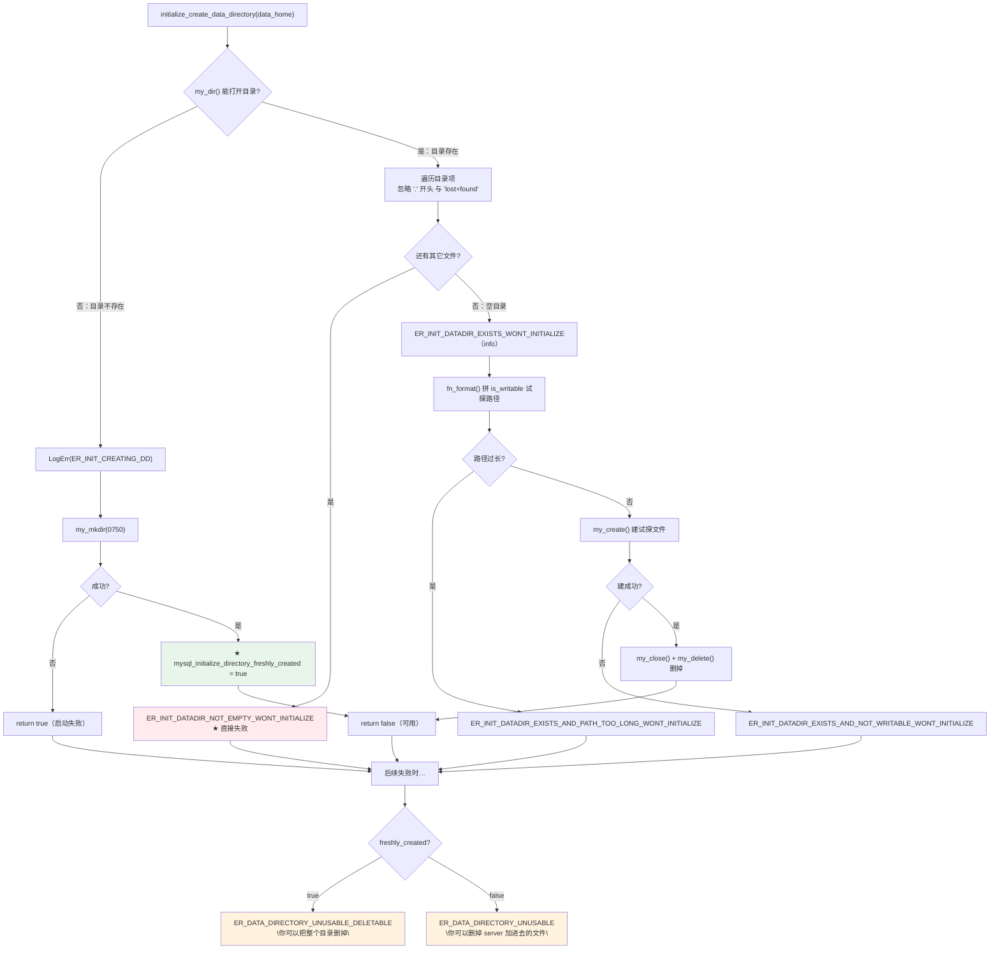
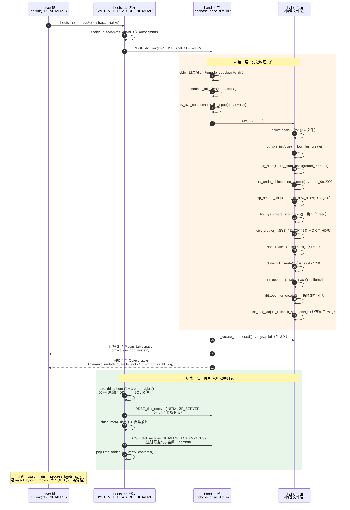

# 数据目录初始化（`--initialize` / bootstrap）深度解析

> 基于 MySQL 8.0.39 源码，涵盖 `mysqld --initialize` / `--initialize-insecure` 的全链路：选项判定 → 数据目录准备 → Data Dictionary 自举 → InnoDB 建库 → 系统表与预置数据 → root 口令与证书 → 退出。
>
> **本篇横跨 server 层与 InnoDB 层**，讲完「数据目录从无到有」这一段纵向闭环：server 侧选项判定 → DD 自举 → **下探到 InnoDB 建库（`srv_start(true)` 全流程）** → root 口令与证书 → 退出。
> 已存在数据目录时的启动走 [`02_startup.md`](02_startup.md)；
> 关闭与退出码走 [`03_shutdown.md`](03_shutdown.md)；
> mysql-test 复用同一 bootstrap 机制搭建测试实例，见 [`../infra/mtr.md`](../infra/mtr.md)；
> DD 本身的对象模型与缓存体系见 [`../dd/dd.md`](../dd/dd.md)。

## 目录

- [概述](#概述)
- [理论基础](#理论基础)
- [核心实现](#核心实现)
- [★ 本机制里的工程实现技法](#-本机制里的工程实现技法)
- [可观测性](#可观测性)
- [Misc](#misc)
- [参考](#参考)

---

## 概述

### 是什么

`mysqld --initialize` 是 MySQL 8.0 内建的数据目录初始化器：它让 **服务器进程自己**在一个空目录里创建出一套可以启动的最小数据集，然后**立刻退出**，不做服务器。

一句话概括它的本质：**MySQL 用自己来创造自己**——用 server 自己的 SQL 引擎（解析器 + `mysql_execute_command` + InnoDB）执行 `CREATE TABLE` / `CREATE USER`，造出容纳元数据的 Data Dictionary（DD）与 `mysql.*` 系统表。这是一次典型的**自举（bootstrapping）**。

### 用途

解决"第一次启动前数据目录里什么都没有"这个鸡生蛋问题：

- 8.0 的元数据权威是**数据字典表**（存在 `mysql.ibd` 里的 InnoDB 表），而不是 5.7 的 `.frm` 文件；
- 要建这些字典表，需要 InnoDB 已经起来、需要 SQL 执行链路可用；
- 要 InnoDB 起来，又需要先有 `ibdata1` / redo / undo / doublewrite 这些物理文件。

所以初始化必须**分两层、按序完成**：先让 InnoDB 建物理文件（`DDSE_dict_init` → `srv_start(true)`），再用 SQL 建字典表与系统表（`bootstrap::initialize` + `process_bootstrap`）。

### 版本演进

| 版本 | 变化 |
|------|------|
| 5.6 / 5.7 | **外部脚本**：`mysql_install_db`（Perl/Shell）+ `mysql_ssl_rsa_setup`。它启动一个 `mysqld --bootstrap` 子进程灌 SQL；系统表定义写在 `scripts/mysql_system_tables.sql` 里；元数据是 `.frm` + `mysql.proc` 等 MyISAM 表 |
| 8.0 | **内建化**：`mysql_install_db` **被删除**，改为 `mysqld --initialize` / `--initialize-insecure`（WL#6391 系列的一部分）。新增：① DD 表**不再由 SQL 脚本建**，而是 C++ 里 `Object_table_definition` 硬编码建表；② 证书/RSA 密钥自动生成也并进初始化；③ `--initialize` 结束时打印随机 root 口令 |
| 8.0.16+ | 引入 `dd::upgrade` 框架与 `--upgrade=NONE/MINIMAL/AUTO/FORCE`，初始化与升级两条路径在 `DD_bootstrap_ctx::Stage` 上彻底分叉 |
| 8.0.30 | redo 从固定的 `ib_logfile0/1` 改为 `#innodb_redo/#ib_redoN`，初始化时创建的文件布局随之改变 |
| 8.4 / 9.x | `mysql_native_password` 插件默认关闭（影响 `mysql_system_users.sql` 里内部用户的认证串写法）；`--initialize` 的骨架不变 |

> 演进动机写在「理论基础 → 他库对比与演进动机」。

---

## 理论基础

### 设计思想与权衡

#### 一、为什么把初始化做进 `mysqld`，而不是留一个外部脚本

**`--initialize` 不是系统变量，而是 `my_long_early_options[]` 里的纯命令行选项**（`sql/mysqld.cc:8892`）：

```cpp
/*
  定义了需要提前解析的 sys_vars
*/
struct my_option my_long_early_options[] = {
#if !defined(_WIN32)
    {"daemonize", 'D', "Run mysqld as sysv daemon", ...},
#endif
    {"skip-grant-tables", 0,
     "Start without grant tables. This gives all users FULL ACCESS to all "
     "tables.", &opt_noacl, &opt_noacl, nullptr, GET_BOOL, NO_ARG, 0, 0, 0,
     nullptr, 0, nullptr},
    {"help", '?', ...}, {"verbose", 'v', ...}, {"version", 'V', ...},
    {"initialize", 'I',                          // ★ 短选项就是 -I
     "Create the default database and exit."
     " Create a super user with a random expired password and store it into "
     "the log.",
     &opt_initialize, &opt_initialize, nullptr, GET_BOOL, NO_ARG, 0, 0, 0,
     nullptr, 0, nullptr},
    {"initialize-insecure", 0,                   // ★ 没有短选项
     "Create the default database and exit."
     " Create a super user with empty password.",
     &opt_initialize_insecure, &opt_initialize_insecure, nullptr, GET_BOOL,
     NO_ARG, 0, 0, 0, nullptr, 0, nullptr},
    ...};
```

> ⚠️ **勘误**：`opt_initialize` 定义在 `sql/mysqld.cc:1228`，但 **`opt_initialize_insecure` 定义在 `sql/sql_initialize.cc:61`**（mysqld.cc 只是 `#include "sql/sql_initialize.h"`）。两者都**不在 `sys_vars.cc`**，所以 `SHOW VARIABLES` 查不到、SET 改不了。

**为什么必须"提前解析"**（`handle_early_options()`，`:8732`）：

```cpp
  /* Add the system variables parsed early */
  sys_var_add_options(&all_early_options, sys_var::PARSE_EARLY);
  /* Add the command line options parsed early */
  for (my_option *opt = my_long_early_options; opt->name != nullptr; opt++)
    all_early_options.push_back(*opt);
  add_terminator(&all_early_options);
```

**初始化期的选项改写**（`adjust_related_options()`，`:8860`）——只有一条：

```cpp
static void adjust_related_options(ulong *requested_open_files) {
  /*
    In bootstrap, disable grant tables (about to be created)
  */
  if (opt_initialize) opt_noacl = true;   // ★★ grant 表此刻还没建出来
  /* The order is critical here, because of dependencies. */
  adjust_open_files_limit(requested_open_files);
  adjust_max_connections(*requested_open_files);
  adjust_table_cache_size(*requested_open_files);
  adjust_table_def_size();
}
```

同一语义族的其他初始化期改写：

```cpp
// :4861 —— 强制关 binlog
  if (opt_initialize || opt_initialize_insecure) {
    /*
      System tables initialization are not binary logged (regardless
      --log-bin option). ...
    */
    opt_bin_log = false;
  }
// :6816 —— 日志只输出 FILE（mysql.general_log / slow_log 还没建）
  if (opt_initialize) log_output_options = LOG_FILE;
// :8166 —— 不起复制线程
  if (opt_initialize) opt_skip_replica_start = true;
// :6596 —— 不动态加载插件
  if (opt_initialize) flags |= PLUGIN_INIT_SKIP_DYNAMIC_LOADING;
// :7758 —— 与 --daemonize 互斥
  if (opt_initialize && opt_daemonize) {
    fprintf(stderr, "Initialize and daemon options are incompatible.\n");
    unireg_abort(MYSQLD_ABORT_EXIT);
  }
```

**`mysqld_main()` 里的两处分流**：

```cpp
// :6545 —— ① DD 初始化路径分流
  if (opt_initialize) {
    if (!is_help_or_validate_option()) {
      if (dd::init(dd::enum_dd_init_type::DD_INITIALIZE)) {
        LogErr(ERROR_LEVEL, ER_DD_INIT_FAILED); unireg_abort(1);
      }
      if (dd::init(dd::enum_dd_init_type::DD_INITIALIZE_SYSTEM_VIEWS)) {
        LogErr(ERROR_LEVEL, ER_SYSTEM_VIEW_INIT_FAILED); unireg_abort(1);
      }
    }
  } else {
    if (!is_help_or_validate_option() &&
        dd::init(dd::enum_dd_init_type::DD_RESTART_OR_UPGRADE)) { ... }
  }

// :8218 —— ② bootstrap 总入口（--initialize 从这里就再也不返回）
  process_bootstrap();
// :5236 —— ③ 建数据目录（只有 --initialize，不含 --initialize-insecure）
  if (unlikely(opt_initialize) &&
      initialize_create_data_directory(mysql_real_data_home)) return 1;
```

**★ `process_bootstrap()` 全文**（`sql/mysqld.cc:8654`）：

```cpp
/**
  Execute the bootstrap thread, if required.

  When mysqld is started with --initialize only,
  the bootstrap thread executes
  - compiled in statements.
  - create the non-DD based INFORMATION_SCHEMA.
  and the server exits.

  When mysqld is started with --init-file only,
  the bootstrap thread executes SQL statements provided
  in the input text file, and the server continues and serves requests.

  When mysqld is started with both --initialize and --init-file,
  the bootstrap thread:
  - executes compiled in statements,
  - executes SQL statements in the --init-file.
  - creates the non-DD based INFORMATION_SCHEMA.
  The server then exits.

  Compiled in statements are executed in a privileged mode,
  with SYSTEM_THREAD_SERVER_INITIALIZE.
*/
static void process_bootstrap() {
  MYSQL_FILE *init_file = nullptr;
  const char *init_file_name = nullptr;
  enum_thread_type system_thread;
  bool need_bootstrap = false;

  if (opt_initialize) {
    // Make sure we can process SIGHUP during bootstrap.
    server_components_initialized();
    need_bootstrap = true;
    system_thread = SYSTEM_THREAD_SERVER_INITIALIZE;   // ★ 特权：允许访问 DD 表
  } else {
    system_thread = SYSTEM_THREAD_INIT_FILE;           // ★ 禁止访问 DD 表
  }

  if (opt_init_file != nullptr) {                      // ★ --init-file 与 --initialize 不互斥
    if (*opt_init_file != '\0') {
      init_file_name = opt_init_file;
      LogErr(INFORMATION_LEVEL, ER_BEG_INITFILE, init_file_name);
      init_file = mysql_file_fopen(key_file_init, init_file_name, O_RDONLY,
                                   MYF(MY_WME));
      need_bootstrap = true;
    }
    if (init_file == nullptr) {
      LogErr(ERROR_LEVEL, ER_INIT_CANT_OPEN_BOOTSTRAP_FILE, init_file_name);
      unireg_abort(MYSQLD_ABORT_EXIT);
    }
  }

  if (need_bootstrap) {
    bool error = bootstrap::run_bootstrap_thread(init_file_name, init_file,
                                                 nullptr, system_thread);

    if (init_file != nullptr) {
      mysql_file_fclose(init_file, MYF(MY_WME));
      LogErr(INFORMATION_LEVEL, ER_END_INITFILE, init_file_name);
    }
    if (error) {
      /* Abort during system initialization, but not init-file execution */
      if (system_thread == SYSTEM_THREAD_SERVER_INITIALIZE) {
        unireg_abort(MYSQLD_ABORT_EXIT);   // ★ 单纯 init-file 失败不退出（只警告）
      }
    }

    if (opt_initialize) {
      // Create non DD based system views during --initialize.
      error = dd::init(
          dd::enum_dd_init_type::DD_INITIALIZE_NON_DD_BASED_SYSTEM_VIEWS);
      if (error != 0) {
        LogErr(ERROR_LEVEL, ER_SYSTEM_VIEW_INIT_FAILED);
        unireg_abort(MYSQLD_ABORT_EXIT);
      }
      unireg_abort(MYSQLD_SUCCESS_EXIT);   // ★★★ 成功终点：永不返回
    }
  }
  return;   // ★ 只有 --init-file（非 --initialize）会走到这里
}
```

**`unireg_abort()` 里针对初始化的特化**（`:2451`）：

```cpp
static void unireg_abort(int exit_code) {
  if (opt_initialize && exit_code && !opt_validate_config)
    LogErr(ERROR_LEVEL,
           mysql_initialize_directory_freshly_created
               ? ER_DATA_DIRECTORY_UNUSABLE_DELETABLE     // ★ 本次新建 → 提示可删
               : ER_DATA_DIRECTORY_UNUSABLE,              // ★ 目录本来就存在 → 别乱删
           mysql_real_data_home);
  ...
  clean_up(!is_help_or_validate_option() && !daemon_launcher_quiet &&
           (exit_code || !opt_initialize));   // ★ --initialize 成功（exit_code==0）时不做 clean_up
  mysqld_exit(exit_code);
}
```

```cpp
// :2505
[[noreturn]] static void mysqld_exit(int exit_code);   // ★ [[noreturn]]

static void mysqld_exit(int exit_code) {
  assert((exit_code >= MYSQLD_SUCCESS_EXIT && exit_code <= MYSQLD_ABORT_EXIT) ||
         exit_code == MYSQLD_RESTART_EXIT);
  mysql_audit_finalize();
  Srv_session::module_deinit();
  delete_optimizer_cost_module();
  clean_up_mutexes();
  my_end(opt_endinfo ? MY_CHECK_ERROR | MY_GIVE_INFO : 0);
  destroy_error_log();
  ...
  exit(exit_code);
}
```

```cpp
// sql/sql_const.h:241
constexpr const int MYSQLD_SUCCESS_EXIT{0};   // ★ 不在 mysqld.h！
constexpr const int MYSQLD_ABORT_EXIT{1};     // systemd 不应自动重启
```

> ★★ "摇身一变成服务器"为什么不行：看 `mysqld_exit()` 做的事——`mysql_audit_finalize()` / `clean_up_mutexes()` / `my_end()` / `destroy_error_log()` / `shutdown_performance_schema()`。这些是**单向不可逆**的全局析构。而 `--initialize` 成功路径**故意跳过** `clean_up()`（见上面的 `!opt_initialize`），因为此刻进程处于 `opt_noacl` / 无 listener / 无 PFS 运行时的畸形态，直接 `exit(0)` 最干净。

**`initialize_create_data_directory()`**（`sql/sql_initialize.cc:227`）——三条分支：

```cpp
bool initialize_create_data_directory(const char *data_home) {
  MY_DIR *dir;
  int flags =
#ifdef _WIN32
      0
#else
      S_IRWXU | S_IRGRP | S_IXGRP          // ★ 0750 风格
#endif
      ;
  if (nullptr != (dir = my_dir(data_home, MYF(MY_DONT_SORT)))) {
    /* ① 目录已存在 */
    bool no_files = true;
    for (uint i = 0; i < dir->number_off_files; i++) {
      FILEINFO *file = dir->dir_entry + i;
      /* Ignore files that start with . or == 'lost+found'. */
      if (file->name[0] != '.' && strcmp(file->name, "lost+found")) {
        no_files = false; break;
      }
    }
    my_dirend(dir);
    if (!no_files) {
      LogErr(ERROR_LEVEL, ER_INIT_DATADIR_NOT_EMPTY_WONT_INITIALIZE);
      return true;                        // ★ 非空 → 拒绝
    }
    LogErr(INFORMATION_LEVEL, ER_INIT_DATADIR_EXISTS_WONT_INITIALIZE);

    /* ② 存在但为空：建一个临时文件 is_writable 探测可写性 */
    if (-1 != (fd = my_create(path, 0, flags, MYF(MY_WME)))) {
      my_close(fd, MYF(MY_WME)); my_delete(path, MYF(MY_WME));
    } else {
      LogErr(ERROR_LEVEL, ER_INIT_DATADIR_EXISTS_AND_NOT_WRITABLE_WONT_INITIALIZE);
      return true;
    }
    return false;
  }
  /* ③ 不存在：创建 */
  LogErr(INFORMATION_LEVEL, ER_INIT_CREATING_DD, data_home);
  if (my_mkdir(data_home, flags, MYF(MY_WME))) return true;
  mysql_initialize_directory_freshly_created = true;   // ★ 失败时错误日志才会提示可删
  return false;
}
```

5.7 的 `mysql_install_db` 是 Perl 脚本，它做的事本质上是"拼一个 `mysqld --bootstrap` 命令行，把 `mysql_system_tables.sql` 灌进去"。8.0 把这一步**收回进程内**，收益是：

1. **只有一个真相来源**：初始化时建表走的代码路径与运行时 `CREATE TABLE` 走的路径**是同一条**（`dispatch_sql_command` → `mysql_execute_command` → `ha_create_table` → 写 DD）。外部脚本方案必然出现"脚本里写的 DDL 与实际引擎行为漂移"。
2. **不需要两次进程启动**：5.7 是"脚本 → fork mysqld --bootstrap → 退出 → 用户再启动 mysqld"，8.0 是"一次进程内完成并退出"。
3. **DD 表由 C++ 直接建**：字典表的定义本来就活在 C++ 里（`Object_table_definition::get_ddl()`），用 SQL 文件再描述一遍纯属重复，且必然不同步。

**放弃的方案**及其代价：

| 方案 | 为什么没选 |
|---|---|
| 保留 `mysql_install_db` 外部脚本 | 需要跨进程维护两套 DDL 定义；脚本无法直接访问 C++ 里的 DD 对象模型 |
| 生成一个独立的 `mysqld-init` 二进制 | 与 mysqld 共享的代码量太大，等于复制一份 server |
| 用一份"预打包的模板数据目录"解压 | 无法适配 `innodb_page_size` / `innodb_data_file_path` / 字符集等启动参数；也解决不了版本升级 |

**代价（这是权衡的另一半）**：`--initialize` 模式下服务器处于一个**高度畸形的中间态**，为了让它能跑下去必须全局旁路大量子系统。源码里这张"裁剪表"长得惊人：

| 位置 | 裁剪内容 | 为什么必须裁 |
|---|---|---|
| `adjust_related_options` | `opt_noacl = true` | grant 表还没建，权限检查无从谈起 |
| `init_common_variables` | `opt_bin_log = false` | 没有 `mysql.gtid_executed`，也无需记 binlog |
| `network_init` | 直接 `return false` | 不监听端口，外部连不进来 |
| `plugin_register_dynamic_and_init_all` | 加 `PLUGIN_INIT_SKIP_DYNAMIC_LOADING` | `mysql.plugin` 表不存在，动态插件无处可注册 |
| PFS | `--initialize` 时不初始化 PFS **运行时**（但 PFS **表**照建） | PFS 运行时需要 DD 与 instrumentation 完整 |
| `create_pid_file` | 跳过 | 进程马上就退出 |
| `read_gtid_executed_from_table` | 跳过 | 表不存在 |

即：**初始化态的 server 是一台被拆掉大半零件的 server**。这个事实决定了后面一系列设计（如"为什么必须立刻退出"）。

#### 二、为什么 bootstrap 必须跑在独立线程 + 独立 `THD`

这是本篇最容易被忽视、但最能体现工程判断的一点。

**需要独立 `THD` 的理由**：bootstrap 要执行真正的 DDL，而 DDL 需要完整的会话上下文——事务、MDL、Diagnostics Area、DD client、mem_root。主线程没有 `THD`，临时造一个复用会污染全局状态。

**需要独立线程的理由**（`run_bootstrap_thread` 里有直接证据）：

```cpp
  my_thread_attr_getstacksize(&thr_attr, &stacksize);
  if (stacksize < my_thread_stack_size) {
    my_thread_attr_setstacksize(&thr_attr, my_thread_stack_size);
  }
  (void)pthread_attr_setscope(&thr_attr, PTHREAD_SCOPE_SYSTEM);
```

即：**默认线程栈不够深**。初始化要执行的 SQL 包含 `fill_help_tables.sql` 里那种巨长的 `INSERT`（`MAX_BOOTSTRAP_QUERY_SIZE = 74000`），解析与 DDL 递归深度远超普通查询，必须显式把栈抬到 `my_thread_stack_size`。

但注意：**开线程不是为了并发**。主线程随后 `my_thread_join()` 阻塞等待，同步取回 `args.m_bootstrap_error`。所以这里线程的作用是**上下文隔离**（独立栈 + 完整 THD 生命周期 + PFS/THD manager 注册），不是并行。

**`system_thread` 标记是权限隔离的闸门**：

```
SYSTEM_THREAD_DD_INITIALIZE     = 512
SYSTEM_THREAD_DD_RESTART        = 1024
SYSTEM_THREAD_SERVER_INITIALIZE = 2048
SYSTEM_THREAD_INIT_FILE         = 4096
SYSTEM_THREAD_SERVER_UPGRADE    = 8192
```

在 `handle_bootstrap_impl` 里它甚至**中途被改写**：执行编译进来的语句时是 `SYSTEM_THREAD_SERVER_INITIALIZE`（允许访问 DD 表），切到 `--init-file` 时改成 `SYSTEM_THREAD_INIT_FILE`（**禁止**访问 DD 表）。debug 构建下这两处各有 `assert` 守门。设计意图很清晰：编译进来的语句是官方的、可信的；用户用 `--init-file` 塞进来的语句不该碰字典表。

#### 三、为什么初始化完必须立刻退出，而不是"摇身一变成服务器"

`--initialize` 完成后走的是 `unireg_abort(MYSQLD_SUCCESS_EXIT)`——**用"abort 路径"走成功的退出码**。这一点看代码会觉得别扭，但它恰恰是对的：

1. 上面那张裁剪表决定了当前进程状态**与运行态不兼容**（`opt_noacl`、`opt_bin_log=false`、PFS 运行时未起、无 listener）。要"继续跑"就得把这些重新初始化一遍，等于重启。
2. `process_bootstrap()` 之后 `mysqld_main` **根本没有回到主流程的代码路径**——`unireg_abort` 是 `[[noreturn]]`。这不是疏忽，是刻意用控制流保证"初始化完就走"。
3. 退出码语义：`MYSQLD_SUCCESS_EXIT = 0`，daemon 化父进程 / 外部脚本据此判断成功。

#### 四、"用 SQL 建系统表" vs "用 C++ 建字典表" 的双轨

这是 8.0 相对 5.7 最重要的结构性变化：

| 类别 | 谁建 | 定义在哪 |
|---|---|---|
| **DD 表**（`mysql.tables` / `mysql.columns` / `mysql.indexes` …） | **C++**：`System_tables` 注册表 + `Object_table_definition::get_ddl()` | `sql/dd/impl/system_registry.cc`（`add_inert_dd_tables` / `add_remaining_dd_tables`）、各 `sql/dd/impl/tables/*.cc` |
| **非 DD 的 `mysql.*` 系统表**（`user` / `db` / `tables_priv` / `help_*` / `time_zone*` / `component` …） | **SQL**：`scripts/mysql_system_tables.sql` 等 | `scripts/*.sql`，经 `comp_sql` 编进二进制 |
| **预置数据**（字符集/排序规则、SRS 空间参考系、help 内容、sys schema） | **SQL 数据文件** | `mysql_system_tables_data.sql`（5.26 MB）、`fill_help_tables.sql`（1.42 MB）、`sys_schema/*.sql` |
| **InnoDB 私有 DD 表**（`innodb_dynamic_metadata`、`innodb_table_stats`） | **C++**，由引擎经 `ddse_dict_init` 回调登记 | `ha_innodb.cc` |

**为什么这样分**：DD 表的结构必须与 C++ 对象模型**逐字节严格对应**（它们是同一份 schema 的两种表示），交给 SQL 文件就等于允许漂移；而 `user` / `help_*` 这类"内容型"表本质是数据而非元数据，用 SQL 描述最自然，且升级时可以用 `mysql_system_tables_fix.sql` 做 ALTER。

### 理论溯源

| 思想 / 理论 | 源码落点 |
|---|---|
| **自举（bootstrapping / self-hosting）**——用一个系统的半成品版本构造它的完整版本（编译器自举的经典形态） | `bootstrap::initialize()` 先用 `store_predefined_tablespace_metadata` 在**内存**里造出 DD 对象的脚手架，再 `flush_meta_data()` 把它们**持久化成真正的 DD 表**，最后 `verify_contents()` 回头校验"造出来的表确实能查到"。三步就是"自举 → 落地 → 自检" |
| **元循环求值（metacircular evaluation）**——SICP 里"用 evaluator 解释 evaluator" | bootstrap 线程用 `dispatch_sql_command` 执行 DDL，而 DDL 的落点正是这套执行器要读的字典表 |
| **分层构建（staged construction）** | `DD_bootstrap_ctx::Stage` 的 11 态状态机：`NOT_STARTED → STARTED → CREATED_TABLESPACES → FETCHED_PROPERTIES → CREATED_TABLES → SYNCED → UPGRADED_TABLES → POPULATED → STORED_DD_META_DATA → VERSION_UPDATED → FINISHED`。初始化只走其中 8 态，升级走全 11 态 |
| **schema 版本化与双版本表定义（target vs actual）** | `create_target_table()` vs `create_actual_table()`：升级的第一阶段建 actual（旧版本）表以读出旧数据，第二阶段建 target（新版本）表把数据迁过去。初始化只有 target。分类依据 WL#6391（注释原文：`Classification of tables based on WL#6391.`） |

### 算法与数据结构

| 结构 | 用途 | 复杂度 / 特点 |
|---|---|---|
| `Compiled_in_command_iterator` | 遍历"编译进二进制的 SQL 语句二维数组" | 二维游标：外层 `m_cmds_ofs` 走 `cmds[]`（8 组脚本），内层 `m_cmd_ofs` 走某组 `const char*[]`。每切一组打一条进度日志 |
| `File_command_iterator` | 遍历 `--init-file` 文件 | 基于 `sql_bootstrap.cc` 的词法切分器 |
| `bootstrap_parser_state` 状态机 | 切分 SQL 文本为语句 | 6 态：`NORMAL / IN_SINGLE_QUOTE / IN_DOUBLE_QUOTE / IN_DASH_DASH_COMMENT / IN_SLASH_STAR_COMMENT / IN_POUND_COMMENT`；两种分隔符 `;` 与 `$$` |
| `DD_bootstrap_ctx` | 全局单例，保存 bootstrap 阶段与版本判定 | 用 `is_restart/is_dd_upgrade/is_server_upgrade/is_minor_downgrade/is_initialize` 五个布尔把"这次启动到底是哪一类"编码出来，全代码据此分叉 |
| `Object_table_definition` | 一张 DD 表的 DDL 与 DML 定义 | `get_ddl()` 出 `CREATE TABLE`，`get_dml()` 出预置 `INSERT`，`populate()` 是 C++ 层的填充钩子 |

### 他库对比与演进动机

| 系统 | 做法 | 与 MySQL 的差异 |
|---|---|---|
| **PostgreSQL** | 独立二进制 `initdb`：fork 一个 `--boot` 模式的 `postgres` backend，用 `postgres.bki`（编译期生成的"裸"建表指令文件）灌数据 | 理念几乎相同（自举 + 编译期生成的建表脚本）。差异：PG 用 **BKI 这种非 SQL 的低级指令**（绕过 SQL 层直接用 `heap_create`/`insert`），MySQL 8.0 走**真正的 SQL DDL 路径**。MySQL 的代价是 bootstrap 需要完整 THD 与 MDL；收益是建表行为与运行期 100% 一致 |
| **Oracle** | `dbca` 或 `CREATE DATABASE` 语句，数据字典由 `sql.bsq`（SQL 脚本）在建库时执行 | 与 5.7 的 `mysql_system_tables.sql` 同宗。MySQL 8.0 把"字典表"从脚本里抽出来交给 C++，是往 PG 的方向靠 |
| **MariaDB** | 保留 `mysql_install_db` 外部脚本 | 未内建化；MariaDB 没有 8.0 的事务型 DD，字典仍以 `.frm` + 表形式存在，脚本方案的代价对它小得多 |
| **SQLite / BerkeleyDB** | 无需初始化，首次打开自动建库 | 嵌入式库，规模与 MySQL 不可比 |

**演进动机（为什么 5.7 → 8.0 必须换）**：8.0 的 DD 是**事务型 InnoDB 表**。这意味着"建字典表"这个动作本身要被 redo 保护、要走 `ha_create_table`、要写 `mysql.tables` 行。5.7 那套"Perl 脚本 + 灌 SQL 建 MyISAM 表"的链路在事务语义上根本不成立（DDL 不原子，崩溃后字典半截）。把字典表定义移进 C++ 并走标准 DDL 路径，是让 DDL 原子化的前提。

---

## 核心实现

### 主链路

#### 三篇总览：生命周期与数据目录状态

三篇的分界线不是"模块"，而是**数据目录的状态**：


两处红色是**跨层耦合最强的地方**：启动的"两阶段插件注册"、关闭的"`pre_dd_shutdown` 屏障"——都是因为 8.0 把元数据放进了 InnoDB 表。虚线是循环：正常关闭回到启动；`fast_shutdown=2` 则直接跳到崩溃恢复。

> 本篇 = P0；[`02_startup.md`](02_startup.md) = P1；[`03_shutdown.md`](03_shutdown.md) = P2。

#### 初始化全链路（★ 右侧标出每一步在 datadir 里的产出物）

```
mysqld --initialize
│
├─[早期选项] handle_early_options()
│    my_long_early_options[] 解析 --initialize / --initialize-insecure
│    if (opt_initialize_insecure) opt_initialize = true;      ← insecure 是 initialize 的超集
│                                                                        ┌─ 产出 ─────────────┐
├─ adjust_related_options()                                              │（无文件）           │
│    if (opt_initialize) opt_noacl = true;                               └────────────────────┘
│
├─ init_common_variables()
│    ├─ opt_bin_log = false;  LogErr(ER_STARTING_INIT)
│    ├─ initialize_create_data_directory()   ← 建目录 / 校验空目录      ┌─ 产出 ─────────────┐
│    │                                                                  │ datadir/（0750）    │
│    └─ generate_server_uuid()                                          │ auto.cnf（uuid）    │
│                                                                       └────────────────────┘
├─ plugin_register_builtin_and_init_core_se()
│    └─ plugin_initialize → ha_initialize_handlerton → innodb_init()
│         只是登记 handlerton 回调（ddse_dict_init / dict_recover / sdi_*）
│         ★ 此刻【不建任何文件】
│
├─ dd::init(DD_INITIALIZE)                                              ┌─ 产出 ─────────────┐
│   └─ run_bootstrap_thread(&bootstrap::initialize,                     │ ibdata1            │
│                            SYSTEM_THREAD_DD_INITIALIZE)               │ #innodb_redo/       │
│      └─ bootstrap::initialize()                                       │   #ib_redo0         │
│         ├─ DDSE_dict_init(DICT_INIT_CREATE_FILES)                     │ undo_001 / undo_002 │
│         │    └─ innobase_init_files()                                 │ ibtmp1 + .ibt 池   │
│         │        ├─ srv_start(true)                                   │ mysql.ibd           │
│         │        │    ① ibdata1  ② redo  ③ undo                       │ （dblwr v2 文件）   │
│         │        │    ④ fsp_header  ⑤ rseg#1  ⑥ dict_create           └────────────────────┘
│         │        │    ⑦ SDI_0  ⑧ dblwr v1(page 64/128)
│         │        └─ dd_create_hardcoded()  → mysql.ibd（含 SDI）
│         └─ initialize_dictionary()
│              store_predefined_tablespace_metadata   (内存脚手架)
│              → create_dd_schema (CREATE SCHEMA mysql)
│              → initialize_dd_properties (建 dd_properties + 写 DD_VERSION)
│              → create_tables (CREATE TABLE × N，C++ 硬编码 DDL)
│              → flush_meta_data ★ 自举落地：把脚手架写成真正的 DD 行
│              → populate_tables (字符集/排序规则)
│              → verify_contents (自检：用刚建好的 DD 查刚建好的 DD)
│              → update_versions
│
├─ dd::init(DD_INITIALIZE_SYSTEM_VIEWS)      ← I_S 视图（建表脚本要查 I_S）
├─ dd::performance_schema::init_pfs_tables(DD_INITIALIZE)
│
├─ init_ssl_communication()                                             ┌─ 产出 ─────────────┐
│    自动生成（auto_generate_certs 默认 ON）                             │ ca.pem / ca-key.pem │
│                                                                       │ server-cert/key.pem │
│                                                                       │ client-cert/key.pem │
│                                                                       │ private_key.pem     │
│                                                                       │ public_key.pem      │
│                                                                       └────────────────────┘
│
├─ process_bootstrap()
│   └─ run_bootstrap_thread(nullptr, init_file, nullptr,
│                            SYSTEM_THREAD_SERVER_INITIALIZE)
│      └─ handle_bootstrap_impl()
│         └─ process_iterator(Compiled_in_command_iterator)   ← 走完整 DDL 路径
│              USE mysql
│              → mysql_system_tables[]      (CREATE TABLE user/db/tables_priv/...)
│              → initialization_data[]      (FLUSH PRIVILEGES
│                                            + CREATE USER root@localhost  ← ★ 在代码里
│                                            + GRANT + global_grants)
│              → mysql_system_data[]        (字符集/排序规则/SRS，5.26 MB)
│              → fill_help_tables[]         (help 内容，1.42 MB)
│              → mysql_system_users[]       (mysql.session / mysql.infoschema)
│              → mysql_sys_schema[]         (sys schema)
│            （若给了 --init-file）切 system_thread=INIT_FILE，跑 File_command_iterator
│            ★ init-file 失败【不会】abort
│
├─ dd::init(DD_INITIALIZE_NON_DD_BASED_SYSTEM_VIEWS)
│
└─ unireg_abort(MYSQLD_SUCCESS_EXIT)   → mysqld_exit(0)   ★ 进程退出，不做服务器
      └─ 用 abort 路径走【成功】退出码，因为此刻进程处于畸形态
         （opt_noacl / 无 listener / 无 PFS 运行时）
```

**读图要点**：文件产出集中在两处——`srv_start(true)`（物理文件）与 `init_ssl_communication()`（证书）；而"表"的产出分两批——DD 表在 `dd::init()` 里用 C++ 硬编码 DDL 建，`mysql.*` 系统表在 `process_bootstrap()` 里用 SQL 建。**两条轨道，别混**。
```
│    my_long_early_options[] 解析 --initialize / --initialize-insecure
│    if (opt_initialize_insecure) opt_initialize = true;      ← insecure 是 initialize 的超集
│
├─ adjust_related_options()
│    if (opt_initialize) opt_noacl = true;
│
├─ init_common_variables()
│    ├─ opt_bin_log = false;  LogErr(ER_STARTING_INIT)
│    ├─ initialize_create_data_directory(mysql_real_data_home)   ← 建目录 / 校验空目录
│    └─ generate_server_uuid()                                    ← 写 auto.cnf
│
├─ plugin_register_builtin_and_init_core_se()
│    └─ plugin_initialize → ha_initialize_handlerton → innodb_init()
│         只是登记 handlerton 回调（ddse_dict_init / dict_recover / sdi_*），此刻不建文件
│
├─ dd::init(DD_INITIALIZE)
│   └─ Dictionary_impl::init → run_bootstrap_thread(&bootstrap::initialize,
│                                                   SYSTEM_THREAD_DD_INITIALIZE)
│      └─ bootstrap::initialize()
│         ├─ DDSE_dict_init(DICT_INIT_CREATE_FILES)  → innobase_ddse_dict_init
│         │    └─ innobase_init_files()
│         │        ├─ srv_start(true)  → ibdata1 / #innodb_redo / undo_00N / dblwr / dict_create
│         │        └─ dd_create_hardcoded()  → mysql.ibd
│         └─ initialize_dictionary()
│              store_predefined_tablespace_metadata   (内存脚手架)
│              → create_dd_schema (CREATE SCHEMA mysql)
│              → initialize_dd_properties (建 dd_properties 表 + 写 DD_VERSION)
│              → create_tables (CREATE TABLE × N，硬编码 DDL)
│              → flush_meta_data (把脚手架落盘成真正的 DD 行)
│              → populate_tables (字符集/排序规则/预置数据)
│              → verify_contents (自检)
│              → update_versions
│
├─ dd::init(DD_INITIALIZE_SYSTEM_VIEWS)          ← I_S 视图（mysql_system_tables.sql 要查 I_S）
├─ dd::performance_schema::init_pfs_tables(DD_INITIALIZE)
├─ init_ssl_communication()                      ← 生成 ca.pem / server-cert.pem / RSA 密钥
│
├─ process_bootstrap()
│   └─ run_bootstrap_thread(nullptr, init_file, nullptr, SYSTEM_THREAD_SERVER_INITIALIZE)
│      └─ handle_bootstrap_impl()
│         └─ process_iterator(Compiled_in_command_iterator)
│              USE mysql
│              → mysql_system_tables[]      (CREATE TABLE user/db/tables_priv/...)
│              → initialization_data[]      (FLUSH PRIVILEGES + CREATE USER root@localhost
│                                            + GRANT + global_grants)
│              → mysql_system_data[]        (字符集/排序规则/SRS，5.26 MB)
│              → fill_help_tables[]         (help 内容，1.42 MB)
│              → mysql_system_users[]       (mysql.session / mysql.infoschema)
│              → mysql_sys_schema[]         (sys schema)
│            （若给了 --init-file）切 system_thread=INIT_FILE，跑 File_command_iterator
│
├─ dd::init(DD_INITIALIZE_NON_DD_BASED_SYSTEM_VIEWS)
└─ unireg_abort(MYSQLD_SUCCESS_EXIT)   → mysqld_exit(0)   ★ 进程退出
```

### 一、模式判定与选项

#### 选项为什么是"命令行专用、查不到、改不了"

`--initialize` / `--initialize-insecure` **不在 `sys_vars.cc` 里**，它们是 `my_long_early_options[]` 里的裸 `my_option`：

```cpp
    {"initialize", 'I',
     "Create the default database and exit."
     " Create a super user with a random expired password and store it into "
     "the log.",
     &opt_initialize, &opt_initialize, nullptr, GET_BOOL, NO_ARG, 0, 0, 0,
     nullptr, 0, nullptr},
    {"initialize-insecure", 0,
     "Create the default database and exit."
     " Create a super user with empty password.",
     &opt_initialize_insecure, &opt_initialize_insecure, nullptr, GET_BOOL,
     NO_ARG, 0, 0, 0, nullptr, 0, nullptr},
```

后果有三条，运维上都用得上：

1. 它们是 `my_option` 而非 `sys_var` ⇒ **没有 `SHOW VARIABLES` 条目**、`SET GLOBAL` 无效、也不进 persisted variables。
2. 变量名反而分散在两处：`opt_initialize` 在 `mysqld.cc`，`opt_initialize_insecure` 在 `sql_initialize.cc`。
3. 因为注册在 **early** 表里，它们早于 `init_common_variables()` 生效——这是硬需求，`initialize_create_data_directory()` 就在 `init_common_variables()` 里被调用。

#### `--initialize-insecure` 是 `--initialize` 的超集

```cpp
  ho_error = handle_options(&remaining_argc, &remaining_argv,
                            &all_early_options[0], mysqld_get_one_option);
  if (ho_error == 0) {
    remaining_argc++;
    remaining_argv--;

    if (opt_initialize_insecure) opt_initialize = true;
  }
```

`opt_initialize` 实际语义是"处于初始化模式"的总开关，全代码凡判断模式只测它；`opt_initialize_insecure` 只是一个**修饰位**，唯一影响的是 root 口令怎么生成。仍有个别地方写 `opt_initialize || opt_initialize_insecure`，属于提升之后的历史冗余。

#### `--initialize` 的行为裁剪总表

| 调用点 | 裁剪 |
|---|---|
| `network_init` | `if (opt_initialize) return false;` —— 完全不监听 |
| `init_common_variables` | `opt_bin_log = false` |
| `plugin_register_dynamic_and_init_all` | 加 `PLUGIN_INIT_SKIP_DYNAMIC_LOADING`（注释说明：mysql 表/PFS/DD 都还没建好） |
| PFS 运行时 / lock-order 工具 / 资源组 | 均跳过 |
| `create_pid_file` | 跳过 |
| `read_gtid_executed_from_table` | 跳过 |
| `reload_optimizer_cost_constants` | 跳过 |
| `mysql_component_infrastructure_init` | 跳过（不读 `mysql.component`） |
| `my_tz_init(..., bootstrap=true)` | 第三参为真 ⇒ 时区表**需要建** |
| `init_acl_memory()` | 显式预分配 ACL 内存（因为 `--noacl`） |
| `opt_skip_replica_start = true` | 不起复制线程 |
| `Events::init(opt_noacl || opt_initialize)` | 事件调度器以 noacl 方式初始化 |
| `log_output_options = LOG_FILE` | 只写文件日志 |
| `opt_secure_file_priv = ""` | 放宽（并打 `ER_SEC_FILE_PRIV_IGNORED`） |
| `log_error_verbosity` 默认值 | `--help` 时改 1，`--initialize` 时保持 2 |
| 与 `--daemonize` | **显式互斥检查**，报 "Initialize and daemon options are incompatible." |
| `--user` 场景 | 建完目录后 `chown` 给 `--user` |

### 二、数据目录准备

#### 判定流程（三条分支、三种结果）



**两条运维要点**：① "空"的判据是"只含 `.` 开头文件或 `lost+found`"——为挂载点上的隐藏文件留的口子；② **失败的数据目录 MySQL 从不自动清理**，只提示用户自己删，且用 `freshly_created` 这个标志区分"整个删"还是"只删 server 加的文件"。

`initialize_create_data_directory()` 是初始化的第一个实质性动作：

```cpp
bool initialize_create_data_directory(const char *data_home) {
  MY_DIR *dir;
  int flags =
#ifndef _WIN32
      S_IRWXU | S_IRGRP | S_IXGRP
#else
      0
#endif
      ;

  if (nullptr != (dir = my_dir(data_home, MYF(MY_DONT_SORT)))) {
    bool no_files = true;
    char path[FN_REFLEN];
    File fd;

    /* Ignore files that start with . or == 'lost+found'. */
    for (uint i = 0; i < dir->number_off_files; i++) {
      FILEINFO *file = dir->dir_entry + i;
      if (file->name[0] != '.' && strcmp(file->name, "lost+found")) {
        no_files = false;
        break;
      }
    }
    my_dirend(dir);

    if (!no_files) {
      LogErr(ERROR_LEVEL, ER_INIT_DATADIR_NOT_EMPTY_WONT_INITIALIZE);
      return true;
    }

    LogErr(INFORMATION_LEVEL, ER_INIT_DATADIR_EXISTS_WONT_INITIALIZE);

    if (nullptr == fn_format(path, "is_writable", data_home, "",
                             MY_UNPACK_FILENAME | MY_SAFE_PATH)) {
      LogErr(ERROR_LEVEL,
             ER_INIT_DATADIR_EXISTS_AND_PATH_TOO_LONG_WONT_INITIALIZE);
      return true;
    }
    if (-1 != (fd = my_create(path, 0, flags, MYF(MY_WME)))) {
      my_close(fd, MYF(MY_WME));
      my_delete(path, MYF(MY_WME));
    } else {
      LogErr(ERROR_LEVEL,
             ER_INIT_DATADIR_EXISTS_AND_NOT_WRITABLE_WONT_INITIALIZE);
      return true;
    }

    /* the data dir found is usable */
    return false;
  }

  LogErr(INFORMATION_LEVEL, ER_INIT_CREATING_DD, data_home);
  if (my_mkdir(data_home, flags, MYF(MY_WME))) return true;

  mysql_initialize_directory_freshly_created = true;
  return false;
}
```

三条判定规则：

1. **目录已存在但非空** → 直接失败（`ER_INIT_DATADIR_NOT_EMPTY_WONT_INITIALIZE`）。"空"的判据是：只含 `.` 开头的文件或 `lost+found`——这是为挂载点上的隐藏文件留的口子。
2. **目录已存在且为空** → 写一次 `is_writable` 试探文件再删掉，验证真的可写。
3. **目录不存在** → `my_mkdir`，权限 `0750`，并置 `mysql_initialize_directory_freshly_created = true`。

最后这个标志只影响**失败时的错误文案**：新建的目录报 `ER_DATA_DIRECTORY_UNUSABLE_DELETABLE`（"你可以把整个目录删掉"），已存在的目录报 `ER_DATA_DIRECTORY_UNUSABLE`（"你可以删掉 server 加进去的文件"）。注意：**MySQL 从不自动清理失败的数据目录**，这是运维上必须手动处理的事。

### 三、Data Dictionary 自举（本篇最核心）

#### 3.1 入口与阶段机

```cpp
bool init(enum_dd_init_type dd_init) {
  if (dd_init == enum_dd_init_type::DD_INITIALIZE ||
      dd_init == enum_dd_init_type::DD_RESTART_OR_UPGRADE) {
    cache::Shared_dictionary_cache::init();
    System_tables::instance()->add_inert_dd_tables();
    System_views::instance()->init();
  }
  return Dictionary_impl::init(dd_init);
}
```

`add_inert_dd_tables()` 先只注册一张 `DD_properties`（"惰性"表=不参与升级比较的表），其余表要等 `DDSE_dict_init()` 从 InnoDB 拿到它私有的 DD 表清单后，才由 `add_remaining_dd_tables()` 补齐。**顺序不能反**：字典表的完整清单 = server 侧定义 ∪ DDSE 侧定义，而 DDSE 只有起来之后才知道自己有几张。

#### 3.2 `DD_bootstrap_ctx`：用版本比较编码"这次是哪种启动"

```cpp
  bool is_restart() const {
    return !opt_initialize && (m_actual_dd_version == dd::DD_VERSION) &&
           (m_upgraded_server_version == MYSQL_VERSION_ID);
  }
  bool is_dd_upgrade() const {
    return !opt_initialize && (m_actual_dd_version < dd::DD_VERSION);
  }
  bool is_server_upgrade() const {
    return !opt_initialize && (m_upgraded_server_version < MYSQL_VERSION_ID);
  }
  bool is_minor_downgrade() const {
    return !opt_initialize &&
           (m_actual_dd_version / 10000 == dd::DD_VERSION / 10000) &&
           (m_actual_dd_version > dd::DD_VERSION);
  }
  bool is_initialize() const {
    return opt_initialize && (m_actual_dd_version == dd::DD_VERSION);
  }
```

注意所有"升级/降级"判定都以 `!opt_initialize` 为前提。这就是为什么 `--initialize` 期间**所有版本校验都被跳过**——`initialize_dd_properties()` 里那段读 `DD_VERSION` / `MYSQLD_VERSION` 并做升降级判断的逻辑，整个被 `if (!opt_initialize)` 包着。

#### 3.3 `bootstrap::initialize()` 的十步

```cpp
bool initialize(THD *thd) {
  bootstrap::DD_bootstrap_ctx::instance().set_stage(bootstrap::Stage::STARTED);
  thd->variables.transaction_read_only = false;
  thd->tx_read_only = false;
  Disable_autocommit_guard autocommit_guard(thd);

  Dictionary_impl *d = dd::Dictionary_impl::instance();
  cache::Dictionary_client::Auto_releaser releaser(thd->dd_client());

  if (DDSE_dict_init(thd, DICT_INIT_CREATE_FILES, d->get_target_dd_version()) ||
      initialize_dictionary(thd, false, d)) {
    return true;
  }
  return false;
}
```

`initialize_dictionary()` 的骨架（初始化路径）：

```cpp
  store_predefined_tablespace_metadata(thd);   // ① 内存里造 mysql / innodb_system 两个 Tablespace 对象
  create_dd_schema(thd);                       // ② CREATE SCHEMA mysql + USE mysql
  initialize_dd_properties(thd);               // ③ 建 dd_properties 表，写入 DD_VERSION 等
  create_tables(thd, nullptr);                 // ④ 建所有 DD 表
  DDSE_dict_recover(thd, DICT_RECOVERY_INITIALIZE_SERVER, target_dd_version);
  flush_meta_data(thd);                        // ⑤ ★ 自举的"落地"：把内存对象写成真正的 DD 行
  DDSE_dict_recover(thd, DICT_RECOVERY_INITIALIZE_TABLESPACES, ...);
  populate_tables(thd);                        // ⑥ 灌预置数据
  update_properties(thd, nullptr, nullptr, "mysql");
  verify_contents(thd);                        // ⑦ 自检
  update_versions(thd, false);                 // ⑧ 写版本号
  // → Stage::FINISHED
```

**第 ⑤ 步是自举的关键**，值得单独看：

```cpp
  /* 先把 mysql schema 与 mysql tablespace 的 id 置为 INVALID，让 Storage_adapter
     把它们当成"新对象"插入，拿到真实 id */
  dd_schema_clone->set_id(INVALID_OBJECT_ID);
  dd_tspace_clone->set_id(INVALID_OBJECT_ID);
  Storage_adapter::instance()->store(thd, dd_schema_clone);
  Storage_adapter::instance()->store(thd, dd_tspace_clone);
  /* 然后逐个 store 每张 DD 表的克隆对象 */
```

也就是说：第 ④ 步建出来的是**空的物理表**，第 ⑤ 步才往里写"这些表自己的元数据行"。**DD 表描述 DD 表自己**——元循环在这里落地。这也是为什么第 ④ 步要先 `SET FOREIGN_KEY_CHECKS=0`：DD 表之间存在循环外键（例如 `tables.schema_id ↔ schemata`，`foreign_keys` 指向 `indexes`），不关掉根本插不进去。

#### 3.4 `create_tables()` 的 target / actual 分支

```cpp
bool create_tables(THD *thd, const std::set<String_type> *create_set) {
  // Turn off FK checks, this is needed since we have cyclic FKs.
  if (dd::execute_query(thd, "SET FOREIGN_KEY_CHECKS= 0")) return true;

  /*
    Decide whether we should create actual or target tables. For plain
    restart and initialize, we create the target tables. For the second
    table creation stage during upgrade, we also create target tables.
    So we create the actual tables only during the first table creation
    stage for upgrade, and for minor downgrade.
  */
  bool create_target_tables = true;
  if (bootstrap::DD_bootstrap_ctx::instance().get_stage() ==
          bootstrap::Stage::FETCHED_PROPERTIES &&
      (bootstrap::DD_bootstrap_ctx::instance().is_dd_upgrade() ||
       bootstrap::DD_bootstrap_ctx::instance().is_minor_downgrade()))
    create_target_tables = false;

  bool error = false;
  for (System_tables::Const_iterator it = System_tables::instance()->begin();
       it != System_tables::instance()->end() && !error; ++it) {
    if (is_non_inert_dd_or_ddse_table((*it)->property())) {
      if (create_set == nullptr ||
          create_set->find((*it)->entity()->name()) != create_set->end()) {
        if (create_target_tables)
          error = create_target_table(thd, (*it)->entity());
        else
          error = create_actual_table(thd, (*it)->entity());
      }
    }
  }

  if (error || dd::execute_query(thd, "SET FOREIGN_KEY_CHECKS= 1")) return true;

  bootstrap::DD_bootstrap_ctx::instance().set_stage(
      bootstrap::Stage::CREATED_TABLES);
  return false;
}
```

初值 `create_target_tables = true`，而 `is_dd_upgrade()`/`is_minor_downgrade()` 都要求 `!opt_initialize` ⇒ **初始化永远建 target 表**。target/actual 双版本机制纯粹是为升级服务的。

建表语句来自 C++：

```cpp
bool create_target_table(THD *thd, const Object_table *object_table) {
  if (object_table->is_abandoned()) return false;
  String_type target_ddl_statement("");
  const Object_table_definition *target_table_def =
      object_table->target_table_definition();
  target_ddl_statement = target_table_def->get_ddl();
  return dd::execute_query(thd, target_ddl_statement);
}
```

InnoDB 侧同样硬编码（举例 `innodb_dynamic_metadata`）：

```cpp
  dd::Object_table *innodb_dynamic_metadata = dd::Object_table::create_object_table();
  innodb_dynamic_metadata->set_hidden(true);
  dd::Object_table_definition *def = innodb_dynamic_metadata->target_table_definition();
  def->set_table_name("innodb_dynamic_metadata");
  def->add_field(0, "table_id", "table_id BIGINT UNSIGNED NOT NULL");
  def->add_field(1, "version", "version BIGINT UNSIGNED NOT NULL");
  def->add_field(2, "metadata", "metadata BLOB NOT NULL");
  def->add_index(0, "index_pk", "PRIMARY KEY (table_id)");
```

#### 3.5 `verify_contents()`：自举之后的自检

```cpp
  // Verify that the dictionary tablespace is present and that its id == 1.
  Tablespace::Name_key tspace_key;
  Tablespace::update_name_key(&tspace_key, MYSQL_TABLESPACE_NAME.str);
  Object_id dd_tspace_id =
      cache::Storage_adapter::instance()->core_get_id<Tablespace>(tspace_key);
  assert(dd_tspace_id == MYSQL_TABLESPACE_DD_ID);
```

它检查三件事：`mysql` schema 存在且 `id == 1`、每个 CORE 表都能按名字查到、`mysql` 表空间存在且 `id == 1`。**注意这是"用刚建好的 DD 去查刚建好的 DD"**——自举闭环的标志。初始化路径里它还会额外校验 `populate_tables()` 灌进去的字符集/排序规则是否可查。

#### 3.6 `dd::upgrade::upgrade_tables` 在初始化时**不参与**

`upgrade_tables()` 的第一行就短路：

```cpp
bool upgrade_tables(THD *thd) {
  if (!bootstrap::DD_bootstrap_ctx::instance().is_dd_upgrade()) return false;
```

而它的**唯一调用点**在 `bootstrap::restart()`（重启/升级路径）里。初始化走 `bootstrap::initialize()`，链路上根本没有它。同理 `sync_meta_data`（把内存定义与磁盘对象做比对同步）也只在 restart 路径出现——初始化用的是反过来方向的 `flush_meta_data`。

#### 3.7 自举的十步：状态机视角

`DD_bootstrap_ctx::Stage` 有 11 态。**初始化只走其中 8 态**（升级走全 11 态）——区别就在 `sync_meta_data` vs `flush_meta_data` 方向相反：

```mermaid
stateDiagram-v2
    direction TB
    [*] --> STARTED : DD_bootstrap_ctx::set_stage()

    STARTED --> CREATED_TABLESPACES : store_predefined_tablespace_metadata()<br/>① 内存里造 mysql / innodb_system 两个 Tablespace 对象
    CREATED_TABLESPACES --> CREATED_TABLES : ② create_dd_schema()<br/>CREATE SCHEMA mysql + USE mysql<br/>③ initialize_dd_properties()<br/>④ create_tables() ← SET FOREIGN_KEY_CHECKS=0（循环外键）

    CREATED_TABLES --> POPULATED : ⑤ DDSE_dict_recover(INITIALIZE_SERVER)<br/>⑥ flush_meta_data() ★★ 自举落地<br/>（把内存脚手架写成真正的 DD 行）<br/>⑦ DDSE_dict_recover(INITIALIZE_TABLESPACES)<br/>⑧ populate_tables()

    POPULATED --> VERSION_UPDATED : ⑨ update_properties()<br/>⑩ verify_contents() ★ 自检<br/>（用刚建好的 DD 查刚建好的 DD）
    VERSION_UPDATED --> FINISHED : update_versions()
    FINISHED --> [*]

    note right of CREATED_TABLES
      ★ 此时表是【空的物理表】
      还没有描述自己的元数据行
    end note
    note right of POPULATED
      ★ flush_meta_data() 是元循环落地点：
      DD 表描述 DD 表自己
    end note

    FETCHED_PROPERTIES : （仅升级路径）
    SYNCED : （仅升级路径）
    UPGRADED_TABLES : （仅升级路径）
    STORED_DD_META_DATA : （仅升级路径）
```

对比**重启路径**（`bootstrap::restart()`）走的分支：它不经过 `flush_meta_data`，而是 `sync_meta_data()`（把内存 C++ 表定义与磁盘上的 DD 对象做比对同步，并顺带填满共享缓存）——方向正好相反。这也是 `upgrade_tables()` 只在 restart 路径被调用的原因。

### 四、系统表与预置数据：SQL 怎么"编进二进制"

#### 4.1 `comp_sql` 代码生成

`scripts/CMakeLists.txt` 用 `comp_sql` 工具把 `.sql` 转成 C 字符串数组头文件：

| 生成的头文件 | 数组名 | 源 SQL |
|---|---|---|
| `sql_commands_system_tables.h` | `mysql_system_tables[]` | `scripts/mysql_system_tables.sql` |
| `sql_commands_system_data.h` | `mysql_system_data[]` | `scripts/mysql_system_tables_data.sql`（5.26 MB，主要是 SRS 空间参考系） |
| `sql_commands_help_data.h` | `fill_help_tables[]` | `scripts/fill_help_tables.sql`（1.42 MB） |
| `sql_commands_system_users.h` | `mysql_system_users[]` | `scripts/mysql_system_users.sql` |
| `sql_commands_sys_schema.h` | `mysql_sys_schema[]` | `scripts/sys_schema/*.sql` |

**核实要点**：`fill_help_tables.sql` 在 8.0 **依然存在**且被 `--initialize` 使用（不是 5.x 遗留）。`mysql_system_tables_fix.sql` 也存在，但**只用于 upgrade**（拼进 `mysql_fix_privilege_tables.sql`），不参与初始化。

#### 4.2 执行顺序表

```cpp
static const char **cmds[] = {initialization_cmds, mysql_system_tables,
                              initialization_data, mysql_system_data,
                              fill_help_tables,    mysql_system_users,
                              mysql_sys_schema,    nullptr};

/** keep in sync with the above array */
static const char *cmd_descs[] = {
    "Creating the system database",
    "Creating the system tables",
    "Filling in the system tables, part 1",
    "Filling in the system tables, part 2",
    "Filling in the mysql.help table",
    "Creating the system users for internal usage",
    "Creating the sys schema",
    nullptr};
```

`cmd_descs` 就是 error log 里那几行进度提示的来源（每条打一次 `ER_SERVER_INIT_COMPILED_IN_COMMANDS`，文案就是 `"%s."`）。

#### 4.3 `process_iterator()`：bootstrap 的执行循环

```cpp
    thd->set_query(...);
    thd->set_query_id(next_query_id());

    Parser_state parser_state;
    parser_state.init(thd, thd->query().str, thd->query().length);

    thd->push_internal_handler(&error_handler);      // Key_length_error_handler
    dispatch_sql_command(thd, &parser_state);
    thd->pop_internal_handler();

    error = thd->is_error();
    thd->send_statement_status();
    ...
    thd->mem_root->ClearForReuse();
```

**关键点**：bootstrap **不走** `dispatch_command()`。它直接调 `dispatch_sql_command()`，因此**没有 `COM_QUERY` 命令分派这一层**——`thd->set_command()` 一直停在构造函数设的 `COM_CONNECT`。（`COM_QUERY` 在这个文件里只作为 general log 的分类参数出现。）这是初始化链路与常规查询链路的分水岭。

### 五、InnoDB 建库：物理文件从哪来

#### 5.0 server 与引擎的握手时序



**这张图解释了全文最核心的一个问题**：为什么必须分两层。第一层（物理文件）不能走 SQL——因为还没有表可以往里写；第二层（字典表）必须走完整 DDL 路径——为了保证与运行期行为 100% 一致。

#### 5.1 调用栈与"谁先谁后"

```
dd::init(DD_INITIALIZE)
└─ bootstrap::initialize()
   └─ DDSE_dict_init(thd, DICT_INIT_CREATE_FILES, version)
      └─ ddse->ddse_dict_init(...)  ==  innobase_ddse_dict_init
         └─ innobase_init_files(DICT_INIT_CREATE_FILES, tablespaces)
            ├─ srv_sys_space.check_file_spec(create, MIN_EXPECTED_TABLESPACE_SIZE)
            ├─ srv_is_upgrade_mode = (dict_init_mode == DICT_INIT_UPGRADE_57_FILES)
            ├─ srv_start(create)
            ├─ dd_create_hardcoded(s_dict_space_id, s_dd_space_file_name)   ← mysql.ibd
            └─ 把 mysql / innodb_system 两个 Plugin_tablespace push 回 server
```

顺序上有一个**容易被忽略的依赖**：`innodb_init()`（插件 init）在 `dd::init()` **之前**跑，但它只登记回调、不开文件；真正建文件要等 `DDSE_dict_init()`——因为"建不建"取决于 `dict_init_mode`，而后者由 server 侧根据 `opt_initialize` / 升级状态决定。**引擎不知道自己是新建还是重启，是 server 告诉它的**。

#### 5.2 `srv_start(create_new_db=true)` 的建库序列

```cpp
    ut_a(log_sys->last_checkpoint_lsn.load() ==
         LOG_START_LSN + LOG_BLOCK_HDR_SIZE);
    ut_a(new_files_lsn == LOG_START_LSN + LOG_BLOCK_HDR_SIZE);

    err = log_start(*log_sys, new_files_lsn, new_files_lsn);
    if (err != DB_SUCCESS) return srv_init_abort(err);

    log_start_background_threads(*log_sys);

    err = srv_undo_tablespaces_init(true);
    if (err != DB_SUCCESS) return (srv_init_abort(err));

    mtr_start(&mtr);
    bool ret = fsp_header_init(0, sum_of_new_sizes, &mtr);
    mtr_commit(&mtr);
    if (!ret) return (srv_init_abort(DB_ERROR));

    /* To maintain backward compatibility we create only
    the first rollback segment before the double write buffer.
    All the remaining rollback segments will be created later,
    after the double write buffers haves been created. */
    trx_sys_create_sys_pages();

    trx_purge_sys_mem_create();
    purge_queue = trx_sys_init_at_db_start();
    trx_purge_sys_initialize(srv_threads.m_purge_workers_n, purge_queue);

    err = dict_create();
    if (err != DB_SUCCESS) return (srv_init_abort(err));

    srv_create_sdi_indexes();

    /* We always create the legacy double write buffer to preserve the
    expected page ordering of the system tablespace.
    FIXME: Try and remove this requirement. */
    err = dblwr::v1::create();
```

完整顺序（含分支之外）：

1. `srv_sys_space.open_or_create()` → **`ibdata1`**（默认 `ibdata1:12M:autoextend`）
2. `log_sys_init(true, ...)` → **redo**（8.0.30+ 是 `#innodb_redo/#ib_redoN`）
3. `log_start()` + `log_start_background_threads()`
4. `srv_undo_tablespaces_init(true)` → **`undo_001` / `undo_002`**
5. `fsp_header_init()` → 初始化系统表空间头
6. `trx_sys_create_sys_pages()` → 第 1 个回滚段（注：为了兼容，**只有第 1 个**建在 doublewrite 之前）
7. `trx_purge_sys_mem_create()` / `trx_sys_init_at_db_start()` / `trx_purge_sys_initialize()`
8. **`dict_create()`** → InnoDB 内部 `SYS_TABLES` / `SYS_COLUMNS` / `SYS_INDEXES` / `SYS_FIELDS` 四棵 B-tree 的根页
9. `srv_create_sdi_indexes()` → SDI 索引
10. **`dblwr::v1::create()`** → legacy doublewrite buffer
11. `srv_open_tmp_tablespace()` → **`ibtmp1`**；`ibt::open_or_create()` → 临时表空间池

注意第 10 步的 `FIXME` 注释：即便新版 doublewrite 已不依赖系统表空间，**仍然**要建 legacy dblwr，理由是"保持系统表空间的页序预期"。这是真实存在的历史包袱。

#### 5.3 `mysql.ibd` 是"硬编码"创建的（不走 SQL）

```cpp
static bool dd_create_hardcoded(space_id_t space_id, const char *filename) {
  page_no_t pages = FIL_IBD_FILE_INITIAL_SIZE;

  dberr_t err = fil_ibd_create(space_id, dict_sys_t::s_dd_space_name, filename,
                               predefined_flags, pages);
  if (err == DB_SUCCESS) {
    mtr_t mtr;
    mtr.start();
    bool ret = fsp_header_init(space_id, pages, &mtr);
    mtr.commit();
    if (ret) {
      btr_sdi_create_index(space_id, false);
      return (false);
    }
  }
  return (true);
}
```

`mysql.ibd` 必须在**任何** `CREATE TABLE` 之前存在——因为后续所有 DD 表都建在它里面。它绕过了 SQL 层，直接 `fil_ibd_create` + `fsp_header_init`。随后把两个 `Plugin_tablespace` 回报给 server，`se_private_data` 格式：

```
id=%u;flags=%u;server_version=%u;space_version=%u;state=normal
```

#### 5.4 系统表空间的页布局：为什么"第一个 rseg 必须建在 dblwr 之前"

建库分支里有一条看起来很奇怪的顺序约束：

```cpp
    /* To maintain backward compatibility we create only
    the first rollback segment before the double write buffer.
    All the remaining rollback segments will be created later,
    after the double write buffers haves been created. */
    trx_sys_create_sys_pages();
```

系统表空间的页布局是**历史约定**：页 0 是 FSP header、页 2 起是 legacy doublewrite 的预留区、页 5 是 `TRX_SYS`。`trx_sys_create_sys_pages()` 建的第 1 个回滚段落在 dblwr 预留区**之前**，其余 rseg 则必须在 dblwr 之后分配。

这个约束的代价是源码里两处 `FIXME`：

```cpp
    /* We always create the legacy double write buffer to preserve the
    expected page ordering of the system tablespace.
    FIXME: Try and remove this requirement. */
    err = dblwr::v1::create();
```

即：**即便新版 doublewrite 已经不依赖系统表空间，建库时仍然必须建一个 legacy dblwr**，纯粹为了保持页序兼容。这是 8.0 里一段真实的升级包袱。

其余 rseg 的补齐发生在 `srv_start` 的公共后段（`create_new_db` 两条路径共有）：

```cpp
  /* Here the double write buffer has already been created and so
  any new rollback segments will be allocated after the double
  write buffer. The default segment should already exist.
  We create the new segments only if it's a new database or
  the database was shutdown cleanly. */

  /* Note: When creating the extra rollback segments during an upgrade
  we violate the latching order, even if the change buffer is empty.
  We make an exception in sync0sync.cc and check srv_is_being_started
  for that violation. It cannot create a deadlock because we are still
  running in single threaded mode essentially. Only the IO threads
  should be running at this stage. */

  ut_a(srv_rollback_segments > 0);
  ut_a(srv_rollback_segments <= TRX_SYS_N_RSEGS);

  if (!trx_rseg_adjust_rollback_segments(srv_rollback_segments)) {
    return (srv_init_abort(DB_ERROR));
  }
```

注意第二条注释：升级时创建额外 rseg 会**违反 latch 顺序**，`sync0sync.cc` 里专门用 `srv_is_being_started` 给它开了例外——理由是此刻实质上是单线程的（只有 IO 线程在跑），不可能死锁。这是"用运行时状态为静态锁序校验开后门"的实例。

#### 5.5 `dict_create()`：InnoDB 自己的四棵内部系统表

```cpp
    err = dict_create();
    if (err != DB_SUCCESS) return (srv_init_abort(err));

    srv_create_sdi_indexes();
```

**这里最容易混淆的一点**：`dict_create()` 建的是 **InnoDB 引擎内部**的四棵系统表——`SYS_TABLES` / `SYS_COLUMNS` / `SYS_INDEXES` / `SYS_FIELDS`，以及定位它们的 `DICT_HDR` 页。它们与 server 层 8.0 的 Data Dictionary（`mysql.tables` / `mysql.columns` …）**是两套东西**，后者建立在前者之上。

建库顺序上 `dict_create()` 必须在 `srv_create_sdi_indexes()` 之前——SDI 索引要挂在 dict 内部表之上。

#### 5.6 undo 表空间的三个子函数

```cpp
static dberr_t srv_undo_tablespaces_init(bool create_new_db) {
  dberr_t err = DB_SUCCESS;

  /* Open any existing implicit undo tablespaces. */
  if (!create_new_db) {
    err = srv_undo_tablespaces_open();
    if (err != DB_SUCCESS) return (err);
  }

  /* If this is opening an existing database, create and open any
  undo tablespaces that are still needed. For a new DB, create
  them all. */
  mutex_enter(&undo::ddl_mutex);
  err = srv_undo_tablespaces_create();
  if (err != DB_SUCCESS) { mutex_exit(&undo::ddl_mutex); return (err); }

  /* Finish building any undo tablespaces just created by adding
  header pages, rseg_array pages, and rollback segments. Then delete
  any undo truncation log files and clear the construction list.
  This list includes any tablespace newly created or fixed-up. */
  err = srv_undo_tablespaces_construct();
  if (err != DB_SUCCESS) { mutex_exit(&undo::ddl_mutex); return (err); }

  mutex_exit(&undo::ddl_mutex);
  return (DB_SUCCESS);
}
```

三阶段职责：`_create` 建文件（`undo_001` / `undo_002`）→ `_construct` 补 header 页、rseg_array 页、回滚段，并清理 `trunc.log` → 全部完成后由 `srv_undo_tablespaces_mark_construction_done()` 收尾。

注意 `create_new_db=false` 时先 `_open()` 再补齐——所以"重启时也可能建新 undo 表空间"（比如上次 truncate 没做完）。

#### 5.7 临时表空间：`ibtmp1` 与临时表空间池

建库分支走完之后（两条路径共有）：

```cpp
  /* Open temp-tablespace and keep it open until shutdown. */
  err = srv_open_tmp_tablespace(create_new_db, &srv_tmp_space);
  if (err != DB_SUCCESS) return (srv_init_abort(err));

  err = ibt::open_or_create(create_new_db);
  if (err != DB_SUCCESS) return (srv_init_abort(err));
```

两个不同的东西：

| | `srv_tmp_space`（`ibtmp1`） | `ibt::open_or_create()` |
|---|---|---|
| 用途 | 非压缩临时表的回滚段与临时数据 | 8.0 的 **InnoDB 临时表空间池**（session temporary tablespaces） |
| 数量 | 1 个 | 池（默认 10 个 `.ibt` 文件） |
| 相关变量 | `innodb_temp_data_file_path` | `innodb_temp_tablespaces_dir` |

#### 5.8 建库分支的完整顺序（汇总）

```
1  srv_sys_space.open_or_create()      → ibdata1         （默认 ibdata1:12M:autoextend）
2  log_sys_init(true, ...)             → redo            （8.0.30+ 是 #innodb_redo/#ib_redoN）
3  log_start() + log_start_background_threads()
4  srv_undo_tablespaces_init(true)     → undo_001 / undo_002
5  fsp_header_init(0, sum_of_new_sizes, &mtr)
6  trx_sys_create_sys_pages()          → 第 1 个 rseg（在 dblwr 之前，为兼容）
7  trx_purge_sys_mem_create() / trx_sys_init_at_db_start() / trx_purge_sys_initialize()
8  dict_create()                       → SYS_TABLES/COLUMNS/INDEXES/FIELDS + DICT_HDR 页
9  srv_create_sdi_indexes()
10 dblwr::v1::create()                 → legacy doublewrite（为页序兼容，有 FIXME）
── 以下两条路径共有 ──
11 srv_open_tmp_tablespace()           → ibtmp1
12 ibt::open_or_create()               → 临时表空间池
13 trx_rseg_adjust_rollback_segments() → 补齐剩余 rseg（在 dblwr 之后）
14 srv_undo_tablespaces_mark_construction_done()
```

#### 5.9 redo 文件到底怎么建出来的

`log_sys_init(create_new_db, flushed_lsn, new_files_lsn)` 是 redo 的建/开入口。先看命名与容量常量（`include/log0constants.h`）：

```cpp
constexpr const char *const LOG_DIRECTORY_NAME = "#innodb_redo";
constexpr const char *const LOG_FILE_BASE_NAME = "#ib_redo";
constexpr size_t LOG_N_FILES = 32;
constexpr os_offset_t LOG_CAPACITY_MIN = 8 * 1024 * 1024;          /* 8M */
constexpr os_offset_t LOG_CAPACITY_MAX = 512ull * 1024 * 1024 * 1024; /* 512G */
constexpr lsn_t LOG_START_LSN = 16 * OS_FILE_LOG_BLOCK_SIZE;       /* 16*512 = 8192 */
constexpr os_offset_t LOG_FILE_HDR_SIZE = 4 * OS_FILE_LOG_BLOCK_SIZE; /* 2048 */
constexpr uint32_t LOG_BLOCK_HDR_SIZE = 12;
```

即：`LOG_START_LSN = 8192`、`LOG_BLOCK_HDR_SIZE = 12`。这解释了两处断言：

```cpp
    ut_a(log_sys->last_checkpoint_lsn.load() == LOG_START_LSN + LOG_BLOCK_HDR_SIZE);  // 8204
    ut_a(new_files_lsn == LOG_START_LSN + LOG_BLOCK_HDR_SIZE);
```

**建库时只建 1 个文件，不是 32 个**：

```cpp
  if (expect_no_files) {
    ut_a(srv_force_recovery < SRV_FORCE_NO_LOG_REDO);
    ut_a(!srv_read_only_mode);
    new_files_lsn = flushed_lsn;
    return log_files_create(log, flushed_lsn);
  }
```

`log_files_create()` 里只有一句 `log_files_create_file(log, LOG_FIRST_FILE_ID, ...)`，即 `#innodb_redo/#ib_redo0`。**其余 31 个由后台线程 `log_files_governor` 在运行时按需创建**——这是 8.0.30 `innodb_redo_log_capacity` 带来的变化：redo 从"固定 2 个预分配文件"变成"按需增长的环形文件池"。

单文件大小：

```cpp
os_offset_t Log_files_capacity::next_file_size(os_offset_t physical_capacity) {
  const auto file_size = ut_uint64_align_down(physical_capacity / LOG_N_FILES, UNIV_PAGE_SIZE);
  ...
}
```

即 **`align_down(innodb_redo_log_capacity / 32, UNIV_PAGE_SIZE)`**（默认 `innodb_redo_log_capacity = 100MB` → 约 3.125MB/文件）。

建文件的手法值得一看——**先建 `_tmp` 再 rename**：

```cpp
  err = log_create_unused_file(log.m_files_ctx, file_id, file_size);   // #ib_redo0_tmp
  ...
  err = log_file_header_write(file_handle, header);
  err = log_files_write_checkpoint_low(log, file_handle, HEADER_1, checkpoint_lsn);
  err = log_files_write_checkpoint_low(log, file_handle, HEADER_2, checkpoint_lsn);
  ...
  err = log_mark_file_as_in_use(log.m_files_ctx, file_id);              // 去掉 _tmp
```

先写两个 checkpoint 头（HEADER_1 / HEADER_2），再 rename 成正式文件。这样"文件存在"本身就意味着"两个 checkpoint 域都已初始化"，不会出现半成品 redo 文件。

最后一步是 `log_start()`，它把内存 `log_t` 的 LSN/sn/link buffer 对齐到"可继续写入"的状态，并把最后一个不完整 block 按 `start_lsn` **截断**：

```cpp
  block_header.m_data_len = start_lsn - block_lsn;   // 截断到最后一个完整 mtr
```

#### 5.10 `fsp_header_init()` 写了什么

```cpp
bool fsp_header_init(space_id_t space_id, page_no_t size, mtr_t *mtr) {
  mtr_x_lock_space(space, mtr);
  auto block = buf_page_create(page_id_t(space_id, 0), page_size, RW_SX_LATCH, mtr);  // 创建 page 0
  space->size_in_header = size;
  fsp_init_file_page(block, mtr);                                    // 清页 + 写 FIL 头/尾
  mlog_write_ulint(page + FIL_PAGE_TYPE, FIL_PAGE_TYPE_FSP_HDR, MLOG_2BYTES, mtr);
  mlog_write_ulint(page + FIL_PAGE_SRV_VERSION, DD_SPACE_CURRENT_SRV_VERSION, MLOG_4BYTES, mtr);
  mlog_write_ulint(page + FIL_PAGE_SPACE_VERSION, DD_SPACE_CURRENT_SPACE_VERSION, MLOG_4BYTES, mtr);

  auto header = FSP_HEADER_OFFSET + page;                            // FSP_HEADER_OFFSET = FIL_PAGE_DATA = 38
  mlog_write_ulint(header + FSP_SPACE_ID, space_id, MLOG_4BYTES, mtr);
  fsp_header_size_update(header, size, mtr);                         // FSP_SIZE
  mlog_write_ulint(header + FSP_FREE_LIMIT, 0, MLOG_4BYTES, mtr);
  mlog_write_ulint(header + FSP_SPACE_FLAGS, space->flags, MLOG_4BYTES, mtr);
  mlog_write_ulint(header + FSP_FRAG_N_USED, 0, MLOG_4BYTES, mtr);
  flst_init(header + FSP_FREE, mtr);
  flst_init(header + FSP_FREE_FRAG, mtr);
  flst_init(header + FSP_FULL_FRAG, mtr);
  flst_init(header + FSP_SEG_INODES_FULL, mtr);
  flst_init(header + FSP_SEG_INODES_FREE, mtr);
  mlog_write_ull(header + FSP_SEG_ID, 1, mtr);                       // 下一个可用 segment id
  fsp_fill_free_list(..., space, header, mtr);
  ...
  if (space_id == TRX_SYS_SPACE) {                                   // ★ 只有系统表空间
    if (btr_create(DICT_CLUSTERED | DICT_IBUF, 0, DICT_IBUF_ID_MIN + space_id,
                   dict_ind_redundant, mtr) == FIL_NULL) return (false);
  }
```

FSP_HEADER 的字段布局（`include/fsp0fsp.h`）：

| 偏移 | 字段 | 含义 |
|---|---|---|
| 0 | `FSP_SPACE_ID` | 表空间 ID |
| 4 | `FSP_NOT_USED` | 历史遗留 |
| 8 | `FSP_SIZE` | 当前大小（页数） |
| 12 | `FSP_FREE_LIMIT` | 尚未加入 free list 的最小页号 |
| 16 | `FSP_SPACE_FLAGS` | 页大小 / 压缩 / 加密 / **SDI** 等标志 |
| 20 | `FSP_FRAG_N_USED` | `FSP_FREE_FRAG` 中已用页数 |
| 24 | `FSP_FREE` | 空闲 extent 链表 |
| +16 | `FSP_FREE_FRAG` | 部分空闲 extent 链表 |
| +32 | `FSP_FULL_FRAG` | 满 fragment extent 链表 |
| +48 | `FSP_SEG_ID` | 下一个可用 segment id（8 字节） |
| … | `FSP_SEG_INODES_FULL` / `FSP_SEG_INODES_FREE` | inode 页链表 |

**为什么必须 mtr 包裹**：所有写页都通过 `mlog_write_*` / `flst_init` / `fsp_fill_free_list` 完成，它们都会**产生 redo**。mtr 保证"page 0 + XDES 页 + IBUF 根页"要么全生效要么全不生效。若不用 mtr，会出现"页类型已改成 `FIL_PAGE_TYPE_FSP_HDR` 但 FSP 字段还没写"的半初始化页，崩溃后无法恢复。

系统表空间的页布局常量（`fsp0types.h`）：

```cpp
constexpr uint32_t FSP_IBUF_TREE_ROOT_PAGE_NO = 4;
constexpr uint32_t FSP_TRX_SYS_PAGE_NO = 5;
constexpr uint32_t FSP_FIRST_RSEG_PAGE_NO = 6;
constexpr uint32_t FSP_DICT_HDR_PAGE_NO = 7;
```

合起来看，建库后**系统表空间的页布局**是这样（这也是理解"为什么第一个 rseg 必须建在 dblwr 之前"的直观图）：

```
page 0   FSP_HDR        ← fsp_header_init()：FSP_SIZE / SPACE_FLAGS / 五条 extent 链表 / SEG_ID
page 1   IBUF_BITMAP
page 2   INODE
page 3   SYS（insert buffer header）
page 4   IBUF 树根      ← fsp_header_init() 尾部 btr_create(DICT_IBUF)，仅系统表空间
page 5   TRX_SYS        ← trx_sys_create_sys_pages()；★ legacy dblwr 的元信息存在此处
                          （TRX_SYS_DBLWR_V1 = UNIV_PAGE_SIZE - 200）
page 6   FSP_FIRST_RSEG ← ★ 第 1 个回滚段（在 dblwr 之前，为向后兼容）
page 7   DICT_HDR       ← dict_create()：SYS_TABLES / SYS_COLUMNS / SYS_INDEXES / SYS_FIELDS 的根
  ...    （dict_create() 分配的其它页 + SDI_0 索引根页）
page 64  ┐
  ...    ├ LEGACY_PAGE1：dblwr 第 1 段（1 个 extent = 64 页）
page 127 ┘            页类型 FIL_PAGE_TYPE_LEGACY_DBLWR
page 128 ┐
  ...    ├ LEGACY_PAGE2：dblwr 第 2 段（1 个 extent = 64 页）
page 191 ┘
  ...    其余 rseg（trx_rseg_adjust_rollback_segments，建在 dblwr 之后）
  ...    XDES / IBUF_BITMAP 页按 extent 推进
```

**为什么这布局改不动**：页号是历史约定，旧版本与工具（甚至崩溃恢复的某些路径）都按它假设。所以即使 8.0.20 起 v2 dblwr 已经不依赖系统表空间，**建库时仍然要建 v1 占住 page 64/128**——源码为此留了两处 `FIXME`。

#### 5.11 doublewrite 的 legacy 页布局：`LEGACY_PAGE1 = 64`、`LEGACY_PAGE2 = 128`

这两个名字**不是编译期常量**，而是运行时分配后写回的变量：

```cpp
static page_no_t LEGACY_PAGE1;
static page_no_t LEGACY_PAGE2;
```

`Double_write::create_v1()` 里的分配逻辑：

```cpp
  const uint32_t n_blocks = 2 * DBLWR_V1_EXTENT_SIZE + FSP_EXTENT_SIZE / 2;   // 2*64 + 32 = 160
  for (uint32_t i = 0; i < n_blocks; ++i) {
    auto new_block = fseg_alloc_free_page(fseg_header, prev_page_no + 1, FSP_UP, &mtr);
    mach_write_to_2(new_block->frame + FIL_PAGE_TYPE, FIL_PAGE_TYPE_LEGACY_DBLWR);
    auto page_no = new_block->page.id.page_no();
    if (i == FSP_EXTENT_SIZE / 2) {                    // i == 32
      ut_a(page_no == FSP_EXTENT_SIZE);                // ★ 64
      mlog_write_ulint(doublewrite + DBLWR_V1_BLOCK1, page_no, MLOG_4BYTES, &mtr);
      page_no1 = page_no;                              // LEGACY_PAGE1 = 64
    } else if (i == FSP_EXTENT_SIZE / 2 + DBLWR_V1_EXTENT_SIZE) {   // i == 96
      ut_a(page_no == 2 * FSP_EXTENT_SIZE);            // ★ 128
      mlog_write_ulint(doublewrite + DBLWR_V1_BLOCK2, page_no, MLOG_4BYTES, &mtr);
      page_no2 = page_no;                              // LEGACY_PAGE2 = 128
    }
  }
  mlog_write_ulint(doublewrite + DBLWR_VER, DBLWR_V1, MLOG_4BYTES, &mtr);
```

即：legacy dblwr 占用系统表空间 **page 64..127 与 page 128..191** 两个 extent，页类型 `FIL_PAGE_TYPE_LEGACY_DBLWR`；两个起始页号（各写两份，含 `DBLWR_V1_REPEAT` 冗余副本）存在 **TRX_SYS 第 5 页** 的 `TRX_SYS_DBLWR_V1 = UNIV_PAGE_SIZE - 200` 偏移处。启动时 `dblwr::v1::init()` 读回这两个值。

**为什么叫 legacy / 为什么 8.0 还在建**：v1 把 buffer 放在系统表空间内部（8.0.20 前唯一实现）；8.0.20 起引入 **v2**——独立的 `#innodb_dblwr` 目录下的 `.dblwr` / `.bdblwr` 文件，由 `dblwr::open()` 创建（注意它在 `log_sys_init()` **之前**）。建库时**仍然必须建 v1**，理由是那句带 `FIXME` 的注释：保持系统表空间的页序不变。

`dblwr::is_enabled()` 的判据：

```cpp
bool Mode::is_enabled_low(ulong mode) {
  return mode == ON || mode == TRUEE || mode == DETECT_AND_RECOVER || mode == DETECT_ONLY;
}
```

即：**只有 `OFF` / `FALSEE` 算关闭**，`DETECT_ONLY`（reduced，只检测不恢复、写量减半）也算启用。

#### 5.12 SDI 索引是什么

SDI 是每个表空间内部一张**隐藏的 B 树**，表名 `SDI_<space_id>`：

```cpp
  snprintf(table_name, sizeof(table_name), "SDI_" SPACE_ID_PF, space);   // 如 "SDI_0"
  constexpr size_t n_cols_sdi = 5;
  dict_mem_table_add_col(table, heap, "type",             DATA_INT, ..., 4, true);
  dict_mem_table_add_col(table, heap, "id",               DATA_INT, ..., 8, true);
  dict_mem_table_add_col(table, heap, "compressed_len",   DATA_INT, ..., 4, true);
  dict_mem_table_add_col(table, heap, "uncompressed_len", DATA_INT, ..., 4, true);
  dict_mem_table_add_col(table, heap, "data",             DATA_BLOB, ...);
  const char *index_name = "CLUST_IND_SDI";
  dict_index_t *temp_index = dict_mem_index_create(table_name, index_name, space,
                              DICT_CLUSTERED | DICT_UNIQUE | DICT_SDI, 2);
  temp_index->add_field("type", 0, true);
  temp_index->add_field("id", 0, true);
  temp_index->disable_ahi = true;                    // 关闭 AHI
```

- 聚簇唯一索引，键 `(type, id)`，`data` 列存**压缩后的 JSON 字典信息**；
- 根页号 + `SDI_VERSION` 写在 **page 0** 的 FSP header 之后（`fsp_sdi_write_root_to_page()`），并在 `FSP_SPACE_FLAGS` 上置 SDI 标志位；
- table_id 用高 32 位全 1 编码：`dict_sdi_get_table_id(space_id) = (~0ULL << 32) | space_id`；index_id 固定为 `UINT64_MAX`。

**为什么建库时只在 system tablespace 建**（`srv_create_sdi_indexes()` 只有一句 `btr_sdi_create_index(SYSTEM_TABLE_SPACE, false)`）：此刻唯一存在的表空间就是系统表空间。其它表空间在各自被创建时建 SDI——`mysql.ibd` 在 `dd_create_hardcoded()` 里，每个 `.ibd` 在 `dict0crea.cc` 里，IMPORT / CREATE TABLESPACE 各有调用点。

#### 5.13 引擎侧与 server 的握手：`innobase_ddse_dict_init()`

⚠️ **勘误**：
- 它注册的是 **4 张**表（`innodb_dynamic_metadata` / `innodb_table_stats` / `innodb_index_stats` / `innodb_ddl_log`），不是两张。
- **`srv_start()` 在 `storage/innobase` 全仓只有一处调用点**（`ha_innodb.cc:5492`，在 `innobase_init_files()` 内），而 `innobase_init_files()` 只被 `innobase_ddse_dict_init()` 调用 ⇒ **InnoDB 启动发生在 DD 自举线程里、任何 `CREATE TABLE mysql.*` 之前**。
- 方向是 **server → engine**（server 通过 handlerton 回调），引擎只往出参回填 `List<const dd::Object_table>` 与 `List<const Plugin_tablespace>`；随后由 server 侧 `DDSE_dict_init()` 灌进 registry。**不是**引擎回调 `dd::get_dictionary()`。

**完整函数体**（`storage/innobase/handler/ha_innodb.cc:12907`）：

```cpp
static bool innobase_ddse_dict_init(
    dict_init_mode_t dict_init_mode, uint, List<const dd::Object_table> *tables,
    List<const Plugin_tablespace> *tablespaces) {
  DBUG_TRACE;
  LogErr(SYSTEM_LEVEL, ER_IB_MSG_INNODB_START_INITIALIZE);
  assert(tables && tables->is_empty());
  assert(tablespaces && tablespaces->is_empty());

  if (dblwr::is_enabled()) {                       // ★ doublewrite 目录在此定下来
    if (innobase_doublewrite_dir != nullptr && *innobase_doublewrite_dir != 0) {
      dblwr::dir.assign(innobase_doublewrite_dir);
      switch (dblwr::dir.front()) {
        case '#': case '.': break;
        default:
          if (!Fil_path::is_absolute_path(dblwr::dir)) dblwr::dir.insert(0, "#");
      }
      ib::info(ER_IB_MSG_DBLWR_1325) << "Using " << dblwr::dir
                                     << " as doublewrite directory";
    } else { dblwr::dir.assign("."); }
    ib::info(ER_IB_MSG_DBLWR_1304) << "Atomic write enabled";
  } else {
    ib::info(ER_IB_MSG_DBLWR_1305) << "Atomic write disabled";
  }

  if (innobase_init_files(dict_init_mode, tablespaces)) {   // ★★ 内部调 srv_start()
    return true;
  }

  /* Instantiate table defs only if we are successful so far. */
  dd::Object_table *innodb_dynamic_metadata =
      dd::Object_table::create_object_table();    // ★ 工厂方法（sql/dd/types/object_table.h:90）
  innodb_dynamic_metadata->set_hidden(true);      // ★ hidden ⇒ server 登记为 DDSE_PRIVATE
  dd::Object_table_definition *def =
      innodb_dynamic_metadata->target_table_definition();
  def->set_table_name("innodb_dynamic_metadata");
  def->add_field(0, "table_id", "table_id BIGINT UNSIGNED NOT NULL");
  def->add_field(1, "version", "version BIGINT UNSIGNED NOT NULL");
  def->add_field(2, "metadata", "metadata BLOB NOT NULL");
  def->add_index(0, "index_pk", "PRIMARY KEY (table_id)");
  /* Options and tablespace are set at the SQL layer. */   // ★ 引擎不指定 ENGINE/表空间

  /* Changing these values would change the specification of innodb statistics
  tables. */
  static constexpr size_t DB_NAME_FIELD_SIZE = 64;
  static constexpr size_t TABLE_NAME_FIELD_SIZE = 199;
  static_assert(DB_NAME_FIELD_SIZE == dict_name::MAX_DB_CHAR_LEN, "...");
  static_assert(TABLE_NAME_FIELD_SIZE == dict_name::MAX_TABLE_CHAR_LEN, "...");

  dd::Object_table *innodb_table_stats = dd::Object_table::create_object_table();
  innodb_table_stats->set_hidden(false);          // ★ 非 hidden ⇒ DDSE_PROTECTED（可 DML）
  def = innodb_table_stats->target_table_definition();
  def->set_table_name("innodb_table_stats");
  def->add_field(0, "database_name", db_field.c_str());   // VARCHAR(64)
  def->add_field(1, "table_name", table_field.c_str());   // VARCHAR(199)
  def->add_field(2, "last_update", "last_update TIMESTAMP NOT NULL \n"
                 "  DEFAULT CURRENT_TIMESTAMP \n  ON UPDATE CURRENT_TIMESTAMP");
  def->add_field(3, "n_rows", "n_rows BIGINT UNSIGNED NOT NULL");
  def->add_field(4, "clustered_index_size", "... BIGINT UNSIGNED NOT NULL");
  def->add_field(5, "sum_of_other_index_sizes", "... BIGINT UNSIGNED NOT NULL");
  def->add_index(0, "index_pk", "PRIMARY KEY (database_name, table_name)");

  dd::Object_table *innodb_index_stats = dd::Object_table::create_object_table();
  innodb_index_stats->set_hidden(false);
  def = innodb_index_stats->target_table_definition();
  def->set_table_name("innodb_index_stats");
  ...
  def->add_index(0, "index_pk",
                 "PRIMARY KEY (database_name, table_name, index_name, stat_name)");

  dd::Object_table *innodb_ddl_log = dd::Object_table::create_object_table();
  innodb_ddl_log->set_hidden(true);               // ★ DDL log 也 hidden
  def = innodb_ddl_log->target_table_definition();
  def->set_table_name("innodb_ddl_log");
  def->add_field(0, "id", "id BIGINT UNSIGNED NOT NULL AUTO_INCREMENT");
  def->add_field(1, "thread_id", "thread_id BIGINT UNSIGNED NOT NULL");
  def->add_field(2, "type", "type INT UNSIGNED NOT NULL");
  ...
  def->add_index(0, "index_pk", "PRIMARY KEY(id)");
  def->add_index(1, "index_k_thread_id", "KEY(thread_id)");

  tables->push_back(innodb_dynamic_metadata);     // ★★ 交给 server：4 张
  tables->push_back(innodb_table_stats);
  tables->push_back(innodb_index_stats);
  tables->push_back(innodb_ddl_log);

  LogErr(SYSTEM_LEVEL, ER_IB_MSG_INNODB_END_INITIALIZE);
  return false;
}
```

**handlerton 钩子注册点**（`ha_innodb.cc:5183`）：

```cpp
  innobase_hton->ddse_dict_init = innobase_ddse_dict_init;   // ★★ server → engine 的入口
  innobase_hton->dict_register_dd_table_id = innobase_dict_register_dd_table_id;
  innobase_hton->dict_cache_reset = innobase_dict_cache_reset;
  innobase_hton->dict_cache_reset_tables_and_tablespaces = ...;
  innobase_hton->dict_recover = innobase_dict_recover;       // ★ 对应 DICT_RECOVERY_* 三态
  innobase_hton->dict_get_server_version = innobase_dict_get_server_version;
```

**`innobase_init_files()` —— `srv_start()` 的唯一调用点 + 表空间回填**（`ha_innodb.cc:5471`）：

```cpp
static int innobase_init_files(dict_init_mode_t dict_init_mode,
                               List<const Plugin_tablespace> *tablespaces) {
  bool create = (dict_init_mode == DICT_INIT_CREATE_FILES);
  //  ★ --initialize 时 initialize() 传的就是 DICT_INIT_CREATE_FILES ⇒ create == true

  /* Check if the data files exist or not. */
  dberr_t err = srv_sys_space.check_file_spec(create, MIN_EXPECTED_TABLESPACE_SIZE);
  if (err != DB_SUCCESS) return innodb_init_abort();

  srv_is_upgrade_mode = (dict_init_mode == DICT_INIT_UPGRADE_57_FILES);

  /* Start the InnoDB server. */
  err = srv_start(create);      // ★★★ srv_start() 在 storage/innobase 的唯一调用点
  if (err != DB_SUCCESS) return innodb_init_abort();

  ...  /* 5.7 升级专用：build table id / 拒绝 prepared XA / 跑空 purge ... */

  bool ret;
  create |= (dict_init_mode == DICT_INIT_UPGRADE_57_FILES);
  ret = create ? dd_create_hardcoded(dict_sys_t::s_dict_space_id,
                                     dict_sys_t::s_dd_space_file_name)   // ★ --initialize：物理建 mysql.ibd
               : dd_open_hardcoded(dict_sys_t::s_dict_space_id,
                                   dict_sys_t::s_dd_space_file_name);    // ★ 重启：只打开
  if (!ret) {
    /* 回填两个预定义表空间给 server */
    static Plugin_tablespace dd_space(dict_sys_t::s_dd_space_name, "",
                                      se_private_data_dd, "", innobase_hton_name);
    static Plugin_tablespace::Plugin_tablespace_file dd_file(
        dict_sys_t::s_dd_space_file_name, "");
    dd_space.add_file(&dd_file);
    tablespaces->push_back(&dd_space);        // ★ mysql ⇒ server 标成 Types::DD

    static Plugin_tablespace innodb(dict_sys_t::s_sys_space_name, "",
                                    se_private_data_innodb_system, "",
                                    innobase_hton_name);
    ...
    tablespaces->push_back(&innodb);          // ★ innodb_system ⇒ Types::PREDEFINED_DDSE
  } else return innodb_init_abort();

  ...
  innodb_inited = true;      // ★ 到这一步 InnoDB 才算可用
}
```

**server 侧接收：`DDSE_dict_init()`（`sql/dd/impl/bootstrap/bootstrapper.cc:729`）**：

```cpp
bool DDSE_dict_init(THD *thd, dict_init_mode_t dict_init_mode, uint version) {
  handlerton *ddse = ha_resolve_by_legacy_type(thd, DB_TYPE_INNODB);   // ★ DDSE 硬编码 InnoDB

  List<const Object_table> ddse_tables;
  List<const Plugin_tablespace> ddse_tablespaces;
  if (ddse->ddse_dict_init == nullptr ||
      ddse->ddse_dict_init(dict_init_mode, version, &ddse_tables,
                           &ddse_tablespaces))
    return true;                              // ★★ 回调进 InnoDB

  List_iterator<const Object_table> table_it(ddse_tables);
  const Object_table *ddse_table = nullptr;
  while ((ddse_table = table_it++)) {
    System_tables::Types table_type = System_tables::Types::DDSE_PROTECTED;   // 可见 ⇒ 只读 DML
    if (ddse_table->is_hidden())
      table_type = System_tables::Types::DDSE_PRIVATE;                       // hidden ⇒ DDL/DML 都不可见
    System_tables::instance()->add(MYSQL_SCHEMA_NAME.str, ddse_table->name(),
                                   table_type, ddse_table);
  }

  if (!opt_initialize) {                      // ★ --initialize 时跳过版本协商（新目录没有旧版本）
    uint server_version = 0;
    if (ddse->dict_get_server_version == nullptr ||
        ddse->dict_get_server_version(&server_version)) { ... return true; }
    if (server_version != MYSQL_VERSION_ID) { ...升级/降级检查... }
  }

  System_tables::instance()->add_remaining_dd_tables();   // ★ 补登记 server 自带的 CORE/SECOND/SYSTEM 表

  List_iterator<const Plugin_tablespace> tablespace_it(ddse_tablespaces);
  const Plugin_tablespace *tablespace = nullptr;
  while ((tablespace = tablespace_it++)) {
    if (my_strcasecmp(system_charset_info, MYSQL_TABLESPACE_NAME.str,
                      tablespace->get_name()) == 0)
      System_tablespaces::instance()->add(tablespace->get_name(),
                                          System_tablespaces::Types::DD, tablespace);
    else
      System_tablespaces::instance()->add(tablespace->get_name(),
                                          System_tablespaces::Types::PREDEFINED_DDSE,
                                          tablespace);
  }
  return false;
}
```

**registry 的真实机制**（⚠️ **不存在 `dd::Object_table_registry`**）——是 `System_tables` + 匿名 namespace 里的模板函数：

```cpp
// sql/dd/impl/system_registry.cc:107
namespace {
template <typename X>
void register_table(dd::System_tables::Types type) {
  dd::System_tables::instance()->add(
      MYSQL_SCHEMA_NAME.str, X::instance().name(), type, &X::instance());
}
void register_table(const dd::String_type table, dd::System_tables::Types type) {
  dd::System_tables::instance()->add(MYSQL_SCHEMA_NAME.str, table, type, nullptr);
}
}

void System_tables::add_inert_dd_tables() {
  dd::System_tables::Types inert = dd::System_tables::Types::INERT;
  register_table<DD_properties>(inert);   // ★★ INERT 表只有 dd_properties 一张，必须先建才能读版本号
}

void System_tables::add_remaining_dd_tables() {
  dd::System_tables::Types core = dd::System_tables::Types::CORE;
  dd::System_tables::Types second = dd::System_tables::Types::SECOND;
  dd::System_tables::Types system = dd::System_tables::Types::SYSTEM;

  register_table<Catalogs>(core);
  register_table<Character_sets>(core);
  register_table<Check_constraints>(core);
  register_table<Collations>(core);
  register_table<dd::tables::Column_statistics>(core);
  register_table<Column_type_elements>(core);
  register_table<Columns>(core);
  register_table<Events>(second);
  register_table<Foreign_key_column_usage>(core);
  register_table<Foreign_keys>(core);
  register_table<Index_column_usage>(core);
  register_table<Index_partitions>(core);
  register_table<Index_stats>(second);
  register_table<Indexes>(core);
  register_table<Parameter_type_elements>(second);
  register_table<Parameters>(second);
  register_table<Resource_groups>(core);
  register_table<Routines>(second);
  register_table<Schemata>(core);
  register_table<Spatial_reference_systems>(second);
  register_table<Table_partition_values>(core);
  register_table<Table_partitions>(core);
  register_table<Table_stats>(second);
  register_table<Tables>(core);
  register_table<Tablespace_files>(core);
  register_table<Tablespaces>(core);
  register_table<Triggers>(core);
  register_table<View_routine_usage>(core);
  register_table<View_table_usage>(core);
  register_table("backup_history", system);   // 已废弃的表：只有名字没有实体
  ...
}
```

```cpp
// sql/dd/impl/system_registry.h:332 —— 表分类
  enum class Types { INERT, CORE, SECOND, DDSE_PRIVATE, DDSE_PROTECTED, PFS, SYSTEM };
  /*
    - An INERT table can never change.
    - The dd::Table objects representing the CORE tables must be present
      to handle a cache miss for an arbitrary table.
    - The dd::Table objects representing the SECOND order tables can be
      fetched from the dd tables as long as the core table objects are present.
  */
```

> ★ `innodb_dynamic_metadata` / `innodb_ddl_log` 是 `DDSE_PRIVATE`（hidden），`innodb_table_stats` / `innodb_index_stats` 是 `DDSE_PROTECTED`（可 DML，优化器和 `ANALYZE` 会写它们）。这解释了为什么 `SELECT * FROM mysql.innodb_dynamic_metadata` 会报"不存在"。

这个函数是 server（`DD_bootstrap_ctx`）与 InnoDB 之间唯一的建库接口，它向 server 回报两类东西：

**(a) 4 张 `dd::Object_table`**

| 表名 | hidden | 关键字段 |
|---|---|---|
| `innodb_dynamic_metadata` | **true** | `table_id` / `version` / `metadata BLOB`，PK(table_id) |
| `innodb_table_stats` | false | `database_name`(64) / `table_name`(199) / `last_update` / `n_rows` / `clustered_index_size` / `sum_of_other_index_sizes`，PK(db, table) |
| `innodb_index_stats` | false | + `index_name` / `stat_name` / `stat_value` / `sample_size` / `stat_description`，PK(db, table, index, stat_name) |
| `innodb_ddl_log` | **true** | `id` AUTO_INCREMENT / `thread_id` / `type` / `space_id` / `page_no` / `index_id` / `table_id` / `old_file_path` / `new_file_path`，PK(id) + KEY(thread_id) |

前两张是**统计信息**（`innodb_stats_persistent` 的落点），后两张是引擎私有的**动态元数据**与**原子 DDL 日志**。

**(b) 2 个 `Plugin_tablespace`**

```cpp
    const char *fmt = "id=%u;flags=%u;server_version=%u;space_version=%u;state=normal";
    snprintf(se_private_data_dd, len, fmt, dict_sys_t::s_dict_space_id, ...);
    snprintf(se_private_data_innodb_system, len, fmt, TRX_SYS_SPACE, ...);
    tablespaces->push_back(&dd_space);       // mysql  → mysql.ibd
    tablespaces->push_back(&innodb);         // innodb_system → ibdata*
```

> **名字核实**：8.0.39 里**没有** `dict_sys_t::s_dd_space_id`，真实成员是 **`s_dict_space_id = 0xFFFFFFFE`**（`s_temp_space_id = 0xFFFFFFFD`，系统表空间 `TRX_SYS_SPACE = 0`）；文件名/名常量是 `s_dd_space_file_name = "mysql.ibd"`、`s_dd_space_name = "mysql"`、`s_sys_space_name = "innodb_system"`。

**`dict_recovery_mode_t` 只有 3 个取值**（常见资料误记为 4 个）：

```cpp
enum dict_recovery_mode_t {
  DICT_RECOVERY_INITIALIZE_SERVER,       ///< First start of a new server
  DICT_RECOVERY_INITIALIZE_TABLESPACES,  ///< First start, create tablespaces
  DICT_RECOVERY_RESTART_SERVER            ///< Restart of an existing server
};
```

建库路径（`bootstrap::initialize_dictionary()`）调用 **2 次** `DDSE_dict_recover()`：

```cpp
  if (DDSE_dict_recover(thd, DICT_RECOVERY_INITIALIZE_SERVER, ...) ||       // 打开 4 张私有表
      flush_meta_data(thd) ||                                              // ★ 自举落地
      DDSE_dict_recover(thd, DICT_RECOVERY_INITIALIZE_TABLESPACES, ...) ||  // 注册预定义表空间
      populate_tables(thd) || ...)
```

语义分工很清晰：

| 模式 | 做什么 |
|---|---|
| `INITIALIZE_SERVER` | 打开 4 张 InnoDB 私有 DD 表、建 `DDTableBuffer` 与 `Log_DDL`，然后**立即返回**（不起线程、不开文件） |
| `INITIALIZE_TABLESPACES` | 不动 DD 表；向 DD 注册预定义表空间（`innodb_temporary` + 所有 undo 表空间），随后 `srv_start_threads()` + `fil_open_for_business()` |
| `RESTART_SERVER` | 打开 4 张表 + `boot_tablespaces()` + `fix_cloned_tables()` + `srv_dict_recover_on_restart()` |

只有 `INITIALIZE_TABLESPACES` 这一路会 `dd::end_transaction()` 提交——因为它要往 DD 里写表空间元数据。

### 六、root@localhost 与随机口令

#### 在哪创建

**在代码里，不在 SQL 脚本里**。（在 `mysql_system_tables_data.sql` 里 grep `'root'` 是 0 命中。）

```cpp
static const char *initialization_data[] = {
    "FLUSH PRIVILEGES",
    insert_user_buffer,
    "GRANT ALL PRIVILEGES ON *.* TO root@localhost WITH GRANT OPTION;\n",
    "GRANT PROXY ON ''@'' TO 'root'@'localhost' WITH GRANT OPTION;\n",
    "INSERT IGNORE INTO mysql.global_grants VALUES ('root', 'localhost', "
    "'AUDIT_ABORT_EXEMPT', 'Y');\n",
    "INSERT IGNORE INTO mysql.global_grants VALUES ('root', 'localhost', "
    "'FIREWALL_EXEMPT', 'Y')",
    nullptr};
```

`insert_user_buffer` 由 `Compiled_in_command_iterator::begin()` 现场填充：

- `--initialize`：`CREATE USER root@localhost IDENTIFIED BY '<12 位随机口令>' PASSWORD EXPIRE;`
- `--initialize-insecure`：`CREATE USER root@localhost;`

#### 口令生成

```cpp
bool generate_password(char *password, int size) {
#define rnd_of(x) x[((int)(my_rnd_ssl(&failed) * 100)) % (sizeof(x) - 1)]

  bool failed = false;
  char *ptr = password;
  bool had_upper = false, had_lower = false, had_numeric = false,
       had_special = false;

  for (; size > 0; --size) {
    char ch = rnd_of(g_allowed_pwd_chars);
    if (failed) return failed;
    /* Ensure we have a password that conforms to the strong password
       validation plugin policy by re-drawing specially the last 4 chars
       if there's need. */
    if (size == 4 && !had_lower) {
      ch = rnd_of(g_lower_case_chars);
      ...
    } else if (size == 3 && !had_numeric) {
      ch = rnd_of(g_numeric_chars);
      ...
    } else if (size == 2 && !had_special) {
      ch = rnd_of(g_special_chars);
      ...
    } else if (size == 1 && !had_upper) {
      ch = rnd_of(g_upper_case_chars);
      ...
    }
    *ptr++ = ch;
  }
  return failed;
}
```

字符表是四类拼接（小写 26 + 符号 19 + 大写 26 + 数字 10）。**最后 4 位被强制"补齐字符类别"**，这样不需要引入密码强度插件就能保证生成的口令满足复杂度要求——用 4 个位置的确定性换取整个强度校验子系统的免引入。

#### 口令怎么到用户手里

```cpp
    char password[GENERATED_PASSWORD_LENGTH + 1];
    char escaped_password[GENERATED_PASSWORD_LENGTH * 2 + 1];
    ulong saved_verbosity = log_error_verbosity;

    if (generate_password(password, GENERATED_PASSWORD_LENGTH)) {
      LogErr(ERROR_LEVEL, ER_INIT_FAILED_TO_GENERATE_ROOT_PASSWORD);
      return true;
    }
    password[GENERATED_PASSWORD_LENGTH] = 0;

    /*
      Temporarily bump verbosity to print the password.
      It's safe to do it since we're the sole process running.
    */
    log_builtins_filter_update_verbosity((log_error_verbosity = 3));
    LogErr(INFORMATION_LEVEL, ER_INIT_GENERATING_TEMP_PASSWORD_FOR_ROOT,
           password);
    log_builtins_filter_update_verbosity(
        (log_error_verbosity = saved_verbosity));
```

即：**临时把 `log_error_verbosity` 抬到 3，打完再恢复**。原因是要绕过默认的 verbosity 过滤，让这句 INFORMATION 级的日志一定出现。

> 运维含义：root 的初始口令**以明文形式落在 error log 里**。error log 的文件权限因此必须与数据目录同等对待。

### 七、证书与 RSA 密钥

初始化**默认**会生成自签名证书（因为 `opt_use_ssl` 默认 `true`）：

```
init_ssl_communication()
└─ TLS_channel::singleton_init(&mysql_main, mysql_main_channel, opt_use_ssl,
                               &server_main_callback, opt_initialize)
   └─ if (use_ssl_arg && callbacks->provision_certs()) return true;
      └─ Ssl_init_callback_server_main::provision_certs()
         ├─ auto_detect_ssl()
         └─ do_auto_cert_generation(status, &opt_ssl_ca, &opt_ssl_key, &opt_ssl_cert)
            ├─ create_x509_certificate(... ca.pem / ca-key.pem ...)         ← 自签 CA
            ├─ create_x509_certificate(... server-cert.pem / server-key.pem) ← CA 签发
            └─ create_x509_certificate(... client-cert.pem / client-key.pem) ← CA 签发
└─ init_rsa_keys()
   └─ do_auto_rsa_keys_generation()
      ├─ generate_rsa_keys(..., "--sha256_password_auto_generate_rsa_keys")
      └─ generate_rsa_keys(..., caching_sha2 ...)
```

源码里那条注释解释了为什么 bootstrap 模式还要开 SSL：

```cpp
  /*
    No real need for opt_use_ssl to be enabled in bootstrap mode,
    but we want the SSL material generation and/or validation
    (if supplied). So, we keep it on.
    ...
  */
```

自签名 CA 的告警在初始化期间被显式抑制：

```cpp
    /* Suppressing warning which is not relevant during initialization */
    if (!strcmp(issuer, subject) &&
        !(opt_initialize || opt_initialize_insecure)) {
      LogErr(WARNING_LEVEL, ER_CA_SELF_SIGNED, ca);
    }
```

**时序提示**：`init_ssl_communication()` 在 `process_bootstrap()` 之前 ⇒ **证书先于建表写到 datadir**。

开关是 `auto_generate_certs`（默认 `true`，`READ_ONLY NON_PERSIST`）。若显式指定了 `--ssl-ca` / `--ssl-cert` / `--ssl-key` 任一，则 `auto_detect_ssl()` 判定为 `SSL_ARTIFACTS_VIA_OPTIONS`，**不再自动生成**。

### 八、收尾与退出

```cpp
static void process_bootstrap() {
  ...
  if (opt_initialize) {
    // Make sure we can process SIGHUP during bootstrap.
    server_components_initialized();
    need_bootstrap = true;
    system_thread = SYSTEM_THREAD_SERVER_INITIALIZE;
  } else {
    system_thread = SYSTEM_THREAD_INIT_FILE;
  }
  ...
  if (need_bootstrap) {
    bool error = bootstrap::run_bootstrap_thread(init_file_name, init_file,
                                                 nullptr, system_thread);
    ...
    if (error) {
      /* Abort during system initialization, but not init-file execution */
      if (system_thread == SYSTEM_THREAD_SERVER_INITIALIZE) {
        unireg_abort(MYSQLD_ABORT_EXIT);
      }
    }

    if (opt_initialize) {
      error = dd::init(
          dd::enum_dd_init_type::DD_INITIALIZE_NON_DD_BASED_SYSTEM_VIEWS);
      if (error != 0) {
        LogErr(ERROR_LEVEL, ER_SYSTEM_VIEW_INIT_FAILED);
        unireg_abort(MYSQLD_ABORT_EXIT);
      }

      unireg_abort(MYSQLD_SUCCESS_EXIT);      // ★ 唯一退出点
    }
  }
}
```

两个细节：

1. `--init-file` 里的语句失败**不会**导致 abort（只有 `SYSTEM_THREAD_SERVER_INITIALIZE` 才 abort）。所以 `--init-file` 出错时进程会继续走完初始化并以 0 退出——这是个真实的行为陷阱。
2. `--init-file` 与 `--initialize` **可以叠加**：先跑编译进来的语句，再跑 init-file。

退出码常量在 `sql/sql_const.h`：

```cpp
constexpr const int MYSQLD_SUCCESS_EXIT{0};
constexpr const int MYSQLD_ABORT_EXIT{1};
constexpr const int MYSQLD_FAILURE_EXIT{2};
constexpr const int MYSQLD_RESTART_EXIT{16};
```

### 九、错误处理

#### 9.1 `unireg_abort()` 里针对初始化失败的特化

```cpp
  if (opt_initialize && exit_code && !opt_validate_config)
    LogErr(ERROR_LEVEL,
           mysql_initialize_directory_freshly_created
               ? ER_DATA_DIRECTORY_UNUSABLE_DELETABLE
               : ER_DATA_DIRECTORY_UNUSABLE,
           mysql_real_data_home);

  // At this point it does not make sense to buffer more messages.
  // Just flush what we have and write directly to stderr.
  flush_error_log_messages();
```

初始化失败时的错误文案（`share/messages_to_error_log.txt`）：

| 错误码 | 文案 |
|---|---|
| `ER_INIT_DATADIR_NOT_EMPTY_WONT_INITIALIZE` | "--initialize specified but the data directory has files in it. Aborting." |
| `ER_INIT_DATADIR_EXISTS_WONT_INITIALIZE` | "--initialize specified on an existing data directory." |
| `ER_INIT_CREATING_DD` | "Creating the data directory %s" |
| `ER_INIT_GENERATING_TEMP_PASSWORD_FOR_ROOT` | "A temporary password is generated for root@localhost: %s" |
| `ER_INIT_ROOT_WITHOUT_PASSWORD` | "root@localhost is created with an empty password ! Please consider switching off the --initialize-insecure option." |
| `ER_DATA_DIRECTORY_UNUSABLE_DELETABLE` | "The newly created data directory %s by --initialize is unusable. You can remove it." |
| `ER_STARTING_INIT` / `ER_ENDING_INIT` | "%s (mysqld %s) initializing of server in progress / has completed" |
| `ER_INIT_BOOTSTRAP_COMPLETE` | "Bootstrapping complete" |

#### 9.2 两个"错误降级"处理器，服务于不同场景

**(a) `Key_length_error_handler`** —— bootstrap 自己用的：

```cpp
class Key_length_error_handler : public Internal_error_handler {
 public:
  bool handle_condition(THD *, uint sql_errno, const char *,
                        Sql_condition::enum_severity_level *,
                        const char *) override {
    return (sql_errno == ER_TOO_LONG_KEY);
  }
};
```

类上方注释直言这是 workaround：`TODO: This is a Workaround due to bug#20629014. Remove this internal error handler when the bug is fixed.`

**(b) `Bootstrap_error_handler`** —— 在 `sql/dd/impl/upgrade/` 下，**服务的是 upgrade 而不是 `--initialize`**（这一点极易搞错）。它做三件事：

```cpp
void Bootstrap_error_handler::my_message_bootstrap(uint error, const char *str,
                                                   myf MyFlags) {
  set_abort_on_error(error);
  my_message_sql(error, str, MyFlags);          // 仍然进 Diagnostics Area
  if (should_log_error(error))
    LogEvent().type(LOG_TYPE_ERROR)...errcode(ER_ERROR_INFO_FROM_DA).verbatim(str);
}
```

- 把 error handler hook 从 `my_message_stderr` 换成 `my_message_sql`，使错误进入标准格式与 DA（否则 bootstrap 线程的错误会以非标准格式打到 stderr 且不置 DA，触发断言）；
- `set_log_error(false)` 可**静默**（错误仍进 DA，但不额外写 error log）；
- `set_allowlist_errors()` 让特定错误即使静默期也照样记日志；
- `set_abort_on_error()` 只对 `ER_WRONG_COLUMN_NAME` 生效（5.7 升级时视图列名过长的致命场景）。

> **核实澄清**：8.0.39 里 `Bootstrap_error_handler` **没有**针对 `ER_DB_CREATE_EXISTS` 的特殊处理。全库该错误码只出现在 `rpl_replica.cc`、`sql_db.cc`、`clone_handler.cc` 三处，与初始化无关。`CREATE SCHEMA mysql` 在 `--initialize` 下也不会撞这个错，因为目录本来就是空的，且语句不带 `IF NOT EXISTS`。

#### 9.3 退出码汇总

| 场景 | 退出码 | 触发点 |
|---|---|---|
| 初始化成功 | 0 | `process_bootstrap` 末尾的 `unireg_abort(MYSQLD_SUCCESS_EXIT)` |
| datadir 非空 / 不可写 | 1 | `init_common_variables` 返回 1 |
| `dd::init` 失败 | 1 | `unireg_abort(MYSQLD_ABORT_EXIT)` |
| bootstrap 线程报错 | 1 | `process_bootstrap` |
| 非 DD based 系统视图初始化失败 | 1 | `process_bootstrap` |
| `--initialize` + `--daemonize` | 1 | 互斥检查 |
| `--init-file` 打不开 | 1 | `MYSQLD_ABORT_EXIT` |
| 口令生成失败 | 1（经 bootstrap 失败） | 迭代器 `begin()` 返回 true |

`mysqld_exit()` 对退出码有断言：`assert((exit_code >= MYSQLD_SUCCESS_EXIT && exit_code <= MYSQLD_ABORT_EXIT) || exit_code == MYSQLD_RESTART_EXIT);`

---

## ★ 本机制里的工程实现技法

### 一、C++ 特性：RAII 守卫串起来的"临时世界"

bootstrap 需要在**一个 THD 上临时改变大量会话语义**，改完还得精确复原。源码的做法是给每个需要临时改的东西配一个 RAII guard：

| Guard | 作用 |
|---|---|
| `Disable_autocommit_guard` | 关 autocommit，让所有 DDL 处于一个事务里（DD 的原子性要求） |
| `Disable_binlog_guard` / `Disable_sql_log_bin_guard` | bootstrap 期禁 binlog |
| `Dictionary_client::Auto_releaser` | 自动释放本线程取到的 DD 对象引用 |
| `Thd_mem_root_guard` | 临时切换 `thd->mem_root` |
| `Internal_error_handler` 栈（`push_internal_handler` / `pop_internal_handler`） | 局部挂载错误处理器 |

```cpp
  Disable_autocommit_guard autocommit_guard(thd);
  Dictionary_impl *d = dd::Dictionary_impl::instance();
  cache::Dictionary_client::Auto_releaser releaser(thd->dd_client());
```

**为什么用 RAII 而不是手动 save/restore**：bootstrap 链路里有大量早期 `return true`（十几个失败点），手动复原必然漏掉某一路。而声明顺序本身就是文档——`autocommit_guard` 必须在 `Auto_releaser` 之前声明，因为它俩的析构顺序要保证 DD 对象释放发生在事务结束之后。

**代价**：这套守卫的声明顺序是**硬性约定**，反了会在断言上炸，而不是编译期报错。

### 二、经典算法的落地：SQL 词法切分器

`read_bootstrap_query()` 实现的是一个教科书级的**有限状态自动机**，用于把 5 MB 级的 `.sql` 文本切成语句：

| 维度 | 教科书原型 | 本实现的落地 | 差异原因 |
|---|---|---|---|
| 状态集 | 通用 SQL 词法分析器的完整 token 集 | 只有 6 态：`NORMAL / IN_SINGLE_QUOTE / IN_DOUBLE_QUOTE / IN_DASH_DASH_COMMENT / IN_SLASH_STAR_COMMENT / IN_POUND_COMMENT` | bootstrap 的输入是**可信的、自己生成的** SQL，不需要处理转义、`\` 续行、预处理指令等边界 |
| 分隔符 | 只有 `;` | 支持 `;` 与 `$$` 两种（`DELIMITER_SEMICOLON` / `DELIMITER_DOLLAR_DOLLAR`） | `mysql_sys_schema.sql` 里有存储过程定义体，必须用 `$$` |
| 缓冲区 | 动态增长 | **固定上界** `MAX_BOOTSTRAP_QUERY_SIZE = 74000`，超了报 `QUERY_SIZE` | 注释直言上界来自 `fill_help_tables.sql` 里最长的那条 INSERT。用固定上界换"不需要处理超大语句的动态扩容" |
| 错误处理 | 词法错误定位 | 8 个枚举错误码：`EOF / IO / DELIMITER / SQ_NOT_TERMINATED / DQ_NOT_TERMINATED / COMMENT_NOT_TERMINATED / QUERY_SIZE / ERROR` | 输入可信，只需要区分"为什么切不出来" |

### 三、代码生成：把 SQL 变成 C 数组

`comp_sql` 是 CMake 期的一个小工具（`MYSQL_ADD_EXECUTABLE(comp_sql comp_sql.cc SKIP_INSTALL)`），把 `.sql` 转成 `const char *xxx[] = {...}`。

**为什么这么做**：

1. 免掉安装/部署时的文件依赖——`mysqld` 二进制自包含初始化脚本，不会出现"脚本与二进制版本不匹配"。
2. 免掉运行时的文件 I/O 与路径解析（初始化时 datadir 可能刚被 `my_mkdir` 建出来）。
3. `mysql_system_tables_data.sql` 里的 SRS 空间参考系数据有 5 MB，做成 C 数组直接进 `.rodata`。

**代价**：改 `fill_help_tables.sql` 内容可能撑爆 `MAX_BOOTSTRAP_QUERY_SIZE = 74000` 这个硬编码常量；且二进制体积变大。

### 四、复杂体系：`Command_iterator` 抽象与二维游标

```
        bootstrap::Command_iterator          (sql/bootstrap_impl.h, 抽象基类)
                      │
        ┌─────────────┴──────────────┐
        │                            │
Compiled_in_command_iterator    File_command_iterator
（编译进二进制的 SQL 数组）      （--init-file 文本文件）
```

| 模式 / 体系 | 代码落点 | 结构说明 |
|---|---|---|
| 抽象基类 + 两个实现 | `bootstrap::Command_iterator` | `begin()` / `next()` / `end()` 三方法；`process_iterator` 只依赖抽象，不关心语句来源 |
| 迭代器模式（二维游标） | `Compiled_in_command_iterator::next()` | 外层 `m_cmds_ofs` 遍历 8 组脚本，内层 `m_cmd_ofs` 遍历组内语句；跨组时打一条进度日志 |
| 模板方法 | `process_iterator()` | 固定骨架（设 query → 初始化 `Parser_state` → 挂 error handler → `dispatch_sql_command` → 取错误 → `ClearForReuse`），变化部分交给迭代器 |

---

## 可观测性

### 系统变量

| 变量名 | 默认值 | 作用域 | 说明 |
|---|---|---|---|
| `--initialize` | — | 命令行 only | 建库 + 随机 root 口令（过期） |
| `--initialize-insecure` | — | 命令行 only | 建库 + 空 root 口令 |
| `auto_generate_certs` | `true` | Global, READ_ONLY, NON_PERSIST | 是否自动生成 SSL 证书 |
| `sha256_password_auto_generate_rsa_keys` / `caching_sha2_password_auto_generate_rsa_keys` | `true` | Global | 是否生成 RSA 密钥对 |
| `log_error_verbosity` | 2（初始化时） | Global | 口令打印时被临时抬到 3 |
| `--init-file` | `nullptr` | 命令行 | 初始化后额外执行的 SQL 文件 |

### 观测对象 → 手段 速查

| 我想看 | 手段 | 入口 |
|---|---|---|
| 初始化进行到哪一步了 | error log | 7 条 `ER_SERVER_INIT_COMPILED_IN_COMMANDS`（"Creating the system tables" 等）+ `ER_INIT_BOOTSTRAP_COMPLETE` |
| root 初始口令 | error log | `ER_INIT_GENERATING_TEMP_PASSWORD_FOR_ROOT`（仅 `--initialize`） |
| 初始化失败原因 | error log | `ER_DATA_DIRECTORY_UNUSABLE[_DELETABLE]`、`ER_INIT_DATADIR_*`；退出码 1 |
| 证书是否生成 | 文件系统 | datadir 下 `ca.pem` / `server-cert.pem` / `client-cert.pem` / `private_key.pem` / `public_key.pem` |
| server_uuid 何时生成 | error log | `ER_CREATING_NEW_UUID_FIRST_START` |
| 单条语句级别 | DBUG | `--debug='d,bootstrap'`（bootstrap 线程内的 DBUG_PRINT 点） |

---

## Misc

### 扩展点：加一张新的系统表要改哪

1. 若是**DD 表**：在 `sql/dd/impl/system_registry.cc` 里 `register_table<X>(core|second)`，并实现对应的 `sql/dd/impl/tables/X.cc`（提供 `get_ddl()`），同时在 `dd_version.h` 里推进 `DD_VERSION` 并写明 WL 号。
2. 若是**普通 `mysql.*` 表**：加到 `scripts/mysql_system_tables.sql`；若需要预置数据，加到 `mysql_system_tables_data.sql`；**若修改了表结构**，必须同步改 `mysql_system_tables_fix.sql`（否则升级路径不会 ALTER）。
3. 若是**预置数据行**：也可以走 C++ 的 `Object_table::populate()` 钩子（DD 表用得多）。
4. 若需要**初始化后额外执行语句**：不要用 `--init-file`（它失败不 abort），改 `initialization_data[]`。

### 坑与已知缺陷（源码级证据）

1. **口令字符分布不均**：`rnd_of` 用 `(int)(my_rnd_ssl(...)*100) % (sizeof(x)-1)`。对长度 82 的 `g_allowed_pwd_chars`（减 1 = 81）而言，`0..99 mod 81` 意味着前 19 个字符出现 2 次、其余 1 次。偏差真实存在，但只影响随机口令，不影响强度。
2. **`generate_password` 的 `my_rnd_ssl(&failed)`**：`failed` 是 `bool`，却被当作 RNG 的 4/8 字节状态指针传入。这是历史遗留的取巧写法。
3. **`bug#20629014`（`ER_TOO_LONG_KEY`）**：DD 表键长度超限时，bootstrap 与 upgrade 都靠 `Key_length_error_handler` **吞掉**错误，注释明说是 workaround 而非修复。
4. **`--init-file` 失败不 abort**：只有 `SYSTEM_THREAD_SERVER_INITIALIZE` 才走 `unireg_abort`。init-file 里的语句失败时，进程仍以 0 退出。
5. **失败的数据目录不自动清理**：`unireg_abort` 只打日志提示用户自己删。
6. **`--initialize` 与 `--daemonize` 的互斥检查在 `#if !defined(_WIN32)` 块内**：Windows 上没有这条检查。
7. **`MAX_BOOTSTRAP_QUERY_SIZE = 74000` 是硬编码**：由 `fill_help_tables.sql` 里最长语句决定，改帮助内容可能撑爆它。
8. **root 口令明文进 error log**：注释的理由是 "It's safe to do it since we're the sole process running"——但 error log 的文件权限因此必须严格。
9. **`mysql_system_tables.sql` 依赖 I_S**：脚本开头有 `set @have_innodb = (select count(engine) from information_schema.engines ...)`。这就是为什么 `DD_INITIALIZE_SYSTEM_VIEWS` 必须在 `DD_INITIALIZE` 之后、`process_bootstrap` 之前跑。
10. **`--initialize` 时 `opt_noacl = true`**：`FLUSH PRIVILEGES` / `GRANT` 照跑，但权限检查整体旁路。

### 易混淆命名

| 名字 | 实际是什么 |
|---|---|
| `sql/bootstrap.cc` vs `sql/sql_bootstrap.cc` | 前者是**线程框架**（`run_bootstrap_thread` / `handle_bootstrap` / `process_iterator`）；后者是 **SQL 文本切分器**（`read_bootstrap_query` / `bootstrap_parser_state`） |
| `Bootstrap_error_handler` | 在 `sql/dd/impl/upgrade/` 下，服务 **upgrade**；**不是** `--initialize` 的错误处理器（初始化用的是 `Key_length_error_handler`） |
| "bootstrap" 一词的两义 | ① 数据目录初始化（`--initialize`）；② DD 初始化/重启/升级时跑的那个线程框架（`run_bootstrap_thread`）。8.0 的 `restart()` 与 `upgrade` 也走 ② |
| `opt_initialize` vs `opt_initialize_insecure` | 前者是"总开关"，后者只是"口令怎么生成"的修饰位；后者为真时前者必为真 |
| `create_target_table` / `create_actual_table` | 新版本 / 旧版本表定义。初始化与重启只建 target；只有升级第一阶段的 target→actual 转换才建 actual |

---

## 参考

**官方文档**
- *MySQL 8.0 Reference Manual → Initializing the Data Directory*（`--initialize` / `--initialize-insecure` 行为与 root 口令语义）
- *MySQL 8.0 Reference Manual → Data Dictionary Schema*
- WorkLog: [WL#6391](https://dev.mysql.com/worklog/task/?id=6391) —— DD 表分类（`System_tables::Types` 的分类依据，源码注释原文引用）
- WorkLog: [WL#6378](https://dev.mysql.com/worklog/task/?id=6378) / [WL#6049](https://dev.mysql.com/worklog/task/?id=6049) —— DD 版本演进（`sql/dd/dd_version.h` 注释引用）

**Bug 论坛**
- [Bug #20629014](https://bugs.mysql.com/bug.php?id=20629014) —— `ER_TOO_LONG_KEY`，`Key_length_error_handler` 的 workaround 出处

**内核月报 / 技术文章**
- 本篇未引用具体某篇月报（初始化主题在公开月报中覆盖很薄，且多为 5.7 时代的 `mysql_install_db`）。**通用警告**：月报多基于 5.6/5.7，函数名几乎必然与 8.0.39 不符，用到前必须回源码 grep 核实。
- 已核实可用的月报（涉及 InnoDB 启动与恢复）见 [`02_startup.md`](02_startup.md) 的「外部材料核实记录」

**相关文档**
- 已存在数据目录时的启动：见 [`02_startup.md`](02_startup.md)
- 关闭与退出码：见 [`03_shutdown.md`](03_shutdown.md)
- DD 对象模型与缓存：见 [`../dd/dd.md`](../dd/dd.md)
- 已存在数据目录时的启动（含 **InnoDB 重启与崩溃恢复**的引擎侧实现）：见 [`02_startup.md`](02_startup.md)
- mysql-test 复用 bootstrap 搭测试实例：见 [`../infra/mtr.md`](../infra/mtr.md)
- 编译构建（`comp_sql`）：见 [`../infra/build.md`](../infra/build.md)
