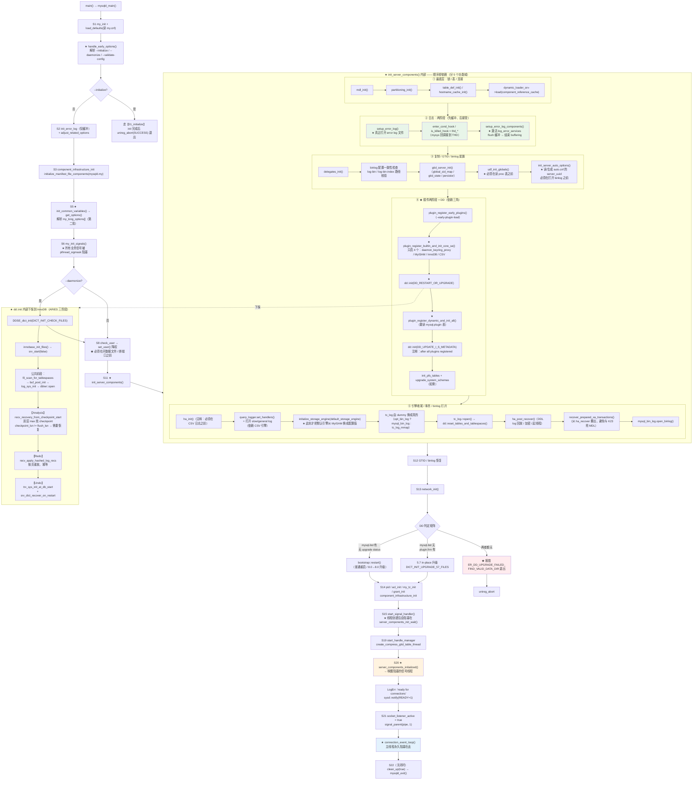
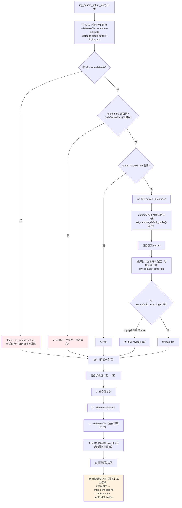
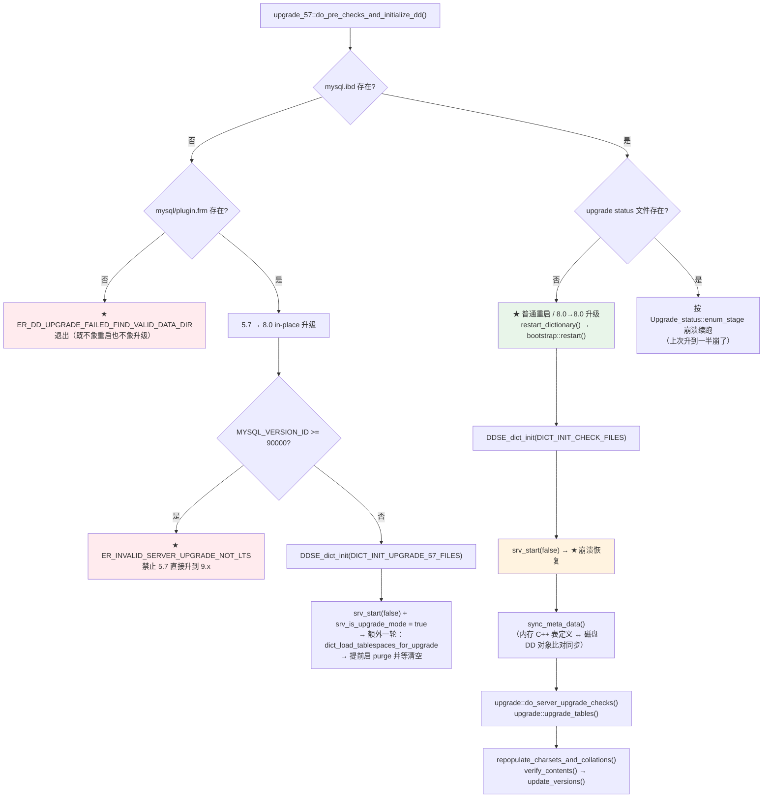

# Server 启动流程深度解析

> 基于 MySQL 8.0.39 源码，覆盖 `main()` → `mysqld_main()` 的全链路：早期选项 → 配置与自动调整 → 降权/daemon 化 → `init_server_components()` → DD 加载与升级 → 引擎/插件/组件 → 崩溃恢复 → 网络监听 → 信号线程 → "ready for connections" → 进入接受循环。
>
> **本篇横跨 server 层与 InnoDB 层**，讲完「已有数据目录 → 可接受连接」这一段纵向闭环：早期选项 → 子系统初始化 → **下探到 InnoDB 启动与崩溃恢复（`srv_start(false)` 全流程、ARIES 三阶段、线程分批启动）** → 网络监听 → ready 宣告。止于 `do_command()`（连接进入命令循环）。
> 数据目录从无到有的创建见 [`01_initialize.md`](01_initialize.md)；
> 关闭与退出见 [`03_shutdown.md`](03_shutdown.md)；
> 收包之后的协议分发与查询执行见 [`../query/01_protocol_to_dispatch.md`](../query/01_protocol_to_dispatch.md)；
> InnoDB 侧的崩溃恢复在 [`../../innodb/recovery.md`](../../innodb/recovery.md)（另一视角：扫描与解析状态机、hash 聚合）；
> 插件/组件框架本身见 [`../plugin/plugin.md`](../plugin/plugin.md) 与 [`../plugin/component.md`](../plugin/component.md)。

## 目录

- [概述](#概述)
- [理论基础](#理论基础)
- [核心实现](#核心实现)
- [★ 本机制里的工程实现技法](#-本机制里的工程实现技法)
- [可观测性](#可观测性)
- [Misc](#misc)
- [参考](#参考)

---

## 概述

### 是什么

`mysqld` 的启动是一个**严格有序的单线程引导过程**：从 `main()` 到 `mysqld_socket_acceptor->connection_event_loop()`，主线程依次把几十个子系统拉起来，任何一步失败都走 `unireg_abort()`。

### 用途

启动要同时满足三个互相拉扯的目标：

1. **依赖正确性**——后一步依赖前一步的产物（DD 依赖 InnoDB，动态插件依赖 DD，日志表依赖 CSV 引擎，网络监听依赖 SSL）。
2. **失败可诊断**——启动期错误必须能进 error log，而 error log 本身也是被启动的一个组件（于是有了"先缓冲、后 flush"的两阶段日志）。
3. **最小权限与可托管**——降权（`--user`）、daemon 化、pid 文件、systemd `sd_notify`，都要在正确的时间点做。

### 版本演进

| 版本 | 变化 |
|------|------|
| 5.7 | 元数据权威是 `.frm` + `mysql.*` MyISAM 表；启动里没有"DD 初始化"这一大块；关闭用全局 `abort_loop` 标志；无 systemd notify |
| 8.0 | **引入事务型 Data Dictionary**：启动新增 `dd::init(DD_RESTART_OR_UPGRADE)` 这一整段；插件注册拆成 builtin+core SE / dynamic 两阶段（因为 dynamic 要读 `mysql.plugin` 表，而表在 DD 里）；新增 `--upgrade=NONE/MINIMAL/AUTO/FORCE`；引入 component 基础设施；`abort_loop` 被 `connection_events_loop_aborted_flag`（`std::atomic<int32>`）取代 |
| 8.0.16+ | `dd::upgrade` 框架成型：系统表升级（`upgrade_system_schemas`）在启动时自动执行，不再需要手工跑 `mysql_upgrade` |
| 8.0.19+ | 支持 `sd_notify`（`sql/sd_notify.cc`），systemd 下可正确表达 `READY=1` / `STOPPING=1` / `STATUS=` |
| 8.0.30 | redo 重做（`#innodb_redo/`），`srv_start` 里新增 log format 升级分支 `recv_verify_log_is_clean_pre_8_0_30` / `recreate_redo_files` |
| 8.4 / 9.x | `mysql_native_password` 默认关闭；`--upgrade` 语义微调；启动骨架不变 |

---

## 理论基础

### 设计思想与权衡

#### 一、为什么是一个两千行的 `mysqld_main`，而不是分层的 `Bootstrap` 类

直观上"启动"应该被重构成一组 `init_*()` 调用加一个调度器。MySQL 没有这么做，因为**启动阶段的依赖关系不是树形的，而是一条会互相穿插的链**：

- `init_error_log()`（建缓冲）必须在选项解析**之前**，因为解析过程就要报 warning；
- `setup_error_log()`（真正打开文件）却必须在 `component_infrastructure_init()` **之后**，因为 error log 本身是由 component 实现的；
- `plugin_register_builtin_and_init_core_se()` 必须在 `dd::init()` 之前（DD 存在 InnoDB 里），而 `plugin_register_dynamic_and_init_all()` 必须在 `dd::init()` **之后**（要读 `mysql.plugin`）；
- `init_server_auto_options()`（读 `auto.cnf` 拿 server_uuid）必须在打开 binlog 之前（uuid 要写进新 binlog 文件头）；
- `ha_init()` 必须在 CSV 日志表之前，而 `tc_log` 要先指向 dummy 再换成真的。

用树形调度器描述这种"交叉依赖"需要额外的 DAG 声明，而一个显式顺序的函数反而**可读性更好**——读者从上往下读一遍就知道全部顺序。代价是这个函数成了全局最大的耦合点，任何子系统初始化顺序的调整都得改它。

#### 二、两阶段选项解析：early options 存在的唯一理由

MySQL 的选项不是一次性解析的，而是分两批：

```
handle_early_options()     解析 my_long_early_options[]  → --initialize / --daemonize /
                           --skip-grant-tables / --validate-config / --no-dd-upgrade ...
                                    ↓（这些标志决定后面所有阶段的分支走向）
init_common_variables()
  └─ get_options()         解析 my_long_options[] + sys_var::PARSE_NORMAL  → 其余全部选项
```

**为什么必须两批**：`--initialize` 会改变 `init_common_variables()` 内部的行为（要调 `initialize_create_data_directory()`），`--daemonize` 要在降权之前 fork，`--validate-config` 要跳过 PFS。这些标志必须在第一批就被确定。

`sys_var` 侧对应两个常量：

```cpp
  static const int PARSE_EARLY = 1;   // 标记需要优先解析的系统变量，其他变量可能会依赖这个
  static const int PARSE_NORMAL = 2;
```

#### 三、插件注册为什么必须分两阶段（这是 8.0 相对 5.7 最重要的启动结构变化）

| 阶段 | 函数 | 初始化谁 | 为什么 |
|---|---|---|---|
| 一 | `plugin_register_builtin_and_init_core_se()` | 只有 4 个：`daemon_keyring_proxy` / **MyISAM** / **InnoDB** / **CSV** | DD 存在 InnoDB 里 ⇒ InnoDB 必须在 `dd::init()` 前起来；MyISAM 作为临时默认引擎（此刻 DD 还不可用，无法查 `default_storage_engine` 的合法性）；CSV 供日志表用；keyring proxy 用于解密 persisted variables |
| 二 | `plugin_register_dynamic_and_init_all()` | 其余 builtin + `--plugin-load` + `mysql.plugin` 表里的全部 | 要读 `mysql.plugin` 表 ⇒ 必须在 `dd::init()` 之后 |

一阶段的注释把设计意图写得很直白：

```cpp
      /*
        Only initialize daemon_keyring_proxy, MyISAM, InnoDB and CSV at this
        stage. Note that when the --help option is supplied,
        daemon_keyring_proxy and InnoDB are not initialized because the plugin
        table will not be read anyway, as indicated by the flag set when the
        plugin_init() function is called.
      */
```

并且一阶段结束时有一个断言把不变量固定下来：

```cpp
      if (is_myisam) {
        assert(!global_system_variables.table_plugin);
        global_system_variables.table_plugin = my_intern_plugin_lock(nullptr, ...);
        global_system_variables.temp_table_plugin = my_intern_plugin_lock(nullptr, ...);
        assert(plugin_ptr->ref_count == 2);
      }
    }
  }
  /* Should now be set to MyISAM storage engine */
  assert(global_system_variables.table_plugin);
```

**代价**：这个"MyISAM 临时默认引擎"的设计会在后续被 `initialize_storage_engine(default_storage_engine, ...)` 覆盖，中间那段窗口里默认引擎是 MyISAM 而非用户配置值。

#### 四、崩溃恢复发生在"插件初始化"里，不在显眼的 `recovery()` 函数里

这是最容易找错位置的一点。恢复链路是：

```
plugin_register_builtin_and_init_core_se()
└─ plugin_initialize()
   └─ ha_initialize_handlerton()
      └─ plugin->plugin->init(hton)  ==  innodb_init(hton)
         （只登记回调，不开文件）
                   ...
dd::init(DD_RESTART_OR_UPGRADE)
└─ upgrade_57::do_pre_checks_and_initialize_dd()
   └─ DDSE_dict_init(DICT_INIT_CHECK_FILES)
      └─ innobase_ddse_dict_init()
         └─ innobase_init_files()
            └─ srv_start(false)          ← ★ 崩溃恢复在这里
               └─ recv_recovery_from_checkpoint_start()
```

**为什么恢复必须在 `dd::init()` 内部（而不是之前）**：只有 DD 侧知道"这次是重启还是 5.7 升级"，从而决定传给 InnoDB 的 `dict_init_mode` 是 `DICT_INIT_CHECK_FILES` 还是 `DICT_INIT_UPGRADE_57_FILES`，以及 `create` 参数。`srv_start()` 自己不知道该新建还是该恢复——**是 server 告诉它的**。

#### 五、error log 的两阶段：为什么启动早期的日志要缓冲

error log 在 8.0 是由 **component** 实现的（`log_sink_*` / `log_filter_*`），而 component 基础设施本身要很晚才起来。于是：

```
init_error_log()              ← 只初始化子系统（mutex + 默认 filter/sink），不开文件
    ... 期间所有 LogErr 进入 log_sink_buffer ...
setup_error_log()             ← 真正打开 error log 文件
setup_error_log_components()  ← 激活用户配置的 log_error_services，结束 buffering
flush_error_log_messages()    ← 把缓冲的消息冲给用户真正要的 sink
```

`log_sink_buffer.cc` 里还留了一条"启动被中止"的回退路径：若 `flush_error_log_messages()` 在 buffering 模式结束前就被调用，则用**基础日志**把已缓冲内容全部打出来然后丢弃。

**代价 / 失效场景**：如果进程在 `setup_error_log()` 之前就崩了（比如极早期的选项解析失败），缓冲的日志可能根本没落盘——这类失败只能靠 stderr 排查。

#### 六、systemd 集成：`sd_notify` 是"宣告"而非"同步"

8.0 确实内建 systemd notify（`sql/sd_notify.cc`），`NOTIFY_SOCKET` 环境变量存在时才连：

| 时机 | 消息 |
|---|---|
| `mysqld_main` 最开始 | `STATUS=Server startup in progress` |
| ready | `READY=1\nSTATUS=Server is operational\nMAIN_PID=<pid>` |
| 关闭开始 | `STOPPING=1\nSTATUS=Server shutdown in progress` |
| `unireg_abort` 有 errno | `ERRNO=<n>` |
| DD 5.7 升级 | `STATUS=Data Dictionary upgrade from MySQL 5.7 in progress/complete` |
| server 升/降级 | `STATUS=Server upgrade/downgrade complete` |

设计要点：`sd_notify` 是 **fire-and-forget**（`SOCK_DGRAM` 写一次），失败只打 warning 不阻断启动。它与 `mysqld_safe` / 双 fork daemon 化是**并存的**两套机制：daemon 化用 pipe 通知父进程成功，systemd 用 socket 通知。

### 理论溯源

| 思想 / 理论 | 源码落点 |
|---|---|
| **Acceptor 模式**（POSA2：把"连接建立"与"连接处理"解耦） | `Connection_acceptor<Listener>` 模板 + `Connection_handler_manager` + `Per_thread_connection_handler` 三层 |
| **Reactor / 事件循环** | `Mysqld_socket_listener::listen_for_connection_event()` 用 `poll()`（无 poll 时 `select()`）等监听 fd |
| **插件架构 + 服务注册（Service Registry）** | plugin 走 `installed_htons[]` / `se_plugin_array`；component 走 `srv_registry->acquire("dynamic_loader")` 等服务名查找 |
| **Unix daemon 化惯例（双 fork + setsid）** | `mysqld::runtime::mysqld_daemonize()` |
| **配置优先级链（CLI > defaults-file > 目录扫描）** | `my_search_option_files()` |
| **依赖注入式回调挂钩** | `set_psi_*_service()` 系列、`enter_cond_hook`/`is_killed_hook` 等把 mysys 回调接到 THD |

#### ARIES：崩溃恢复的理论原型

InnoDB 的恢复是 **ARIES**（Mohan et al., *ARIES: A Transaction Recovery Method*, ACM TODS 1992）的一个落地变体。三阶段对应关系：

| ARIES 阶段 | InnoDB 落点 | 说明 |
|---|---|---|
| **Analysis** | `recv_recovery_from_checkpoint_start()` | 从 `last_checkpoint_lsn` 起扫 redo，解析出 (space_id, page_no) 建 `recv_sys` 哈希表；同时收集 `MLOG_FILE_OPEN` 建立 space_id → 文件的映射 |
| **Redo**（repeating history） | `recv_apply_hashed_log_recs()` | 遍历哈希表，**按页**重放；幂等：页上 lsn ≥ redo lsn 则跳过 |
| **Undo** | `trx_sys_init_at_db_start()` → `trx_rollback_or_clean_recovered()` | 扫 undo 重建 rseg/undo 链表 → 重建崩溃时的事务 → 按状态提交或回滚 |

**与教科书 ARIES 的差异（这几条才是重点）**：

| 维度 | ARIES 原型 | InnoDB 的落地 | 差异原因 |
|---|---|---|---|
| redo 粒度 | 逻辑的（page-oriented 或 logical） | **物理/逻辑混合**，记录类型有 50 多种，每种字段布局不同 | 既要能直接贴到页上，又要支持"页内重组织"这类逻辑操作。代价：**解析必须逐字段走一遍才能确定长度**（恢复慢的一个根因，对应 bug#82937） |
| Analysis 的产物 | 事务表 + 脏页表（DPT） | `recv_sys` 的哈希表（按 space_id+page_no）+ space 映射 | 哈希表本身就编码了"哪些页是脏的"，不需要单独 DPT |
| 脏页表排序 | 不需要 | **恢复期的 flush list 用红黑树加速插入定位** | 正常运行时顺序由 `log_sys->mutex` + `log_flush_order_mutex` 保证；恢复期没有这个保证，只能边插边找位置，线性查找太慢 |
| Checkpoint | fuzzy checkpoint | fuzzy checkpoint，`last_checkpoint_lsn` 在 redo 头 | 同 |
| 半页写 | ARIES 不讨论（假设原子写） | **doublewrite buffer** | 存储硬件不保证 16KB 原子写 |

配套的两个经典设计：

- **WAL 与幂等 redo**："只应用 redo lsn > page lsn 的记录"就是幂等性的落点——页头存着自己的 lsn，重放时比较即可，不需要额外事务表判断"这条 redo 是否已应用"。
- **checkpoint 域双写**：redo 文件头有两个 checkpoint 域轮流写。若只有一个域，写那 512 字节（`OS_FILE_LOG_BLOCK_SIZE`）时掉电会导致整个域不可用、数据库无法启动。两个域轮流写把"单点半写"变成"至少有一个可用"，同时减少扇区故障影响。

### 算法与数据结构

| 结构 | 用途 | 特点 |
|---|---|---|
| `my_option` | 一个命令行选项的完整描述（name/id/comment/value/def_value/min/max/arg_source…） | 用 `name == nullptr` 标记数组结束；`id` 在 0..255 时才生成短选项 |
| `installed_htons[]` | `legacy_db_type` → `handlerton*` 的直查表 | 冲突时从 `DB_TYPE_FIRST_DYNAMIC` 起找空闲 slot，找不到报 `ER_TOO_MANY_STORAGE_ENGINES` |
| `se_plugin_array` / `builtin_htons` | slot → plugin 的映射 | 与 `installed_htons` 是两种索引方式（slot 序 vs db_type 序） |
| `Shared_dictionary_cache` | DD 对象全局共享缓存 | 各类型独立容量；`m_map<Abstract_table>()` 容量取 `max_connections`（与选项自动调整耦合） |
| `Bind_address_info` 列表 | 支持多个 `--bind-address` | 8.0 支持一次绑多个地址 |

### 他库对比与演进动机

| 系统 | 启动形态 | 与 MySQL 的差异 |
|---|---|---|
| **PostgreSQL** | `postmaster` → fork 每个 backend；启动由 `PostmasterMain` 完成，共享内存/ WAL 恢复在 `StartupXLOG` | PG 是**多进程**模型，恢复发生在 postmaster 内、接受连接前，与 MySQL 的"恢复藏在引擎插件 init 里"结构不同。PG 无插件式的存储引擎抽象 |
| **SQL Server / Oracle** | 服务化启动，恢复由独立的 recovery 阶段完成，有明确的 `RECOVERING` 状态对外可见 | MySQL 没有对外的"恢复中"状态（`server_operational_state` 只有 BOOTING / OPERATING / SHUTTING_DOWN），恢复期间端口**未监听**，外部看就是"还没起来" |
| **Redis / MongoDB** | 单线程/单进程，启动即加载数据文件 | 无插件体系，无 DD，启动链短一个数量级 |

**演进动机（为什么 8.0 要重构启动结构）**：事务型 DD 把"元数据"变成了"数据库里的数据"。这带来一个环：读元数据要开引擎，开引擎又可能要读元数据。MySQL 的破环方式是**分层 + 硬编码**：先只启 InnoDB/MyISAM/CSV 三个引擎（不读任何表），用硬编码的方式打开 `mysql.ibd`，建好 DD 缓存，然后才允许读表级的插件配置。PostgreSQL 用的是同一思路的不同实现（先 `StartupXLOG`，再起 catalog 访问层）。

---

## 核心实现

### 主链路

#### 流程图：23 个阶段与关键分支



**读图要点**：三处绿色是启动最关键的依赖三角——**两阶段插件注册夹着 `dd::init()`**；橙色是"宣告 ready"（同时唤醒信号线程）；蓝色是主线程此后的归宿。

#### 调用栈全景

```
main()                                              sql/main.cc（只有一行：return mysqld_main(argc, argv)）
└─ mysqld_main()
   │
   ├─ S0  极早期       initialize_stack_direction / substitute_progpath / sysd::notify_connect
   │                   calculate_mysql_home_from_my_progname
   ├─ S1  mysys 初始化  pre_initialize_performance_schema → my_init → load_defaults("my")
   │                   sys_var_init → persisted_variables_cache → init_pfs_instrument_array
   │                   → handle_early_options()                      ← 第一批选项
   ├─ S2  日志与 PSI    init_error_log → adjust_related_options → initialize_performance_schema
   │                   → LO_init(LOCK_ORDER) → set_psi_*_service → init_server_psi_keys
   ├─ S3  SSL/组件      init_ssl → umask → component_infrastructure_init
   │                   → initialize_manifest_file_components(mysqld.my) → Resource_group_mgr::init
   ├─ S4  杂项          mysql_audit_initialize / Srv_session::module_init / query_logger.init
   ├─ S5  通用变量      init_common_variables() → get_options()      ← 第二批选项（含配置文件）
   ├─ S6  信号/线程栈   keyring_lockable_init → my_init_signals → my_thread_attr_setstacksize
   ├─ S7  daemon 化     --initialize+--daemonize 互斥检查 → chdir("/") → mysqld_daemonize()
   ├─ S8  降权          check_user → (--initialize 时 chown datadir) → set_user / set_effective_user
   ├─ S9                 my_setwd(mysql_real_data_home)
   ├─ S10                set_ports()
   ├─ S11 ★ 子系统      init_server_components()
   │                     ├─ mdl_init / partitioning_init / table_def_init / hostname_cache_init
   │                     ├─ setup_error_log → setup_error_log_components
   │                     ├─ gtid_server_init / udf_init_globals / init_server_auto_options(auto.cnf)
   │                     ├─ plugin_register_early_plugins
   │                     ├─ plugin_register_builtin_and_init_core_se   ← InnoDB 登记回调
   │                     ├─ dd::init(DD_RESTART_OR_UPGRADE)            ← ★ InnoDB 启动 + 崩溃恢复
   │                     ├─ plugin_register_dynamic_and_init_all       ← 读 mysql.plugin
   │                     ├─ dd::init(DD_UPDATE_I_S_METADATA) / init_pfs_tables
   │                     ├─ upgrade_system_schemas（如需要）
   │                     ├─ ha_init / query_logger.set_handlers / initialize_storage_engine
   │                     ├─ tc_log = opt_bin_log ? &mysql_bin_log : &tc_log_mmap
   │                     ├─ tc_log->open → dd::reset_tables_and_tablespaces → ha_post_recover
   │                     │  → Recovered_xa_transactions::recover_prepared_xa_transactions
   │                     └─ mysql_bin_log.open_binlog
   ├─ S12 GTID/binlog   gtid_state->init → read_gtid_executed_from_table
   │                   → mysql_bin_log.init_gtid_sets → auto_purge_at_server_startup
   ├─ S13 网络          init_ssl_communication → network_init()
   ├─ S14 pid/ACL/时区   create_pid_file → reload_optimizer_cost_constants
   │                   → mysql_component_infrastructure_init（读 mysql.component）
   │                   → acl_init → my_tz_init → grant_init → servers_init → init_status_vars
   │                   → Events::init
   ├─ S15 信号线程      start_signal_handler()
   ├─ S16               validate_authentication_policy / persisted_variables_cache.set_persisted_options
   ├─ S17 bootstrap     process_bootstrap()（仅 --initialize / --init-file）
   ├─ S18               mysql_audit_notify(SERVER_STARTUP_STARTUP)
   ├─ S19 后台线程      start_handle_manager / create_compress_gtid_table_thread
   ├─ S20 ★ ready       LogErr(ER_SERVER_STARTUP_MSG "ready for connections")
   │                   → server_components_initialized()  ← 唤醒阻塞中的信号线程
   │                   → server_operational_state = SERVER_OPERATING
   │                   → sysd::notify("READY=1 ...")
   ├─ S21 ★ 进入循环    socket_listener_active = true
   │                   → signal_parent(pipe_write_fd, 1)
   │                   → mysqld_socket_acceptor->connection_event_loop()   ← 主线程永久阻塞
   └─ S22 退出          SERVER_SHUTTING_DOWN → sysd::notify("STOPPING=1")
                       → terminate_compress_gtid_table_thread
                       → gtid_state->save_gtids_of_last_binlog_into_table
                       → my_thread_join(&signal_thread_id) → clean_up(true)
                       → mysqld_exit(signal_hand_thr_exit_code)
```

**三条硬性依赖链**（顺序乱了就会崩）：

1. `my_init()`（mysys + 线程库）→ 才能 `load_defaults()` 读配置文件；
2. `system_charset_info = &my_charset_utf8mb3_general_ci` 必须先设，否则 `handle_options()` 比较选项名时没有可用 charset；
3. `handle_early_options()` 必须早于 `init_common_variables()`，因为 `--initialize` 要改变后者的内部行为。

### 一、选项与配置

#### 1.1 `my_option` 结构

```cpp
struct my_option {
  const char *name;       /**< Name of the option. name=NULL marks the end of the my_option[] array. */
  int id;                 /**< 0<id<=255 → 短选项字符；>255 → 只有长选项 */
  const char *comment;    /**< option comment, for autom. --help. NULL 则 --help 不可见 */
  void *value;            /**< A pointer to the variable value */
  void *u_max_value;
  TYPELIB *typelib;       /**< Pointer to possible values */
  ulong var_type;         /**< GET_BOOL, GET_ULL, etc */
  enum get_opt_arg_type arg_type;   /**< REQUIRED_ARG or OPT_ARG */
  longlong def_value;
  longlong min_value;
  ulonglong max_value;
  struct get_opt_arg_source *arg_source;  /**< 该变量是从哪设置的（命令行/配置文件/默认值） */
  long block_size;        /**< Value should be a mult. of this */
  void *app_type;
};
```

插件侧用 `MYSQL_SYSVAR_*` 宏声明 `SYS_VAR`，由 `sys_var_pluginvar` 适配成 server 侧对象，再由 `mysql_getopt_value` 在 `get_options()` 里注册。`arg_source` 字段是 8.0 加的——它让 `SHOW VARIABLES` 能回答"这个值是从哪来的"。

#### 1.2 配置文件搜索顺序

```
load_defaults("my", load_default_groups, ...)
└─ my_load_defaults()
   └─ my_search_option_files()
```

`my_search_option_files()` 的判定顺序：

1. 先从**命令行**取出 `--defaults-file` / `--defaults-extra-file` / `--defaults-group-suffix` / `--login-path`；`MYSQL_GROUP_SUFFIX` 环境变量作为 fallback；
2. `--no-defaults` ⇒ `found_no_defaults`，后面整个目录扫描跳过；
3. 若给了 **绝对路径**（`dirname_length(conf_file)` 非零）⇒ **只读这一个文件**；
4. 否则若 `my_defaults_file` 已设 ⇒ 只读它；
5. 否则遍历 `default_directories`（由 `init_variable_default_paths()` 按平台建立），逐目录读 `my.cnf`；遍历到空字符串条目时插入读一次 `my_defaults_extra_file`。

额外规则：`mysqld` 显式关闭 login file（`my_defaults_read_login_file = false;`），所以 `mylogin.cnf` 对 mysqld 无效。

组名顺序：

```cpp
const char *load_default_groups[] = {"mysqld", "server", MYSQL_BASE_VERSION, nullptr, nullptr};
```

即 `[mysqld]` → `[server]` → `[mysqld-8.0]`；**命令行优先级最高**。



两处红色是运维最容易踩的坑：**`--defaults-file` 是独占语义**（给了它，`/etc/my.cnf` 等目录里的文件一律不读）；`--no-defaults` 会跳过全部配置文件。黄色那层是"启动期自动调整"——它会**静默下调** `max_connections` 等（见 1.3）。

#### 1.3 启动期的自动调整（四个联动公式）

这块不在 `init_common_variables()`，而在更早的 `adjust_related_options()`：

```cpp
static void adjust_related_options(ulong *requested_open_files) {
  if (opt_initialize) opt_noacl = true;

  /* The order is critical here, because of dependencies. */
  adjust_open_files_limit(requested_open_files);
  adjust_max_connections(*requested_open_files);
  adjust_table_cache_size(*requested_open_files);
  adjust_table_def_size();
}
```

```cpp
static void adjust_open_files_limit(ulong *requested_open_files) {
  /* MyISAM requires two file handles per table. */
  limit_1 = 10 + max_connections + table_cache_size * 2;
  /* We are trying to allocate no less than max_connections*5 file handles */
  limit_2 = max_connections * 5;
  /* Try to allocate no less than 5000 by default. */
  limit_3 = open_files_limit ? open_files_limit : 5000;

  request_open_files = max<ulong>(max<ulong>(limit_1, limit_2), limit_3);

  effective_open_files = my_set_max_open_files(request_open_files);

  if (effective_open_files < request_open_files) {
    if (open_files_limit == 0)
      LogErr(WARNING_LEVEL, ER_CHANGED_MAX_OPEN_FILES, effective_open_files, request_open_files);
    else
      LogErr(WARNING_LEVEL, ER_CANT_INCREASE_MAX_OPEN_FILES, effective_open_files, request_open_files);
  }
  open_files_limit = effective_open_files;
  ...
}
```

顺序固定：`open_files → max_connections → table_cache → table_def_cache`，因为后者公式要用前者结果。两条硬地板：

- `TABLE_OPEN_CACHE_MIN = 400`：即使 `open_files_limit` 很小，table cache 也不会被压到 0；
- `table_definition_cache` 默认 `min(400 + table_cache_size/2, 2000)`。

`init_common_variables()` 里还有一批依赖 `max_connections` 的派生默认值（`thread_cache_size` = `8 + max_connections/100` 上限 100；`host_cache_size`；`back_log`）。

**这些公式与 DD 的耦合点**：`Shared_dictionary_cache::init()` 里 `m_map<Abstract_table>()->set_capacity(max_connections)`——table cache 容量直接取调整后的 `max_connections`。

#### 1.4 `--user` 降权为什么在这个位置

```
mysqld_main
├─ check_user(mysqld_user)      ← 校验用户存在；非 root 时告警；user=="root" 时特殊处理
├─ (opt_initialize) chown(datadir)
└─ set_user(mysqld_user, user_info)
     └─ initgroups → setgid → setuid → (TEST_CORE_ON_SIGNAL) prctl(PR_SET_DUMPABLE, 1)
```

**位置判据**：必须在 `mysqld_daemonize()` **之后**（daemon 化需要 root 权限写 pid、切根目录），但必须在 `init_server_components()` 与 `network_init()` **之前**——降权之后就没权限打开数据文件、绑定低端口了。而 datadir 的属主调整（`--initialize` 的 `chown`）必须放在降权**之前**。

`--chroot` 走 `set_root()`，位置在 `get_options()` 里，比 `set_user` 更早（chroot 后路径语义就变了）。

### 二、子系统初始化：`init_server_components()` 的顺序

这个函数是启动的主体。下面按**功能域**分组（顺序即源码顺序），并给出每步的依赖理由。

| # | 调用 | 功能域 | 为什么在这里 |
|---|---|---|---|
| 1 | `mdl_init()` | 锁 | 最底层的元数据锁，后面所有 DDL/开表依赖 |
| 2 | `partitioning_init()` | 表 | 建表元数据要用 |
| 3 | `table_def_init()` | 表 | table definition cache |
| 4 | `hostname_cache_init(host_cache_size)` | 连接 | 容量依赖上面算出的 `host_cache_size` |
| 5 | `dynamic_loader_srv->load(component_urns)` | 组件 | `component_urns[] = {"file://component_reference_cache"}`；必须在 `opt_plugin_dir` 解析之后 |
| 6 | `my_timer_initialize()` | 计时 | `--help` 时跳过；成功才置 `have_statement_timeout` |
| 7 | `randominit(&sql_rand, ...)` / `setup_fpu()` | 杂项 | |
| 8 | **`setup_error_log()`** | 日志 | **真正打开 error log**（此前只是缓冲） |
| 9 | `enter_cond_hook` / `is_killed_hook` / `set_waiting_for_disk_space_hook` = `thd_*` | 挂钩 | 把 mysys 回调接到 THD |
| 10 | `xa::Transaction_cache::initialize()` | 事务 | |
| 11 | **`setup_error_log_components()`** | 日志 | 依赖 #8 + component 基础设施；激活 `log_error_services`、flush 缓冲 |
| 12 | `MDL_context_backup_manager::init()` | 锁 | |
| 13 | `delegates_init()` | 复制 | observer delegates |
| 14 | binlog 配置一致性检查 | binlog | 必须在选项已解析后 |
| 15 | `opt_server_id_mask` / `server_id` 越界检查 | 复制 | |
| 16 | `mysql_bin_log.open_index_file(...)` | binlog | index 文件要先建好 |
| 17 | `rpl_make_log_name()` 生成 basename；binlog 与 relaylog 同名检查 | 复制 | |
| 18 | `process_key_caches` / `ha_init_errors()` | handler | |
| 19 | **`gtid_server_init()`** | 复制 | 建 `global_sid_lock` / `global_sid_map` / `gtid_state` / `gtid_table_persistor` |
| 20 | **`udf_init_globals()`** | 插件 | 注释明确：必须在读 proc 表之前、component 初始化之前，让 component 能注册 UDF |
| 21 | `tc_log = &tc_log_dummy;` | 事务 | 先指向 dummy，使 `plugin_init()` 读 `mysql.plugin` 表时能提交 attachable 事务；第 51 步换成真的 |
| 22 | **`init_server_auto_options()`** | 标识 | 读/生成 `auto.cnf` 里的 `server_uuid`；注释：必须在打开 binlog 之前 |
| 23 | **`plugin_register_early_plugins()`** | 插件 | `--early-plugin-load` |
| 24 | **`plugin_register_builtin_and_init_core_se()`** | 插件/引擎 | **只启 keyring proxy / MyISAM / InnoDB / CSV** |
| 25 | `init_sql_command_flags()` | SQL | 注释：必须在 `dd::init()` 之前（dd init 会真执行 DDL） |
| 26 | **`dd::init(DD_RESTART_OR_UPGRADE)`** | DD | **必须在 #24 之后**（DD 在 InnoDB 里）；**必须在 #33 之前**（动态插件要读表） |
| 27 | **`plugin_register_dynamic_and_init_all()`** | 插件 | 读 `mysql.plugin` 表 |
| 28 | `dynamic_plugins_are_initialized = true; delete_optimizer_cost_module();` | 插件 | |
| 29 | thread_pool 检测 → 禁用 resource group | 资源 | |
| 30 | 5.7 升级中 ⇒ `dd::init(DD_POPULATE_UPGRADE)` | DD | |
| 31 | **`dd::init(DD_UPDATE_I_S_METADATA)`** | DD | 注释：**"after all the plugins are registered"**（插件的 I_S 表才能进 DD） |
| 32 | `dd::performance_schema::init_pfs_tables(...)` | DD/PFS | |
| 33 | 需升级 ⇒ `run_bootstrap_thread(&dd::upgrade::upgrade_system_schemas, SYSTEM_THREAD_SERVER_UPGRADE)` | DD | 8.0.16+ 的 server upgrade 框架 |
| 34 | `dd::init(DD_INITIALIZE_NON_DD_BASED_SYSTEM_VIEWS)` | DD | |
| 35 | `res_grp_mgr->post_init()` / `Session_tracker::server_boot_verify()` | 杂项 | |
| 36 | `--help` / `--validate-config` ⇒ `unireg_abort(MYSQLD_SUCCESS_EXIT)` | 退出点 | |
| 37 | errmsg 已加载检查 | 日志 | |
| 38 | **`ha_init()`** | handler | 注释：**"We have to initialize the storage engines before CSV logging"** |
| 39 | `dd::ndbinfo::init_schema_and_tables` | DD | |
| 40 | `query_logger.set_handlers()` + 打开 slow/general log | 日志 | 依赖 CSV 引擎（log tables） |
| 41 | **`initialize_storage_engine(default_storage_engine, ...)`** | 引擎 | 此刻才把默认引擎换成用户配置值（覆盖第 24 步的 MyISAM 临时值） |
| 42 | `set_externally_disabled_storage_engine_names()` | 引擎 | |
| 43 | `tc_log = opt_bin_log ? &mysql_bin_log : &tc_log_mmap;` | 事务 | 把第 21 步的 dummy 换真的 |
| 44 | `Recovered_xa_transactions::init()` | 事务 | |
| 45 | `tc_log->open(...)` | 事务 | |
| 46 | `dd::reset_tables_and_tablespaces()` | DD | 清掉被恢复改写的表/表空间元数据缓存 |
| 47 | **`ha_post_recover()`** | 引擎 | 各 SE 的 post_recover 钩子 |
| 48 | `Recovered_xa_transactions::recover_prepared_xa_transactions()` | 事务 | 注释说明它**从 `ha_recover()` 里挪出来**，避免与 #46 抢 MDL |
| 49 | `rpl_encryption.initialize()` | 复制 | |
| 50 | **`mysql_bin_log.open_binlog(...)`** | binlog | |
| 51 | `locked_in_memory && !getuid()` ⇒ `setreuid` + `mlockall` | 安全 | |
| 52 | `Rpl_acf_configuration_handler` / `Source_IO_monitor` / `udf_load_service` | 复制 | |
| 53 | `init_optimizer_cost_module` / `ft_init_stopwords` / `init_max_user_conn` / `init_icu_data_directory` | 优化器 | |

**澄清（常见误记）**：`acl_init` / `grant_init` / `servers_init` / `my_tz_init` / `init_status_vars` **都不在** `init_server_components()` 里，它们在 `mysqld_main` 主体、`network_init()` 之后：

```cpp
  if (abort || acl_init(opt_noacl)) { ... }
  if (abort || my_tz_init((THD *)nullptr, default_tz_name, opt_initialize) ||
      grant_init(opt_noacl)) { ... unireg_abort(MYSQLD_ABORT_EXIT); }
  if (!opt_initialize && (dd::upgrade::no_server_upgrade_required() ||
                          opt_upgrade_mode == UPGRADE_MINIMAL))
    servers_init(nullptr);
```

`servers_init` 那条 `if` 的理由写在注释里：升级时 bootstrap 线程已经从 `mysql.servers` 初始化过了，不必再做一遍。

### 三、数据目录判定与 DD 加载

#### 3.1 判定矩阵：这次启动到底是哪一类

`upgrade_57::do_pre_checks_and_initialize_dd()` 用三个文件是否存在来分类：

```cpp
  build_table_filename(path, ..., "", "mysql", ".ibd", 0, &not_used);
  bool exists_mysql_tablespace = (!my_access(path, F_OK));

  // Check existence of mysql/plugin.frm
  build_table_filename(path, ..., "mysql", "plugin", ".frm", 0, &not_used);
  bool exists_plugin_frm = (!my_access(path, F_OK));

  if (!exists_mysql_tablespace && !exists_plugin_frm) {
    LogErr(ERROR_LEVEL, ER_DD_UPGRADE_FAILED_FIND_VALID_DATA_DIR);
    return true;
  }
```

| `mysql.ibd` | `mysql/plugin.frm` | upgrade status 文件 | 走的路径 |
|---|---|---|---|
| 有 | — | 无 | `restart_dictionary()` → `bootstrap::restart()`（普通重启 / 8.0→8.0 升级） |
| 有 | — | 有 | 按 `Upgrade_status::enum_stage` 崩溃续跑 |
| 无 | 有 | 无 | 5.7→8.0 in-place 升级（`DICT_INIT_UPGRADE_57_FILES`） |
| 无 | 无 | — | **报错 `ER_DD_UPGRADE_FAILED_FIND_VALID_DATA_DIR` 退出** |



外层报错：

```cpp
    if (!is_help_or_validate_option() &&
        dd::init(dd::enum_dd_init_type::DD_RESTART_OR_UPGRADE)) {
      LogErr(ERROR_LEVEL, ER_DD_INIT_FAILED);
      /* If clone recovery fails, we rollback the files to previous
      dataset and attempt to restart server. */
      int exit_code = clone_recovery_error ? MYSQLD_RESTART_EXIT : MYSQLD_ABORT_EXIT;
      unireg_abort(exit_code);
    }
```

注意 clone 恢复失败时用 `MYSQLD_RESTART_EXIT`——让外部管理者重启，因为 clone 已经把文件回滚了。

#### 3.2 `bootstrap::restart()`

```cpp
  if (create_dd_schema(thd) || initialize_dd_properties(thd) ||
      create_tables(thd, nullptr) || sync_meta_data(thd) ||
      DDSE_dict_recover(thd, DICT_RECOVERY_RESTART_SERVER,
                        d->get_actual_dd_version(thd)) ||
      upgrade::do_server_upgrade_checks(thd) || upgrade::upgrade_tables(thd) ||
      repopulate_charsets_and_collations(thd) || verify_contents(thd) ||
      update_versions(thd, false)) {
    return true;
  }
```

与初始化的关键差异是 **`sync_meta_data()`**：它把**内存里的 C++ 表定义**与**磁盘上持久化的 DD 表对象**做比对同步，并把共享缓存填满（用局部 `Auto_releaser` 持有 `mysql` schema 与 tablespace 对象，保证 id 一致性）。初始化路径用的是方向相反的 `flush_meta_data()`。

`enum_dd_init_type` 全谱：

```cpp
enum class enum_dd_init_type {
  DD_INITIALIZE = 1,
  DD_INITIALIZE_SYSTEM_VIEWS,
  DD_RESTART_OR_UPGRADE,
  DD_POPULATE_UPGRADE,
  DD_DELETE,
  DD_UPDATE_I_S_METADATA,
  DD_INITIALIZE_NON_DD_BASED_SYSTEM_VIEWS
};
```

`Dictionary_impl::init()` 把这 7 种一一映射到不同的 bootstrap 线程入口函数。

#### 3.3 SDI：写在表空间里的元数据

SDI（Serialized Dictionary Information）是存在**表空间内部**的表定义 JSON，作用是在没有 DD 的情况下也能读出表结构（典型场景：`.ibd` 文件搬运、表空间导入）。启动期的三个接触点：

1. **回调注册**（`innodb_init` 内）：

```cpp
  innobase_hton->sdi_create = dict_sdi_create;
  innobase_hton->sdi_drop = dict_sdi_drop;
  innobase_hton->sdi_get_keys = dict_sdi_get_keys;
  innobase_hton->sdi_get = dict_sdi_get;
  innobase_hton->sdi_set = dict_sdi_set;
  innobase_hton->sdi_delete = dict_sdi_delete;
```

2. **5.7 升级时批量写 SDI**：`upgrade_57::add_sdi_info()`，在 `fill_dd_and_finalize()` 与崩溃续跑分支里调用。
3. **读**：`sdi_tablespace.cc` 用 `hton.sdi_get_keys()` 枚举。

#### 3.4 版本校验与 `--upgrade` 四态

```cpp
  if (!opt_initialize) {
    uint server_version = 0;
    if (ddse->dict_get_server_version == nullptr ||
        ddse->dict_get_server_version(&server_version)) {
      LogErr(ERROR_LEVEL, ER_CANNOT_GET_SERVER_VERSION_FROM_TABLESPACE_HEADER);
      return true;
    }
    if (server_version != MYSQL_VERSION_ID) {
      if (opt_upgrade_mode == UPGRADE_NONE) {
        LogErr(ERROR_LEVEL, ER_SERVER_UPGRADE_OFF);
        return true;
      }
      if (!DD_bootstrap_ctx::instance().supported_server_version(server_version)) {
        if (server_version > MYSQL_VERSION_ID && ...)
          LogErr(ERROR_LEVEL, ER_INVALID_SERVER_DOWNGRADE_NOT_PATCH, server_version, MYSQL_VERSION_ID);
        else
          LogErr(ERROR_LEVEL, ER_SERVER_UPGRADE_VERSION_NOT_SUPPORTED, server_version);
        return true;
      }
    }
  }
```

四个模式：`UPGRADE_NONE`（拒绝升级，直接退出）/ `UPGRADE_MINIMAL`（跳过不升级）/ `UPGRADE_AUTO` / `UPGRADE_FORCE`。

`upgrade_system_schemas()` 执行 4 个 SQL 脚本（注释原文）：`mysql_system_tables.sql`（建表）、`mysql_system_tables_fix.sql`（改表）、`mysql_system_tables_data_fix.sql`（灌数据）、`mysql_sys_schema.sql`（sys schema）。

### 四、存储引擎、插件与组件

#### 4.1 插件注册：`ha_initialize_handlerton`

```cpp
int ha_initialize_handlerton(st_plugin_int *plugin) {
  handlerton *hton = static_cast<handlerton *>(
      my_malloc(key_memory_handlerton_objects, sizeof(handlerton), MYF(MY_WME | MY_ZEROFILL)));
  if (hton == nullptr) { LogErr(ERROR_LEVEL, ER_HANDLERTON_OOM, plugin->name.str); goto err_no_hton_memory; }
  hton->slot = HA_SLOT_UNDEF;
  /* Historical Requirement */
  plugin->data = hton;  // shortcut for the future
  if (plugin->plugin->init && plugin->plugin->init(hton)) {
    LogErr(ERROR_LEVEL, ER_PLUGIN_INIT_FAILED, plugin->name.str);
    goto err;
  }
```

注册部分（注意：**没有** `install_hton()` 这个函数，就是一行数组赋值）：

```cpp
      if (hton->db_type <= DB_TYPE_UNKNOWN ||
          hton->db_type >= DB_TYPE_DEFAULT || installed_htons[hton->db_type]) {
        int idx = (int)DB_TYPE_FIRST_DYNAMIC;
        while (idx < (int)DB_TYPE_DEFAULT && installed_htons[idx]) idx++;
        if (idx == (int)DB_TYPE_DEFAULT) {
          LogErr(WARNING_LEVEL, ER_TOO_MANY_STORAGE_ENGINES);
          goto err_deinit;
        }
        hton->db_type = (enum legacy_db_type)idx;
      }
      ...
      installed_htons[hton->db_type] = hton;
      hton->savepoint_offset = savepoint_alloc_size;
      savepoint_alloc_size += tmp;
      if (hton->prepare) total_ha_2pc++;
```

以及固定引擎的全局指针：

```cpp
  switch (hton->db_type) {
    case DB_TYPE_HEAP:      heap_hton = hton;      break;
    case DB_TYPE_TEMPTABLE: temptable_hton = hton; break;
    case DB_TYPE_MYISAM:    myisam_hton = hton;    break;
    case DB_TYPE_INNODB:    innodb_hton = hton;    break;
    default: break;
  };
  reload_optimizer_cost_constants();
```

`ha_init()` 本身极轻——只算两个值：

```cpp
int ha_init() {
  opt_using_transactions = se_plugin_array.size() > static_cast<ulong>(opt_bin_log);
  savepoint_alloc_size += sizeof(SAVEPOINT);
  return 0;
}
```

#### 4.2 InnoDB：`srv_start(false)` 的恢复分支

`srv_start()` 是 InnoDB 生命周期的总入口，一个 `bool` 参数决定建库还是重启。下面先给出恢复分支的入口代码，然后逐段展开它的**完整前段**（4.3~4.5）、**ARIES 三阶段**（4.6~4.8）与**线程启动**（4.9）。

```cpp
  } else {                                   // create_new_db == false
    err = dblwr::v1::init();
    if (err != DB_SUCCESS) return srv_init_abort(err);

    buf_pool_invalidate();                   // 保证重读，不用启动前的旧页
    fil_open_system_tablespace_files();

    /* We always try to do a recovery, even if the database had
       been shut down normally: this is the normal startup path */
    RECOVERY_CRASH(1);

    if (new_files_lsn != 0) flushed_lsn = new_files_lsn;

    ut_a(log_sys->m_format <= Log_format::CURRENT);
    const bool log_upgrade = log_sys->m_format < Log_format::CURRENT;
    if (log_upgrade) {
      recv_verify_log_is_clean_pre_8_0_30(*log_sys);
      recreate_redo_files(flushed_lsn);
    }

    err = recv_recovery_from_checkpoint_start(*log_sys, flushed_lsn);   // ★
    if (err != DB_SUCCESS) return srv_init_abort(err);

    arch_page_sys->post_recovery_init();
    err = dict_boot();
    ...
    if (srv_force_recovery < SRV_FORCE_NO_LOG_REDO) {
      RECOVERY_CRASH(2);
      err = recv_apply_hashed_log_recs(*log_sys, !recv_sys->is_cloned_db && !log_upgrade);
      if (recv_sys->found_corrupt_log || err != DB_SUCCESS) { err = DB_ERROR; return srv_init_abort(err); }
      recv_lsn_checks_on = true;
    }
    if (srv_force_recovery == 0 && fil_check_missing_tablespaces()) { ... }
    RECOVERY_CRASH(3);
    auto *dict_metadata = recv_recovery_from_checkpoint_finish(false);
```

要点：

- **8.0 是"总是进入恢复流程"**，由 `recv_recovery_from_checkpoint_start()` 根据 checkpoint lsn 与 `flushed_lsn` 的关系决定是否真的重放。
- `RECOVERY_CRASH(1/2/3)` 是崩溃注入点（debug 用）。
- `dict_boot()` 与初始化路径的 `dict_create()` 对应：一个读、一个建。
- `srv_force_recovery >= SRV_FORCE_NO_LOG_REDO` 时跳过 redo 应用；`== 0` 时才检查缺失表空间。

#### 4.3 `srv_start()` 公共前段全景

两条分支（建库 / 恢复）共享同一段前置初始化，顺序如下（完整阶段表）：

| # | 调用 | 做了什么 / 为什么在这里 |
|---|---|---|
| 1 | `srv_start_state = SRV_START_STATE_NONE` | 重置启动状态位掩码 |
| 2 | upgrade mode 的守卫检查 | `srv_force_recovery != 0` 或 `srv_read_only_mode` 时直接拒绝升级 |
| 3 | `ut_d(sync_check_enable())` | 打开 latch order 校验（debug） |
| 4 | `srv_boot()` | 建 `srv_sys`、各类全局 mutex/event |
| 5 | `os_create_block_cache()` | 块缓存（压缩页用） |
| 6 | `fil_init(innobase_get_open_files_limit())` | 文件层初始化 |
| 7 | `fil_set_scan_dir()` × 4 | 登记要扫描的目录（见 4.4） |
| 8 | `clone_init()` | **必须在扫描之前**——clone 恢复要把文件替换掉 |
| 9 | `fil_scan_for_tablespaces()` | 把磁盘上的 `.ibd`/`.ibu` 扫成 `fil_space_t` |
| 10 | `os_aio_init()` + `os_aio_start_threads()` | AIO 子系统与 IO 线程 |
| 11 | `buf_pool_init(srv_buf_pool_size, srv_buf_pool_instances)` | buffer pool（要在 AIO 之后） |
| 12 | `fsp_init` / `pars_init` / `recv_sys_create` / `recv_sys_init` | 恢复用的内存结构（先于 redo 文件） |
| 13 | `trx_sys_create()` / `lock_sys_create(srv_lock_table_size)` | 事务系统与锁系统 |
| 14 | `buf_flush_page_cleaner_init()` | 注释：即使只读模式也可能有 intrinsic table 的刷脏任务 |
| 15 | `srv_start_state_set(SRV_START_STATE_IO)` | ★ 能力就绪标记：从这一刻起恢复过程可以发起 I/O |
| 16 | `srv_sys_space.open_or_create()` | 打开/建 `ibdata1`，读出 `flushed_lsn` |
| 17 | `dict_persist_init()` / `mtr_t::s_logging.init()` | 动态元数据持久化模块 |
| 18 | `dblwr::open()` | **在 `log_sys_init` 之前**——redo 初始化过程中就可能要写页 |
| 19 | `log_sys_init(create_new_db, flushed_lsn, new_files_lsn)` | 建/开 redo |
| 20 | `arch_init()` | archiver |

第 16 步有一个关键判据：

```cpp
  if (flushed_lsn < LOG_START_LSN) {
    ut_ad(!create_new_db);
    /* Data directory hasn't been initialized yet. */
    ib::error(ER_IB_MSG_DATA_DIRECTORY_NOT_INITIALIZED_OR_CORRUPTED);
    return srv_init_abort(DB_ERROR);
  }
```

**`flushed_lsn < LOG_START_LSN` = "数据目录没初始化"**。注意这正是 [`03_shutdown.md`](03_shutdown.md) 里讲的 `innodb_fast_shutdown=2` 故意不写的那个字段——**同一个字段既表达"是否初始化过"，又表达"上次是否干净关闭"**。

#### 4.4 目录扫描：四个来源与 `fil_scan_for_tablespaces()`

```cpp
  /* This is the default directory for IBD and IBU files. Put it first
  in the list of known directories. */
  fil_set_scan_dir(MySQL_datadir_path.path());

  /* Add --innodb-data-home-dir as a known location for IBD and IBU files
  if it is not already there. */
  fil_set_scan_dir(Fil_path::remove_quotes(srv_data_home));

  /* Add --innodb-directories as known locations for IBD and IBU files. */
  if (srv_innodb_directories != nullptr && *srv_innodb_directories != 0) {
    fil_set_scan_dirs(Fil_path::remove_quotes(srv_innodb_directories));
  }

  /* Note whether the undo path is different (not the same or under)
  from all other known directories. ... */
  MySQL_undo_path_is_unique = !fil_path_is_known(MySQL_undo_path.path());
  if (MySQL_undo_path_is_unique) {
    fil_set_scan_dir(Fil_path::remove_quotes(MySQL_undo_path));
  }
  ib::info(ER_IB_MSG_378) << "Directories to scan '" << fil_get_dirs() << "'";
```

四个来源：`datadir` / `innodb_data_home_dir` / `innodb_directories` / `innodb_undo_directory`（仅当它是独立路径时）。

**这段是 8.0 相对 5.7 最重要的恢复优化**：5.6/5.7 时代恢复需要**打开所有表**才能确定 `space_id → 文件` 的映射，表多时（几十上百万）恢复会 hang 在 "Reading tablespace information from the .ibd files…"。8.0 改成**扫文件系统 + 读 redo 里的 `MLOG_FILE_OPEN` 记录**，完全不打开表。

演进链：5.7 用 `MLOG_FILE_NAME`（WL#7142）→ **8.0.1 起被 `MLOG_FILE_OPEN` 取代**（`include/log0types.h` 原文：`Remove MLOG_FILE_NAME and MLOG_CHECKPOINT, introduce MLOG_FILE_OPEN redo log record.`）。

#### 4.5 buffer pool / log / dblwr 的初始化顺序

```cpp
  if (!os_aio_init(srv_n_read_io_threads, srv_n_write_io_threads)) { ... }
  err = buf_pool_init(srv_buf_pool_size, srv_buf_pool_instances);
  if (err != DB_SUCCESS) { ib::error(ER_IB_MSG_1131); return srv_init_abort(DB_ERROR); }
  ...
  fsp_init();
  pars_init();
  recv_sys_create();
  recv_sys_init();
  trx_sys_create();
  lock_sys_create(srv_lock_table_size);

  /* Create i/o-handler threads: */
  os_aio_start_threads();

  /* Even in read-only mode there could be flush job generated by
  intrinsic table operations. */
  buf_flush_page_cleaner_init();

  srv_start_state_set(SRV_START_STATE_IO);
```

顺序理由：AIO 必须先于 buffer pool（刷脏/读页都走 AIO）；`recv_sys` 只是内存结构，可以先于 redo 文件建立。

```cpp
  srv_startup_is_before_trx_rollback_phase = !create_new_db;

  if (create_new_db) {
    recv_sys_free();      // 新建库不需要恢复结构，直接释放
  }
```

#### 4.6 ARIES 三阶段在 InnoDB 的落地

##### 阶段一 Analysis：`recv_recovery_from_checkpoint_start()`

先处理 8.0.30 的 redo 格式升级分支：

```cpp
    ut_a(log_sys->m_format <= Log_format::CURRENT);
    const bool log_upgrade = log_sys->m_format < Log_format::CURRENT;

    if (log_upgrade) {
      if (srv_read_only_mode) {
        ib::error(ER_IB_MSG_LOG_UPGRADE_IN_READ_ONLY_MODE, ulong{to_int(log_sys->m_format)});
        return srv_init_abort(DB_ERROR);
      }
      /* Check if the redo log from an older known redo log
      version is from a clean shutdown. */
      err = recv_verify_log_is_clean_pre_8_0_30(*log_sys);
      if (err != DB_SUCCESS) return srv_init_abort(err);

      /* Redo logs are clean. We need to recreate REDO files */
      err = recreate_redo_files(flushed_lsn);
      if (err != DB_SUCCESS) return srv_init_abort(err);
    }
```

**设计要点**：老格式 redo **只有在确认"逻辑为空"（干净关闭）时才允许升级**。若老 redo 里还有未应用的日志，直接拒绝启动——因为新旧格式的写入语义不同，混写会产生非法文件。这是"宁可拒绝启动也不做有损转换"。

然后是恢复主调用：

```cpp
    err = recv_recovery_from_checkpoint_start(*log_sys, flushed_lsn);
    if (err != DB_SUCCESS) return srv_init_abort(err);

    if (err == DB_SUCCESS) {
      arch_page_sys->post_recovery_init();
      /* Initialize the change buffer. */
      err = dict_boot();
    }
```

`dict_boot()` 与建库分支的 `dict_create()` 对应：一个**读**四棵内部系统表，一个**建**它们。

##### 阶段二 Redo：`recv_apply_hashed_log_recs()`

```cpp
    const bool redo_writes_allowed = !srv_read_only_mode;
    ut_a(srv_force_recovery < SRV_FORCE_NO_LOG_REDO || !redo_writes_allowed);

    if (redo_writes_allowed) {
      /* We need to start log threads now, because recovery
      could result in execution of ibuf merges. These merges
      could result in new redo records. In the read-only mode
      we do not need log threads, because we disallow new redo
      records in such mode. If upgrade was forced, or the data
      directory was cloned, we will start redo threads later. */
      log_start_background_threads(*log_sys);
    }

    if (srv_force_recovery < SRV_FORCE_NO_LOG_REDO) {
      RECOVERY_CRASH(2);

      /* Don't allow IBUF operations for cloned database
      recovery as it would add extra redo log and we may
      not have enough margin.
      Don't allow IBUF operations when redo is written
      in the older format than the current, because we
      would write new redo records in the current fmt,
      and end up with file in both formats = invalid. */
      err = recv_apply_hashed_log_recs(*log_sys,
                                       !recv_sys->is_cloned_db && !log_upgrade);
      if (recv_sys->found_corrupt_log || err != DB_SUCCESS) {
        err = DB_ERROR;
        return (srv_init_abort(err));
      }
      /* Recovery complete, start verifying the page LSN on read. */
      recv_lsn_checks_on = true;
    }
```

三条要点：

1. **redo 线程必须在应用日志之前启动**——恢复过程里的 ibuf merge 会产生**新的 redo**。恢复不是只读过程。
2. 第二个参数就是"是否允许 ibuf 操作"：clone 恢复和格式升级时都为 false。
3. `recv_lsn_checks_on = true`：恢复完成后才打开"读页时校验 lsn"。**恢复期故意放宽、恢复后收紧**。

##### 恢复收尾与动态元数据的鸡生蛋问题

```cpp
    if (srv_force_recovery == 0 && fil_check_missing_tablespaces()) {
      ib::error(ER_IB_MSG_1139);
      auto p = recv_recovery_from_checkpoint_finish(true);
      ut_a(p == nullptr);
      return (srv_init_abort(DB_ERROR));
    }
    if (recv_sys->found_corrupt_log) ib::warn(ER_IB_MSG_RECOVERY_CORRUPT);
    if (!srv_force_recovery && !srv_read_only_mode) buf_flush_sync_all_buf_pools();

    RECOVERY_CRASH(3);
    auto *dict_metadata = recv_recovery_from_checkpoint_finish(false);
    ut_a(dict_metadata != nullptr);

    /* We need to save the dynamic metadata collected from redo log to DD
    buffer table here. This is to make sure that the dynamic metadata is not
    lost by any future checkpoint. Since DD and data dictionary in memory
    objects are not fully initialized at this point, the usual mechanism to
    persist dynamic metadata at checkpoint wouldn't work. */
    if (!recv_sys->is_cloned_db && !dict_metadata->empty()) {
      ut_a(redo_writes_allowed);
      /* ... 因为 DD 还没起来，只能用内部 API 直接打开 mysql.ibd ... */
      fil_space_t *space = fil_space_acquire_silent(dict_sys_t::s_dict_space_id);
      if (space == nullptr) {
        dberr_t error = fil_ibd_open(true, FIL_TYPE_TABLESPACE,
                                     dict_sys_t::s_dict_space_id, predefined_flags,
                                     dict_sys_t::s_dd_space_name,
                                     dict_sys_t::s_dd_space_file_name, true, false);
        if (error != DB_SUCCESS) { ib::error(ER_IB_MSG_1142); return srv_init_abort(DB_ERROR); }
      } else {
        fil_space_release(space);
      }
      dict_persist->table_buffer = ut::new_withkey<DDTableBuffer>(UT_NEW_THIS_FILE_PSI_KEY);
      dict_metadata->store();
      log_buffer_flush_to_disk(*log_sys);
    }
    ut::delete_(dict_metadata);

    RECOVERY_CRASH(4);
    log_sys->m_allow_checkpoints.store(true, std::memory_order_release);
```

两个设计点：

- **动态元数据（autoinc 等）从 redo 恢复出来后必须写回 `mysql.ibd`**，否则后续 checkpoint 会把它丢掉。但此刻 **DD 还没起来**，所以只能用内部 API（`fil_ibd_open` + `dict_metadata->store()`）绕过 DD 层直接操作。
- `m_allow_checkpoints` 在恢复完成**之后**才置 true——恢复期间禁止写 checkpoint，否则会把"还没重放完"的状态固化。

##### 阶段三 Undo：`trx_sys_init_at_db_start()`

```cpp
    err = srv_undo_tablespaces_init(false);
    if (err != DB_SUCCESS && srv_force_recovery < SRV_FORCE_NO_UNDO_LOG_SCAN) {
      return (srv_init_abort(err));
    }
    trx_purge_sys_mem_create();
    purge_queue = trx_sys_init_at_db_start();
    ...
    trx_purge_sys_initialize(srv_threads.m_purge_workers_n, purge_queue);
```

`trx_sys_init_at_db_start()` 完成 Undo 的前两步（重建 rseg/undo 链表 + 重建事务状态）。**第三步（真正回滚）被推迟到 server 侧**，见 4.7。

##### 数据流总览

```
                        ┌──────────────────── redo 文件 ────────────────────┐
                        │  #innodb_redo/#ib_redoN（环形，按需增长）          │
                        └───────────────────────┬──────────────────────────┘
                                                │ 每次读 RECV_SCAN_SIZE = 4×UNIV_PAGE_SIZE
                                                ▼
   ┌────────────────────────────────────────────────────────────────────┐
   │ 【Analysis】recv_recovery_from_checkpoint_start()                   │
   │                                                                    │
   │  1. recv_find_max_checkpoint()                                     │
   │       文件内：HEADER_1 / HEADER_2 取 lsn 大者（坏域跳过）            │
   │       文件间：再取大者 + 校验 lsn 落在该文件区间内                   │
   │                        ↓ checkpoint_lsn                            │
   │  2. if (checkpoint_lsn != flush_lsn) → recv_init_crash_recovery()   │
   │        （flush_lsn 来自系统表空间 page 0 偏移 26）                   │
   │                        ↓                                           │
   │  3. recv_recovery_begin() 循环：                                    │
   │       recv_read_log_seg() ──→ recv_scan_log_recs()                 │
   │                                   │                                │
   │                                   ├─ recv_parse_log_recs()         │
   │                                   │    解析出 (space_id, page_no)  │
   │                                   │    single_rec / multi_rec      │
   │                                   │    （multi 需 MLOG_MULTI_REC_END）│
   │                                   ↓                                │
   │                            recv_sys->spaces                        │
   │                        std::unordered_map<space_id, Space>         │
   │                        每页一个链表，★ 按 lsn 从小到大              │
   │                                   │                                │
   │                                   ├─ if (recv_heap_used() > max_mem)│
   │                                   │     ★ 中途 recv_apply_hashed…() │
   │                                   │       （之后 recv_no_ibuf_ops） │
   └───────────────────────────────────┼────────────────────────────────┘
                                       │
                                       ▼
   ┌────────────────────────────────────────────────────────────────────┐
   │ 【Redo】recv_apply_hashed_log_recs()                                │
   │   遍历哈希表 → 读页（recv_read_in_area 合并 32 页的 I/O）            │
   │   → 逐条应用，★ 只应用 redo_lsn > page_lsn 的（幂等）                │
   │   → 脏页挂 flush list（用 rbtree 加速定位插入点）                    │
   │   完成后 recv_lsn_checks_on = true                                  │
   └───────────────────────────────────┬────────────────────────────────┘
                                       │ recv_recovery_from_checkpoint_finish()
                                       ▼
   ┌────────────────────────────────────────────────────────────────────┐
   │ 【Undo】trx_sys_init_at_db_start() + trx_rollback_or_clean_recovered│
   │   扫 undo → 重建 rseg / undo 链表 → 重建崩溃时的事务                 │
   │   → ACTIVE 回滚 / PREPARED 交 server 与 binlog 裁决                  │
   │   ★ DD 事务必须先回滚（srv_dict_recover_on_restart）                │
   └────────────────────────────────────────────────────────────────────┘
```

#### 4.7 恢复的"后半段"：为什么 DD 事务必须优先回滚

```cpp
void srv_dict_recover_on_restart() {
  /* Resurrect locks for dictionary transactions */
  trx_resurrect_locks(false);

  /* Roll back any recovered data dictionary transactions, so
  that the data dictionary tables will be free of any locks. ... */
  if (srv_force_recovery < SRV_FORCE_NO_TRX_UNDO && trx_sys_need_rollback()) {
    trx_rollback_or_clean_recovered(false);
  }

  /* Resurrect locks for non-dictionary transactions only after rolling back all
  dictionary transactions. ... */
  trx_resurrect_locks(true);
  trx_clear_resurrected_table_ids();

  /* Do after all DD transactions recovery, to get consistent metadata */
  apply_dynamic_metadata();

  if (srv_force_recovery < SRV_FORCE_NO_IBUF_MERGE) {
    srv_sys_tablespaces_open = true;
  }
}
```

**`trx_resurrect_locks` 被调用两次**（先只 resurrect DD 事务的锁，回滚完再 resurrect 其余）。源码里那段超长注释解释了一个真实 bug：

```cpp
  /* Resurrect locks for non-dictionary transactions only after rolling back all
  dictionary transactions. This is required as of today since we read
  uncommitted data while constructing table object in dd_table_open_on_id_low.
  ...
  TODO-1: dd_table_open_on_id_low : Reading uncommitted data doesn't seem
  correct and needs to be analyzed and possibly fixed.
  ...
  2. Not able to load innodb dict_* object for the table involved in the DDL.
     This could result in much more serious issue when binary log is enabled
     and crash happens after the transaction is prepared. Currently in binlog
     transaction recovery path no session THD is created and we rely on cached
     dict_* object to find out if a table is dropped. If the dict_table_t
     object is not already loaded, the table is considered dropped and undo
     apply is skipped. This would further result in uncommitted but prepared
     transaction data being committed and persisted.

  TODO-2: Have session (THD) while doing binary log recovery. ...
  Note: The current work around fixes both issues but ideally should not be
  required if base issues [TODOs] are fixed. */
```

即：恢复锁时要读未提交数据去构造表对象，必须先让 DDL 事务回滚干净。否则在"**binlog 已写 + 崩溃发生在 prepare 之后**"的场景下，可能把未提交事务的数据**错误提交**。这是**用顺序约束掩盖设计缺陷**的实例，两条 `TODO` 都还挂着。

#### 4.8 线程体系：24 个 `IB_thread` 与四批启动

`srv_threads`（`include/srv0srv.h`）的全部成员：

| 成员 | 职责 |
|---|---|
| `m_master` | 后台任务：ibuf merge、background drop tables、shutdown 期任务 |
| `m_purge_coordinator` / `m_purge_workers[]` | purge 协调者与工作者（**`workers[0]` 就是 coordinator**，少起一个线程） |
| `m_page_cleaner_coordinator` | 刷脏 |
| `m_buf_dump` / `m_buf_resize` | buffer pool dump/load、在线 resize |
| `m_dict_stats` / `m_fts_optimize` / `m_ts_alter_encrypt` | 统计收集、全文 optimize、加密变更 |
| `m_lock_wait_timeout` / `m_monitor` / `m_error_monitor` | 锁超时、Monitor 输出、长信号量等待告警 |
| `m_log_writer` / `m_log_flusher` | redo 写 / fsync |
| `m_log_write_notifier` / `m_log_flush_notifier` | redo 通知等待者 |
| `m_log_checkpointer` / `m_log_files_governor` | 周期性 checkpoint / redo 文件管理（8.0.30 `innodb_redo_log_capacity` 引入） |
| `m_log_archiver` / `m_backup_log_archiver` / `m_page_archiver` | 归档 |
| `m_recv_writer` / `m_trx_recovery_rollback` | 恢复期刷脏 / 恢复后回滚事务（**临时线程**） |
| `m_gtid_persister` | clone 用的 GTID 持久化 |

`IB_thread` 封装 `std::thread`，提供 `start()` / `is_active()` / `wait()`——**"线程是否已退出"成为可查询状态**，这是 [`03_shutdown.md`](03_shutdown.md) 里关闭轮询机制的基础。

**为什么要分四批启动**（因为有些线程会访问 DD，而 DD 此刻可能还没好）：

| 批次 | 函数 | 起了什么 | 为什么在这批 |
|---|---|---|---|
| 1 | `srv_start` 内联 | `lock_wait_timeout` / `error_monitor` / `monitor` / `buf_resize` | 不依赖 DD |
| 2 | `srv_start_purge_threads()` | purge coordinator + workers | 升级时可能提前调用；purge 会读 undo 并改用户表 |
| 3 | `srv_start_threads()` | `buf_resize` / master / `dict_stats` / `fts_optimize` | 在 `srv_dict_recover_on_restart()` 之后 |
| 4 | `srv_start_threads_after_ddl_recovery()` | `trx_recovery_rollback` | **必须等 DD 事务回滚完** |

```mermaid
sequenceDiagram
    autonumber
    participant M as 主线程
    participant SV as server 侧<br/>init_server_components
    participant I as InnoDB<br/>srv_start / post_recover
    participant DD as Data Dictionary

    Note over SV,I: ── 批次 1：不依赖 DD 的线程 ──
    SV->>I: plugin_register_builtin_and_init_core_se()<br/>→ innodb_init(hton)（只登记回调）
    SV->>I: dd::init(DD_RESTART_OR_UPGRADE)
    I->>I: srv_start(false) → 崩溃恢复（ARIES 三阶段）
    I->>I: 【批 1】lock_wait_timeout / error_monitor / monitor / buf_resize
    I->>I: 【批 2】srv_start_purge_threads()<br/>purge coordinator + workers
    I->>I: srv_start_wait_for_purge_to_start() ★ 同步等 purge 就绪

    Note over SV,DD: ── DD 恢复完成 ──
    SV->>SV: dd::reset_tables_and_tablespaces()
    SV->>I: ha_post_recover() → innobase_post_recover()
    I->>I: log_ddl->recover()（回放 DDL 日志）
    I->>I: undo / redo 加密处理
    I->>DD: dd_tablespace_update_cache() ★ 读 DD 刷新表空间缓存

    Note over I: ── 批次 3 ──
    I->>I: srv_start_threads()
    I->>I: periodical_checkpoints_enabled = true ★★
    I->>I: 【批 3】master / dict_stats / fts_optimize

    Note over I,DD: ── DD 事务回滚（必须由 InnoDB 自己做）──
    SV->>I: srv_dict_recover_on_restart()
    I->>I: trx_resurrect_locks(false)  ← 第 1 次：只 DD 事务
    I->>I: trx_rollback_or_clean_recovered(false)
    I->>I: trx_resurrect_locks(true)   ← 第 2 次：其余事务
    I->>I: apply_dynamic_metadata()

    Note over I: ── 批次 4 ──
    I->>I: srv_start_threads_after_ddl_recovery()
    I->>I: 【批 4】trx_recovery_rollback
    I->>M: os_event_set(recovery_lock_taken) ★ 同步
    Note right of M: 主线程等它拿到所有待回滚表的<br/>shared MDL 之后才继续

    rect rgb(232, 245, 233)
        Note over I: ★★ 周期性 checkpoint 直到【批 3】才允许
        为了让启动期可预测（好写 mtr、少分支）
    end
```

`srv_start_threads()` 里有一处很能说明问题的注释——**周期性 checkpoint 被推迟到这一刻才打开**：

```cpp
    /* Before 8.0, it was master thread that was doing periodical
    checkpoints (every 7s). Since 8.0, it is the log checkpointer
    thread, which is owned by log_sys, that is responsible for
    periodical checkpoints (every innodb_log_checkpoint_every ms).
    Note that the log checkpointer thread was created earlier and
    is already active, but the periodical checkpoints were disabled.
    ...
    The reason was to make the situation more deterministic during
    the startup, because then:
            - it is easier to write mtr tests,
            - there are less possible flows - smaller risk of bug.
    Now we start allowing periodical checkpoints! Since now, it's
    hard to predict when checkpoints are written! */
    log_limits_mutex_enter(*log_sys);
    log_sys->periodical_checkpoints_enabled = true;
    log_limits_mutex_exit(*log_sys);
```

即：**为了让启动期可预测，故意让 checkpoint 线程早起但"不开工"**。这是把可测试性直接写进启动设计的例子。

`srv_start_threads_after_ddl_recovery()` 里还有一次启动期同步：

```cpp
    srv_threads.m_trx_recovery_rollback = os_thread_create(
        trx_recovery_rollback_thread_key, 0, trx_recovery_rollback_thread);
    srv_threads.m_trx_recovery_rollback.start();
    /* Wait till shared MDL is taken by background thread for all tables,
    for which rollback is to be performed. */
    os_event_wait(recovery_lock_taken);
```

**主线程要等回滚线程把待回滚的表都拿到 shared MDL 之后才继续**——否则 server 可能先打开这些表，让用户看到不一致的数据。

#### 4.9 启动失败：`srv_init_abort()`

```cpp
#ifdef UNIV_DEBUG
#define srv_init_abort(_db_err) \
  srv_init_abort_low(create_new_db, __FILE__, __LINE__, _db_err)
#else
#define srv_init_abort(_db_err) srv_init_abort_low(create_new_db, _db_err)
#endif
```

**注意它带 `create_new_db` 参数**——清理动作取决于"刚才是在建库还是在恢复"：建库失败可以删掉刚建的文件，恢复失败则不能动数据。

`srv_start` 里有 30 余处 `return srv_init_abort(...)`，全部走同一条清理路径，最终把错误码交给 `innobase_init_files()` → `innodb_init_abort()` → server 侧 `unireg_abort()`。

#### 4.10 `buf_pool_init()`：为什么实际大小总比配置的大

进入 `buf_pool_init()` 之前，请求大小已经被**两层对齐**改过：

```cpp
  srv_buf_pool_chunk_unit = buf_pool_adjust_chunk_unit(srv_buf_pool_chunk_unit);
  srv_buf_pool_size = buf_pool_size_align(srv_buf_pool_size);
```

```cpp
static inline ulint buf_pool_size_align(ulint size) {
  const ulint m = srv_buf_pool_instances * srv_buf_pool_chunk_unit;
  size = std::max(size, srv_buf_pool_min_size);
  if (size % m == 0) return (size);
  else return ((size / m + 1) * m);        // 向上取整到 instances × chunk_unit 的整数倍
}
```

即：**`innodb_buffer_pool_size` 会被上调到 `instances × chunk_unit` 的整数倍**。这是 `SHOW VARIABLES` 里看到的值与配置值不符的第一个原因。

第二个原因在 `buf_chunk_init()`：

```cpp
  mem_size = ut_2pow_round(mem_size, UNIV_PAGE_SIZE);
  /* Reserve space for the block descriptors. */
  mem_size += ut_2pow_round(
      (mem_size / UNIV_PAGE_SIZE) * (sizeof *block) + (UNIV_PAGE_SIZE - 1),
      UNIV_PAGE_SIZE);                                  // 额外预留 buf_block_t 描述符
  ...
  /* Align a pointer to the first frame. Note that when os_large_page_size is
  smaller than UNIV_PAGE_SIZE, we may allocate one fewer block than requested.
  When it is bigger, we may allocate more blocks than requested. */
  chunk->size = ut::large_page_allocation_size(...) / UNIV_PAGE_SIZE - (frame != chunk->mem);

  /* Subtract the space needed for block descriptors. */
  {
    ulint size = chunk->size;
    while (frame < (byte *)(chunk->blocks + size)) { frame += UNIV_PAGE_SIZE; size--; }
    chunk->size = size;                                 // 扣掉被描述符占用的页
  }
```

即：每个 chunk 还要为 `buf_block_t` 描述符预留内存（向上取整到页），并从可用页数里扣掉；启用 large page 时实际页数还可能**多于**请求。两者叠加 → `buf_pool->curr_size`（真实页数）与用户配置值不同，而 `page_hash` / `zip_hash` 都按 `curr_size` 建。

**chunk 存在的意义**：把一大块连续内存切成 `srv_buf_pool_chunk_unit` 大小的块，使 `innodb_buffer_pool_size` 能**在线 resize**（按 chunk 增删），而不必重新 malloc 整块。

多实例是**均分 + 并行创建**：

```cpp
  const ulint size = total_size / n_instances;
  ...
  for (i = 0; i < n_instances; /* no op */) {
    ulint n = i + n_cores;                              // 每批 = CPU 核数（≤8）
    if (n > n_instances) { n = n_instances; }
    for (ulint id = i; id < n; ++id)
      threads.emplace_back(std::thread(buf_pool_create, &buf_pool_ptr[id], size, id, &m, std::ref(errs[id])));
    ...
    if (err != DB_SUCCESS) {
      for (size_t id = 0; id < n; ++id)
        if (buf_pool_ptr[id].chunks != nullptr) buf_pool_free_instance(&buf_pool_ptr[id]);  // 回滚
      buf_pool_free();
      return (err);
    }
```

启动日志里那两行就来自这里：`ER_IB_MSG_1130` "Initializing buffer pool, total size = %.3f%c, instances = %lu, chunk size = %.3f%c" 与 `ER_IB_MSG_1132` "Completed initialization of buffer pool"。

#### 4.11 `fil_scan_for_tablespaces()`：只建索引，不建对象

一个容易误解的点：**扫描阶段并没有创建 `fil_space_t`**。`Tablespace_dirs::scan()` 只做三件事：

1. 遍历所有已登记目录（`Dir_Walker::walk`），按后缀把文件分成 `.ibd` 与 undo 两类；
2. **多线程**读每个文件的头几页，取出 `space_id`（`Fil_system::get_tablespace_id()`）；
3. 把 `space_id → 相对文件名` 记进目录索引（`Dir::add()`），并检测冲突。

```cpp
  if (!duplicates.empty()) {
    ib::error(ER_IB_MSG_384) << "Multiple files found for the same tablespace ID:";
    print_duplicates(duplicates);
    err = DB_FAIL;
  }
```

**space_id 冲突直接导致启动中止**（`DB_FAIL` → `srv_init_abort`）；单个文件打不开或 space_id 非法只打 warning 跳过。

`fil_space_t` 的真正创建发生在**崩溃恢复阶段**的 `Fil_system::open_for_recovery(space_id)`：

```cpp
  if (!lookup_for_recovery(space_id)) return DB_FAIL;      // 扫描表里没有 → 失败
  const auto result = get_scanned_filename_by_space_id(space_id);
```

> **辨析**：`fil_space_open()` 是另一个东西——它只把**已存在**的 `fil_space_t` 的文件句柄打开（`Fil_shard::space_open`），前提是对象已在 cache 中。发现 ≠ 打开，两条路径。

#### 4.12 `recv_recovery_from_checkpoint_start()` 的六个阶段

> **先纠正三处常见误记**（这些在 5.7 及更早的资料里成立，8.0.39 已变）：
> ① `recv_group_scan_log_recs` **不存在**，真实名是 `recv_scan_log_recs()`；
> ② 恢复主路径里**没有 `MLOG_CHECKPOINT` 检查**——checkpoint 已改为 redo 文件里的独立 header，由 `log_checkpoint_header_read()` 读取；
> ③ `recv_sys->spaces` **不是固定容量的 `hash_table_t`**，而是 `std::unordered_map`，因此没有教科书里那个"按 buffer pool 大小算哈希桶数"的容量计算。

按代码控制流，该函数分六步：

| 阶段 | 动作 | 关键代码 / 判据 |
|---|---|---|
| 0 | `buf_flush_init_flush_rbt()` + force_recovery 短路 | `if (srv_force_recovery >= SRV_FORCE_NO_LOG_REDO) return DB_SUCCESS;` |
| 1 | 找最新 checkpoint | `recv_find_max_checkpoint(log, checkpoint)` |
| 2 | 读并校验 checkpoint header | `ut_a(checkpoint_lsn == checkpoint_header.m_checkpoint_lsn)` |
| 3 | **判定是否需要崩溃恢复** | `if (checkpoint_lsn != flush_lsn) → recv_init_crash_recovery()` |
| 4 | 扫描 + 解析 + 聚合 | `recv_recovery_begin(log, checkpoint_lsn)` |
| 5 | 一致性断言 / 损坏判定 | `found_corrupt_log` / `found_corrupt_fs` |
| 6 | 启动 log 系统 + 冗余写 checkpoint | `log_start(...)` + `log_files_next_checkpoint(...)` |

**第 3 步是"干净关闭"判定的唯一公式**：

```cpp
  if (checkpoint_lsn != flush_lsn) {
    if (checkpoint_lsn < flush_lsn) {
      ib::warn(ER_IB_MSG_RECOVERY_CHECKPOINT_FROM_BEFORE_CLEAN_SHUTDOWN, ...);
    }
    if (!recv_needed_recovery) {
      ib::info(ER_IB_MSG_RECOVERY_IS_NEEDED, ulonglong{flush_lsn}, ulonglong{checkpoint_lsn});
      if (srv_read_only_mode) { ib::error(ER_IB_MSG_RECOVERY_IN_READ_ONLY); return DB_ERROR; }
      recv_init_crash_recovery();
    }
  }
```

即 **`checkpoint_lsn == flush_lsn` ⟺ 干净关闭**。`flush_lsn` 就是 [`03_shutdown.md`](03_shutdown.md) 里讲的、由 `fil_write_flushed_lsn()` 写进系统表空间 page 0 的那个值。

**第 1 步的双层 max**——checkpoint 域双写的落地：

```cpp
  for (auto checkpoint_header_no : {Log_checkpoint_header_no::HEADER_1,
                                    Log_checkpoint_header_no::HEADER_2}) {
    const dberr_t err = log_checkpoint_header_read(file_handle, checkpoint_header_no, checkpoint_header);
    if (err != DB_SUCCESS) { ut_a(err == DB_CORRUPTION); continue; }   // 坏掉的域跳过
    const lsn_t checkpoint_lsn = checkpoint_header.m_checkpoint_lsn;
    if (checkpoint_lsn == 0) { continue; }
    if (!found || checkpoint_lsn > checkpoint.m_checkpoint_lsn) { ... }  // 取更大的
  }
```

外层再遍历所有 redo 文件取全局最大，并且**要求 checkpoint_lsn 必须落在该文件的 LSN 区间内**，否则丢弃（`ER_IB_MSG_RECOVERY_CHECKPOINT_OUTSIDE_LOG_FILE`）。这比 5.6 时代的"两域轮流写"多了一层几何校验。

**第 4 步的内存上限与"中途应用"**：

```cpp
  ulint max_mem = UNIV_PAGE_SIZE * (buf_pool_get_n_pages() -
                    (recv_n_pool_free_frames * srv_buf_pool_instances));
  lsn_t start_lsn = ut_uint64_align_down(checkpoint_lsn, OS_FILE_LOG_BLOCK_SIZE);
  while (!finished) {
    const lsn_t end_lsn = recv_read_log_seg(log, log.buf, start_lsn, start_lsn + RECV_SCAN_SIZE);
    finished = recv_scan_log_recs(log, max_mem, log.buf, end_lsn - start_lsn, start_lsn, &log.m_scanned_lsn);
    start_lsn = end_lsn;
  }
```

`RECV_SCAN_SIZE = 4 * UNIV_PAGE_SIZE`（每次读 64KB redo）。在 `recv_scan_log_recs()` 内部：

```cpp
    if (recv_heap_used() > max_memory) {
      recv_apply_hashed_log_recs(log, false);      // ★ 内存不够，中途应用一轮并清空哈希表
    }
```

中途应用过一次之后，`recv_no_ibuf_operations = true`——后续 apply 不再允许 change buffer 操作，恢复结束必须 invalidate buffer pool。这是"内存不够"这个简化假设的代价。

#### 4.13 `innobase_post_recover()`：为什么 DD 恢复之后还要再来一轮

`ha_post_recover()` 遍历所有引擎调 `hton->post_recover()`，位置在 `dd::reset_tables_and_tablespaces()` 之后——**即 DD 已经完全可用之后**。

`innobase_post_recover()` 做的事：

```cpp
  if (srv_force_recovery < SRV_FORCE_NO_TRX_UNDO) {
    dberr_t err = log_ddl->recover();                 // ① 回放 DDL 日志（原子 DDL 的收尾）
    if (err != DB_SUCCESS) ib::fatal(UT_LOCATION_HERE, ER_IB_MSG_POST_RECOVER_DDL_LOG_RECOVER);
  }
  fil_free_scanned_files();                            // ② 释放启动扫描的目录索引
  if (srv_undo_log_encrypt) { ... srv_enable_undo_encryption(); buf_flush_sync_all_buf_pools(); }
  if (srv_redo_log_encrypt) { ... srv_enable_redo_encryption(); }
  if (srv_read_only_mode || srv_force_recovery >= SRV_FORCE_NO_BACKGROUND) {
    purge_sys->state = PURGE_STATE_DISABLED;
    return;
  }
  Auto_THD thd;
  if (dd_tablespace_update_cache(thd.thd)) { ut_d(ut_error); }   // ③ 用 DD 刷新表空间缓存
  srv_start_threads_after_ddl_recovery();                        // ④ 起 trx_recovery_rollback
  if (!opt_initialize) { if (!log_pfs_create_tables()) { ... } } // ⑤ 建 PFS 表
```

**为什么必须推迟到这一轮**：在 `srv_start()` 返回的那个时间点，InnoDB 只是把 DD 表空间打开了，**server 层的 DD 还没恢复**，用户表也还不能按名字打开。而这轮里的四件事全都依赖 DD：
- DDL log 回放要按表名找表空间；
- `dd_tablespace_update_cache()` 直接读 DD 的表空间定义；
- undo/redo 加密要按 DD 记录逐个处理，且要保证首 page 落盘（注释：恢复时读首 page 不 apply redo，加密标志读不到就会误判为未加密）。

#### 4.14 `innobase_init_files()`：四种 `dict_init_mode_t` 怎么走

```cpp
  ut_ad(dict_init_mode == DICT_INIT_CREATE_FILES ||
        dict_init_mode == DICT_INIT_CHECK_FILES ||
        dict_init_mode == DICT_INIT_UPGRADE_57_FILES);

  bool create = (dict_init_mode == DICT_INIT_CREATE_FILES);
  dberr_t err = srv_sys_space.check_file_spec(create, MIN_EXPECTED_TABLESPACE_SIZE);
  srv_is_upgrade_mode = (dict_init_mode == DICT_INIT_UPGRADE_57_FILES);
  err = srv_start(create);
```

| 模式 | `create` | 走法 |
|---|---|---|
| `DICT_INIT_CREATE_FILES` | **true** | 校验 → `srv_start(true)` 建库 → `dd_create_hardcoded()` 建 `mysql.ibd` |
| `DICT_INIT_CHECK_FILES` | false | 校验 → `srv_start(false)` → `dd_open_hardcoded()` |
| `DICT_INIT_UPGRADE_57_FILES` | false（随后 `create \|= true`） | `srv_start(false)` + upgrade 专属段 → 因 `create` 被置真，走 `dd_create_hardcoded()` |
| `DICT_INIT_IGNORE_FILES` | — | **本函数不支持**（`ut_ad` 排除），全仓库未核实到调用点 |

`check_file_spec()` 只做**静态检查**，不真正打开或创建文件：文件数 < 1000、总大小 ≥ 5MB（`MIN_EXPECTED_TABLESPACE_SIZE`）、逐个文件的存在性/读写权限、以及"新建时不允许部分文件已存在"；最后还检查首个文件是否够放 dblwr（`TRX_SYS_DOUBLEWRITE_BLOCK_SIZE * 3`）。

**5.7 升级的额外一轮**（`srv_is_upgrade_mode`）：

```cpp
  if (srv_is_upgrade_mode) {
    if (!dict_sys_table_id_build()) return innodb_init_abort();     // 重建 table_id 映射
    if (trx_sys->found_prepared_trx) { ... return innodb_init_abort(); }  // 不能有残留 prepared XA
    bool old_btr_search_value = btr_search_enabled;
    btr_search_enabled = false;                                     // 加载期间关 AHI
    dict_load_tablespaces_for_upgrade();                             // 全量加载表空间
    srv_start_purge_threads();                                       // ★ 提前启 purge
    while ((rseg_history_len = trx_sys->rseg_history_len.load()) != 0) {
      ib::info(ER_IB_MSG_547) << "Waiting for purge to become empty: ...";
      sleep(1);
    }
    buf_flush_sync_all_buf_pools();
    dict_upgrade_evict_tables_cache();                               // 清空缓存
  }
```

**为什么必须这样**：5.7→8.0 升级时，InnoDB 自己的字典（`SYS_TABLES` 等）会在升级过程中**被删除**，所以必须在删除之前把 purge 全部做完、ibuf 合并完、表空间全部预加载——否则 purge 后续无法通过 table_id 找表（所有 table_id 会被加上固定 offset）。

**两个 abort 的区别**：

| | `srv_init_abort`（宏） | `innodb_init_abort()` |
|---|---|---|
| 层次 | InnoDB 内核（`srv0start.cc` 内 30 余处早退点） | handler 层，返回给 server |
| 返回 | `dberr_t` 错误码，继续冒泡 | `int` = 1 |
| 清理 | `clone_files_error()` + `srv_shutdown_exit_threads()` | 额外 `innodb_space_shutdown()` + 释放 component/plugin service handles |
| 日志 | `ER_IB_MSG_1104`（新建失败）/ `1105`（打开失败），带 `create_new_db` 区分 | 不打自己的日志 |

#### 4.15 `srv_start()` 的收尾：`srv_is_being_started` 与三组校验

公共后段走完之后，`srv_start` 还有五步收尾。

**(1) `fil_encryption_rotate()`——恢复中续转密钥**

```cpp
  /* Rotate the encryption key for recovery. It's because
  server could crash in middle of key rotation. Some tablespace
  didn't complete key rotation. Here, we will resume the rotation. */
  if (!srv_read_only_mode && !create_new_db &&
      srv_force_recovery < SRV_FORCE_NO_LOG_REDO) {
    size_t fail_count = fil_encryption_rotate();
    if (fail_count > 0) {
      ib::info(ER_IB_MSG_1146) << "During recovery, fil_encryption_rotate() failed for "
                               << fail_count << " tablespace(s).";
    }
  }
```

"rotate" 指的是：InnoDB 的表空间加密是两层——数据用**表空间密钥**加密，表空间密钥再用 **master key（keyring）** 包裹后存在首 page 的 encryption info 里。`ALTER INSTANCE ROTATE INNODB MASTER KEY` 时把每个表空间的密钥用**新 master key 重新包裹**。若 rotate 过程中崩溃，部分表空间还是用旧 master key 包的，`Fil_shard::encryption_rotate()` 用 `needs_encryption_rotate(space)` 识别这类"半成品"并续转。

**`fail_count` 不是致命错误**——只打一条 info，启动继续。

**(2) `srv_is_being_started = false`——启动期特权结束**

这个 bool 在 `srv_start()` 早期置 true，是**大量 latch order / 加锁断言的豁免标志**。核实到的用法包括：

- 升级时创建额外 rseg 会违反锁序，`sync0sync.cc` 用 `srv_is_being_started` 开例外；
- `log0files_governor.cc` 几十处 `(unless srv_is_being_started)`——redo 文件管理器的 latching 契约在启动期不要求持有 `log_files_mutex`；
- `log0chkp.cc` / `trx0trx.cc` / `trx0rseg.cc` / `os0file.cc` 里若干 `ut_ad(srv_is_being_started || ...)`。

把它置 false，就是宣布"**此后所有锁序与 mutex 持有契约恢复正常**"。它必须放在所有"单线程豁免"动作（rseg 创建、undo 构建、加密 rotate）之后。

**(3) 两组表空间大小一致性校验（fatal 判据不同）**

```cpp
  sum_of_data_file_sizes = srv_sys_space.get_sum_of_sizes();      // 磁盘实际大小(页)
  tablespace_size_in_header = fsp_header_get_tablespace_size();   // page 0 里记录的大小(页)

  /* 分支 A：最后一个文件【不能】自动扩展 */
  if (!srv_read_only_mode && !srv_sys_space.can_auto_extend_last_file() &&
      sum_of_data_file_sizes != tablespace_size_in_header) {
    ib::error(ER_IB_MSG_1147, ...);
    if (srv_force_recovery == 0 && sum_of_data_file_sizes < tablespace_size_in_header) {
      /* This is a fatal error, the tail of a tablespace is missing */
      ib::error(ER_IB_MSG_1148);
      return (srv_init_abort(DB_ERROR));
    }
  }

  /* 分支 B：最后一个文件【能】自动扩展 */
  if (!srv_read_only_mode && srv_sys_space.can_auto_extend_last_file() &&
      sum_of_data_file_sizes < tablespace_size_in_header) {
    ib::error(ER_IB_MSG_1149, ...);
    if (srv_force_recovery == 0) {
      ib::error(ER_IB_MSG_1150);
      return (srv_init_abort(DB_ERROR));
    }
  }
```

| 分支 | 触发 | fatal 判据 | 非 fatal 的情形 |
|---|---|---|---|
| A | `!can_auto_extend` 且 `sum != header` | `force_recovery == 0` **且** `sum < header` | `sum > header`（文件比 header 记的大，说明上次扩展后没来得及更新 header）——可容忍 |
| B | `can_auto_extend` 且 `sum < header` | 只要 `force_recovery == 0` | 无（有自动扩展能力时文件被截断必是故障） |

`ER_IB_MSG_1148` 的原文很有名：`"Cannot start InnoDB. The tail of the system tablespace is missing. Have you edited innodb_data_file_path in my.cnf in an inappropriate way, removing ibdata files from there? ..."`

**(4) `clone_files_recovery(true)`——为什么幂等**

```cpp
  /* Finish clone files recovery. This call is idempotent and is no op
  if it is already done before creating new log files. */
  clone_files_recovery(true);
```

它操作的是磁盘上的**状态文件**（`CLONE_INNODB_ERROR_FILE` / `CLONE_INNODB_REPLACED_FILES` / `CLONE_INNODB_OLD_FILES`），每次进入先 `file_exists()` 判空；且它在 `srv_start()` 里被调用**两次**（建 redo 文件前一次 `finished=false`，这里一次 `finished=true`），第二次进来时状态已被推进，故为 no-op。

**(5) 最后一行日志**

```cpp
  ib::info(ER_IB_MSG_1151, INNODB_VERSION_STR, ulonglong{log_get_lsn(*log_sys)});
  return (DB_SUCCESS);
```

`ER_IB_MSG_1151` = `"%s started; log sequence number %llu"`，即 error log 里那句 `InnoDB 8.0.39 started; log sequence number xxxxxxxx`。它是 `srv_start()` 成功返回的**最后一行**，可作为"InnoDB 启动完成"的日志锚点。

#### 4.16 Component vs Plugin：两套并存的可扩展框架

```
mysqld_main
├─ component_infrastructure_init()          ← 极早（PSI 之后）
│    initialize_minimal_chassis(&srv_registry)
│    srv_registry->acquire("dynamic_loader_scheme_file.mysql_minimal_chassis", ...)
│    srv_registry->acquire("dynamic_loader", &dynamic_loader_srv)
│    registrator->set_default("mysql_rwlock_v1.mysql_server")   → rwlock_service
│    registrator->set_default("mysql_psi_system_v1.mysql_server") → system_service
│    registrator->set_default("mysql_runtime_error.mysql_server")  → error_service
├─ initialize_manifest_file_components()    ← 读 mysqld.my manifest
├─ init_server_components() → dynamic_loader_srv->load({"file://component_reference_cache"})
└─ mysql_component_infrastructure_init()    ← 很晚（DD + 网络之后）
     persistent_dynamic_loader_init(thd)    ← 读 mysql.component 表
```

| 维度 | Plugin | Component |
|---|---|---|
| 注册入口 | `mysql_mandatory_plugins` / `mysql_optional_plugins` 静态数组 + `mysql.plugin` 表 | service registry（`srv_registry->acquire("服务名")`） |
| 装载器 | `plugin_load_list` / `plugin_load`（`dlopen`） | `dynamic_loader_srv->load(urn)` / `persistent_dynamic_loader_init()` |
| 持久化表 | `mysql.plugin` | `mysql.component`（需 THD + DD，所以放在很后面） |
| 对外接口 | `handlerton` / `st_mysql_plugin` | service（`SERVICE_TYPE(xxx)`）+ `my_service<T>` |
| 静态声明 | `mysql_declare_plugin(innobase)` | `mysqld.my` manifest 文件 |
| 错误码 | `ER_CANT_INITIALIZE_BUILTIN_PLUGINS` / `..._DYNAMIC_PLUGINS` | `ER_COMPONENTS_INFRASTRUCTURE_BOOTSTRAP` / `ER_COMPONENTS_PERSIST_LOADER_BOOTSTRAP` |

源码里有一条注释直接承认了命名混乱：

```cpp
  /*
    Read components from manifest file

    Note that the word 'components' is used differently in the server.
    Here we address the component service infrastructure, but in other places,
    like init_server_components() the word is used in bit different context
    and may mean general idea of modularity.
  */
```

### 五、网络与连接接受

#### 5.1 `network_init()`

```cpp
static bool network_init(void) {
  if (opt_initialize) return false;
  ...
  if (!opt_disable_networking || unix_sock_name != "") {
    if (my_bind_addr_str != nullptr &&
        check_bind_address_has_valid_value(my_bind_addr_str, &bind_addresses_info)) { ... return true; }
    ...
    Mysqld_socket_listener *mysqld_socket_listener = new (std::nothrow)
        Mysqld_socket_listener(bind_addresses_info, mysqld_port, admin_address_info,
                               mysqld_admin_port, ..., back_log, mysqld_port_timeout, unix_sock_name);
    mysqld_socket_acceptor = new (std::nothrow)
        Connection_acceptor<Mysqld_socket_listener>(mysqld_socket_listener);
    if (mysqld_socket_acceptor->init_connection_acceptor()) return true;
    if (report_port == 0) report_port = mysqld_port;
  }
```

#### 5.2 三种 `Connection_acceptor` 实现

`Connection_acceptor<Listener>` 是模板，要求 Listener 提供 `setup_listener` / `listen_for_connection_event` / `close_listener`：

| 实现 | Listener 类 | 平台 | 选项 |
|---|---|---|---|
| TCP + Unix socket | `Mysqld_socket_listener` | 全平台 | `--port` / `--socket` / `--bind-address` / `--admin-address` / `--admin-port` |
| Named pipe | `Named_pipe_listener` | Windows | `--enable-named-pipe` |
| Shared memory | `Shared_mem_listener` | Windows | `--shared-memory` |

Windows 上三种 listener 各起一个线程；Unix 上主线程直接跑 `connection_event_loop()`。

#### 5.3 监听 socket 的建立顺序（admin 优先）

```cpp
  /*
    It's matter to add a socket for admin connection listener firstly,
    before listening sockets for other connection types be added.
    It is done in order to check availability of new incoming connection
    on admin interface with higher priority than on other interfaces..
  */
  if (!m_admin_bind_address.address.empty()) {
    ... m_socket_vector.emplace_back(mysql_socket, Socket_type::TCP_SOCKET, ..., Socket_interface_type::ADMIN_INTERFACE);
  }
  // Setup tcp socket listener
  if (m_tcp_port) { for (const auto &bind_address_info : m_bind_addresses) { ... } }
  // Setup unix socket listener
  if (m_unix_sockname != "") { ... }
  setup_connection_events(m_socket_vector);
```

admin 接口放在 `m_socket_vector` 的最前面，这样 `poll()` 返回时先被检查——**在连接数打满时 admin 接口仍能挤进去**（配合 `connection_count > max_connections && !is_admin_connection` 的判定）。

#### 5.4 从 accept 到命令循环

```
mysqld_socket_acceptor->connection_event_loop()
└─ Mysqld_socket_listener::listen_for_connection_event()
   ├─ poll(m_poll_info.m_fds, n, -1)   /  select(...)
   └─ accept_connection(...) → Channel_info*
└─ Connection_handler_manager::process_new_connection(channel_info)
   ├─ check_and_incr_conn_count(is_admin_connection)
   └─ Per_thread_connection_handler::add_connection(channel_info)
      ├─ check_idle_thread_and_enqueue_connection()     ← 复用 thread cache 里的线程
      └─ mysql_thread_create(..., handle_connection, channel_info)
         └─ handle_connection()
            ├─ init_new_thd(channel_info)
            ├─ Global_THD_manager::add_thd(thd)
            ├─ thd_prepare_connection(thd)              ← 鉴权
            ├─ while (thd_connection_alive(thd)) { if (do_command(thd)) break; }   ★
            ├─ end_connection / close_connection / remove_thd / delete thd
            └─ Per_thread_connection_handler::block_until_new_connection()   ← 回线程缓存
```

连接数上限检查（给 SUPER 留一个位）：

```cpp
  /*
    Here we allow max_connections + 1 clients to connect
    (by checking before we increment by 1).
    The last connection is reserved for SUPER users. This is
    checked later during authentication where valid_connection_count()
    is called for non-SUPER users only.
  */
  if (connection_count > max_connections && !is_admin_connection) {
    connection_accepted = false;
    m_connection_errors_max_connection++;
  }
```

**本篇到此为止**：`thd_prepare_connection()` 内部与 `do_command()` 之后属于协议/查询层，见 [`../query/01_protocol_to_dispatch.md`](../query/01_protocol_to_dispatch.md)。

### 六、信号、daemon 化与 pid 文件

#### 6.1 `my_init_signals()`：四类信号各有归宿

```cpp
void my_init_signals() {
  struct sigaction sa;
  (void)sigemptyset(&sa.sa_mask);

  if (!(test_flags & TEST_NO_STACKTRACE) || (test_flags & TEST_CORE_ON_SIGNAL)) {
    my_init_stacktrace();
    if (test_flags & TEST_CORE_ON_SIGNAL) {
      struct rlimit rl;
      rl.rlim_cur = rl.rlim_max = RLIM_INFINITY;
      if (setrlimit(RLIMIT_CORE, &rl)) LogErr(WARNING_LEVEL, ER_CORE_VALUES);
    }
    /*
      SA_RESETHAND resets handler action to default when entering handler.
      SA_NODEFER allows receiving the same signal during handler.
    */
    sa.sa_flags = SA_RESETHAND | SA_NODEFER;
    sa.sa_handler = handle_fatal_signal;
    sigaction(SIGABRT, &sa, nullptr);
    sigaction(SIGFPE, &sa, nullptr);
#if defined(HANDLE_FATAL_SIGNALS)
    sigaction(SIGBUS, &sa, nullptr);
    sigaction(SIGILL, &sa, nullptr);
    sigaction(SIGSEGV, &sa, nullptr);
#endif
  }

  sa.sa_flags = 0;  sa.sa_handler = SIG_IGN;    (void)sigaction(SIGPIPE, &sa, nullptr);
  sa.sa_handler = empty_signal_handler;         (void)sigaction(SIGALRM, &sa, nullptr);

  sa.sa_handler = SIG_DFL;
  (void)sigaction(SIGTERM, &sa, nullptr);
  (void)sigaction(SIGHUP,  &sa, nullptr);
  (void)sigaction(SIGUSR1, &sa, nullptr);

  (void)sigemptyset(&mysqld_signal_mask);
  (void)sigaddset(&mysqld_signal_mask, SIGQUIT);
  (void)sigaddset(&mysqld_signal_mask, SIGHUP);
  (void)sigaddset(&mysqld_signal_mask, SIGTERM);
  (void)sigaddset(&mysqld_signal_mask, SIGTSTP);
  (void)sigaddset(&mysqld_signal_mask, SIGUSR1);
  (void)sigaddset(&mysqld_signal_mask, SIGUSR2);
  if (!(test_flags & TEST_SIGINT)) (void)sigaddset(&mysqld_signal_mask, SIGINT);
  pthread_sigmask(SIG_SETMASK, &mysqld_signal_mask, nullptr);
}
```

关键设计：**所有"业务信号"都被 `pthread_sigmask(SIG_SETMASK)` 阻塞**，只有专门的信号线程用 `sigwaitinfo()` 同步取。这是 POSIX 多线程程序处理信号的标准做法——避免"信号随机打到某个线程"的不确定性。`SIGINT` 默认也被 block（`--debugging` 时例外）。

#### 6.2 信号线程的行为

```cpp
extern "C" void *signal_hand(void *arg [[maybe_unused]]) {
  my_thread_init();
  sigset_t set;
  (void)sigaddset(&set, SIGTERM); (void)sigaddset(&set, SIGQUIT);
  (void)sigaddset(&set, SIGHUP);  (void)sigaddset(&set, SIGUSR1);
  (void)sigaddset(&set, SIGUSR2);
  ...
  server_components_init_wait();        // ★ 阻塞等 server_components_initialized()
  for (;;) {
    while ((rc = sigwaitinfo(&set, &sig_info)) == -1 && errno == EINTR) { }
    ...
    if (error || server_shutting_down) { my_thread_end(); my_thread_exit(nullptr); return nullptr; }
    switch (sig) { ... }
```

**`server_components_init_wait()` 是启动与信号的同步点**：信号线程虽在 S15 就创建，但会一直阻塞到 S20 的 `server_components_initialized()` 才真正开始处理信号。注释说明：

> Wait until that all server components have been successfully initialized. This step is mandatory since signal processing can be done safely only when all server components have been initialized.

| 信号 | 行为 |
|---|---|
| SIGTERM / SIGQUIT | 关闭（详见 [`03_shutdown.md`](03_shutdown.md)） |
| SIGUSR2 | 置 `signal_hand_thr_exit_code = MYSQLD_RESTART_EXIT` 后 **fallthrough 到 SIGTERM** |
| SIGHUP | `handle_reload_request(REFRESH_LOG \| REFRESH_TABLES \| REFRESH_FAST \| REFRESH_GRANT \| REFRESH_THREADS \| REFRESH_HOSTS)` —— **不关闭** |
| SIGUSR1 | `handle_reload_request(REFRESH_ERROR_LOG \| REFRESH_GENERAL_LOG \| REFRESH_SLOW_LOG)` —— 轮转/flush 日志 |
| SIGALRM | `empty_signal_handler`，只为打断 `poll()` |
| SIGPIPE | `SIG_IGN` |
| SIGABRT/FPE/BUS/ILL/SEGV | `handle_fatal_signal`（stack trace + core），**不进 sigwait 循环** |
| SIGINT | 默认被 block |

#### 6.3 daemon 化：双 fork + pipe 通知

```
mysqld::runtime::mysqld_daemonize()
├─ pipe(pipe_fd)
├─ fork()
│    ├─ 父：读 pipe 等子进程信号 → unireg_abort(MYSQLD_SUCCESS_EXIT)
│    └─ 子：open("/dev/null") → dup2(STDIN) → setsid() → fork()
│           ├─ 孙（真正的 daemon）：is_daemon_proc = true; return pipe_fd[1];
│           └─ 中：_exit(MYSQLD_SUCCESS_EXIT)
```

标准 sysv 双 fork（第二次 fork 使进程彻底脱离会话首进程，不会再获取控制终端）。父子通过 pipe 通信：daemon 在"可服务"时写 `1`，失败时写 `0`。

```cpp
void mysqld::runtime::signal_parent(int pipe_write_fd, char status) {
  if (pipe_write_fd != -1) {
    while (write(pipe_write_fd, &status, 1) == -1 && errno == EINTR) { }
    close(pipe_write_fd);
  }
}
```

#### 6.4 pid 文件

```
create_pid_file()
├─ 逐级检查父目录是否 world-writable
│    -1 → ER_CANT_CHECK_PID_PATH + exit
│     1 → ER_PID_FILE_PRIV_DIRECTORY_INSECURE（警告）
│    -2 → ER_PID_FILEPATH_LOCATIONS_INACCESSIBLE
├─ mysql_file_create(key_file_pid, pidfile_name, 0664, O_WRONLY|O_TRUNC, ...)
└─ 写入 getpid() + '\n'；pid_file_created = true
```

`delete_pid_file()` 会**先读回 pid 比对 `getpid()`** 再删——防止误删别人的 pid 文件。`create_pid_file()` 位于 `network_init()` 之后。

### 七、"可以服务了"的那一刻

```cpp
  LogEvent().type(LOG_TYPE_ERROR).subsys(LOG_SUBSYSTEM_TAG).prio(SYSTEM_LEVEL)
      .lookup(ER_SERVER_STARTUP_MSG, my_progname, server_version,
              (opt_initialize ? "" : mysqld_unix_port), mysqld_port,
              MYSQL_COMPILATION_COMMENT_SERVER);

  if (!opt_disable_networking && my_admin_bind_addr_str)
    LogEvent()...lookup(ER_SERVER_STARTUP_ADMIN_INTERFACE, my_admin_bind_addr_str,
                        mysqld_admin_port, MYSQL_COMPILATION_COMMENT);
  ...
  server_components_initialized();     // 唤醒信号线程

  set_super_read_only_post_init();     // 注释：放在这里是因为 get_option 阶段设会干扰 event scheduler

  server_operational_state = SERVER_OPERATING;
  sysd::notify("READY=1\nSTATUS=Server is operational\nMAIN_PID=", getpid(), "\n");
```

文案（`share/messages_to_error_log.txt`）：

```
ER_SERVER_STARTUP_MSG  "%s: ready for connections. Version: '%s'  socket: '%s'  port: %d  %s."
ER_SERVER_STARTUP_ADMIN_INTERFACE  "Admin interface ready for connections, address: '%s'  port: %d"
```

三态机：

```cpp
enum enum_server_operational_state {
  SERVER_BOOTING,      /* Server is not operational. It is starting */
  SERVER_OPERATING,    /* Server is fully initialized and operating */
  SERVER_SHUTTING_DOWN /* Server is shutting down */
};
```

`server_components_initialized()` 的实现与它的等待方：

```cpp
static void server_components_initialized() {
  mysql_mutex_lock(&LOCK_server_started);
  mysqld_server_started = true;
  mysql_cond_broadcast(&COND_server_started);
  mysql_mutex_unlock(&LOCK_server_started);
}

static void server_components_init_wait() {
  mysql_mutex_lock(&LOCK_server_started);
  while (!mysqld_server_started)
    mysql_cond_wait(&COND_server_started, &LOCK_server_started);
  mysql_mutex_unlock(&LOCK_server_started);
}
```

它也出现在 `unireg_abort()` 里——目的是把阻塞中的信号线程唤醒以便 join。

进入循环前还有一个 handshake：

```cpp
  mysql_mutex_lock(&LOCK_socket_listener_active);
  socket_listener_active = true;      // 让信号线程可以"打断"我
  mysql_mutex_unlock(&LOCK_socket_listener_active);
```

### 八、启动失败路径

#### 8.1 退出码（`sql/sql_const.h`）

```cpp
constexpr const int MYSQLD_SUCCESS_EXIT{0};
/** ... The exit code signifies the server should NOT BE RESTARTED AUTOMATICALLY
    by init systems like systemd. */
constexpr const int MYSQLD_ABORT_EXIT{1};
constexpr const int MYSQLD_FAILURE_EXIT{2};
/** ... allows for external programs like systemd, mysqld_safe to restart mysqld
    server. The exit code 16 is chosen so it is safe as InnoDB code
    exit directly with values like 3. */
constexpr const int MYSQLD_RESTART_EXIT{16};
```

注意 16 这个数字的选择理由：**避开 InnoDB 直接 `_exit(3)` 之类的小值**。

| 值 | 语义 | 典型触发 |
|---|---|---|
| 0 | 成功 | `--help` / `--validate-config` / `--initialize` 完成 / daemon 父进程 |
| 1 | 失败，**systemd 不要自动重启** | 绝大多数 `unireg_abort(MYSQLD_ABORT_EXIT)` |
| 2 | daemon 化中间层失败 / fatal signal | `mysqld_daemon.cc` / `signal_handler.cc` |
| 16 | 请重启我 | clone 恢复失败、`RESTART` 语句（SIGUSR2） |

#### 8.2 `unireg_abort()`

```cpp
static void unireg_abort(int exit_code) {
  if (errno) sysd::notify("ERRNO=", errno, "\n");

  if (opt_initialize && exit_code && !opt_validate_config)
    LogErr(ERROR_LEVEL, mysql_initialize_directory_freshly_created
                            ? ER_DATA_DIRECTORY_UNUSABLE_DELETABLE
                            : ER_DATA_DIRECTORY_UNUSABLE, mysql_real_data_home);

  flush_error_log_messages();
  server_operational_state = SERVER_SHUTTING_DOWN;

  if (opt_help) usage();

  bool daemon_launcher_quiet = (IF_WIN(false, opt_daemonize) && !mysqld::runtime::is_daemon() && ...);
  if (!daemon_launcher_quiet && exit_code) LogErr(ERROR_LEVEL, ER_ABORTING);

  mysql_audit_notify(MYSQL_AUDIT_SERVER_SHUTDOWN_SHUTDOWN,
                     MYSQL_AUDIT_SERVER_SHUTDOWN_REASON_ABORT, exit_code);
#ifndef _WIN32
  if (signal_thread_id.thread != 0) {
    server_components_initialized();          // 唤醒可能阻塞的信号线程
    pthread_kill(signal_thread_id.thread, SIGTERM);
    my_thread_join(&signal_thread_id, nullptr);
  }
  signal_thread_id.thread = 0;
  if (mysqld::runtime::is_daemon()) mysqld::runtime::signal_parent(pipe_write_fd, 0);
#endif
  clean_up(...);
  mysqld_exit(exit_code);
}
```

与正常关闭共享 `clean_up()`（靠 `set_server_shutting_down()` 幂等）。差异：启动失败路径要**主动给信号线程发 SIGTERM 并 join**（因为此时没人发信号），且 audit reason 是 `..._REASON_ABORT`。

---

## ★ 本机制里的工程实现技法

### 一、C++ 特性

| 特性 | 用在哪 | 收益 | 代价 / 反直觉处 |
|---|---|---|---|
| **模板 + 策略类** | `Connection_acceptor<Listener>` | 三种 listener（socket / named pipe / shared memory）复用同一个事件循环 | Listener 必须**鸭子类型**地提供三个方法，没有接口约束，写错只在编译期报错 |
| **`new (std::nothrow)`** | `network_init` 里创建 listener / acceptor | 启动期 OOM 要能优雅报错而非抛异常（mysqld 大量代码是 C 风格、未开异常的写法） | 每个 `new` 后都要判 nullptr，容易漏 |
| **函数指针表做类型派发** | `plugin_type_initialize[]` / `plugin_type_deinitialize[]` | 按 plugin type 派发到 `ha_initialize_handlerton` / 其他类型的 init | 表下标与 `enum` 必须手工对齐 |
| **`std::atomic` 状态标志** | `connection_events_loop_aborted_flag`（`std::atomic<int32>`）、`server_operational_state`、`signal_hand_thr_exit_code`（`std::atomic<int>`） | 跨线程（主线程 / 信号线程 / 连接线程）无锁读 | 取代了 5.7 的裸 `volatile bool abort_loop`，但语义是"单向广播"，不适合需要同步等待的场景（那类用 mutex+cond） |
| **变参模板** | `sysd::notify(...)` 接受任意数量参数拼成一条消息 | 调用点写起来像流式输出 | 失败静默（只打 warning），不阻断启动 |
| **`Auto_THD` RAII** | `mysql_component_infrastructure_init()` 需要临时 THD | 自动创建/销毁 THD，异常路径也安全 | 只在很短的作用域里用，生命周期必须严格控制 |

### 二、经典算法的落地

| 维度 | 教科书原型 | 本实现的落地 | 差异原因 / 代价 |
|---|---|---|---|
| **配置优先级** | 标准 CLI > env > file 链 | `--defaults-file` 是"**独占**"而非"叠加"：给了就只读它一个文件；`--defaults-extra-file` 才叠加 | MySQL 的部署假设是"一份配置文件管一个实例"，独占语义能避免"以为改了其实没生效" |
| **文件描述符上限自适应** | 通常取固定值或 `ulimit` | 三路取 max：`10 + max_conn + table_cache*2`、`max_conn*5`、`open_files_limit ?: 5000` | MyISAM 每表 2 个 fd 的硬性需求；代价是三个公式互相牵扯，`max_connections` 可能被**悄悄下调**（打 warning） |
| **线程缓存** | 通用对象池 | `check_idle_thread_and_enqueue_connection()` 复用空闲线程，`block_until_new_connection()` 归还；`kill_blocked_pthreads()` 缩容到 0 | 用 `max_blocked_pthreads = 8 + max_connections/100`（上限 100）控制池大小 |
| **事件循环** | Reactor | `poll()` 优先，无 `HAVE_POLL` 时退化 `select()`；`retval < 0 && socket_errno == SOCKET_EINTR` 视为正常（被 SIGALRM 打断） | 复用 `HAVE_POLL` 宏做编译期选择，是 MySQL 跨平台的一贯手法 |

### 三、复杂体系与设计模式的代码结构

```
                       mysqld_main（启动编排者）
                                │
      ┌───────────────┬─────────┴──────────┬────────────────┐
      │               │                    │                │
 选项解析体系     子系统初始化         可扩展框架         连接接受体系
      │               │                    │                │
 my_long_options[]  init_server_components  plugin 两阶段   Connection_acceptor
 + sys_var 注册表     （60+ 步，顺序耦合）   + component      <Listener>
 + my_search_option_                        两阶段           + Connection_handler
   files() 优先级链                                            _manager
                                                             + Per_thread_/
                                                               One_thread_handler
```

| 模式 / 体系 | 代码落点 | 结构说明 |
|---|---|---|
| **模板方法** | `Connection_acceptor<Listener>::connection_event_loop()` | 固定骨架 `while (!aborted) { listen(); process(); }`，变化部分（怎么 listen）交给 Listener |
| **工厂 / 策略选择** | `Connection_handler_manager::init()` | 按 `thread_handling` 选 `Per_thread_connection_handler` 或 `One_thread_connection_handler` |
| **观察者（delegate）** | `delegates_init()` / `RUN_HOOK(server_state, ...)` | 复制、审计等模块注册回调，在启动/关闭的关键点被通知 |
| **两阶段初始化** | 选项（early/normal）、插件（core SE/dynamic）、error log（init/setup）、component（chassis/persistent） | 破环的通用手法：**第一阶段建立最小可用集，第二阶段依赖第一阶段产物继续扩展** |
| **单例 + 显式 init** | `Shared_dictionary_cache::instance()` / `Dictionary_impl::s_instance` | 每个单例都有显式的 `init()` / `shutdown()`，不用静态初始化的构造顺序（避免跨 TU 初始化顺序问题） |

---

## 可观测性

### 系统变量

| 变量名 | 默认值 | 作用域 | 说明 |
|---|---|---|---|
| `max_connections` | 151（可能被下调） | Global | 受 `open_files_limit` 联动调整 |
| `table_open_cache` | 4000（可能被下调） | Global | 地板 `TABLE_OPEN_CACHE_MIN = 400` |
| `table_definition_cache` | `min(400 + table_open_cache/2, 2000)` | Global | 启动时算出来 |
| `open_files_limit` | 0（→ 5000） | Global, READ_ONLY | 0 表示自动 |
| `thread_cache_size` | `8 + max_connections/100`（上限 100） | Global | |
| `back_log` | `max_connections`（上限 65535） | Global | |
| `innodb_data_file_path` | `ibdata1:12M:autoextend` | READ_ONLY | |
| `innodb_force_recovery` | 0 | Global | 影响是否跳过 redo 应用 |
| `--upgrade` | AUTO | 命令行 | NONE/MINIMAL/AUTO/FORCE |

### 观测对象 → 手段 速查

| 我想看 | 手段 | 入口 |
|---|---|---|
| 启动到哪一步 / 卡在哪 | error log | `ER_STARTING_INIT`、各子系统失败时的 `ER_*`；配合 `SET GLOBAL log_error_verbosity=3` |
| "到底起来没有" | error log | `ER_SERVER_STARTUP_MSG`（"ready for connections"）；systemd 下看 `sd_notify` 的 `READY=1` |
| 启动失败的精确阶段 | error log + 退出码 | `unireg_abort` 前的那条 `ER_ABORTING`；退出码 1 = 别自动重启，16 = 请重启 |
| 崩溃恢复做了什么 | error log | `ER_IB_MSG_RECOVERY_IS_NEEDED`（需要恢复）、`ER_IB_MSG_RECOVERY_CHECKPOINT_FOUND`、`ER_IB_MSG_RECOVERY_CORRUPT`；`SHOW ENGINE INNODB STATUS` |
| InnoDB 是否起来了 | error log | **`ER_IB_MSG_1151`："%s started; log sequence number %llu"** —— `srv_start()` 成功返回的最后一行，是最好的锚点 |
| 扫了哪些目录 / 扫出多少文件 | error log | `ER_IB_MSG_379`（"Scanning '...'"）、`ER_IB_MSG_383`（"Completed space ID check of N files."） |
| **space_id 冲突** | error log + 启动中止 | `ER_IB_MSG_384`（"Multiple files found for the same tablespace ID:"）+ 逐个列出 |
| buffer pool 实际多大 | error log | `ER_IB_MSG_1130`："Initializing buffer pool, total size = %.3f%c, instances = %lu, chunk size = %.3f%c" |
| 加密密钥续转失败 | error log | `ER_IB_MSG_1146`（非致命，只 info） |
| 系统表空间被截断 | error log + 启动中止 | `ER_IB_MSG_1147/1148`（不可自动扩展）或 `1149/1150`（可自动扩展） |
| 插件/组件是否加载成功 | SQL | `information_schema.PLUGINS`、`mysql.component` 表 |
| 系统表是否被升级 | error log | `STATUS=Server upgrade complete`（sd_notify）、`upgrade_system_schemas` 相关日志 |
| 配置来源 | SQL | `performance_schema.variables_info`（`arg_source` 字段的对外体现） |
| 启动期慢在哪 | PFS | `stage/` 系列 instrument（`MYSQL_SET_STAGE` 埋点） |

---

## Misc

### 扩展点：加一个启动阶段要改哪

1. **加一个新系统变量**：`sql/sys_vars.cc` 里用 `Sys_var_*` 工厂声明；若它会被其他变量的默认值公式依赖，要标 `PARSE_EARLY`。
2. **加一个子系统初始化**：插进 `init_server_components()`，位置由依赖决定——问自己"它需不需要 DD？需不需要插件？需不需要 binlog？"；在它之前的所有失败点都要 `unireg_abort`。
3. **加一种新存储引擎**：实现 `handlerton` + `mysql_declare_plugin`；若希望它在 `dd::init()` 之前可用，必须加到 `plugin_register_builtin_and_init_core_se()` 的白名单（目前只有 4 个）。
4. **加一种新 acceptor**：实现 `setup_listener` / `listen_for_connection_event` / `close_listener` 三个方法，实例化 `Connection_acceptor<YourListener>`。
5. **加一种新退出码**：改 `sql/sql_const.h`，并同步 `mysqld_exit()` 的 assert 范围与外部管理者（systemd / mysqld_safe）的语义。

### 外部材料核实记录（重要：纠正阿里内核月报的说法）

已读：**《MySQL · 引擎特性 · InnoDB 崩溃恢复》**，[数据库内核月报 2017/07/01](http://mysql.taobao.org/monthly/2017/07/01/)（作者：韩逸，**代码基于 5.6 分支**）。

该文给了极好的问题视角（ARIES 三阶段的落地、checkpoint 域双写的动机、hash 表与 flush list rbtree 的作用、WL#7142 的表空间发现优化、bug#82937 的解析效率问题）。但**它的函数名与 8.0.39 几乎全部对不上**，逐条纠正：

| 月报里的名字（5.6） | 8.0.39 实际 |
|---|---|
| `innobase_start_or_create_for_mysql` | **已删除**。替代：`innobase_init_files()` → `srv_start(bool)` |
| `recv_recovery_from_checkpoint_start_func` | `recv_recovery_from_checkpoint_start()` |
| `open_or_create_data_files` | `SysTablespace::open_or_create()` |
| `fil_open_log_and_system_tablespace_files` | `fil_open_system_tablespace_files()` |
| `trx_rollback_or_clean_all_recovered` | `trx_rollback_or_clean_recovered()`；后台线程是 `trx_recovery_rollback_thread` |
| `buf_dblwr_process`（dblwr 半写检查） | 已重构为 `dblwr::v1::init()` / `dblwr::open()`（见 [`../../innodb/dblwr.md`](../../innodb/dblwr.md)） |
| `buf_flush_page_cleaner_thread` | **`buf_flush_page_coordinator_thread()`**（coordinator）+ `buf_flush_page_cleaner_thread()`（worker）。注意方向与直觉相反：带 cleaner 的是 worker |
| `recv_group_scan_log_recs` | **不存在**，真实名 `recv_scan_log_recs()` |
| `trx_rseg_array_init` / `trx_lists_init_at_db_start` | 仍存在，但现在都包在 `trx_sys_init_at_db_start()` 内 |
| `buf_dblwr_process`（半写检查） | 已重构为 `dblwr::v1::init()` / `dblwr::open()`（见 [`../../innodb/dblwr.md`](../../innodb/dblwr.md)） |

**四处机制级纠正**（不是改名，是真的变了）：

1. **`MLOG_FILE_NAME` 在 8.0.1 已被移除**，改为 `MLOG_FILE_OPEN`（`include/log0types.h` 原文：`Remove MLOG_FILE_NAME and MLOG_CHECKPOINT, introduce MLOG_FILE_OPEN redo log record.`）。月报讲的 WL#7142 方案在 8.0 里已换代；8.0.39 源码里残留的 `MLOG_FILE_NAME` 字样只出现在 **MEB** 专用路径（`MEB_file_name` / `Fil_system::meb_name_process()`），不在恢复主路径。
2. **"恢复时要打开所有表"这个问题在 8.0 已不存在**：改成 `fil_scan_for_tablespaces()` 扫目录 + redo 里的 `MLOG_FILE_OPEN`。月报描述的"几十上百万张表导致恢复 hang"是 5.6/5.7 的痛点。
3. **恢复里不再有 `MLOG_CHECKPOINT` 检查**：8.0 起 checkpoint 是 redo 文件里的独立 header（`Log_checkpoint_header`），由 `log_checkpoint_header_read()` 读取；`MLOG_CHECKPOINT` 只留在 `log0types.h` 的定义里，不在恢复主路径。
4. **"按 buffer pool 大小算 redo 哈希表容量"这个说法在 8.0 已不成立**：`recv_sys->spaces` 是 `std::unordered_map`，按需扩容、无显式容量。真正有上界的是解析 buffer（`RECV_PARSING_BUF_SIZE = 2MB`）、每次扫描量（`RECV_SCAN_SIZE = 4 × UNIV_PAGE_SIZE`）与 `max_mem`（页大小 ×（总页数 − 预留帧 × 实例数））—— 超过 `max_mem` 就中途 `recv_apply_hashed_log_recs()`。月报引用的 bug#53122 是关于旧实现的内存分配，仅作背景。

**月报里仍然成立、已核实保留的结论**：checkpoint 域双写防 512 字节半写；redo 幂等 = 比较页 lsn；hash 表按 (space_id, page_no) 聚合且桶内按 lsn 有序；flush list rbtree 的动机；multi-rec 需要 `MLOG_MULTI_REC_END` 才完整；`innodb_force_recovery` 七档语义（8.0.39 枚举值与月报一致）；bug#53122（hash 表内存）、bug#82937（解析效率）可作背景引用。

### 坑与已知缺陷

1. **`max_connections` 会被静默下调**：`adjust_max_connections()` 在 fd 不够时把它降到 `requested_open_files - 10 - 800`，只打一条 warning（`ER_CHANGED_MAX_CONNECTIONS`）。运维看到 `max_connections` 与配置不符时应先查这条日志。
2. **`--defaults-file` 是独占语义**：给了它就不会再读 `/etc/my.cnf` 等目录里的文件。想叠加要用 `--defaults-extra-file`。
3. **`--initialize` 与 `--daemonize` 的互斥检查只在 Unix**：Windows 上没有这条检查。
4. **启动期 error log 可能丢**：在 `setup_error_log()` 之前崩溃的话，缓冲的消息可能没落盘，只能看 stderr。
5. **恢复期间端口未监听**：外部看不出"恢复中"，只看到"连接被拒"。`server_operational_state` 只有 3 态，没有 `RECOVERING`。
6. **`ha_init()` 名不副实**：它极轻（只算两个值），真正的引擎初始化在 `plugin_register_builtin_and_init_core_se()` 与 `dd::init()` 里。
7. **`install_hton()` 不存在**：注册就是一行 `installed_htons[hton->db_type] = hton;`（这是很多二手资料里的错名）。
8. **`abort_loop` 已不存在**（5.7 遗留名）：8.0 是 `connection_events_loop_aborted_flag` / `connection_events_loop_aborted()`。
9. **社区边界**：社区版**没有**"启动进度百分比"、没有"并行子系统初始化"（启动严格单线程）、没有 SQL 层并行查询。启动加速方面社区只有"两阶段插件注册"这一处结构性优化。

### 易混淆命名

| 名字 | 实际是什么 |
|---|---|
| `init_error_log()` vs `setup_error_log()` | 前者只建子系统（缓冲模式），后者才真正打开文件 |
| `init_server_components()` | **不含** `acl_init` / `grant_init` / `my_tz_init` / `network_init`——这些在 `mysqld_main` 主体里 |
| `plugin_register_builtin_and_init_core_se()` vs `plugin_register_dynamic_and_init_all()` | 前者只启 4 个（keyring proxy / MyISAM / InnoDB / CSV），后者启其余全部；分界线是 `dd::init()` |
| "component" | 在 `initialize_manifest_file_components()` 里指 component service 基础设施；在 `init_server_components()` 里指"模块化的组件"这个泛化概念。源码注释自己都承认了这一点 |
| `MYSQLD_ABORT_EXIT(1)` vs `MYSQLD_RESTART_EXIT(16)` | 1 = 别自动重启；16 = 请重启我 |
| `server_components_initialized()` | 不是"初始化组件"，而是"广播：组件已就绪"（唤醒阻塞的信号线程） |

---

## 参考

**论文**
- C. Mohan et al. *ARIES: A Transaction Recovery Method Supporting Fine-Granularity Locking and Partial Rollbacks Using Write-Ahead Logging*. ACM TODS 1992. —— 三阶段（Analysis/Redo/Undo）+ repeating history 的原型；本篇「理论溯源」给出了 InnoDB 与之的 5 处差异

**官方文档**
- *MySQL 8.0 Reference Manual → Configuring the Server*（配置文件搜索顺序、选项优先级）
- *MySQL 8.0 Reference Manual → Tablespace Discovery During Crash Recovery*（8.0 替代"打开所有表"的机制）
- WorkLog: [WL#7142](https://dev.mysql.com/worklog/task/?id=7142) —— 崩溃恢复的表空间发现优化（`MLOG_FILE_NAME` 的引入；8.0.1 由 `MLOG_FILE_OPEN` 取代）
- *MySQL 8.0 Reference Manual → The Data Dictionary*
- *MySQL 8.0 Reference Manual → Upgrading MySQL*（`--upgrade=NONE/MINIMAL/AUTO/FORCE` 语义）
- *MySQL 8.0 Reference Manual → mysqld — The MySQL Server*（信号、退出码、`--daemonize`）
- WorkLog: [WL#6391](https://dev.mysql.com/worklog/task/?id=6391) —— DD 表分类，是"两阶段插件注册"这一启动结构变化的上游动因

**Bug 论坛**
- bugs.mysql.com：搜索 "mysqld startup hang" / "unireg_abort" 可查启动期 hang 的报告（多数落在 `wait_till_no_thd` 与 InnoDB 恢复阶段）
- [Bug #53122](https://bugs.mysql.com/bug.php?id=53122) —— 恢复期 hash 表内存分配大小（阿里内核月报引用）
- [Bug #82937](https://bugs.mysql.com/bug.php?id=82937) —— redo 解析效率：解析时必须逐字段走完才能确定记录长度，月报称优化后可提速一倍

**内核月报 / 技术文章**
- [《MySQL · 引擎特性 · InnoDB 崩溃恢复》](http://mysql.taobao.org/monthly/2017/07/01/)，数据库内核月报 2017/07/01 —— **基于 5.6 分支**。函数名与 8.0.39 的逐条纠正、以及哪些结论仍成立，见本篇「Misc → 外部材料核实记录」

**相关文档**
- 数据目录初始化：见 [`01_initialize.md`](01_initialize.md)
- 关闭流程：见 [`03_shutdown.md`](03_shutdown.md)
- 崩溃恢复（另一视角：扫描与解析状态机、hash 聚合）：见 [`../../innodb/recovery.md`](../../innodb/recovery.md)
- redo 物理格式与 checkpoint：见 [`../../innodb/redo_log.md`](../../innodb/redo_log.md)
- doublewrite（半页写恢复）：见 [`../../innodb/dblwr.md`](../../innodb/dblwr.md)
- 插件 / 组件框架：见 [`../plugin/plugin.md`](../plugin/plugin.md)、[`../plugin/component.md`](../plugin/component.md)
- 协议分发与查询执行：见 [`../query/01_protocol_to_dispatch.md`](../query/01_protocol_to_dispatch.md)
- 系统变量体系：见 [`../infra/variables.md`](../infra/variables.md)
